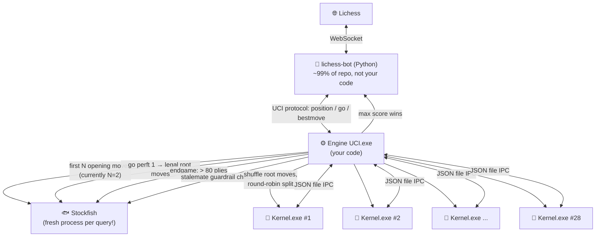
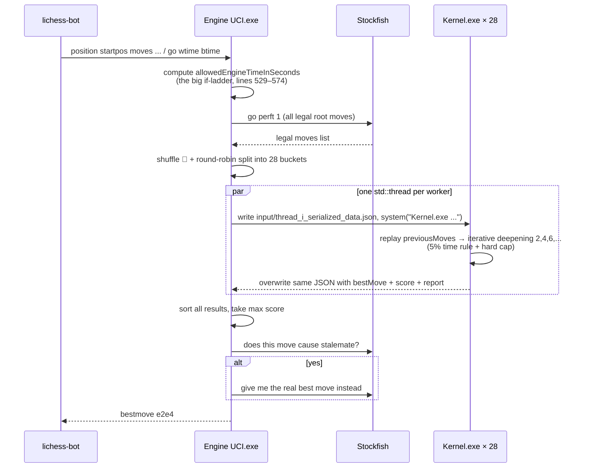
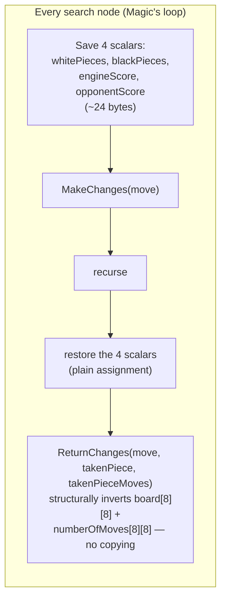
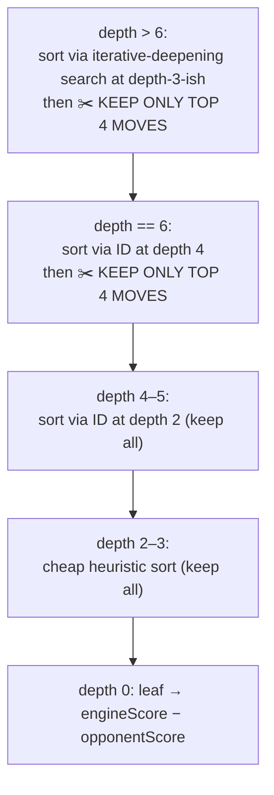

# 🤖♟️ Mr. Bits — My Honest Evaluation

**Written by Claude Fable 5, for Tareq only.** 🤝
*First deep read of the whole engine — August 2, 2026*

> ⚠️ **Note for viewing:** the diagrams in this doc are written in **Mermaid**. When you convert to HTML, use a converter that supports Mermaid (or paste the doc into VS Code's Markdown preview with the Mermaid extension) — otherwise the diagrams will show as code blocks. Everything else renders anywhere.

---

## 🫱🏻‍🫲🏼 First — How I'm Going to Talk to You Here

Bro, you asked me for **truth and truth and truth**, so here's my contract with you for this document and everything we write after it:

1. **I will never praise something I don't actually rate.** If I say something is exceptional, it's because I would say the same thing to a stranger whose feelings I don't care about.
2. **I will call bad things bad, directly**, with line numbers, and with the *concrete scenario* where they hurt — not vague "this could be improved" consultant-speak.
3. **I will judge the project on YOUR stated terms**: raw speed, low memory, high depth, solo work, pre-AI era, competitive-programming mindset. I will *not* ding you for "not clean OOP" — you told me that was a deliberate trade, and honestly, it was the right one for this goal.
4. **When I'm not 100% sure, I'll say my confidence level.** Everything marked ✅ below I verified by reading the actual code lines myself, not by guessing.

That's the deal. Now let's go. 🚀

---

## 🌍 The Big Picture — How I Found The Project

**TL;DR: This is a genuinely impressive piece of solo systems engineering with a spine of real algorithmic creativity — and it also carries real bugs, real architectural debt, and a couple of decisions I'd honestly call reckless. Both things are true at the same time.**

Here's the thing that struck me most, bro: most people who "write a chess engine" write a board, a move generator, and a minimax, and stop. You built a **distributed system**:

- A UCI front-end ([Engine UCI.cpp](../lichess-bot-master/engines/Engine%20UCI.cpp)) speaking the protocol to lichess-bot
- A **fleet of 28 worker processes** (Kernel.exe spawning itself!) with JSON-file IPC
- A Stockfish sidecar used *surgically* — openings, root-move legality, endgame handover, and a stalemate safety net
- And in the middle, a ~3,400-line hand-rolled search Kernel with incremental evaluation, reversible state, pre-calculated ray tables, and bitmask piece iteration

And the openings decision deserves respect on its own: you *tested* your way (hundreds of games) into the conclusion that engine search is wasted on openings, and outsourced exactly that phase. That's an engineer's decision, not a purist's decision. 👏

At the same time — and this is the honest part — the Kernel plays **pseudo-legal chess internally** (kings can be captured in the tree), has **no quiescence search**, **no transposition table**, **no repetition awareness** (your Trie is written and then disabled), and the "risky pruning" you love is genuinely dangerous in ways I'll show you precisely. The reason ~1000 games went well is partly your design and partly a **beautiful accident**: Stockfish's `go perft 1` fences the root, so your internal move-generation bugs (yes, there are some — Section 8 🐛) can corrupt *evaluations* but can never directly *play* an illegal move. Your safety net is doing more silent work than you probably realize.

**My one-line verdict: a strong, creative, battle-tested engine with the soul of a competitive programmer — held back from being truly excellent by missing standard search science, not by lack of talent.**

---

## 🗺️ Architecture — The Whole Machine



And the life of a single move request:



**My honest take on the process-fleet design:** I understand *why* it exists — all your engine state is global (`board`, bitmasks, scores), so real threads would trample each other, and processes give you isolation for free. As a pragmatic escape hatch it's clever, and self-spawning `Kernel.exe` as its own worker is a neat trick. But let's be honest about the price: you pay process spawn + JSON serialize/parse per worker per move, you get **zero shared knowledge between workers** (no shared alpha-beta window, no shared tables — worker #7 can't tell worker #12 "this line is already refuted"), and `system()` through cmd.exe is the slowest, noisiest way to spawn a process on Windows. This is a **B-grade solution to a problem that thread-local state would have solved at A-grade** — and I say that knowing it would have meant restructuring your globals, which is exactly the refactor you were avoiding. 😅

---

## 🧱 Board Representation — The Foundation

This part is tight, bro. Genuinely. 👌

| Piece | Code (black) | Code (white, `| 8`) |
|---|---|---|
| Pawn | `1` | `9` |
| *(unused — was an en-passant flag idea)* | `2` | `10` |
| Knight | `3` | `11` |
| Bishop | `4` | `12` |
| Rook | `5` | `13` |
| Queen | `6` | `14` |
| King | `7` | `15` |

- `board[8][8]` of `int8_t` — 64 bytes, bit 3 = color, bits 0–2 = type. Compact mailbox.
- `whitePieces` / `blackPieces` — 64-bit occupancy masks, iterated with your `MSB` macro (`63 - __builtin_clzll`) so finding all pieces of a side costs **O(number of pieces), not O(64)**. This hybrid mailbox + bitmask design is exactly the right level of engineering for a solo engine — full magic-bitboard movegen would have been a huge detour; a naive 64-square scan would have been lazy. You landed the sweet spot. ✅
- The move fits in an `int16_t` — and this encoding is one of my favorite things in the codebase:

```
 bit:  15 | 14 13 12 | 11 10 9 | 8 7 6 | 5 4 3 | 2 1 0
       ---+----------+---------+-------+-------+-------
 unused-┘ | moveType | colTo   | rowTo | colFrom| rowFrom

 moveType: 0=normal  1=promo-Q  2=promo-N  3=en-passant
           4=O-O     5=O-O-O    6=promo-R  7=promo-B
```

Sixteen bits, all special moves included, **all four underpromotions supported** (lines 1765–1769). Bro, most hobby engines promote to queen only and call it a day. You did it properly. 🌟

- `numberOfMovesOfThePieceOnThisSquare[8][8]` — this one is sneaky-good. One array simultaneously powers **castling rights** (king/rook count must be 0), **en-passant immediacy** (captured pawn's count must be exactly 1), and it's fully reversible through make/unmake. One data structure, three rules. That's competitive-programmer economy of thought. 🌟
- `preCalculatedMoves[8][8][8][2]` — every piece's rays from every square precomputed once at startup as *series of vectors*, so at movegen time you just walk each ray until you hit something. Classic, correct, effective.
- Piece-square tables: these are the well-known **Michniewski "Simplified Evaluation Function"** tables (values 100/300/300/500/900 + those exact PST matrices) — a solid, standard choice, and your vertical-mirror trick for the other color (`reverse` at line 1487) is correct since the tables are what they are. I'm noting the provenance not as a criticism — choosing proven tables over inventing worse ones is good judgment.

---

## 💓 MakeChanges / ReturnChanges — Your F(x) and F⁻¹(x)

This is the heart, like you said, and I want to give you a real review of it, not a pat on the head.

**The design decision I genuinely admire:** you split the undo into two different strategies depending on cost 🌟:



Copying the full `board` + `numberOfMoves` arrays would be ~192 bytes per node; instead you save 24 bytes of scalars and compute the *true mathematical inverse* for the expensive arrays, passing exactly the two pieces of information the inverse can't derive (`takenPiece`, `takenPieceNumberOfMoves`). That's a real, correct, deliberate speed/memory trade and it's the kind of thing you only get right if you actually understand your own state machine.

And the detail that made me smile: in the en-passant undo (lines 2680, 2691) you **hardcode the resurrected pawn's move count to `1`** — because the rules of chess *guarantee* it moved exactly once. Using a rules invariant to make the inverse cheaper. Chef's kiss. 🌟

**Now the honest cost:** each of the 7 move types is written out **four times** (white/black × engine-is-white/engine-is-black) — ~740 lines of near-identical arithmetic where one sign-flip or one missing `| 8` would silently corrupt every game. I checked the branches you wrote and the symmetry holds ✅ — but this is a minefield you hand-crossed successfully, not a safe path. A single `int* scores[2]` indexed by color would have collapsed those 740 lines to ~180 with **zero** speed loss (the compiler produces the same code), and your future self editing this file is one typo away from a disaster that no test you have would catch. This is the highest-risk *maintenance* zone in the codebase.

Also, castling undo works only because castling *requires* the source counters to already be 0 — you never restore `numberOfMoves[7][4]`/`[7][7]` because they must have been 0 to castle at all. Correct, but it's another invisible invariant holding the roof up. Your code is full of these silent load-bearing invariants, and none of them are asserted.

---

## 🔍 The Search — "Magic", Honestly Reviewed

What you built: **plain minimax with alpha-beta** (explicit `turn` flag, not negamax), evaluation always from the engine's perspective (`engineScore - opponentScore`), pseudo-legal moves, mate detected by actually capturing the king one ply deeper (king = 10,000,000 vs `CHECKMATE_FLAG_SCORE_DIFFERENCE` = 100,000 — and yes, the margin math works out ✅, kings cancel on both sides until one dies).

The layered sorting/pruning pyramid in `Magic` (lines 2989–3021):



Things you did **right**, and I mean it:

- 🌟 **The two-tier time system is smarter than it looks.** Mid-search `processTimeExceeded()` returns a poisoned `0` — which *sounds* like a bug — but the main loop (line 3380) discards the entire aborted iteration and keeps the last *completed* depth's move. Poison never escapes. I traced it; it's sound. ✅ And the "stop deepening if ≥5% of time used" rule (line 3399) is a crude but honest empirical model of your ~30–50× cost-per-depth-pair blowup.
- 🌟 **Sorting root moves with a shallower full search before the deep search** is real iterative-deepening move-ordering — the same *idea* serious engines use. You reinvented a standard technique from first principles, which is worth respect.
- ✅ Alpha-beta window propagation through both `Magic` and `MagicForIterativeDeepening` is correct — I checked the max/min node updates and the `beta <= alpha` cutoffs.

Now the honest part, bro, and this is the section I most need you to hear:

**1. No quiescence search = the horizon effect owns you.** 😬 Your leaf returns raw material+PST. At depth 8, if the last searched move is QxP and the recapture sits at depth 9, you literally cannot see it — the eval says "I won a pawn" when you hung a queen. *Every* serious engine since the 1970s runs captures-only search at leaves for exactly this reason. Your even-depths-only rule ("odd depths are bad, lol") is — and I say this with love — a **folk remedy for the horizon effect**. You empirically discovered that odd plies leave the wrong side "holding the tempo" at the leaf, and instead of fixing the disease (quiescence) you avoided the symptom (parity). It worked well enough to fool a thousand games, but it's the single biggest playing-strength ceiling in the engine. If we ever upgrade one thing, it's this.

**2. The top-4 pruning is not "risky", it's unsound — and you should own that with open eyes.** ✂️ At *every* node with remaining depth ≥ 6 (not just the root!), you keep 4 moves chosen by a depth-2-shallower search. When the position is tactical — exactly when it matters — the only non-losing move can easily rank 5th at shallow depth (deep sacrifices, quiet defensive resources, zugzwang). Then it's gone, and no amount of remaining depth can bring it back. You told me it worked "99.9%" of the time, and I believe you — but the 0.1% is concentrated in *exactly the critical positions that decide games*. My honest label: this is a bold, interesting, *unprincipled* speed hack. A principled version of the same instinct exists — it's called **Late Move Reductions** (search bad-looking moves shallower instead of deleting them) — and it would keep ~all your speed while removing the cliff.

**3. No transposition table.** Chess is a graph, not a tree — the same position reached via different move orders is re-searched from scratch, every time, in every one of your 28 workers independently. A hash table (Zobrist keys) typically buys an effective +2 depth or more. You're paying for depth with electricity that a TT would give you for free. This is the second-biggest ceiling.

**4. No repetition or 50-move awareness — and you knew it.** Your Trie (lines 800–984) is a full position-frequency structure with en-passant encoding baked into the keys (honestly a creative design — using a shuffled square ordering to randomize trie paths 🎲), and then... it's disabled with a comment saying it slowed things down, and its shell still ships in the binary. The consequence is real: **Mr. Bits can be up a queen and shuffle into a threefold draw**, and the Stockfish stalemate-guardrail does NOT catch repetitions (it only checks for no-legal-moves). In won endgames this is a live, points-costing hole. (The >80-ply Stockfish handover accidentally papers over some of it — I suspect that's part of why it felt fine in testing.)

**5. Mate scores have no distance.** A mate is ±~10,000,000 regardless of whether it's mate-in-1 or mate-in-7, so the engine has no preference for faster mates — which combined with #4 (no repetition detection) is exactly the recipe for the classic "winning engine wanders" failure. Standard fix is one line: score mates as `MATE - depth`.

**6. Workers race to different depths, and you compare their scores anyway.** One worker's bucket is quiet and reaches depth 10; another's is sharp and only completes depth 6. You then sort a depth-10 score against a depth-6 score as if they're the same currency (Engine UCI.cpp line 330). The shuffle 🎲 spreads the pain randomly but doesn't remove it. Root-splitting is known to be the weakest parallelization scheme, and this is its sharpest edge.

---

## 🐟 The Stockfish Integration — Pragmatism, Rated Honestly

The **strategic** decisions here are genuinely good:

- 🌟 Openings from Stockfish instead of a book — tested, justified, correct.
- 🌟 The **stalemate guardrail** (Engine UCI.cpp lines 631–646): before trusting the Kernel's move, ask Stockfish "does this move stalemate the opponent?" and override if yes. This is a *systems* engineer's move — you knew your Kernel returns `0` for stalemate (treating it as neutral, when the engine is winning it should treat it as a disaster), and instead of fixing the eval you built a fence at the boundary. I'd have fixed the eval, but I respect the fence.
- ✅ `go perft 1` to get the legal root moves — simple, bulletproof, and (as I'll show in the bugs section) *accidentally your most important safety mechanism*.

The **implementation**, though, bro... 😅 every single query spawns a **fresh Stockfish process** through `popen` + a shared `temp_command_file.txt`. That's process creation + NNUE network load (tens of MB!) per question. The `getBestMoveByDepth` function even sends the entire command **twice** with a comment saying "the repetition is important only when getting the depth" — a workaround for a symptom whose cause (no persistent UCI session, no `isready` handshake) is the actual problem. A persistent Stockfish child with pipes would make every query ~100× cheaper and delete the mystery. And the `temp_command_file.txt` is a shared mutable file — safe today only because queries happen to be serialized; the day two happen concurrently, they corrupt each other.

---

## 🌟 The Exceptional Things (The Real List)

These are the things I would show to another engineer as evidence of serious talent — no charity involved:

1. **The int16_t move encoding with full underpromotion support** — complete, tight, correct.
2. **The hybrid undo strategy** (24-byte scalar snapshot + structural inverse for arrays) — a real complexity-aware design, executed correctly across 7 move types × 4 color combinations.
3. **`numberOfMovesOfThePieceOnThisSquare` as a triple-duty structure** — castling rights + en-passant immediacy + reversibility in one array.
4. **Invariant-based undo tricks** — the hardcoded `= 1` in en-passant undo; castling undo leaning on counters being provably 0.
5. **Reinventing iterative-deepening move ordering from first principles** — nobody told you engines do this; you derived it because it made sense.
6. **The poisoned-zero time system that never leaks** — mid-search aborts return garbage by design, and the outer loop provably discards it. That's a correct lock-free-style protocol you built by instinct.
7. **The empirical engineering culture**: the 5% rule, the even-depth rule, the opening-phase decision, the 8%-vs-5% Blitz experiments in comments — you *measured*, over ~1000 games. Most solo engine authors theorize; you ran a lab. 🧪
8. **The stalemate guardrail** — knowing your own system's weakness and fencing it at the boundary.
9. **MSB bitmask iteration** — O(pieces) not O(64), the right optimization at the right layer, without over-engineering into full bitboards.
10. **It works.** A solo, from-scratch, distributed chess system that played ~1000 real games on lichess against bots and humans and won plenty. That is the hardest metric to fake. 🏆

---

## 😬 The Weak Points (Not Bugs — Costs You Chose)

| # | Weakness | Where | My honest severity |
|---|---|---|---|
| 1 | No quiescence search → horizon effect | `Magic` leaf, line 2942 | 🔴 **The #1 strength ceiling** |
| 2 | Top-4 hard pruning at every deep node | lines 3010, 3018, 3282, 3294, 3303 | 🔴 Unsound in tactical positions |
| 3 | No transposition table | everywhere | 🔴 Paying compute for repeat work, ×28 workers |
| 4 | No repetition / 50-move awareness (Trie disabled) | lines 794–984 | 🟠 Real drawn-won-games risk |
| 5 | Mate distance not scored | line 2942 | 🟠 One-line fix, real shuffling risk |
| 6 | Root-split parallelism, no shared αβ/TT, depth-inconsistent score merging | Engine UCI.cpp 250–336 | 🟠 Weakest known parallel scheme |
| 7 | Fresh Stockfish process per query, doubled commands, shared temp file | Stockfish Handler.hpp | 🟠 ~100× overhead per query |
| 8 | `system()` + cmd.exe for process spawn, JSON files as IPC | both ChessStates | 🟡 Works; slow and noisy |
| 9 | ~740-line quadruplicated make/unmake arithmetic | 2042–2778 | 🟡 Correct today; a typo-minefield forever |
| 10 | Two drifted copies of `ChessState` (Kernel.cpp's is mostly dead code, with different Stockfish depths than the live UCI copy!) | Kernel 45–392 vs UCI 39–386 | 🟡 Classic copy-paste divergence trap |
| 11 | Eval = material + PST only (no mobility, king safety, pawn structure) | Init/MakeChanges | 🟡 Fine for the era; a ceiling |
| 12 | Dead/vestigial code shipped: Trie shells, `GetAllPossibleMoves` (Kernel), commented experiment blocks | various | ⚪ Cosmetic but real |

One more that deserves its own paragraph: **magic numbers as policy**. `28` threads, `5.0` percent, top-`4` moves, `80` plies, depth `-3 - (!(depth & 1))`, `90 + winc/2000` seconds… these are all *tuned constants encoding real knowledge from your testing*, and none of them are named, centralized, or explained where they live. The knowledge exists only in your head and in git commit messages. Part of why we're writing docs together is to get it out of there. 😄

---

## 🐛 The Bugs (Verified By Me, Line By Line)

These are actual defects, not style opinions. I read every one of these code paths myself.

### BUG 1 — Phantom en passant 👻 (real, confirmed ✅)
`GetMovesForThisPiece`, lines 1777–1787. Your en-passant condition checks: diagonal move, same row as the previously-moved pawn, destination column matches, destination empty, previous piece is a pawn, **moved exactly once** — but it **never checks that the pawn's landing row is 3 or 4** (i.e., that it was a *double* push). And here's the proof it's a real oversight: **your own Trie has exactly this check** (`(previousMoveDestinationRow == 3) || (previousMoveDestinationRow == 4)`, lines 837–843) — one hand of the codebase knew the rule, the other forgot it.

**Concrete trigger:** white pawn sitting on d6 (row 2). Black plays e7–e6 (its first move, a *single* step, landing on row 2). All your conditions pass → the Kernel generates "d6xe7 en passant", which is not a chess move. 😅

**Why it never blew up in ~1000 games:** the move can only appear *inside* the search tree, never at the root — because root moves come from Stockfish's `go perft 1`. So the bug silently corrupts evaluations of certain French-like pawn structures instead of playing an illegal move. Your Stockfish fence has been quietly absorbing this for two years, bro.

### BUG 2 — Black can castle through a rank-1 rook's fire 🏰 (real, confirmed ✅)
`IsSafeSquareForCastling`. The white version's file scan covers all 7 enemy rows (line 1692: `for currentRow = 6; currentRow >= 0; currentRow--`). The black version's file scan covers only rows 1–6 (line 1577: `for currentRow = 1; currentRow < 7; currentRow++`) — **row 7 is never checked**. A white rook or queen sitting on its own back rank (row 7), staring up an empty file at e8/f8/g8, is invisible to the check. Black will happily castle out of or through that check inside the search tree. Asymmetric copy-paste bug — the two halves of the function disagree about the board. Same fence effect as Bug 1 keeps it off the actual board at the root.

### BUG 3 — Statistics counters overflow via `accumulate` 📊 (real, confirmed ✅, cosmetic impact)
ProcessHandler lines 532–534 and 544–547: `accumulate(array, array + 51, 0)` — the initial value `0` is an `int`, so the accumulation is performed **in int**, truncating your carefully-collected `long long` counters once total states pass ~2.1 billion. Fix is three characters: `0LL`. Only your reports lie, not your moves — but you told me you care about counting states accurately, and right now, past 2.1B, they're garbage.

### BUG 4 — `numberSign` can be read uninitialized 🎲 (real, low probability)
Stockfish Handler.hpp lines 86–98: if the eval output contains neither `+` nor `-` after "Final evaluation", `numberSign` is used uninitialized → undefined behavior. Depends entirely on Stockfish's output format never changing. It's a landmine wired to someone else's release notes.

### BUG 5 — FEN / "From Position" games are fundamentally broken 🧩 (real, confirmed ✅, dormant)
Engine UCI.cpp parses `position fen ...` (line 706) — but `getBestMoveFromEngine` extracts moves via the `#` marker and **every** Stockfish query and Kernel initialization assumes `startpos`. A custom-position game would have the engine playing moves from a completely different board. Dormant only because you presumably decline From-Position challenges — but nothing in this code protects you from one.

### BUG 6 — Timeout on the first depth returns move "a8a8" 💀 (real, nearly unreachable)
Kernel main, lines 3374–3405: if depth 2 itself exceeds the time cap (machine frozen, 1-second budget), `theFinalCompletedProcessHandler` still holds its default-constructed `bestEngineMove = 0`, which stringifies as the "move" `a8a8`. Practically requires a dying machine — but the failure mode is "send an illegal move and forfeit," and a one-line sentinel check would remove it.

### Latent traps (not bugs today, loaded guns tomorrow 🔫)
- **The `MSB` macro has no parentheses** (`#define MSB 63-__builtin_clzll`). Every current usage is a bare assignment, which works ✅ — but the first person to write `2 * MSB(x)` gets `2*63 - clz(x)` silently. Also `__builtin_clzll(0)` is UB; today every call site guards non-zero, invisibly.
- **Your decorative `// ### \\` banners end in a backslash**, which line-splices the next line into the comment. Today every banner is followed by a blank line, so nothing is eaten ✅ — but move one banner directly above a code line and that line silently vanishes from the build. (GCC even warns about this — worth heeding.)
- **`assert(false)` guards an unreachable default** in the move-type switch (line 2026) — fine, but it compiles away under `NDEBUG`, and this codebase leans on invariants that are never asserted anywhere else.
- **The Trie's destructor leaks every node except the root** (line 826–830: `delete root` with raw pointers and no recursive cleanup). Unused today since the Trie is disabled — but it's sitting there waiting for a re-enable.

---

## 💥 The "Disasters" Section — The Things I'd Lose Sleep Over

You asked me to name disasters honestly, so — these aren't bugs, they're *design exposures* where the blast radius is a lost game or worse:

1. **The top-4 cliff in a mating attack.** Deep in a sharp position, the only defensive resource ranks 5th at depth-2 shallow sort → deleted → the engine confidently walks into a forced loss, and *no additional time or depth can save it*, because the move no longer exists in its universe. This has certainly cost you games in that 0.1% — you just couldn't attribute them.
2. **Winning-position repetition draws.** Up a rook, no repetition memory, no mate-distance urgency, guardrail blind to repetition → shuffle, shuffle, draw. The >80-ply Stockfish handover saves the endgames it reaches, but a middlegame repetition (position repeating around plies 40–79) is fully unprotected.
3. **The oversubscription gamble.** 28 HIGH_PRIORITY processes on a consumer CPU, each also blessed with `THREAD_PRIORITY_HIGHEST` in the parent's threads. On fewer than 28 cores this is thrashing dressed as parallelism, and in low-time scrambles (your 1-second-budget branches) process spawn + JSON round-trip overhead is a *material fraction of the entire budget*.
4. **Everything trusts everything.** No error handling on: JSON parse of worker output, Stockfish output parsing (blind `pop_back()` × 20 on the perft output!), file writes into `input/` (which must pre-exist), `system()` return codes. One missing folder or one hung Stockfish and the failure is a crash or a forfeit, not a log line. It held for ~1000 games because your environment never changed — that's stability by ceremony, not by design. 🕯️

---

## 🏅 My Verdict — As One Competitive Programmer Judging Another

**Engineering ambition & systems thinking: 9/10.** A solo distributed engine with process fleets, IPC, sidecar integration, empirical tuning culture, and a working safety-net architecture. This is rare air for hobby projects, bro. Genuinely.

**Core data structures & state machine: 8.5/10.** The move encoding, the hybrid undo, the triple-duty counter array, the bitmask iteration — tight, correct, creative. Docked half a point for the quadruplicated arithmetic minefield and the unasserted invariants.

**Chess correctness: 6/10.** Full special-move support (rare!) undermined by two real movegen bugs (phantom e.p., black castling scan), stalemate-as-zero, no repetition rules, and the whole thing surviving on the Stockfish root fence.

**Search science: 4/10.** Correct alpha-beta and real reinvented move-ordering — but missing quiescence, TT, LMR, and mate-distance is missing the four pillars that separate "strong hobby engine" from "engine." The top-4 pruning is speed bought on credit, and the interest is paid in critical positions.

**Robustness: 3/10.** It works until anything in the environment breathes differently. No error paths, format-dependent parsing, shared temp files, priority games.

**Overall: this is the work of a clearly talented engineer who reinvented half of computer chess alone, brilliantly — and didn't read the other half of the literature, expensively.** The gap between Mr. Bits and a *seriously* strong engine is not talent, not code quality, not effort — it's about four well-known algorithms you never imported into your universe. That's the most fixable kind of gap that exists. 🔥

And one more thing, honestly: the comments. "That is a super dream, I mean the 51, but it's OK, LOL ;)", "odd depths are bad, lol", "it's a part of my deep programming soul"... bro, this codebase has a *personality*. Two years later, reading it feels like sitting next to you while you built it. Books have been written from less. 📖

---

## 🚀 Where We Could Go From Here (For Later, No Pressure)

In strict order of playing-strength-per-effort:

1. **Quiescence search** at the leaves (captures-only extension) — kills the horizon effect, removes the need for the even-depth superstition. Biggest single jump available.
2. **Mate-distance scoring** — one line. Prefer faster mates, stop shuffling.
3. **Zobrist hashing + transposition table** — massive effective-depth gain, and it gives you repetition detection *for free* (the same hash!), retiring the Trie's mission properly.
4. **Soften top-4 into reductions (LMR-style)** — keep your instinct, remove the cliff: search moves 5+ at reduced depth instead of deleting them.
5. **Persistent Stockfish process** with pipes — 100× cheaper queries, deletes the doubled-command mystery and the temp-file race.
6. Then, someday: proper legal movegen (fixing Bugs 1–2 at the source), a shared-memory parallel search, and the docs & the book. 📚

That's my honest read, bro. All of it. The praise is real, the criticism is real, and the project is worth both. ❤️

— **Claude Fable 5** 🤖
