# 🧠♟️ Mr. Bits Gets a Brain — Neural Networks for a Deeper Search

**Written by Claude Opus 5.5, for Tareq.** 🤝
*Research doc #2 · October 22, 2026 · the companion to "01 - Fable 5 Honest Evaluation of Mr Bits"*

<div style="background:linear-gradient(90deg,#1e3a8a,#6d28d9);color:#ffffff;border-radius:14px;padding:16px 22px;margin:16px 0;">

**In one sentence:** your idea (score every child with a net, trust the best few, search deeper) is sound, the labels are free or cheap, and Mr. Bits is an unusually good host for it, because on an instrumented copy of your Kernel **92.6% of all nodes at depth 10 go into the sorting searches** that a net can replace. 🚀

</div>

> ⚠️ **Viewing note:** the diagrams are **Mermaid** and the colored boxes are small HTML blocks. Your *Markdown PDF* extension renders both: it loads Mermaid from unpkg and runs markdown-it with HTML enabled. Before handing this over I rendered **every diagram in this file** with that same Mermaid build in a headless browser ✅

> 🔬 **How this doc was made:** six research agents (datasets & labels; architectures & hardware; search integration & testing; your codebase; two independent idea generators) plus my own modeling. Two kinds of measurements ran on your laptop: an **instrumented copy** of Kernel.cpp, and **NNUE speed benchmarks**. Both lived in my scratch folder, so your repo was never modified. As you asked, **nothing came from the ChatGPT Docs folder**: not one file in it was opened. 🙈

---

## 🫱🏻‍🫲🏼 0. The Deal — Same Contract As Last Time

You asked for all the ideas, so you're getting all of them, including the ones where I have to say "bro, no, that one is a trap." 😄 The rules:

1. **Your ideas get judged on the merits.** Several are genuinely great; one of them is *exactly* what strong engines do. Some need a twist. One of them (the 3–4 separate phase nets) I'll argue against, with numbers, and then give you the experiment that settles it.
2. **Every claim carries a confidence marker:** ✅ = verified (in your code, in a measurement, or in a source listed in §19) · 🟡 = my estimate or model, with the arithmetic shown · 🔮 = an idea or prediction, not yet proven.
3. **This is a research doc, not a sales pitch.** A neural net will not magically fix the engine. When something has to come *before* the net (spoiler: quiescence search, and a free compiler flag), I'll say it loudly.

**Reading map:** 10 minutes → §1 + §2 · the label question → §5 · about to write code → §12 · about to spend money → §11 + §14 · all the ideas → §15.

---

## ⚡ 1. The One-Screen Answer

<div style="background:#eff6ff;border-left:6px solid #2563eb;border-radius:10px;padding:12px 18px;margin:16px 0;color:#1e293b;">

**🧩 "Is my idea good?"** Yes. Its textbook names are *learned move ordering* and *selective search*. Mr. Bits is a perfect host: your sorting searches eat **92.6% of the nodes and 87% of the time** at depth 10 (measured ✅, §2), and a net ranks the same moves about 5× cheaper at depth 4–5 and tens of thousands of times cheaper at depth 9–10 (measured ✅, §12.3).

**🏷️ "Where do I get the y values?"** You don't need to buy anything, and it doesn't take years:
- 🆓 **Lichess evaluation database:** 394,669,566 positions with deep, multi-line Stockfish evals, public domain (CC0) ✅
- 🆓 **DeepMind's ChessBench:** **15.3 billion** Stockfish evaluations of *every legal move* in 530M positions. That's literally "evaluate every child", already done for you ✅
- ⚙️ **Make your own:** 100M positions at 5,000 Stockfish nodes each take ≈ 6–12 hours of pure search on your Nebius box, about **$10–21** 🟡 (add 10–50% for UCI and Python overhead)
- 💸 The paid databases (ChessBase Mega 2026: €229.90, 11.7M games) contain **zero engine evaluations** ✅. Buy compute, not data.

**🎯 "What should the net output?"** Train on **win probability**, output centipawns, display pawns. Your pawn display survives, but the numbers follow the labels: trained on Stockfish scores, +1.00 means what it means to Stockfish (≈ 50% chance to win), not exactly one pawn of material (§5.1).

**🔀 "Another structure I didn't think of?"** An **action-value head**: one forward pass on the *parent* scores all ~35 moves at once, with no "best move" labels needed. Plus a **statistically calibrated trust factor** (ProbCut / conformal sets) instead of a fixed 5 (§4, §8).

**🎭 "3–4 phase nets?"** Make it **one net with piece-count buckets**. Stockfish 19 (Sep 2026) went back to a single net ✅, and your Kernel only plays plies 4–80 anyway ✅. You'll still get the experiment that decides it for real (§9).

**🩺 "NNUE alone was bad"** Your old test ranked children with Stockfish's *static* `eval`, with no quiescence search ✅. NNUE nets are trained on quiet-filtered positions (none in check, none whose best move is a capture), so that test was very likely to look bad 🟡 (§10).

**🎁 Before any net:** your production `Kernel.exe` is an unoptimized `-O0` build. Rebuilding the same code with `-O2 -march=native` gave **×3.48** with identical results (measured ✅, §2.3).

**💸 Budget:** v1 ≈ **$33–62** for the lean core (≈ $65–120 with the deep slice, all ablations and test matches) on the Nebius box; everything fits **well under $300** 🟡 (§14).

</div>

---

## 🗺️ 2. Where a Brain Fits in Mr. Bits — And Why It's Worth It

### 2.1 What `Magic()` does today

Here's the most important thing in this document, so it goes first. Look at what `Magic()` does at every node (Kernel.cpp lines 2989–3021) ✅:

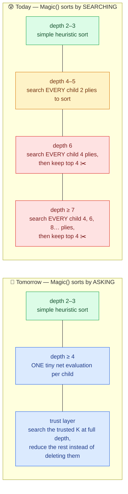

`SortTheMovesAccordingToIterativeDeepening` (lines 2878–2933) runs a **full-window** search under *every* child: `alpha = INT_MIN` and `beta = INT_MAX` are never tightened between siblings. `Magic` calls it **before** its move loop, so it runs at every node, including the cut-nodes that refute on the very first move and never look at the other 34 ✅. The sort depth grows with the node's remaining depth (so deeper iterations reach deeper sorts): 4 plies at depth 6–8, 6 at depth 9–10, 8 at depth 11–12 ✅.

### 2.2 Measured: where a depth-10 iteration really goes

In two of your old commit messages (before you reinitialized the repo) you wrote that you should count the states of `MagicForIterativeDeepening`, *"because I guess in this version there are too many calculations that are happening there, even more than in the function 'Magic'"*. Bro, **your instinct is right, and it's not close.** The codebase agent built an instrumented copy of Kernel.cpp, with the same node counts, moves and scores as production. It ran a realistic worker (2 root moves in an Italian Game position) through a full depth-10 iteration (18 s) ✅:

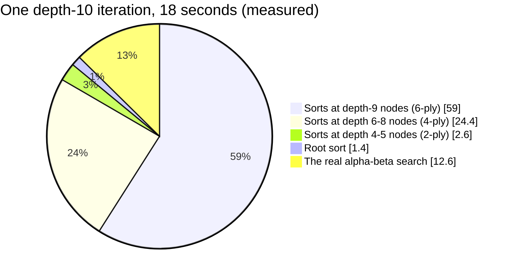

- **92.6% of all nodes** and **87% of the time** were sorting sub-searches. The main tree was 7.4% of the nodes.
- The two 6-ply sorts at the depth-9 nodes alone took **59% of the time**: 16.6 million nodes *each*.
- In a single process with all 36 root moves, the root sort alone was **71%** of a depth-8 iteration.

Before the measurement existed, I built a best-case model of your search (the box below). At depth 10 it predicts 93.6% for a single process sorting all 35 root moves, and 88.7% for the 2-move worker layout that was measured, against 92.6% measured. So the model's shape can be trusted 🟡:

| Root depth | Share of nodes spent **sorting** (model) | Nodes today (model) | Nodes if the net sorts (model) | Fewer nodes |
|---|---|---|---|---|
| 6 | 🟠 67% | 143,289 | 49,279 | **×2.9** |
| 8 | 🔴 92% (measured with 36 root moves: 91% ✅) | 2,432,429 | 197,609 | **×12.3** |
| 10 | 🔴 94% (measured in a 2-move worker: 92.6% ✅) | 11.9 M | 0.79 M | **×15** |
| 12 | 🔴 99% | 327 M | 3.2 M | **×103** |

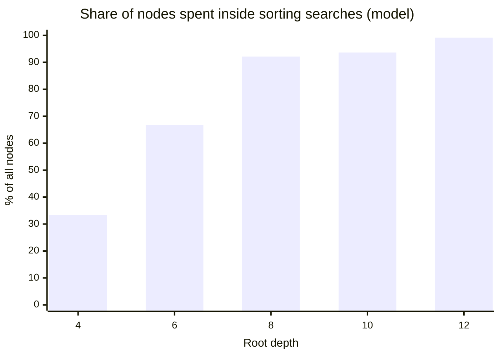

<div style="background:#f8fafc;border-left:6px solid #475569;border-radius:10px;padding:12px 18px;margin:16px 0;color:#1e293b;">

**🧮 How the model works (so you can attack it):** branching factor b = 35. Inside every search I assume *perfect* move ordering, which is the best case for today's code *and* for the net. A full-window search of depth d then visits the Knuth–Moore minimum of b^⌈d/2⌉ + b^⌊d/2⌋ − 1 leaves, and node types follow the classic PV / CUT / ALL recursion. The sort cost at each node is copied from your code: 0 at depth 2–3; b × (1-ply search) at 4–5; b × (3-ply search) at 6; b × ((depth − 4 − (!(depth & 1)))-ply search) above 6. The root sorts all 35 moves, as a single process does, using your root table (at root depth 8 that's a 6-ply sort, deeper than the inner rule). Your top-4 cut stays in both versions, and the net costs 1 node-equivalent per child (at 3 node-equivalents, the ×15 becomes ×14). The real numbers differ from the model, but the *shape* doesn't: the sorting bill grows exponentially with depth, and it's paid at every node, including the cut-nodes that only ever search one move (86% of the nodes that pay for a sort, in this same model).

</div>

### 2.3 🎁 The free ×3.48 you can take today

<div style="background:#ecfdf5;border-left:6px solid #059669;border-radius:10px;padding:12px 18px;margin:16px 0;color:#1e293b;">

**✅ Your production `Kernel.exe` is an unoptimized `-O0` build.** Compiling the unmodified Kernel.cpp with your g++ 14.2 and *no flags* reproduces the exact file size and code size of the shipped binary. Its disassembly has zero AVX instructions, and `std::max` is called out of line. ✅

An `-O2 -march=native` build of the **same source** ran the same depth-10 worker search in **5,042 ms instead of 17,569 ms: ×3.48**, with identical node counts (50,322,351), the same move and the same score ✅. (A reviewer's second run on a busier machine measured ×4.05, so ×3.48 is the conservative number.) That's roughly 10M nodes/s per process instead of 1.8–2.9M.

```
g++ -O2 -march=native -std=c++17 Kernel.cpp -o Kernel.exe
```

(If the bot ever runs on a different PC, replace `-march=native` with `-mavx2 -mbmi2 -mlzcnt -mpopcnt`; your i9-14900HX has AVX2 but no AVX-512 ✅.) Two follow-ups:
1. **Retune the 5% rule.** In the `-O2` run the search finished depth 10 at 5 s, then burned the remaining 115 s on a depth-12 iteration that couldn't finish ✅. A faster engine needs a smarter "should I start the next depth?" rule (§17).
2. **Any neural-net code needs this anyway.** SIMD inference compiled at `-O0` would crawl.

</div>

### 2.4 The honest twist: the net isn't the only way to delete this bill

<div style="background:#fffbeb;border-left:6px solid #d97706;border-radius:10px;padding:12px 18px;margin:16px 0;color:#1e293b;">

**⚠️ Honesty check.** The classic ordering tools (the **TT move** from the previous iteration, **MVV-LVA/SEE** for captures, **killer moves** and **history tables**) also replace sorting searches, at almost zero cost. That's how Stockfish orders moves: TT move → good captures → killers/countermove → quiet moves by history → bad captures ✅ (the Stockfish 16 source sitting in your `engines/stockfish/src/movepick.cpp`).

Doc 01's item 3 (Zobrist hashing + a TT, part of Stage 0 here) will therefore shrink the bill **even before any net**: the TT move from the previous iteration is free move ordering. That's good news, not bad: it means the net has to beat *TT + killers + history*, not just your 4-ply sort. Where the net adds what history can't: **ranking the quiet moves at nodes with no TT information**, and **deciding how hard to reduce each move** (the trust factor). So measure again after Stage 0, and add killers + history before you compare. The net's job is to win *that* comparison.

</div>

<div style="background:#ecfdf5;border-left:6px solid #059669;border-radius:10px;padding:12px 18px;margin:16px 0;color:#1e293b;">

**✅ Make the measurement permanent (an hour of work):** both `Magic` and `MagicForIterativeDeepening` call `increaseTheNumberOfStatesForACertainDepth(depth)` (lines 2941 and 2788), so your per-depth counters mix the two. On top of that, the counters are reset *after* the root sort (line 3170), so your reports never include root-sort nodes ✅. Add one counter that only `MagicForIterativeDeepening` increments, and print the ratio after every game.

</div>

So the pitch isn't "a neural net evaluates better than material + PST." It's this:

> **The net's first job is to replace your most expensive computation, the sorting searches, with something about 5× cheaper at depth 4–5 (more once the accumulator is incremental), hundreds of times cheaper at depth 6–8 and tens of thousands of times cheaper at depth 9+ (measured, §12.3). Every node it saves turns into depth.** 🧠➡️⏱️➡️📈

Its second job (later, with care) is to become a better *leaf* evaluator than material + PST. Both jobs are on the roadmap (§16), in that order.

---

## 🎓 3. Neural Networks in 10 Minutes — Competitive-Programmer Edition

You said you're not a deep-learning person. Good news: you already know 90% of it. You just know it under different names. 😄

### 3.1 A neural net is a function with tunable numbers

```
f(x) = W3 · relu( W2 · relu( W1 · x + b1 ) + b2 ) + b3
```

- **x**: the input vector, here the board written as 768 zeros and ones (§6).
- **W, b**: the *weights* and *biases*, together called the **parameters**. They're like the numbers in your piece-square tables, except there are hundreds of thousands of them, arranged in layers.
- **relu(z) = max(0, z)**: the only "nonlinear" ingredient. Without it, stacking layers collapses into one big matrix, which is a purely linear evaluation. Which brings me to the best part:

<div style="background:#f5f3ff;border-left:6px solid #7c3aed;border-radius:10px;padding:12px 18px;margin:16px 0;color:#1e293b;">

**🤯 Your current eval is already a neural network.** Material + PST is `eval = Σ w[piece][square]` over the pieces on the board. That's a **linear model with 768 inputs and zero hidden layers**, whose weights Michniewski picked by hand. So:

- **Step 1:** *learn* those 768 weights from data instead of hand-picking them. That's "Texel tuning" (it gained the Texel engine about **+100 Elo** ✅). Congratulations, you trained your first network. 🎉
- **Step 2:** add one hidden layer, so the model can learn *interactions* that a PST can't express: bishop pair, king safety, a passed pawn with a rook behind it, "this knight is great *because* that pawn is gone".

That's the whole conceptual jump, bro. Everything else is engineering.

</div>

### 3.2 Training = minimizing an error with gradient descent

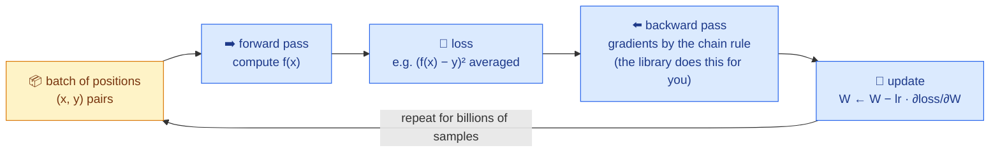

Think of it as **ternary search's big brother**: you're minimizing a function you can only probe locally, except in 200,000 dimensions instead of one, and the derivative tells you which way is downhill in every dimension at once.

### 3.3 The words you'll see everywhere

| Word | Competitive-programmer translation |
|---|---|
| **Sample** | One `(position, label)` pair, like one test case |
| **Batch** | Process 16k samples at once and average their gradients (GPUs love big batches) |
| **Epoch** / **superbatch** | One pass over the dataset, or a fixed chunk of it (in bullet, a superbatch is 6,104 batches × 16,384 ≈ 100M positions ✅) |
| **Learning rate (lr)** | The step size of gradient descent. Too big diverges, too small crawls |
| **Overfitting** | Memorizing the test cases instead of learning the problem. You detect it with… |
| **Validation set** | …positions the net *never* trains on, from games it never saw |
| **Inference** | Using the trained net: one forward pass, no learning |
| **Quantization** | Converting float weights to int16/int8 so inference is fast integer math |

### 3.4 What one evaluation costs (measured on your laptop ✅)

For the first net I'll recommend (§7): 768 inputs → 256 hidden (× 2 perspectives) → 1 output.

- The input is **sparse**: only ~32 of the 768 bits are 1 (one per piece). So the first layer isn't a 768×256 matrix multiply. It's **adding 32 rows of 256 numbers**.
- The famous **NNUE trick** is pure competitive programming: when a move changes 2–4 input bits, you **don't recompute the sum. You update it**. Subtract the row of the square the piece left, add the row of the square it reached. It's the same idea as a point update on a maintained array sum: O(changed features × H) instead of O(pieces × H). 😎

The research agent benchmarked exactly this net on your i9-14900HX (`g++ -O3 -mavx2`) ✅:

| Operation (H = 256) | Cost |
|---|---|
| Incremental update + output (the NNUE way) | **26–40 ns** |
| Full rebuild from scratch + output (no NNUE trick) | **0.26–0.38 µs** |

So even the "lazy" version without incremental updates costs about a third of a microsecond. Your sorting search at a depth-6 node costs *about 160,000 nodes* (the measured average of the 4-ply sorts in the depth-10 run; ≈ 44,000 even with perfect ordering).

---

## 🧩 4. Your Idea, Formalized — "Evaluate Every Child, Trust the Best K"

Your plan in one picture:

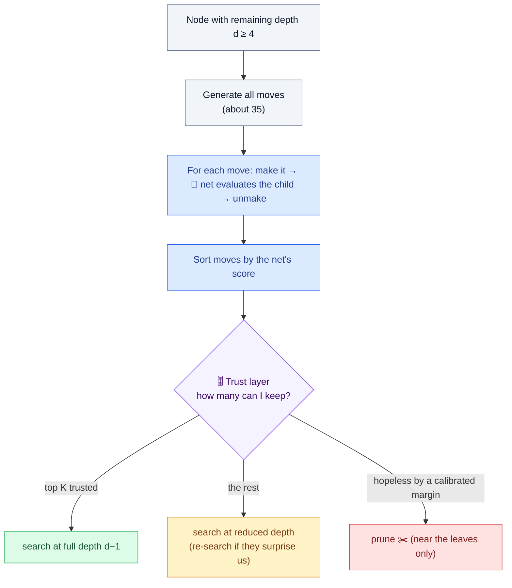

**This idea is sound, and it has names**: *learned move ordering* plus *selective search*. The general shape (a cheap judge ranks, an expensive search verifies the best few) is how every strong engine works today; only the judges differ. Stockfish ranks moves with learned history statistics (and judges positions with NNUE). Leela ranks moves with a policy network ✅. There's even direct prior art for your exact flavor:
- **Giraffe** (Matthew Lai, 2015): a learned move evaluator drove a probability-limited search and reached about IM level. Its move net had the true best move in its top 3 about 70% of the time ✅.
- **Winter**: a hobby engine that orders moves with a learned model predicting "will this move cause a beta cutoff?" ✅
- **Realization Probability Search** (shogi, 2002): depth is spent according to the −log of each move's probability. The shogi program Gekisashi won the 2002 world championship with it ✅.

The two places where I'll push you are the **trust layer** (§4.2–4.3) and **how many forward passes you pay** (§8).

### 4.1 What it buys: effective branching factor → depth

The quantity that decides your depth is the **effective branching factor (EBF)**: how many times more nodes each extra ply costs. With a fixed node budget N, the depth you reach is about log(N) / log(EBF) 🟡:

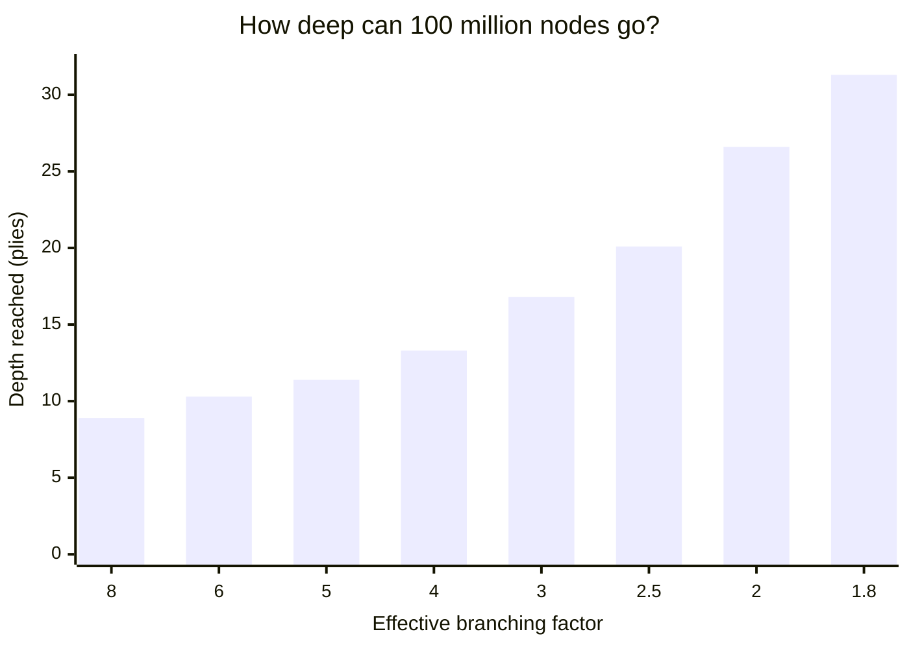

Every point of EBF you shave off is worth *plies*, not percent. Your measured growth from depth 8 to 10 today is ×20–24 in nodes (EBF ≈ 4.5–4.9 ✅) and ×15 in time, because the deeper iteration runs at 2.9M instead of 1.8M nodes/s. LMR-style selectivity is known to push the EBF below 2 ✅. Better ordering is the single biggest lever, because alpha-beta's best case (about b^(d/2) nodes instead of b^d) only happens when the best move is searched **first** ✅.

### 4.2 The "trust factor" — five ways to define it

| Trust rule | What it does | 👍 | 👎 |
|---|---|---|---|
| **Fixed K** (your "best 5") | Keep the top K moves | Dead simple | Same K in a quiet position and in a mating attack |
| **Margin Δ** (your own `scoreDifferenceFactor` comment, lines 2928–2931!) | Keep every move within Δ of the best score | Adapts: 1 move when one is obviously best, 10 when many are close | Δ must be *calibrated*, not guessed (see the box) |
| **Probability mass** ("top-p") | Keep moves until their probabilities sum to 95% | The natural choice with a policy head (§8) | Needs a net that outputs probabilities |
| **Conformal set** 🔮 | A move set that contains a good move with probability ≥ 1 − α **on average** over positions like the calibration set (a real statistical guarantee, but a marginal one: nothing is promised for any single position) | You choose the average miss rate per depth: say 1% at depth ≥ 8 and 5% at depth 3–5 | Needs a calibration set from your own search trees, and the guarantee weakens once the new pruning changes which positions get searched; I know of no chess engine doing it yet |
| **Learned trust** 🔮 | A tiny second net predicts "is it safe to cut here?" | Learns *when* the main net is unreliable | Needs labels generated by search |

<div style="background:#eff6ff;border-left:6px solid #2563eb;border-radius:10px;padding:12px 18px;margin:16px 0;color:#1e293b;">

**💡 Your `scoreDifferenceFactor` idea already has a famous name: ProbCut** (Michael Buro, 1995). It's your idea plus statistics ✅:

1. On real search data, fit the deep result from the cheap one: `v_deep ≈ a · v_net + b`, and measure the spread σ of the errors (linear regression).
2. At a max node, skip a child when `a · v_net + b + t·σ ≤ alpha`: even an optimistic guess can't raise alpha.
3. t sets the risk. With roughly normal errors, a wrong cut happens about Φ(−t) of the time: t = 1.5 → 6.7%, t = 2 → 2.3%, t = 2.5 → 0.6%, t = 3 → 0.13% 🟡. Fit (a, b, σ) separately per depth band and game phase, and fit tactical moves separately from quiet ones (their errors are much wider).

ProbCut's multi-depth version powered Logistello, which beat the human Othello world champion 6–0 in 1997 ✅, and Stockfish 16 (the version in your folder) uses a form of ProbCut ✅. So the "good fixed number" from your comment doesn't need to be guessed. **You measure it.** 🎯

</div>

### 4.3 The big flip: prune near the leaves, not near the root

<div style="background:#fffbeb;border-left:6px solid #d97706;border-radius:10px;padding:12px 18px;margin:16px 0;color:#1e293b;">

**🔄 The big flip.** In Mr. Bits, `depth` means *remaining* depth. So your top-4 cut fires at nodes with **≥ 6 plies left**: the nodes *closest to the root*, where one wrong cut changes the move you actually play. You put it there because that's where sorting is expensive.

Strong engines do the opposite ✅ (all numbers from the Stockfish 16 source in your own folder):
- **Reductions everywhere:** late moves are searched shallower by about 0.41 · ln(depth) · ln(moveNumber) + 1.34 plies, then re-searched if they beat alpha. Stockfish's code comment credits LMR with about **117 Elo**.
- **Hard pruning only near the leaves:** once (3 + d²)/2 moves of any kind have been tried (3 + d² when the position is improving), the remaining quiet moves are skipped. At depth 6 that still keeps the first **19 moves**, not 4. The code has no depth cap, but the limit grows with d² (26 moves at depth 7, 33 at depth 8, 42 at depth 9), so it only bites in the last few plies.

Once the net makes sorting cheap everywhere, you're free to make the same flip:
- remaining depth ≥ 6: **no deletions.** Trusted moves get full depth; the rest get reduced depth (LMR, doc 01 item 4).
- remaining depth 2–5: margin-based pruning (ProbCut-style) of the quiet moves the net hates.

</div>

**Why the flip matters, in numbers 🟡.** Hard cuts *multiply* their risk along a line. If each truncating node keeps the true best move with probability r, a line through n truncating nodes survives with probability rⁿ. At root depth 10, Mr. Bits truncates at **4 consecutive levels** (remaining depth 9, 8, 7, 6) ✅:

| Per-cut reliability r | 1 cut | 2 cuts | 4 cuts (your depth 10) | 6 cuts (depth 12) |
|---|---|---|---|---|
| 99% | 99% | 98% | 96% | 94% |
| 95% | 95% | 90% | 🟠 81% | 🔴 74% |
| 90% | 90% | 81% | 🔴 66% | 🔴 53% |

The AlphaZero authors made the same point from the other side: **alpha-beta carries the biggest evaluation errors straight up to the root**, while averaging searches like MCTS let them cancel out ✅. So in alpha-beta, a net should *decide how much to reduce*, not *whether a move exists*.

### 4.4 Safety rails (never trust the net blindly here)

- **In check:** search every evasion. There are few of them, and that's exactly where static judges fail.
- **The net's top choice always gets full depth**, and so does your old heuristic's top choice when the two disagree. It's a cheap insurance policy 🔮.
- **Captures and promotions:** order them by exchange value (SEE / MVV-LVA) or a tiny quiescence search, and use the net mainly for **quiet** moves. A child's static score right after a capture ignores the recapture ✅. Until quiescence search exists, never prune a capture on the net's word alone.
- **Re-search rule:** if a reduced move comes back *above* alpha (at a max node) or *below* beta (at a min node), search it again at full depth. That one rule turns "trust" from a gamble into a speed bet you can lose cheaply.
- **Pseudo-legal moves can steal trusted slots** ⚠️. Today an illegal move (one that leaves your king attacked) is buried by the sorting search, because the child search captures the king and scores it −10,000,000 ✅. The net doesn't know the move is illegal and may rank it 2nd. Under a hard top-K cut, it would push a real move out of the K slots. So check legality before ranking (`IsKingAttacked`, §12.3).
- **King captures** are your mate detector ✅. Never let the net "rank" one away. Keep them, or short-circuit them.

---

## 🏷️ 5. The Big Question — Where Does y Come From?

This was your biggest worry, so this is the biggest section. Short version: **y is the cheapest part of the whole project.** 😄

### 5.1 What y should *be* — three "pawn" scales and a curve

When you say "+1 = a bit better, +9 = a queen up", you're using one of **three different scales** that the chess world mixes up all the time:

| Scale | What "+1.00" means | Where you meet it |
|---|---|---|
| **Material pawns** (Mr. Bits today) | One pawn of material, plus PST bonuses | `engineScore − opponentScore` |
| **Lichess human scale** | A **59%** expected score; +3 → 75%, +9 → **96.5%** ✅ | Lichess analysis, accuracy, ChessBench labels (likely) |
| **Stockfish ≥ 15.1** | A **50% chance to win** in engine-vs-engine self-play at long time control; +2.00 ≈ 99.6% in Stockfish 16's model ✅ | Every modern Stockfish output (`NormalizeToPawnValue = 328` in your Stockfish 16 source) |

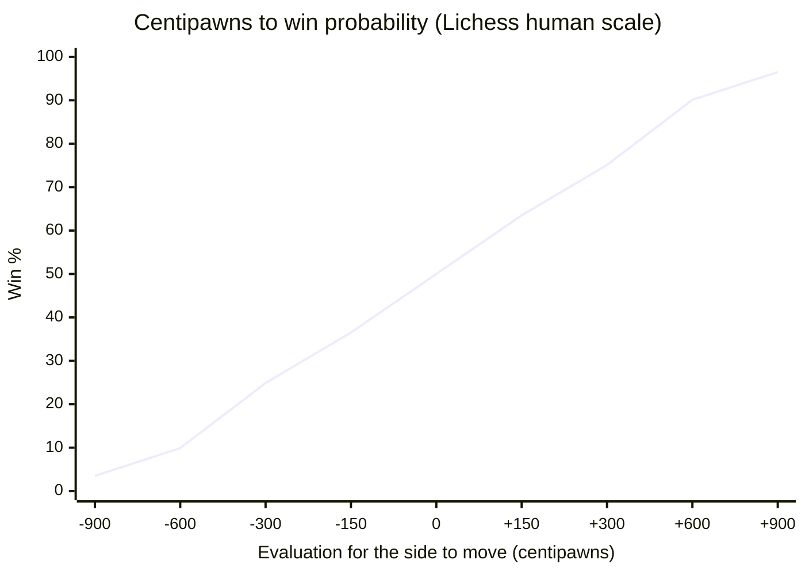

<div style="background:#f5f3ff;border-left:6px solid #7c3aed;border-radius:10px;padding:12px 18px;margin:16px 0;color:#1e293b;">

**🎯 The recipe for y:**
- **Train on win probability**, with Lichess's human-calibrated curve, which matches *your* intuition: `p = 1 / (1 + e^(−cp/271.6))`. The constant is 1/0.00368208 ✅.
- **Let the net output centipawns.** The loss compares `sigmoid(output/271.6)` with the target, so the trained net still speaks in pawns, but in its labels' pawns (Stockfish's scale from the table above), not your material pawns. To convert back: `cp = 271.6 · ln(p / (1 − p))`. In bullet, set the eval scale to 271.6 and `SCALE` in BitsNet.hpp (§12.1) to 272. If the two differ, every score comes out scaled (400 against 271.6 is ×1.47).
- **Why squash at all?** In raw centipawns, the difference between +15 and +25 (both totally winning) would dominate the loss, and the net would waste its capacity there. In win-% space it focuses on the range where decisions are made (−3…+3).
- **Mates:** map to p ≈ 0 or 1 (clamp cp to ±3000), never to your 10,000,000 king value.
- **One more beautiful fact:** plain alpha-beta only *compares* scores, so any order-preserving rescaling gives *identical* decisions ✅. The scale only starts to matter once margins exist (ProbCut, futility), and that's exactly why we calibrate them (§4.2).

</div>

Optionally, blend in the game result: `target = λ · p + (1 − λ) · result`, with λ sliding from 1.0 to about 0.8 during training. Stockfish's own nets used 1.0 → 0.75 and 1.0 → 0.7 ✅. Blending teaches things search scores miss. For example, a "+1.5" opposite-colored-bishop ending is drawn far more often than a "+1.5" rook ending. Use results only from real games between strong players (both rated 2000+, normal termination), and use λ = 1 for positions that never occurred in a game.

### 5.2 The label menu

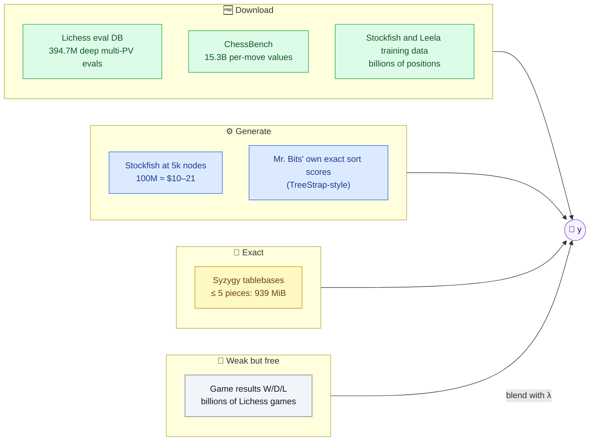

| Source | What you get | Label quality | License | Best use |
|---|---|---|---|---|
| ⭐ **Lichess evaluation DB** (`lichess_db_eval.jsonl.zst`) | **394,669,566** positions (updated 2026-07-29), each with depth, nodes and up to several principal variations ✅ | 🟢 Deep Stockfish (mixed versions with different cp scales; one fixed curve can't undo that, so fit this source's own sigmoid scale on positions you also label with your Stockfish, then convert to win %) | CC0 ✅ | Deep value labels; the **multi-PV entries are free top-K ground truth** for testing your trust factor |
| ⭐ **ChessBench** (DeepMind, NeurIPS 2024) | 10M games → **530M positions + 15.3B action-values**: Stockfish 16's win % for *every legal move* (≈ 29 per position) ✅ | 🟢 Stockfish 16, about 50 ms per move | Data CC-BY 4.0, code Apache-2.0 🟡 (check the repo's LICENSE) | The **ranking head** (§8), and child positions that include the *blunders* your pruning must recognize |
| **Lichess game PGNs** with `[%eval]` comments | A minority of games carry server analysis; Hugging Face's `Lichess/fishnet-evals` lists **34.5B** rows ✅ | 🟡 Single line, about 1.5–2.25M nodes | CC0 | Bulk pretraining (deduplicate hard: openings repeat millions of times) |
| **Stockfish NNUE training data** (`.binpack`, Hugging Face user *linrock*) | Billions of quiet-filtered positions, Leela-derived and rescored ✅ | 🟢 Battle-tested | Leela parts ODbL 🟡 | A ready-made dataset for an NNUE-style *leaf* net (after quiescence exists) |
| **Leela self-play data** (storage.lczero.org) | 2.5B+ games, with policy targets (MCTS visit distributions) and win/draw/loss ✅ | 🟢 Strong, but 8 KB per record | ODbL ✅ | Policy-head experiments; download one month at most |
| **Syzygy tablebases** | Exact win/draw/loss: ≤ 5 pieces = **939 MiB**, 6 pieces = 149 GiB ✅ | 💎 Exact | Probing library Fathom: MIT ✅ | Exact endgame labels, or probe them in-search *instead of* an endgame net |
| **Lichess puzzles** | **6,057,356** tagged puzzles (updated 2026-07-29) ✅ | 🛡️ Ground truth for tactics | CC0 | **Test set**, not training: "does the solution survive my pruning?" (§13) |
| **Stockfish at fixed nodes** (DIY) | Any positions you choose, including the ones *your* search visits | 🟡 Noisy at 5k nodes, good at 50k+ | Your own | The bulk of v1, and the fix for distribution shift (§17) |
| **Mr. Bits' own sort scores** 🔮 | Every full-window sort already computes **exact** minimax values for ~35 children | 🟠 Horizon-blind until quiescence exists | Your own | Self-distillation (TreeStrap); 100% original data |

### 5.3 "It would take years"? — No: hours. (But your intuition had a reason.)

The cost of labeling depends entirely on *how deep* each label is. On the Nebius RTX PRO 6000 box (which comes with 24 vCPUs), assuming 0.5–1.0M Stockfish nodes per second per vCPU 🟡 (measure it with Stockfish's built-in `speedtest`):

| Labels | Per position | 100M positions on the 24-vCPU box | Cost at $1.80/h |
|---|---|---|---|
| Stockfish `go nodes 5000` (≈ depth 9) | 5–10 ms | **5.8–11.6 hours** | **$10–21** |
| Stockfish `go nodes 50000` | 50–100 ms | 58–116 hours | $104–208 |
| Lichess-server depth (~1.5M nodes) | 1.5–3 s | ~2,600 hours (months) | 💀 |
| Mr. Bits' own depth-8 search, all moves | ~6.3 s at `-O0` | at most 0.35–0.45M labels/day on 28–32 processes (assuming linear scaling; at the 8–9× your laptop measured for 28 NNUE workers, §12.5, it's ≈ 0.1M/day) → **years** for 1B | your electricity |

*(The first two rows are pure search time; add 10–50% for UCI and Python overhead.)*

<div style="background:#ecfdf5;border-left:6px solid #059669;border-radius:10px;padding:12px 18px;margin:16px 0;color:#1e293b;">

**✅ So you were right twice and wrong once.** "Years" is true for *deep* labels on a home PC (≈ 6–12 years for 1B Lichess-depth labels on 8 cores 🟡), and for labels from Mr. Bits' own depth-8 search. It's wrong for what a first net actually needs: hobby engines generate their training data at about **5,000 nodes** per move today ✅ (noggin, Tarnished), and Stockfish's own NNUE nets have reportedly learned from labels about that cheap 🟡. And the deep labels already exist **for free** (the Lichess eval DB alone would cost you $800–1,700 to recreate at 1M nodes for just 40M positions 🟡).

</div>

### 5.4 Should you buy a dataset? Honestly: no.

| Product | Price | Contents | Engine evals? |
|---|---|---|---|
| ChessBase Mega Database 2026 | €229.90 / £195 ✅ | ~11.7M human games, 114k with human annotations | ❌ none |
| ChessBase Corr Database 2026 | €199.90 ✅ | 2.5M correspondence games | ❌ none |

No dataset for sale that I could find beats the free ones for this goal 🟡 (I checked the main ChessBase products, not every paid offering). A few hundred dollars buys **~167 hours of the Nebius box** (GPU + 24 vCPUs), which is enough for labeling, training, ablations and test matches (§14). **Buy compute, not data.** 💪

### 5.5 Data hygiene — the boring part that decides everything

1. **Split by game, never by position.** Positions from one game are near-copies, so a random split leaks them into validation and the scores lie. Use `hash(game_id) % 50 == 0` → validation ✅ (standard ML practice).
2. **Deduplicate** by normalized FEN (no move counters) with a 64-bit Zobrist hash. When the same position comes from two sources, keep the better label: tablebase > deep eval DB > 50k nodes > 5k nodes.
3. **Skip only plies < 4.** Stockfish plays your first 2 moves (the game's first 4 plies), but the Kernel *does* play everything from ply 4 on ✅. Stockfish's own pipeline skips everything up to ply 28 ✅; you can't afford that.
4. **Keep each game position with probability ~1/6**, for fewer and less correlated samples (nnue-pytorch's `--random-fen-skipping` does the same ✅).
5. **Add children, including bad ones** 🔮: out of every 100 positions, about 75 game positions, 20 random legal children, 4 capture children and 1 *illegal* "own king left hanging" child labeled as a win for the side to move (so the net learns to rank illegal moves last). Giraffe built its 175M training positions this way, by adding a random legal move to each position ✅.
6. **The quiet filter: OFF in v1, ON in v2.** Stockfish drops positions in check or whose best move is a capture ✅. That's right for a *leaf* net that sits behind quiescence search, and wrong for a v1 net that will be asked about noisy children because quiescence doesn't exist yet.
7. **Balance the phases** by piece count (25–32 / 17–24 / 9–16 / 2–8), weighted toward where Mr. Bits actually spends its search nodes. Down-weight plies > 100, since Stockfish plays after ply 80 ✅.

### 5.6 The v1 data recipe (copy-paste ready)

<div style="background:#f8fafc;border-left:6px solid #0f172a;border-radius:10px;padding:12px 18px;margin:16px 0;color:#1e293b;">

**📋 "MB-Net v1" data: ~145M positions, ≈ $33–62 for the lean core** 🟡 (A's labels, the test sets, processing and training with 3 ablations: 18–34 h; the full v1 program in §14 is ≈ $65–120)

- **A. 100M** positions from two recent months of Lichess standard rated games (≥ 20 plies, normal termination): 75M game positions, 20M random children, 4M capture children, 1M illegal children. Labeled with Stockfish 17.1+ (`Threads=1`, `Hash=16`, `go nodes 5000`), with 24 persistent processes over pipes. Don't reuse your current Stockfish handler, which starts a new process per query.
- **B. 40M** positions from the Lichess eval DB: the deepest evaluation's first line, depth ≥ 24 to start, sampled evenly across piece-count groups.
- **C. 5M** positions with ≤ 5 pieces, labeled exactly from Syzygy WDL (win = 1, loss = 0; draw, cursed win and blessed loss = 0.5).
- **Label:** side-to-move win probability `p = 1 / (1 + e^(−cp/271.6))` (§5.1); λ blend with game results only for real-game positions from 2000+ players.
- **Frozen test sets:** **Gold** (100k validation positions relabeled at 1M nodes), **Ranking** (10k positions with *every child* labeled at 50k nodes), **Tactics** (20k Lichess puzzles, removed from training).

</div>

---

## 🔢 6. What Goes In — Encoding the Board

### 6.1 The standard encoding (and why your flags are optional)

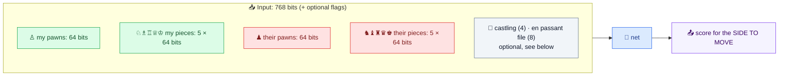

**12 piece types × 64 squares = 768 one-hot inputs.** Only ~32 of them are 1 at any time.

About your flags, honestly 🟡: **NNUE-style evaluators don't take castling or en-passant flags at all** ✅. Stockfish's inputs are piece-square-king features, plus (since 2026) threat and pawn-pair features. The search already handles the *legality* those flags encode, and their *evaluation* value is tiny: an en-passant right lasts one ply, and a castling right is worth some king safety. They're almost free to add, so add them later **as an experiment** (they matter more for a move-ranking head than for an evaluator). The one "flag" that really matters is **who is to move**, because tempo is worth a lot. The next trick handles it for free.

### 6.2 The perspective trick: always look from the side to move

Instead of "white pieces / black pieces" plus a side-to-move bit, encode **"my pieces / their pieces"**, and when it's black to move, **flip the board vertically**. The net then learns one skill ("judge the position for the player to move") instead of two mirrored ones, and it works roughly like doubling the data with color-flipped copies 🟡.

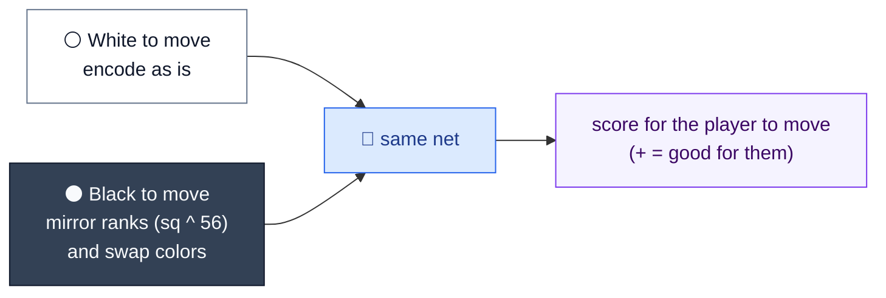

Your "+1 = white is better" stays the **display** convention. Inside the engine, you convert once (§12).

### 6.3 Mapping it onto Mr. Bits' board ✅

Your representation makes this almost free:

| Mr. Bits code (black / white) | Piece | Net type index |
|---|---|---|
| `1` / `9` | Pawn | 0 |
| `3` / `11` | Knight | 1 |
| `4` / `12` | Bishop | 2 |
| `5` / `13` | Rook | 3 |
| `6` / `14` | Queen | 4 |
| `7` / `15` | King | 5 |

- **Squares:** your bit number is `row * 8 + column` with row 0 = rank 8 (`BitToSquareAndViceVersaInitialization`, line 1087; `convertMoveFromStandardToInt16_t` uses `rowFrom = 8 - rank`). The standard a1 = 0 … h8 = 63 numbering that python-chess and every trainer use is therefore just **`bit ^ 56`**. One XOR. 😎 Bonus: FEN lists ranks 8 → 1, the same order as your rows, so training FENs map straight onto `board[8][8]`.
- **Side to move** at a `Magic` node: white is to move exactly when `turn == ENGINE_COLOR` (lines 2795 and 2948 test the same condition), and `ENGINE_COLOR = 1` means white.
- **Castling rights** (if you add the flags): white can still castle short when `board[7][4] == 15 && numberOfMovesOfThePieceOnThisSquare[7][4] == 0 && board[7][7] == 13 && numberOfMovesOfThePieceOnThisSquare[7][7] == 0`. Only the original piece can have a count of 0 on its start square, so this equals FEN castling rights exactly ✅. White's long castle is the same test with `[7][0]` instead of `[7][7]` (codes 15 and 13 again); black's two rights use row 0 with codes 7 (king, `[0][4]`) and 5 (rook, `[0][7]` for short, `[0][0]` for long), each with a move count of 0.
- **En passant** (if you add it): the previous move was a pawn *double* push. The piece now on its destination is a pawn with a move count of 1, on row 4 (white) or row 3 (black). Use the rule from your Trie (lines 835–843), not the one in movegen, which is doc 01's Bug 1.
- **What doesn't exist:** no halfmove clock and no repetition info ✅. Leave them out of the net.

---

## 🏗️ 7. The Architecture Ladder — From Your PST to Stockfish-Class

### 7.1 What the strongest engine did (it's a ladder, not a jump)

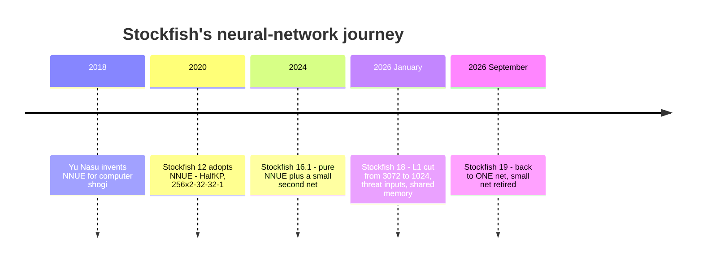

All of it ✅. Notice two things: the network *shrank* its first layer (3072 → 1024) when it got smarter inputs, and the two-network design was **retired** this September. Remember that when we get to your 3–4 nets in §9. 😉

### 7.2 Your ladder

| Rung | Net | Size / speed on your CPU | Data | Job in Mr. Bits |
|---|---|---|---|---|
| **0** | **Texel-tuned PST** (linear, zero hidden layers) | Same as today | Millions of positions with results | Rehearses the *whole* pipeline; about +100 Elo for the Texel engine ✅ |
| **1** | ⭐ **BitsNet v1: (768 → 256) × 2 → 1**, SCReLU | 0.38 MiB · **26–40 ns** incremental, **0.26–0.38 µs** full rebuild ✅ | 100–150M positions | **Ranker** at depth ≥ 4 (stage 2), then **leaf judge** (stage 4) |
| **2** | (768 → 1024) × 2 → 1 + **4–8 piece-count output buckets** (Stockfish uses 8) | 1.5 MiB · ~130 ns incremental ✅ | 500M–2B | Your "phase nets", done right (§9) |
| **3** | + **king buckets** (e.g. 4, with horizontal mirroring) | ×4 weights; full rebuild when the king changes bucket | 1.5B+ (the akimbo engine used 1.5B ✅) | A stronger judge |
| **4** | **Action-value / policy head** on a small trunk | Scoring only the legal moves: **0.2–0.6 µs per node** ✅ | ChessBench | **One-pass ranking** (§8) |
| **5** | Multi-layer NNUE (Stockfish-style) | int8 hidden layers, SIMD | 2–5B+ | Top hobby tier; only after the search is solid |
| **6** | GPU ResNets / transformers (Leela, ChessBench) | 20–300 µs per GPU call 🟡 | 10⁸–10¹⁰ labels | A *different kind of engine* (MCTS), not a next step for alpha-beta |

### 7.3 BitsNet v1, drawn

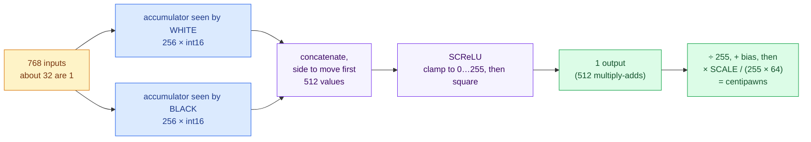

This exact shape (two perspective accumulators, SCReLU, QA = 255, QB = 64) is the standard hobby-engine net ✅. Its `SCALE` must equal the trainer's eval scale: 400 in most hobby engines, 272 with §5.1's 271.6 curve. That means tutorials, trainers and reference code all speak your language.

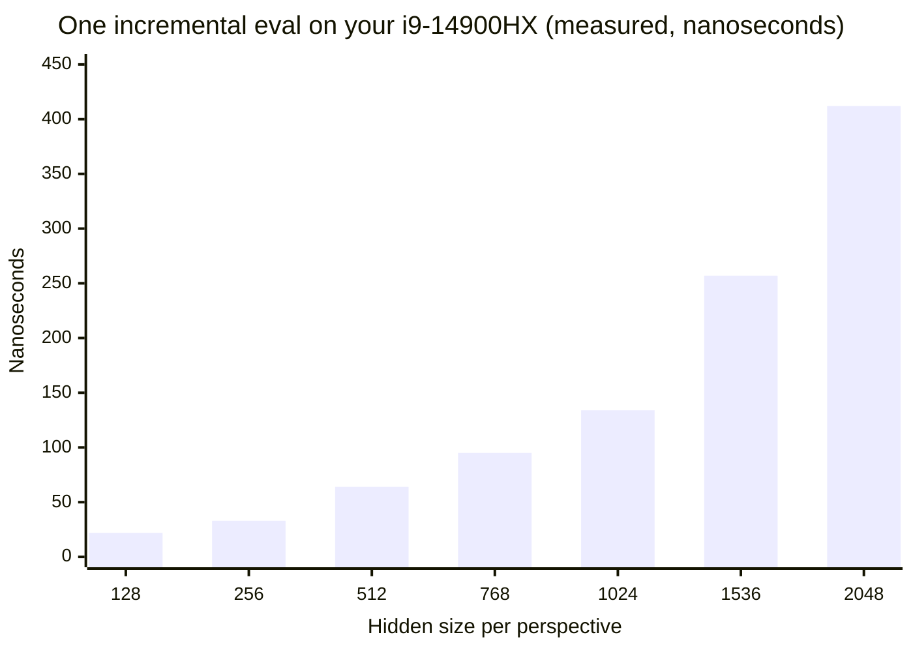

(Kernel-only costs with random weights, the midpoints of the measured ranges ✅. A real search adds move generation and cache effects on top.)

### 7.4 Trainers

| Trainer | What it is | Verdict |
|---|---|---|
| ⭐ **bullet** (github.com/jw1912/bullet) | A Rust library for NNUE-style nets with CUDA, ROCm and Metal backends, used by "many of the strongest chess engines" ✅. Start from its simple 768 → N perspective example | **Your v1 trainer** |
| **nnue-pytorch** | Stockfish's official trainer, with a fast C++ binpack loader and λ blending ✅ | Only for Stockfish-shaped multi-layer nets |
| **Plain PyTorch** | Full freedom | For custom heads (the action-value head in §8, uncertainty heads) |

---

## 🔀 8. The Structure You Didn't Think Of — Score All Moves From the Parent

### 8.1 One pass instead of 35

Your plan pays **one evaluation per child**: make the move, evaluate, unmake, × 35. An **action-value head** asks the parent *once* and gets a score for every legal move:

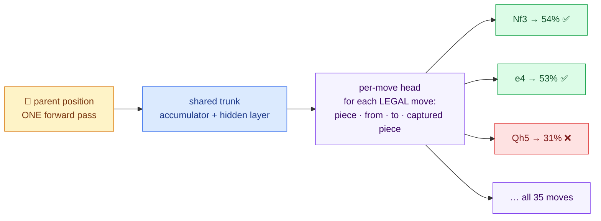

*(The percentages are illustrative.)*

- **It's not "best move" output.** It's *your* idea, "evaluate each child", computed in one pass. Each move gets a win %, which converts back to pawns.
- **It dodges the trap that sank your NNUE test** 🟡. Evaluating a child *right after a capture* means judging a mid-exchange position, which static nets are bad at. The action-value head is queried at the *parent*, and each move's label (ChessBench) already contains Stockfish's search of the exchange.
- **The labels exist:** ChessBench's 15.3B action-values are exactly this target ✅. Their 270M-parameter transformer trained on it reached **2895 Lichess blitz Elo against humans without any search**, though only about **2299 against bots** ✅. That shows how much knowledge the labels carry, and also that a net alone still isn't an engine.

### 8.2 Making it CPU-fast: the factorized head 🔮

A full output layer over every possible move (4,096 from-to pairs, or Leela's 1,858) is wasteful on a CPU: about 4,096 × 512 ≈ 2M multiply-adds per node, more than 35 child evaluations. But alpha-beta only needs the ~35 **legal** moves, so score each one with a cheap dot product:

```
q(move) = w · ReLU( H  +  E_from[piece][from]  +  E_to[piece][to]  +  E_cap[captured][to]  +  E_promo[type] ) + b
```

`H` comes from the trunk (computed once per node). The `E` tables are learned embeddings, so each legal move costs a few hundred multiply-adds. A simpler version of this head (a from-to table dotted with the hidden layer) was measured on your laptop at **0.2–0.6 µs per node** ✅. Optional extra inputs from your C++: the exchange value of the move (SEE, ~1–2 days to write) and "does it give check?".

### 8.3 Train it to *rank*, not to be exact

Pruning only needs the **order** of the top moves. So train with two losses together 🔮:
- **Listwise:** `KL( softmax(Q/T) ‖ softmax(q/T) )` over the legal moves, where Q are the true action-values. (Softmax turns the ~35 scores into probabilities that sum to 1; T is a temperature that sets how soft they are; KL measures how far the net's distribution is from the target's.) It's soft, so it also learns the 2nd and 3rd-best moves (exactly what ordering needs, and the reason one-hot "best move" targets tend to make overconfident rankers 🟡).
- **Regression:** keep ~30–50% Huber loss on the win % itself, so the margins of §4.2 stay calibrated.
- **Report** recall@K per phase, not just MSE.

### 8.4 More structures, from safest to wildest

| Structure | One-liner | Why it fits Mr. Bits |
|---|---|---|
| 🛡️ **Cascade pre-filter** | The net keeps the top ~10 moves plus a never-prune set; **your existing sort** ranks only those and keeps 4, as today | Fail-safe by construction: the net can only drop moves it ranks below 10th. The safest first integration |
| 🔁 **TreeStrap self-distillation** | Log the *exact* child values your full-window sorts already compute, then train the net to predict a *deeper* Mr. Bits search than the one it replaces | Free labels in your own scale, from exactly the positions where the net gets queried. The original TreeStrap program, Meep, went from 1068 Elo (TD-Leaf) to 2157 ✅ |
| ⚖️ **Pairwise referee** | A small Siamese net answers "is child i better than child j?" only for the 2–4 moves sitting on the cut line | DeepChess built a whole engine from pairwise comparisons ✅. Here it's used only where the decision is close |
| 🌡️ **Uncertainty head** | The net also predicts *how wrong it probably is* (σ); prune hard where σ is small, widen or extend where it's large | Free alarm already in your engine: a big gap between the net and your material + PST eval means tactics are in the air |
| 🎯 **NN-ranked root** | Rank the root moves once in Engine UCI, then give the top moves dedicated workers and bundle the junk ones | Today root moves are shuffled randomly 🎲 and dealt round-robin ✅ |

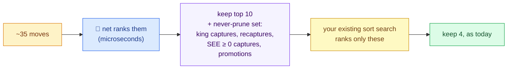

---

## 🎭 9. Your 3–4 Phase Networks — Honest Take & a Better Design

Your intuition is right: openings, middlegames and endgames need different knowledge. The *implementation* (four separate nets) is the part I'd change. Three facts first ✅:

1. **Your Kernel only plays plies 4–80.** Stockfish plays your first 2 moves and every move after ply 80 (Engine UCI.cpp lines 523 and 615–625). So an "opening net" would mostly judge positions Stockfish already plays for you, and an "endgame net" only matters before ply 81.
2. **Stockfish itself uses one network with 8 "layer stacks"** chosen by piece count, `(pieceCount − 1) / 4` (your local `nnue_architecture.h` and `evaluate_nnue.cpp`). That's one shared first layer with phase-specific output layers. And Stockfish 19 just **retired** its separate small net.
3. **Separate nets create evaluation jumps at phase boundaries, and alpha-beta exploits jumps.** If the endgame net is more optimistic, the search starts trading pieces just to cross into it. One capture can flip which net is used in the middle of a line.

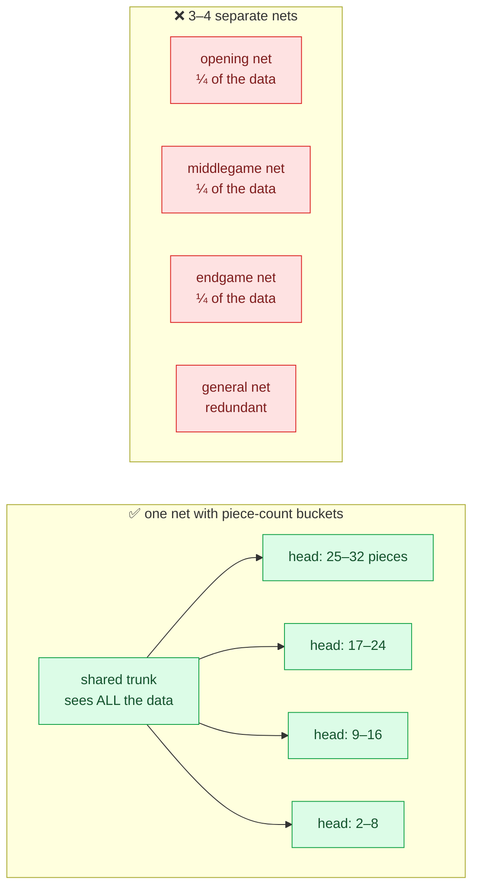

With buckets, only one small head runs per evaluation (same speed), every head shares one consistent scale, and the trunk learns from 100% of the data.

**For endgames, use the truth instead of a net:** Syzygy tablebases are *exact* ✅. The ≤ 5-piece set is only 939 MiB, and the MIT-licensed Fathom library ✅ probes it from eight bitboards (white, black, kings, queens, rooks, bishops, knights, pawns) with a1 = bit 0, as in Stockfish. Your `whitePieces`/`blackPieces` give the first two after `__builtin_bswap64` (the whole-board form of `bit ^ 56`), and the six piece-type boards take one pass over `board[8][8]` 🟡. With 6 pieces (149 GiB) you could even think about retiring the "Stockfish after ply 80" handover one day.

<div style="background:#f5f3ff;border-left:6px solid #7c3aed;border-radius:10px;padding:12px 18px;margin:16px 0;color:#1e293b;">

**🧪 But don't take my word for it: run the experiment.** Train three nets on the **same 150M positions** with the same number of training samples:
- **G**: one plain net
- **B**: one net with 4 piece-count buckets
- **P**: separate phase nets, blended near the boundaries like a tapered eval: `ŷ = w · ŷ_mid + (1 − w) · ŷ_end`

Measure: gold-set loss per phase, top-5 recall per phase, the average **jump in ŷ across captures that cross a boundary**, and 2,000 games per pair (≈ ±12 Elo at 95% confidence 🟡). **Pick the simplest option within the error bar of the best.** My bet is B. If P wins, I'll happily be wrong, because you'll have the numbers. 😄

</div>

---

## 🩺 10. Why Your NNUE Test Looked Bad (It Wasn't NNUE's Fault)

I found your old experiment ✅. `Stockfish Handler Testing.cpp` scores **every legal child** with Stockfish 16's **static `eval` command** (no search, no quiescence) and compares the result with `go depth 20`. And `getSortedMovesByNNUE` in `Stockfish Handler.hpp` (lines 189–224, wrapped by `getBestMoveByNNUE` at 178–187) is a complete "rank children by a static net" ranker, which is your trust-factor idea again, built two years ago. 😄 I believe your result 100%. But the conclusion needs one correction, because it decides the whole roadmap:

1. **NNUE is trained to judge *quiet* positions.** Stockfish's trainer skips positions in check or whose best move is a capture ✅. A developer on TalkChess put that at 20–40% of the data, depending on the source, and reported that training on non-quiet positions was about 100 Elo *worse* (forum reports 🟡). The deal is "search resolves the tactics, the net judges what's left." So a child position right after a capture is exactly what that net is *not* built for. With the recapture pending, it looks a piece up.
2. **Every static evaluator fails that test**, including your material + PST. It's the same disease as the horizon effect in doc 01. Your even-depth rule ("odd depths are bad, lol") is the folk remedy for it, and quiescence search is the cure.
3. **Raw accuracy isn't the metric; accuracy per microsecond *inside a search* is.** An eval that's off by ±80 cp but costs 30 ns, inside a search that resolves captures, beats a far more accurate judge that costs a millisecond. The first Stockfish NNUE roughly *halved* nodes per second and still gained strength ✅.
4. **"Searchless" is possible, at a price.** The ChessBench transformer needed 270M parameters and ~15B labels to reach ~2300 against bots without search ✅. That's ~10⁷ times the work of one NNUE evaluation per decision 🟡. A small net is a *leaf judge* or a *move ranker*, never a player on its own.

<div style="background:#ecfdf5;border-left:6px solid #059669;border-radius:10px;padding:12px 18px;margin:16px 0;color:#1e293b;">

**✅ The lesson:** test a net the way it will be used. Test it on **quiet positions only**, or **inside a search that has quiescence**, or (for ranking) as an **action-value head at the parent** (§8). That's why quiescence search is Stage 0 of the roadmap (§16), *before* any network. Without it, the net gets blamed for the horizon effect.

</div>

---

## 🏋️ 11. Training on the RTX PRO 6000 — The Pipeline

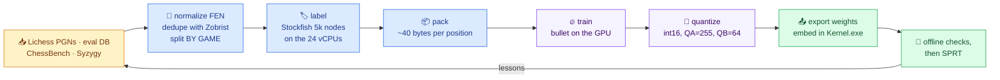

### 11.1 The hardware you're renting

| Item | Value |
|---|---|
| GPU | NVIDIA RTX PRO 6000 Blackwell: 24,064 CUDA cores, **96 GB GDDR7** ✅; ~120 TFLOPS FP32 and 1,597 GB/s on the Server Edition clouds usually run (check with `nvidia-smi -q`) ✅ |
| The Nebius box | 1 GPU + **24 vCPUs + 218 GB RAM**, **$1.80/hour** on demand ✅ (October 2026 price page; untouched by Nebius's 1 October increase on H100–B300). Preemptible capacity uses dynamic spot pricing since 1 October: from about $0.79/hour, floating up to just under the on-demand rate 🟡 (price trackers). Check your console, since prices move |
| What it's good for | The 24 vCPUs **label** while the GPU **trains**. 145M positions × ~40 bytes ≈ 6 GB, so the *whole dataset fits in GPU memory* 🟡 |
| Expected training time | A 1024-wide NNUE over billions of positions: **hours, not days** 🟡 (reported speeds are 2–3M positions/s on smaller GPUs). The GPU is not your bottleneck; labels and the data loader are |

<div style="background:#eff6ff;border-left:6px solid #2563eb;border-radius:10px;padding:12px 18px;margin:16px 0;color:#1e293b;">

**💡 Your laptop can do v1 for free.** It has an **RTX 5070 Laptop GPU with 8 GB** (Blackwell, compute capability 12.0) and 32 GB of RAM ✅. That's plenty for a 768 → 256 net on 100–150M positions. Use it for the pipeline check and the first experiments, and rent the RTX PRO 6000 when you scale up or run ablations in parallel. (Blackwell needs a recent CUDA toolkit; check bullet's README for the supported versions 🟡.)

</div>

### 11.2 Step 0 of training: prove the pipeline by learning *your own* eval

Before spending a cent on Stockfish labels (this opens roadmap Stage 1), label 20M positions with **Mr. Bits' own material + PST** (unlimited and free), train for an hour, and require all three of these 🟡:
1. C++ (quantized) outputs match a Python re-implementation of the same integer math **exactly** (0 cp) on 100k positions (mind that C++ `/` truncates toward zero while Python `//` floors), and stay within a few cp of the Python float net on average (rounding the output weights to steps of 1/64 alone costs that much, with outliers of a few tens of cp; a layout or sign bug costs hundreds);
2. the color-flip test passes: `ŷ(pos) == ŷ(color-flipped pos)`, bit-identical in the C++ integer net, because the net scores the side to move (mirror the ranks, swap the colors, flip the side to move; only a white-view score would change sign);
3. the net reproduces your hand-written eval within **≤ 20 cp RMSE**.

If this fails, nothing later can work. If it passes, your converter, trainer, quantizer and C++ inference are all proven at once. 🧪

### 11.3 Starter settings (to tune, not gospel 🟡)

- **Optimizer:** AdamW, batch 16,384, learning rate 1e-3 with cosine decay to 1e-5.
- **Length:** about 30 passes over v1's ~145M positions (≈ 4.4B samples): under an hour at the 2–3M positions/s of §11.1, up to ~5 GPU-hours if the data loader is the bottleneck.
- **Ablations, one at a time:** the sigmoid scale (271.6 in §5.1) ∈ {150, 272, 400}, each with its own `SCALE`; final λ ∈ {1.0, 0.8}; share of children 0% vs 25%; 5k-node labels vs ¼ as many 20k-node labels at equal compute.
- **Learning curve:** train on 10M, 30M and 100M positions, and only buy more data while the gold-set loss keeps falling.

---

## 🔌 12. Plugging It Into Kernel.cpp

Everything below follows your naming and your globals. Save §12.1 as a self-contained header, `BitsNet.hpp`, next to `json.hpp`, and include it right after `#include "json.hpp"` (line 7). The functions in §12.2–12.3 use your globals and constants (lines 15–37), `MSB` and `MakeChanges`/`ReturnChanges`, so paste them into Kernel.cpp itself, just above `MagicForIterativeDeepening` (line 2779). Compile with `-O2 -march=native -std=c++17` (§2.3). The review agents compiled exactly this placement against a copy of your Kernel ✅.

### 12.1 The network and its features

```cpp
// BitsNet.hpp - a minimal (768 -> H) x 2 -> 1 perspective network for Mr. Bits.
// Needs C++17 (inline variables, std::clamp): compile with -std=c++17 or newer.
#pragma once
#include <algorithm>
#include <cstddef>
#include <cstdint>
#include <cstdio>

namespace BitsNet {

constexpr int INPUTS = 768;   // 2 sides x 6 piece types x 64 squares
constexpr int H      = 256;   // hidden neurons per perspective (start small!)
constexpr int QA     = 255;   // quantization of the feature transformer
constexpr int QB     = 64;    // quantization of the output layer
constexpr int SCALE  = 272;   // must equal the trainer's eval scale: 271.6 for §5.1's curve (400 only if you train with 400)

struct Network {
    alignas(64) int16_t ftWeights[INPUTS][H];   // one row of H numbers per input feature
    alignas(64) int16_t ftBias[H];
    alignas(64) int16_t outWeights[2 * H];      // [side to move | other side]
    int16_t outBias;
};

inline Network net;  // about 400 KB for H = 256; loaded once at startup

// The trainer must export the weights in exactly this order: ftWeights, ftBias, outWeights, outBias
// (check your trainer's export format). Some exporters pad the file to a multiple of 64 bytes, so accept both.
inline bool Load(const char* path) {
    FILE* f = fopen(path, "rb");
    if (!f) return false;
    size_t bytesRead = fread(&net, 1, sizeof(Network), f);
    bool longer = fgetc(f) != EOF;                                     // file bigger than this net: wrong export
    fclose(f);
    size_t unpadded = offsetof(Network, outBias) + sizeof(int16_t);   // 394,754 bytes for H = 256
    return !longer && (bytesRead == unpadded || bytesRead == sizeof(Network));   // raw or 64-byte padded
}

// Mr. Bits piece code (& 7) -> 0..5 for P, N, B, R, Q, K. Code 2 is unused.
constexpr int TYPE_INDEX[8] = {-1, 0, -1, 1, 2, 3, 4, 5};

// The input feature of one piece, seen from one side.
// Mr. Bits bit = row * 8 + column (row 0 = rank 8), so the standard a1 = 0 square is bit ^ 56.
// From black's point of view the board is mirrored, which gives (bit ^ 56) ^ 56 = bit.
inline int FeatureIndex(int8_t piece, int bit, bool perspectiveIsWhite) {
    bool pieceIsWhite = piece & 8;
    int square = perspectiveIsWhite ? (bit ^ 56) : bit;
    bool isMine = (pieceIsWhite == perspectiveIsWhite);
    return (isMine ? 0 : 384) + TYPE_INDEX[piece & 7] * 64 + square;
}

struct Accumulator {
    alignas(64) int16_t white[H];   // the first layer, seen by white
    alignas(64) int16_t black[H];   // the first layer, seen by black
};

}  // namespace BitsNet
```

### 12.2 Building the accumulator and evaluating

Version 1 rebuilds the first layer from scratch with your MSB loop. That's ~0.3 µs measured (§3.4), plenty fast for **sorting** at depth ≥ 4. The incremental version is only needed when the net becomes your *leaf* judge (stage 4).

```cpp
// Uses Mr. Bits' globals: board, whitePieces, blackPieces, getPieceRowFromBit, getPieceColumnFromBit, MSB.
inline void RefreshAccumulator(BitsNet::Accumulator& acc) {
    using namespace BitsNet;
    std::copy(net.ftBias, net.ftBias + H, acc.white);
    std::copy(net.ftBias, net.ftBias + H, acc.black);
    long long occupied = whitePieces | blackPieces;
    while (occupied) {
        int8_t bit = MSB(occupied);
        occupied ^= (1ll << bit);
        int8_t piece = board[getPieceRowFromBit[bit]][getPieceColumnFromBit[bit]];
        const int16_t* forWhite = net.ftWeights[FeatureIndex(piece, bit, true)];
        const int16_t* forBlack = net.ftWeights[FeatureIndex(piece, bit, false)];
        for (int i = 0; i < H; i++) {
            acc.white[i] += forWhite[i];
            acc.black[i] += forBlack[i];
        }
    }
}

inline int SCReLU(int x) {
    x = std::clamp(x, 0, BitsNet::QA);
    return x * x;
}

// Centipawns from the point of view of the side to move.
inline int EvaluateSideToMove(const BitsNet::Accumulator& acc, bool whiteToMove) {
    using namespace BitsNet;
    const int16_t* mine   = whiteToMove ? acc.white : acc.black;
    const int16_t* theirs = whiteToMove ? acc.black : acc.white;
    long long sum = 0;
    for (int i = 0; i < H; i++) sum += (long long)SCReLU(mine[i])   * net.outWeights[i];
    for (int i = 0; i < H; i++) sum += (long long)SCReLU(theirs[i]) * net.outWeights[H + i];
    sum /= QA;                   // SCReLU squared the QA scale; remove one copy of it
    sum += net.outBias;
    return int(sum * SCALE / (QA * QB));
}

// Mr. Bits' search is engine-perspective minimax: positive = good for the engine.
inline int EvaluateForEngine(bool whiteToMove) {
    BitsNet::Accumulator acc;
    RefreshAccumulator(acc);
    int score = EvaluateSideToMove(acc, whiteToMove);
    return (whiteToMove == ENGINE_COLOR) ? score : -score;
}
```

<div style="background:#fef2f2;border-left:6px solid #dc2626;border-radius:10px;padding:12px 18px;margin:16px 0;color:#1e293b;">

**🔴 The #1 bug every engine author hits with nets: the sign.** The net speaks "side to move", your search speaks "engine", your display speaks "white", and the datasets speak a mix (Lichess `[%eval]` is from white's view, ChessBench and Leela from the side to move 🟡). That's a lot of places to flip a sign wrong, and a sign bug doesn't crash: it plays the *worst* move with total confidence. 😅 Before anything else, write the 10-line color-flip test: mirror the board, swap the colors, flip castling, en passant and the side to move, and the side-to-move eval must come out *identical*.

</div>

### 12.3 Replacing the sorting search (with the legality filter)

Mr. Bits has no general "is this square attacked?" function yet ✅, so here is one, written for your board:

```cpp
// Is the king of the given color attacked? Mailbox scan on board[8][8]; row 0 = rank 8.
bool IsKingAttacked(bool whiteKing) {
    int8_t myKing = whiteKing ? 15 : 7;
    int kingRow = -1, kingColumn = -1;
    long long mine = whiteKing ? whitePieces : blackPieces;
    while (mine) {
        int8_t bit = MSB(mine);
        mine ^= (1ll << bit);
        if (board[getPieceRowFromBit[bit]][getPieceColumnFromBit[bit]] == myKing) {
            kingRow = getPieceRowFromBit[bit];
            kingColumn = getPieceColumnFromBit[bit];
            break;
        }
    }
    if (kingRow < 0) return true;                         // no king: it was already captured

    int8_t enemyColorBit = whiteKing ? 0 : 8;
    auto enemyAt = [&](int r, int c, int8_t type) {
        return r >= 0 && r < 8 && c >= 0 && c < 8 && board[r][c] == (type | enemyColorBit);
    };

    // Black pawns move toward row 7, so they attack a white king from the row above it (and vice versa).
    int pawnRow = whiteKing ? kingRow - 1 : kingRow + 1;
    if (enemyAt(pawnRow, kingColumn - 1, 1) || enemyAt(pawnRow, kingColumn + 1, 1)) return true;

    static const int KNIGHT[8][2] = {{-2,-1},{-2,1},{-1,-2},{-1,2},{1,-2},{1,2},{2,-1},{2,1}};
    for (const auto& d : KNIGHT) if (enemyAt(kingRow + d[0], kingColumn + d[1], 3)) return true;

    for (int dr = -1; dr <= 1; dr++)
        for (int dc = -1; dc <= 1; dc++)
            if ((dr || dc) && enemyAt(kingRow + dr, kingColumn + dc, 7)) return true;

    static const int RAYS[8][2] = {{-1,0},{1,0},{0,-1},{0,1},{-1,-1},{-1,1},{1,-1},{1,1}};
    for (int k = 0; k < 8; k++) {
        int8_t slider = (k < 4) ? 5 : 4;                  // rook lines first, then bishop lines
        for (int r = kingRow + RAYS[k][0], c = kingColumn + RAYS[k][1];
             r >= 0 && r < 8 && c >= 0 && c < 8; r += RAYS[k][0], c += RAYS[k][1]) {
            if (board[r][c] == 0) continue;
            if (board[r][c] == (slider | enemyColorBit) || board[r][c] == (6 | enemyColorBit)) return true;
            break;                                         // the ray is blocked
        }
    }
    return false;
}
```

And here's a drop-in sibling of `SortTheMovesAccordingToIterativeDeepening`, with the same save/restore discipline as your code:

```cpp
const int ILLEGAL_MOVE_SCORE = 1000000000;   // worse than any real score, including king captures

void SortTheMovesWithBitsNet(const bool& turn, vector<int16_t>& currentMoves) {
    vector<pair<int, int16_t>> scored;
    scored.reserve(currentMoves.size());
    bool moverIsWhite = (turn == ENGINE_COLOR);
    bool childWhiteToMove = !moverIsWhite;               // after our move, the other side moves

    for (const int16_t& currentMove : currentMoves) {
        int8_t takenPiece = board[(currentMove >> 6) & 7][(currentMove >> 9) & 7];
        int16_t numberOfMovesOfTheTakenPiece = numberOfMovesOfThePieceOnThisSquare[(currentMove >> 6) & 7]
                                                                                  [(currentMove >> 9) & 7];
        long long whitePiecesBefore = whitePieces, blackPiecesBefore = blackPieces;
        int engineScoreBefore = engineScore, opponentScoreBefore = opponentScore;
        MakeChanges(currentMove);

        int score;
        if (abs(engineScore - opponentScore) > CHECKMATE_FLAG_SCORE_DIFFERENCE) {
            score = engineScore - opponentScore;          // a king was captured: keep the exact verdict
        } else if (IsKingAttacked(moverIsWhite)) {
            score = turn ? -ILLEGAL_MOVE_SCORE : ILLEGAL_MOVE_SCORE;   // illegal: sink it to the bottom
        } else {
            score = EvaluateForEngine(childWhiteToMove);
        }

        whitePieces = whitePiecesBefore;   blackPieces = blackPiecesBefore;
        engineScore = engineScoreBefore;   opponentScore = opponentScoreBefore;
        ReturnChanges(currentMove, takenPiece, numberOfMovesOfTheTakenPiece);
        scored.push_back({score, currentMove});
    }

    if (turn) sort(scored.begin(), scored.end(), greater<pair<int, int16_t>>());
    else      sort(scored.begin(), scored.end(), less<pair<int, int16_t>>());
    for (size_t i = 0; i < scored.size(); i++) currentMoves[i] = scored[i].second;
}
```

In `Magic`, the tiers then become:

```cpp
if (depth > 1 && depth < 4) {
    SortTheMovesWithMySimpleHeuristic(allPossibleMoves);          // unchanged
}
else if (depth >= 4) {
    SortTheMovesWithBitsNet(turn, allPossibleMoves);              // was: a 2-, 4-, 6- or 8-ply search per child
    if (depth >= 6) {
        while (allPossibleMoves.size() > 4) {                     // your top-4 cut stays until §12.4 replaces it
            allPossibleMoves.pop_back();
        }
    }
}
```

⚠️ **Keep your top-4 cut in this stage.** Switch it off only for the §13.1 exactness test, and replace it with §12.4's reductions in Stage 3. Without the cut, every depth-6+ node would search all ~35 moves at full depth: the reviewers measured depth-8 searches taking 2–12× *longer* than today that way ✅.

What the ranker itself costs, measured with this exact code at `-O2 -march=native` on 2,000 game positions ✅:

| Sorting step at a node | Today's search sort | `SortTheMovesWithBitsNet` (v1, full refresh) | Cheaper by |
|---|---|---|---|
| depth 4–5 (2-ply sort) | 64.9 µs | 12.0 µs | ×5.4 |
| depth 6–8 (4-ply sort) | 10.4 ms | 12.0 µs | ×540–860 |
| depth 9–10 (6-ply sort) | 850 ms | 12.0 µs | ×38,000–70,000 |

That's the *cost* side only. Whether the net keeps the *right* 4 is the quality side, which §13's recall and puzzle tests measure.

### 12.4 Turning the top-4 cliff into a slope (LMR)

The move loop keeps the first `K` moves at full depth and **searches the rest shallower**, instead of `pop_back()`-ing them (delete the `pop_back` loop from §12.3 when you add this):

```cpp
int moveIndex = 0;
bool inCheck = IsKingAttacked(turn == ENGINE_COLOR);          // in check: never reduce an evasion (§4.4)
for (const int16_t& currentMove : allPossibleMoves) {
    // ... save state + MakeChanges(currentMove), exactly as today (takenPiece is read before MakeChanges) ...

    int8_t moveType = (currentMove >> 12) & 7;
    bool tactical = (takenPiece != 0) || (moveType == 3) || (moveType == 1) || (moveType == 2)
                    || (moveType == 6) || (moveType == 7);   // capture, en passant, promotion
    bool givesCheck = IsKingAttacked(turn != ENGINE_COLOR);   // after MakeChanges: does the move check the opponent?
    bool reduce = (depth >= 6) && (moveIndex >= K) && !tactical && !inCheck && !givesCheck;

    int correspondingScore;
    if (reduce) {
        // R = 2 keeps your even-depth parity until quiescence search exists.
        correspondingScore = Magic(depth - 1 - 2, !turn, currentMove, alpha, beta);
        bool surprising = turn ? (correspondingScore > alpha) : (correspondingScore < beta);
        if (surprising) {
            correspondingScore = Magic(depth - 1, !turn, currentMove, alpha, beta);   // re-search
        }
    } else {
        correspondingScore = Magic(depth - 1, !turn, currentMove, alpha, beta);
    }

    // ... restore state + ReturnChanges, alpha/beta update, cutoff, exactly as today ...
    moveIndex++;
}
```

`K` starts at your favorite number (4 or 5), and §13 shows how to set it from data instead. Reducing by **2** plies instead of the usual 1 is a deliberate Mr. Bits special 😄: your even-depth rule exists because of the horizon effect, and a 1-ply reduction would make a line through a reduced move end an odd number of plies from the root. Once quiescence search lands, the parity problem disappears and the normal R = 1 (growing with depth and move number, §4.3) takes over.

### 12.5 Later: the net as your leaf judge (stage 4)

- **Where:** the leaf returns at lines 2791 and 2944. Keep the king-capture test on the incremental material, because it's your mate detector ✅. Only the *quiet* leaf value changes, and only behind quiescence search (its stand-pat score becomes the net's eval). Clamp the net to ±30,000, well inside the 100,000 mate threshold.
- **Incremental updates:** the accumulator updates belong in `MakeChanges` next to the PST updates (a quiet move: −from, +to in both perspectives; a capture: also −victim; castling: king + rook; en passant: the captured pawn sits on another square; promotion: −pawn, +new piece, and −victim when it captures). `ReturnChanges` never undoes them, so save and restore the accumulator with the 4 scalars at every search-time `MakeChanges` call: your 4 snapshot sites (lines 2846–2856, 2901–2911, 3099–3109, 3187–3197) ✅ plus the new one in `SortTheMovesWithBitsNet` (§12.3). The game replay in `InitializeEveryThing` (lines 3328–3336) also calls `MakeChanges` and keeps its changes on purpose, so build the accumulator once with `RefreshAccumulator` after it (main calls `InitializeEveryThing` at line 3372). Your quadruplicated `MakeChanges` is the riskiest code to touch, so one more reason to start with the ranker.
- **The 28 workers:** each fresh `Kernel.exe` would re-read the weights every move. Embed them in the executable (generate a `.h` with `xxd -i`, or use incbin) or memory-map one shared file. Also: on your laptop, 28 workers measured only about **8–9×** the single-core NNUE throughput, not 28× ✅ (hyper-threads, E-cores, laptop power limits). Try 16–24 workers too.

---

## 🧪 13. Proving It Works — Measure Before You Believe

You ran a lab with ~1000 games of experiments. This section upgrades the lab. 🧪

### 13.1 The free exactness test (do this first!)

<div style="background:#ecfdf5;border-left:6px solid #059669;border-radius:10px;padding:12px 18px;margin:16px 0;color:#1e293b;">

**✅ Move order cannot change the value of an unpruned alpha-beta search. It only changes the node count** ✅. So: switch off the top-4 truncation, run at a **fixed depth with no time limit**, and compare the old sort with the net sort. The root score **must be identical**, and the main-tree node count (count `Magic` nodes separately from the sort sub-searches, §2.4) tells you *exactly* how good the ordering is. That's a perfect, risk-free unit test of the ranker before a single game is played. (It needs `go depth N` / `go nodes N`, which Engine UCI.cpp doesn't support yet ✅. Add them, and pass the limit to the Kernel in the JSON with no time cap, because Kernel.cpp's iterative-deepening loop (lines 3376–3403) stops only on time.)

</div>

### 13.2 Offline checks (minutes, no games needed)

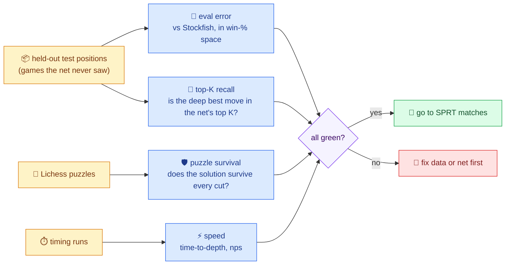

| Check | How | What "good" looks like |
|---|---|---|
| **Eval error** | Mean squared error in win-probability space against the Gold set | Clearly below a Texel-tuned material + PST baseline |
| **Top-K recall** ⭐ | On positions with multi-PV deep evals (the Lichess eval DB gives them free), the % where the best move is in the net's top K. Also "near-best recall": any move within 25–50 cp of the best | **Your trust factor, measured.** Pick K per depth and phase so recall stays ≥ 97–99% 🟡. Measure today's 4-ply-sort top-4 the same way, to see how often it already drops the best move |
| **Puzzle survival** 🛡️ | Lichess puzzles: run the solution line at fixed depth and check whether the solution move survives *every* pruning node; report by theme (sacrifice, quiet move, defensive move…) and rating. Needs a FEN loader in the Kernel first, since today it only replays moves from the start position (doc 01's Bug 5) | The tactical safety test. Puzzles are exactly the "only move ranks 5th" positions the top-4 cliff kills. It turns your "99.9% safe" into a number |
| **Speed** | Time-to-depth on a fixed set of 200–1,000 positions | The net sort must be much cheaper than the search sort it replaces (§2) |

⚠️ **Run every ranker measurement without a time limit.** On timeout, `Magic` and `MagicForIterativeDeepening` return 0, which looks like a real score (lines 2784–2786 and 2937–2939) ✅, so an interrupted sort ranks moves by fake zeros.

### 13.3 Online: matches with SPRT (the only judge that matters)

| Item | Recommendation |
|---|---|
| **Tool** | **fastchess** (MIT, v1.8.0 as of April 2026 ✅) through your existing UCI front-end; cutechess-cli works too |
| **SPRT** | elo0 = 0, elo1 = 5 for small changes (elo1 = 10 for big ones), α = β = 0.05: the standard hobby setting ✅. Fishtest uses [0, 2] at short time controls ✅, but that costs far more games |
| **Time control** | Hobby engines test at 10+0.1 or 8+0.08 ✅, but today's Mr. Bits can't: even a move with a 1 s cap takes ≈ 2.2 s of wall time ✅ (a fixed overhead of ~1–2 s per move, most likely the 28 process spawns, JSON files and Stockfish launches 🟡; every Kernel move also starts Stockfish twice ✅). With a sub-second increment it loses on time early: around move 5 at 10+0.1, and still around move 10 at 60+0.6, in a clock model built from your logged think times 🟡. Until a test mode and a persistent Stockfish remove that overhead, test with an increment of 3 s or more: 10+3, or the 2+3 you already play on lichess. Expect only ~100–200 games a day 🟡 |
| **Openings** | A balanced **PGN** book that starts from the initial position, with color-reversed pairs. Never an EPD/FEN book: Engine UCI.cpp drops the FEN and replays the moves from the start position (doc 01's Bug 5). After a book of 4+ plies the "first 2 moves" rule never fires, because book plies count, but the >80-ply Stockfish takeover and the stalemate guardrail still do, so keep them identical in both versions, or switch them off |
| **Concurrency** | 1 game at a time on your laptop (each move spawns 28 workers). Parallel games first need a 1–4-worker "test mode" with per-process file names (today every instance shares `input/thread_N_serialized_data.json`, `temp_command_file.txt` and `history/` in its working directory), and on the Linux Nebius VM also a port of the Windows-only calls (`windows.h`, `SetPriorityClass`, the `cmd.exe` launch of `.\engines\Kernel.exe`), or Wine |
| **How many games?** | With ~35% draws, 1,000 games pin Elo to about ±17 and 10,000 games to about ±5.5 🟡. Big changes (quiescence!) show up within a few hundred games; small tweaks need thousands |

**Setting up the A/B match:** give each version its own full copy of the `lichess-bot-master` folder (here `C:/mb_new` and `C:/mb_base`), and start each engine with its copy as the working directory (`dir=`). `Engine UCI.exe` always launches `engines/Kernel.exe` and uses `input/` and `stockfish/` relative to its working directory, so from one shared folder "new" and "base" would run the *same* Kernel ✅. Make sure each copy has an empty `input/` folder, because Engine UCI.cpp doesn't create it. Usually only `engines/Kernel.exe` differs between the two copies. Example command, with flags from memory, so check `fastchess -help` 🟡:

```
fastchess -engine cmd="C:/mb_new/engines/Engine UCI.exe" dir=C:/mb_new name=new -engine cmd="C:/mb_base/engines/Engine UCI.exe" dir=C:/mb_base name=base -each tc=10+3 -openings file=book.pgn format=pgn order=random -games 2 -rounds 5000 -repeat -concurrency 1 -sprt elo0=0 elo1=5 alpha=0.05 beta=0.05 -pgnout file=test.pgn
```

<div style="background:#fffbeb;border-left:6px solid #d97706;border-radius:10px;padding:12px 18px;margin:16px 0;color:#1e293b;">

**⚠️ One change per test.** Net + new trust rule + new time management in one match tells you nothing when it fails, and nothing *reliable* when it wins. Your commit history shows you already think in checkpoints, so make each checkpoint one SPRT.

</div>

---

## 💸 14. Budget — Spend on Compute, Not Datasets

All at the Nebius box's $1.80/hour (GPU + 24 vCPUs), with throughput assumptions marked 🟡 in §5.3:

| Line item | Hours | Cost |
|---|---|---|
| 100M labels at 5k nodes | 5.8–11.6 | $10–21 |
| 10M "deep slice" at 50k nodes | 5.8–11.6 | $10–21 |
| Gold + ranking test sets | 1.3–2.6 | $2–5 |
| Data processing (PGN, eval DB, tablebases, dedupe) | 3–5 | $5–9 |
| v1 training + 6–8 ablations | 15–30 | $27–54 |
| Test matches on the box (optional; needs the test mode and a Linux port or Wine first, §13.3) | ~5 | ~$9 |
| **Total v1 program** | **~36–66** | **≈ $65–120** (lean core: $33–62) |

*Lean core = the 5k-node labels, the test sets and processing, plus training with only 3 ablations (8–15 h).*

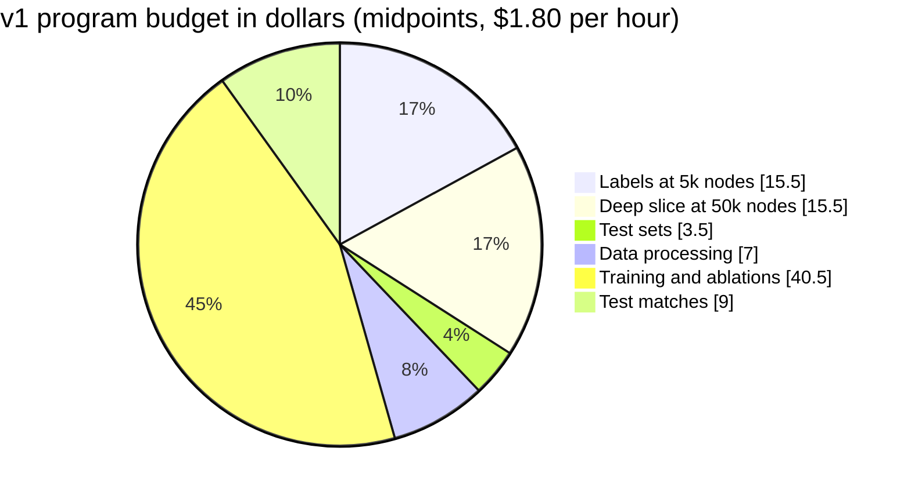

That leaves **$180–235 of a $300 budget** for v2: 300M–1B positions, the ChessBench ranking head, and data logged from Mr. Bits' own search 🟡. Three money tips: stop the instance when it's idle, label on preemptible capacity with checkpointed output shards, and use your laptop's RTX 5070 for everything small (§11.1).

---

## 💡 15. The Idea Bank — All the Ideas, Ranked

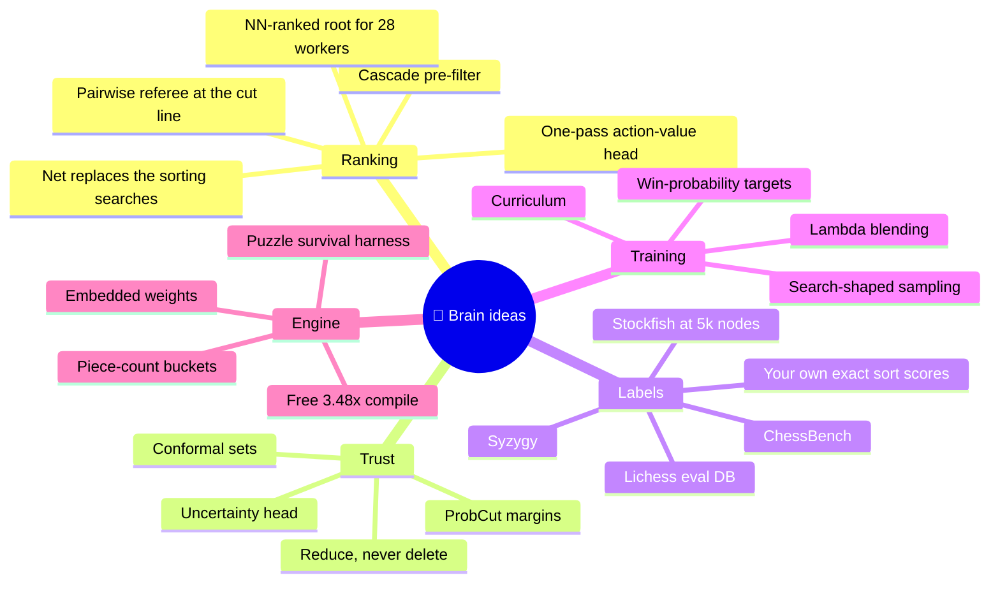

| # | Idea | Effort | Payoff | Confidence |
|---|---|---|---|---|
| 1 | 🎁 **Compile with `-O2 -march=native`** (§2.3) | Minutes | ×3.48 measured | ✅ Certain |
| 2 | 🧠 **Net replaces the sorting searches** at depth ≥ 4 (§12.3) | Days | Up to ×15 fewer nodes at depth 10 (model); in the measured worker the sorts are 92.6% of the nodes and 87% of the time, which caps it at about ×13.5 in nodes and ×8 in time | 🟡 High for speed; Elo must be measured against TT + killers + history (§2.4) |
| 3 | 🛡️ **Cascade pre-filter**: the net keeps 10, your sort keeps 4 (§8.4) | Days | Faster time-to-depth at almost no risk | 🟡 High |
| 4 | 🧪 **Puzzle survival harness** (§13.2) | 2–4 days, plus a FEN loader for the Kernel | Every pruning change gets a safety number in an hour | ✅ High as a tool |
| 5 | 🎯 **ProbCut-calibrated `scoreDifferenceFactor`** (§4.2) | 3–5 days | Adaptive K: fewer wasted slots, fewer deleted saves | 🟡 Medium-high, a proven family of techniques |
| 6 | 📉 **Reduce, never delete** (NN-guided LMR) | 6–10 days | Removes the top-4 cliff while keeping most of the speed | 🟡 Medium-high, best after quiescence + TT |
| 7 | 🏷️ **Stockfish 5k-node label factory** (§5.6) | 2–3 days | 100M labels for $10–21 | ✅ High (method); 🟡 (speed) |
| 8 | 📊 **Win-% targets + λ blending** (§5.1) | Hours | Stable training; outputs on Stockfish's pawn scale | ✅ Standard practice |
| 9 | 🔢 **Piece-count buckets** instead of phase nets (§9) | 1–2 days in the trainer | Phase knowledge without jumps | 🟡 Medium-high |
| 10 | 🧠 **Net as the quiet-leaf judge** (stage 4, §12.5) | ~2 weeks, after quiescence search | The proven NNUE Elo source: a better leaf eval than material + PST | 🟡 High once quiescence exists |
| 11 | ⚖️ **Action-value head from ChessBench** (§8) | 10–15 days | 1 pass instead of 35, labels that include the exchanges | 🟡 Medium-high for ranking quality |
| 12 | 🔁 **TreeStrap self-distillation** of your exact sort scores | 4–7 days | Labels from exactly the positions that get queried | 🟡 High as fine-tuning; medium on its own |
| 13 | 🎲 **Conformal trust sets** (§4.2) | 3–6 days | A trust factor with a calibrated average miss rate | 🔮 Medium, untried in chess as far as I know |
| 14 | 🌡️ **Uncertainty head / NN-vs-PST alarm** | 3–5 days | Prune hard when calm, widen when tactics are in the air | 🔮 Medium-low to medium |
| 15 | 🎯 **NN-ranked root for the 28 workers** | 8–15 days | Workers stop spending effort on junk root moves | 🔮 Medium |
| 16 | ⚖️ **Pairwise referee** at the cut line | 3–5 days | Better decisions exactly at K | 🔮 Medium |
| 17 | 📚 **Curriculum** (your eval → tablebases → 5k → deep) | Days | Debugging power, then quality | 🟡 Likely helpful |
| 18 | 🏆 **TD-Leaf from your own Lichess games** (KnightCap: 1650 → 2150 in 308 games ✅) | Weeks | Learns from real opponents, a late polish | 🔮 Low-medium for a neural net |
| 19 | 🖥️ **Shared GPU inference server** on the laptop's RTX 5070 | 2+ weeks | Only if a big net clearly beats the CPU net | 🔮 Low-medium |
| 20 | 🎭 **Four separate phase nets** | Weeks | Probably negative (jumps, ¼ of the data each) | ❌ Run the §9 experiment before believing it |

```mermaid
quadrantChart
    title Idea bank - effort vs expected payoff
    x-axis Low effort --> High effort
    y-axis Low payoff --> High payoff
    quadrant-1 Big bets
    quadrant-2 Do first
    quadrant-3 Nice extras
    quadrant-4 Later or never
    O2 compile: [0.05, 0.85]
    Net sort: [0.35, 0.8]
    Cascade filter: [0.3, 0.6]
    Puzzle harness: [0.25, 0.55]
    ProbCut trust: [0.4, 0.65]
    Label factory: [0.3, 0.7]
    NN leaf judge: [0.65, 0.9]
    Action value head: [0.62, 0.75]
    Piece buckets: [0.3, 0.45]
    TreeStrap labels: [0.5, 0.5]
    Conformal sets: [0.55, 0.42]
    Root ranking: [0.7, 0.35]
    GPU server: [0.9, 0.2]
    Four phase nets: [0.75, 0.12]
    TD Leaf: [0.62, 0.22]
```

---

## 🛣️ 16. The Roadmap — Every Stage Ends With an SPRT

```mermaid
timeline
    title Mr. Bits gets a brain - the roadmap
    Stage 0 - Foundations : O2 build, a free 3.48x : Quiescence search and mate-distance scores : Zobrist hashing, TT, killers, history and repetition : go depth, go nodes, a test mode, fastchess and SPRT
    Stage 1 - Data : Lichess eval DB and Stockfish 5k-node labels : Texel-tune your PST, a zero-hidden-layer net
    Stage 2 - BitsNet v1 as ranker : 768 to 256x2 to 1, trained with bullet : Replaces the sorting searches at depth 4+
    Stage 3 - Trust : Recall-at-K, puzzles and ProbCut calibration : The top-4 cliff becomes an LMR slope
    Stage 4 - BitsNet as judge : Incremental accumulator : Net replaces material + PST at quiet leaves : Piece-count buckets
    Stage 5 - One-pass ranking : Action-value head from ChessBench : NN-ranked root for the 28 workers
    Stage 6 - Its own data : Positions from Mr. Bits' own search : Retrain and repeat
```

| Stage | Why it's in this position | Exit criterion |
|---|---|---|
| **0 · Foundations** | The `-O2` build is free speed. Without quiescence search, every net looks dumb (§10). Without SPRT, you can't tell progress from luck. These are doc 01's top items, finally done | qsearch + TT pass SPRT against today's Mr. Bits |
| **1 · Data** | The pipeline is 80% of ML work. Texel tuning tests the *whole* pipeline with the simplest possible "net" | The tuned PST beats Michniewski's tables in SPRT |
| **2 · Ranker** | Your idea, as an isolated change: one new function, no edits to `MakeChanges` | The exactness test passes (§13.1); time-to-depth drops; SPRT win at equal time |
| **3 · Trust** | Your top-K idea, made safe and calibrated | Recall ≥ target, puzzle survival up, SPRT win |
| **4 · Judge** | The *proven* Elo machine of modern engines, but it touches the riskiest code (`MakeChanges`) | SPRT win with incremental updates |
| **5 · One pass** | 1 forward pass instead of ~35 per node (§8) | Faster than stage 2 at equal recall |
| **6 · Self-play** | Data from Mr. Bits' own search fixes the distribution gap (§17) and makes the net truly *yours* | Each generation beats the previous one |

---

## ⚠️ 17. Honest Risks & Traps

| # | Trap | What happens | Defense |
|---|---|---|---|
| 1 | 🔴 **Sign / perspective bug** | The engine plays the worst move, confidently | The color-flip test (§12.2) |
| 2 | 🔴 **Train/validation leakage** | Positions from the same game land in both sets; validation lies; the net looks great but isn't | Split **by game**; deduplicate test FENs out of training across all sources |
| 3 | 🔴 **Hard cuts multiply errors** | rⁿ survival along a line (§4.3); alpha-beta carries the biggest error to the root | Reductions instead of deletions near the root; hard pruning only near the leaves |
| 4 | 🟠 **Distribution shift** | The net learned from *real games*, but your search visits absurd positions (pieces hanging, kings walking) it has never seen | Random and blunder children in v1 (§5.5); positions logged **from Mr. Bits' own search** in v2 |
| 5 | 🟠 **The old sort was also a tactics detector** | A 4-ply search *sees* 2-move tactics; a static net may not | Captures by SEE, never-prune sets, the cascade (§8.4), the puzzle gate |
| 6 | 🟠 **Illegal moves in trusted slots** | Pseudo-legal moves rank high and push real moves out of the top K | `IsKingAttacked` before ranking (§12.3) |
| 7 | 🟡 **Speed regression** | The net turns out slower than planned and the depth gain evaporates | Measure time-to-depth from day one |
| 8 | 🟡 **Quantization mismatch** | The float net is great, the int16 net is broken | C++ matches a Python integer re-implementation exactly on 100k positions (§11.2) |
| 9 | 🟡 **Dataset bias** | The Lichess eval DB is crowded with openings people analyze; cp scales differ across Stockfish versions | Re-weight by phase; deduplicate; train in win-% space with a sigmoid scale fitted per source on shared positions |
| 10 | 🟡 **Process spawn cost** | 28 fresh workers each read the weights every move | Embed the weights in `Kernel.exe` (§12.5) |
| 11 | 🟡 **Time management** | A faster search breaks the 5% rule's calibration (at `-O2`, 115 s were wasted on an unfinishable depth 12 ✅) | Predict the next iteration's cost from the measured growth factors (in time: ×9–18 from depth 6 to 8, ×15 from 8 to 10, and more than ×22 from 10 to 12 at `-O2` ✅; doc 01's ~30–50× was an estimate) |
| 12 | 🟡 **Originality rules** | A net trained only on Stockfish/Leela labels is "their judgment"; TCEC requires 2 of 3 NN parts (trainer, weights, engine) to be unique ✅ | Keep data provenance; stage 6 makes the data your own |
| 13 | ⚪ **Five changes at once** | You can't tell what helped | One change per SPRT |

---

## 📖 18. Glossary

| Term | Meaning |
|---|---|
| **Ablation** | A training run that changes exactly one setting, to see whether it matters |
| **Accumulator** | The first layer's output, kept up to date incrementally as moves are made and unmade |
| **Action-value (Q)** | The value of *playing a specific move* in a position. A Q head scores all moves in one pass |
| **Conformal prediction** | A statistics method that outputs a *set* (here: of moves) guaranteed to contain the right answer with a chosen probability, on average over positions drawn like the calibration data |
| **Distillation** | Training a small, fast "student" to imitate a big, slow "teacher" (here: Stockfish, or your own deep search) |
| **EBF** | Effective branching factor: the node-count multiplier per extra ply |
| **Huber loss** | Squared error for small misses, absolute error for big ones, so outliers don't dominate |
| **λ (lambda) blending** | Mixing the engine score with the game result in the training target |
| **LMR / LMP** | Late Move Reductions / Pruning: search late-ordered moves shallower, or skip them near the leaves |
| **Multi-PV** | An engine analysis that reports the best *several* lines, not just one |
| **NNUE** | "Efficiently updatable neural network": a sparse-input net whose first layer is updated incrementally. Fast on CPUs |
| **Perspective net** | A net that sees the board from the side to move's point of view (§6.2) |
| **Policy** | A probability for each legal move ("how promising is this move?"), used for ordering, not as an evaluation |
| **ProbCut** | Pruning with a statistically calibrated margin from a cheap estimate (§4.2) |
| **Quantization** | Turning float weights into small integers for fast inference |
| **Quiescence search** | Searching only captures (and maybe checks) at the leaves until the position is quiet |
| **Recall@K** | How often the right move is in the net's top K (§13.2) |
| **SCReLU** | Squared clipped ReLU: clamp to [0, 1] (0…255 after int16 quantization, §7.3), then square. A common NNUE activation |
| **SEE** | Static exchange evaluation: who wins the material fight on one square if both sides keep capturing |
| **Softmax** | Turns a list of scores into probabilities that sum to 1 |
| **SPRT** | Sequential probability ratio test: keeps playing games until it's statistically sure whether a change gains Elo |
| **Superbatch** | bullet's training unit: 6,104 batches × 16,384 positions ≈ 100M positions |
| **Syzygy** | Endgame tablebases: exact win/draw/loss for every position with few pieces |
| **TD-Leaf** | A reinforcement-learning method that trains the eval toward the results of its own later searches |
| **Texel tuning** | Fitting eval weights so that a logistic function of the eval predicts game results |
| **TreeStrap** | Training the eval toward deep-search values at *every* node of the search tree, not just the root |
| **Value / WDL** | A position's evaluation: one number, or three probabilities (win / draw / loss) |

---

## 📚 19. References

**Data**
- Lichess open database, evaluation DB and puzzles: https://database.lichess.org/
- Lichess win-% formula: https://lichess.org/page/accuracy
- Lichess on Hugging Face (eval mirror, fishnet evals): https://huggingface.co/datasets/Lichess/chess-position-evaluations · https://huggingface.co/datasets/Lichess/fishnet-evals
- ChessBench, Ruoss et al., NeurIPS 2024: https://arxiv.org/abs/2402.04494 · code and data: https://github.com/google-deepmind/searchless_chess
- Stockfish training data: https://huggingface.co/linrock · https://robotmoon.com/nnue-training-data/
- Leela data and its license: https://storage.lczero.org/files/training_data/ · https://lczero.org/blog/2021/06/the-importance-of-open-data/
- Syzygy tablebases: https://www.chessprogramming.org/Syzygy_Bases · Fathom: https://github.com/jdart1/Fathom
- ChessBase Mega Database 2026: https://www.newinchess.com/chessbase-mega-database-2026

**Networks and training**
- NNUE on the Chess Programming Wiki: https://www.chessprogramming.org/NNUE
- Stockfish network history: https://official-stockfish.github.io/docs/nnue-pytorch-wiki/docs/nnue_architecture_history.html
- Stockfish 18 / 19 release posts: https://stockfishchess.org/blog/2026/stockfish-18/ · https://stockfishchess.org/blog/2026/stockfish-19/
- Stockfish WDL model (centipawn normalization): https://github.com/official-stockfish/WDL_model
- bullet trainer: https://github.com/jw1912/bullet · nnue-pytorch: https://github.com/official-stockfish/nnue-pytorch
- Nebius prices: https://nebius.com/prices

**Search and testing**
- Late Move Reductions: https://www.chessprogramming.org/Late_Move_Reductions · ProbCut: https://www.chessprogramming.org/ProbCut
- SPRT: https://www.chessprogramming.org/Sequential_Probability_Ratio_Test · fastchess: https://github.com/Disservin/fastchess · OpenBench: https://github.com/AndyGrant/OpenBench
- Texel's tuning method: https://www.chessprogramming.org/Texel%27s_Tuning_Method
- Stockfish 16's search, move picker and NNUE, read from your own `engines/stockfish/src` folder (`search.cpp`, `movepick.cpp`, `nnue/nnue_architecture.h`, `uci.h`)

**Papers and prior art**
- AlphaZero: https://arxiv.org/abs/1712.01815 · Giraffe: https://arxiv.org/abs/1509.01549 · DeepChess: https://arxiv.org/abs/1711.09667
- KnightCap TD-Leaf: https://arxiv.org/abs/cs/9901002 · TreeStrap: https://papers.nips.cc/paper/3722-bootstrapping-from-game-tree-search · Meep: https://www.chessprogramming.org/Meep
- Winter's learned move ordering: https://www.chessprogramming.org/Winter · Realization Probability Search: https://www.chessprogramming.org/Realization_Probability_Search
- Conformal sets (RAPS): https://arxiv.org/abs/2009.14193 · Maia: https://arxiv.org/abs/2006.01855
- Seer (retrograde learning from tablebases): https://github.com/connormcmonigle/seer-nnue

---

## 🐛 Appendix A — Two New Bugs Found While Grounding This Doc

Not neural-network topics, but you'd want to know, and they feed the net bad positions ✅ (both inside the search tree only, because root moves come from Stockfish):

1. **White's castling safety scan looks for the wrong rook code.** `IsSafeSquareForCastling`, white side, the rank-1 scan (lines 1715 and 1727) tests for black codes **6 or 7** (queen or king) where it should test **6 or 5** (queen or rook). The black side correctly tests 14/13. So a black rook giving check along rank 1 is missed.
2. **Long castling demands too much.** b1/b8 must be *unattacked* in your code (lines 1868 and 1898), but the rules only require it to be *empty*, so some legal O-O-O moves never get generated.

(Doc 01's Bugs 1 and 2, phantom en passant and black's castling file scan that stops at row 6 and never sees a white rook or queen on rank 1 (line 1577), are still there too.)

## 🔬 Appendix B — The Measurements Behind This Doc

All of these ran on your laptop (Lenovo, Intel i9-14900HX with 24 cores / 32 threads, 32 GB RAM, RTX 5070 Laptop GPU with 8 GB) in my temporary scratch folder, never in your repo ✅:
- **Instrumented Kernel:** a copy of Kernel.cpp with counters per sort tier, verified to produce the same nodes, moves and scores as production. Depth-10 worker: 50.7M nodes (the engine's own report says 50.3M because it leaves out the 0.41M root-sort nodes), 92.6% in sorts (§2.2).
- **Build forensics:** production is `-O0`; the `-O2 -march=native` rebuild gives ×3.48 with identical results (§2.3).
- **NNUE kernel benchmarks:** g++ 14.2 `-O3 -mavx2` (plus one clang 19 run), random int16 weights, N = 128 … 2048; the multi-process run used 28 workers (§3.4, §7.3, §12.5).
- **Real-game logs** (726 moves, 2026-01-22): median think time 2.48 s, with a fixed overhead of roughly 1–2 s per move.
- **Review pass:** five independent reviewers (external facts, C++ correctness, ML/math, codebase claims, editorial) plus adversarial verifiers checked this doc before you got it. They compiled the §12 code against a copy of your Kernel and tested it: `IsKingAttacked` agreed with python-chess on 50,166 positions and with your own move generator on 15M, `FeatureIndex` matched bullet's standard 768 encoding, and the sign and sort conventions held for 1.46M ranked children ✅.

If you want the instrumented build or the benchmark code for your own experiments, just ask, bro. I'll copy them into the repo for you.

---

That's the whole research, bro. My honest summary: **your idea is good, your engine is the perfect host for it, the data is free, the compute is cheap, and the only real enemies are the horizon effect and the sign bug.** 😄 Fix the foundations from doc 01, take the free ×3.48, then let's teach Mr. Bits to think before it searches. 🧠♟️❤️

— **Claude Opus 5.5** 🤖
