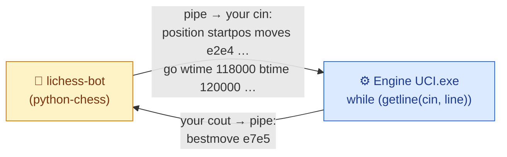
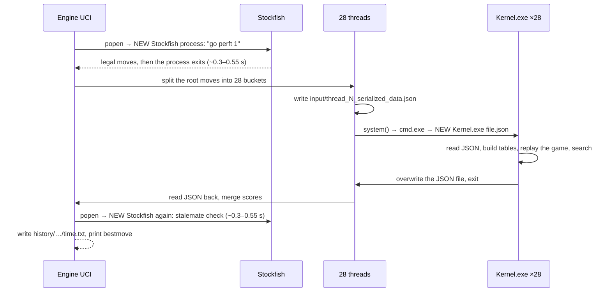
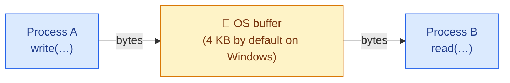

# 🎓 How Two Processes Talk — A Tutorial for Mr. Bits

**Written by Claude Opus 5.5, for Tareq.** 🤝 *October 23, 2026 · v2, October 25: corrected with what the prototypes measured on your laptop*

> 🗑️ **This is the temporary tutorial you asked for.** Delete it once you've learned it. The two plans (02 and 03) and the runbook (04) don't depend on it.

---

## 1. 🏷️ The name of the thing

<div style="background:#eff6ff;border-left:6px solid #2563eb;border-radius:10px;padding:12px 18px;margin:16px 0;color:#1e293b;">

**It's called IPC: Inter-Process Communication.** The specific technique you're describing ("Engine UCI gives the input to the Kernel directly") is **pipes**: connecting a child process's `stdin` and `stdout` to pipes owned by the parent.

It is **not** "pipelining". Pipelining means splitting work into stages that overlap in time, like a CPU working on several instructions at once, or an assembly line. Both words contain "pipe", so everyone mixes them up at first 😄.

</div>

The words you'll meet, translated into Mr. Bits:

| Term | Meaning | In Mr. Bits |
|---|---|---|
| **Process** | A running program with its own private memory | `Engine UCI.exe`, each `Kernel.exe`, Stockfish, lichess-bot |
| **Thread** | A line of execution *inside* a process, sharing that process's memory | The 28 `std::thread`s in Engine UCI, each waiting for one Kernel |
| **IPC** | Any way two processes exchange data | Today: JSON files |
| **Pipe** | A one-way byte channel the operating system manages, with a write end and a read end | How lichess-bot already talks to Engine UCI |
| **stdin / stdout / stderr** | The three standard streams every process is born with | `cin`, `cout`, `cerr` |
| **Redirection** | Connecting a child's stdin/stdout to pipes (or files) instead of the console | What python-chess does to Engine UCI |
| **Spawn** | Create a new process | `system()` → `cmd.exe` → `Kernel.exe` |
| **Handle** | Windows' name for an open file, pipe end or process | Each pipe has two: a read end and a write end |
| **Worker / worker pool** | Long-lived child processes that wait for jobs | The goal: N Kernels alive for the whole game |
| **Protocol** | The agreed message format | UCI, between lichess-bot and Engine UCI |
| **Framing** | How the reader knows where one message ends | In UCI: one command per line |
| **JSON Lines** (a.k.a. NDJSON) | One compact JSON object per line | The format for Engine UCI ⇄ Kernel |

---

## 2. 🧱 A process in 60 seconds

- **Every process has its own memory.** A `Kernel.exe` cannot read Engine UCI's variables, even on the same machine; the operating system forbids it. That isolation is a feature: one crash can't corrupt another program. It's also why your globals (`board`, `whitePieces`…) are safe in 28 processes and would *not* be safe in 28 threads.
- So when processes need to share data, **they need a channel the operating system provides**: a file, a pipe, a socket, shared memory…
- **Every process is born with three open "files":** `stdin` (number 0), `stdout` (1) and `stderr` (2). In a terminal they're the keyboard and the screen. But the parent that starts a process can connect them to *anything*: a file, or a pipe.

---

## 3. 😄 Surprise: you already wrote a pipe program

Look at Engine UCI's `main()`:

```cpp
while (getline(cin, line)) {             // read one command from stdin
    ...
    cout << "bestmove " << bestMove << "\n";   // answer on stdout
}
```

It never opens a file or a socket, yet lichess-bot talks to it all game long. How? lichess-bot uses python-chess, which starts `Engine UCI.exe` with its `stdin` and `stdout` **connected to pipes** (`SimpleEngine.popen_uci` in `lib/engine_wrapper.py`). python-chess writes `position …` and `go …` lines into one pipe and reads your `bestmove …` from the other.



**That's exactly the mechanism we want between Engine UCI and the Kernel.** You don't need to learn a new world, just the parent's side of it.

<div style="background:#f5f3ff;border-left:6px solid #7c3aed;border-radius:10px;padding:12px 18px;margin:16px 0;color:#1e293b;">

**🤓 A hidden detail that saved you, until it doesn't:** `cout << "bestmove ..." << "\n"` has no flush, and output to a pipe is buffered. So why does lichess-bot receive it immediately? Because in C++, **`cin` is "tied" to `cout`**: before every `getline(cin, …)`, the library flushes `cout` automatically. Your loop goes straight back to `getline` after printing, so the answer gets flushed by luck 😄.

The day you add work *after* the print (a log line, telemetry), that work runs **before** the move leaves. Measured ✅: 1.5 s of work after an unflushed `bestmove` made python-chess wait 2,399 ms instead of 907 ms. So: **flush explicitly after every message**, and don't rely on the tie. Tonight's `Engine UCI.cpp` does.

</div>

---

## 4. 🐢 What happens today, step by step (with measured costs)



Measured on your laptop with your real binaries ✅:

| Step | Cost |
|---|---|
| `cmd.exe` start (paid by every `system()` and `popen()`) | ~25 ms |
| One fresh Stockfish process answering `go perft 1` | **~0.55 s** on Oct 23 (worst run 2.0 s), **~0.31–0.34 s** on Oct 25: it depends on how busy the laptop is |
| The same query to a Stockfish kept alive and fed through pipes | **~0.2 ms** (0.18–0.29 ms) |
| One `Kernel.exe` with a 1 s budget: wall time vs. its own search time | 172 ms vs. 126 ms |
| 28 `Kernel.exe` at once: whole batch vs. search per worker | 537 ms vs. ~227 ms |
| The same 28 workers kept alive: one request to each and all 28 answers back | **~0.4 ms** (measured with dummy workers) |

So at a 1-second cap, a move costs ≈ **0.6–1.1 s of Stockfish launches + ≈ 0.3 s of Kernel launches + ≈ 0.25 s of real search**. That matches your lichess logs: moves with a 1 s cap took a median of 2.16 s. Most of each fast move is *startup*, not thinking.

<div style="background:#f8fafc;border-left:6px solid #475569;border-radius:10px;padding:12px 18px;margin:16px 0;color:#1e293b;">

**📜 History repeats:** in the 1990s, web servers ran a brand-new program for every web request ("CGI"). It was simple, and it was slow, because starting a process costs far more than the work it did. The fix was **FastCGI**: start the program once, keep it alive, and send it requests through a pipe or socket. That's exactly the move from "spawn `Kernel.exe` per move" to "a worker pool for the whole game". You re-invented CGI; now we upgrade to FastCGI 😄.

</div>

---

## 5. 🍽️ The menu of IPC mechanisms

| Mechanism | How it works | Speed | Difficulty | For Mr. Bits? |
|---|---|---|---|---|
| **Files** (today) | Writer writes a file; reader reads it after some signal (here: the process exiting) | Slow-ish, and forces a new process per message | Easy | ❌ Only as a fallback / debugging mode |
| **Anonymous pipes** + redirected stdin/stdout | Parent creates pipes; the child inherits them as its stdin/stdout | Microseconds per message (0.2 ms round trip with Stockfish, 0.4 ms for all 28 workers ✅) | Medium | ⭐ **The recommended choice** |
| **Named pipes** | A pipe with a name (`\\.\pipe\mrbits`) that any process can open | Same as pipes | Medium+ | If processes are started independently, or if you need a real read timeout (overlapped I/O, §6) |
| **Sockets** (TCP on `localhost`) | Like a network connection, on a port number | Fast (tens of µs) | Medium+ | If you want the same code on Linux (Nebius) or across machines |
| **Shared memory** (file mapping) | Both processes map the same RAM | Fastest (no copying at all) | Hard: needs locks and synchronization | Later: a transposition table shared by all workers |
| **Threads** (no IPC at all) | One process, shared memory | Fastest | Hardest for Mr. Bits: every global must become per-thread | The long-term option (doc 01's "thread-local state") |

---

## 6. 🔧 How a pipe works inside



Four rules explain almost every pipe bug:
1. **One-way.** A conversation needs **two pipes**: requests go into the child's stdin, answers come out of its stdout.
2. **A byte stream, not messages.** The reader can receive half a message, or two at once. You need **framing** (§7).
3. **Blocking.** `read` waits until data arrives. `write` waits if the buffer is full, i.e. if nobody is reading. On Windows, a read on an anonymous pipe **can't time out by itself**: it blocks until data arrives or every write end closes.
4. **End of file.** When *every* write end of a pipe is closed, including copies a child inherited by accident, the reader gets EOF. On Windows, `ReadFile` then fails with `ERROR_BROKEN_PIPE` (109), which `getline` turns into end of input. That's how an *idle* worker knows its parent is gone and exits. A worker in the middle of a search doesn't read stdin, so it doesn't notice: only the Job Object (step 7 below) stops it.

### Starting a child with pipes on Windows (the steps)

The prototypes (`ready-for-tonight/`) do all of this; here's what each step is for:

1. **`CreatePipe` twice**, one pipe for the child's stdin and one for its stdout. Pass `nSize = 65536`: the default is only 4 KB, and 64 KB pipes made big answers 4.5× faster ✅.
2. **Create both pipes non-inheritable** (`lpPipeAttributes = NULL`). Right before `CreateProcess`, make only the child's three handles inheritable (`SetHandleInformation(h, HANDLE_FLAG_INHERIT, HANDLE_FLAG_INHERIT)`), and pass a `STARTUPINFOEX` whose **`PROC_THREAD_ATTRIBUTE_HANDLE_LIST`** holds exactly those three (flag `EXTENDED_STARTUPINFO_PRESENT`). The child then inherits nothing else:
   - not its own stdin's write end (otherwise EOF never arrives: the classic bug);
   - not another worker's pipe ends. Measured ✅: 28 workers spawned in parallel without the list left 27 of 28 deaths undetectable, because a sibling held a copy of each one's stdout;
   - not Engine UCI's own stdin/stdout from python-chess (without the list, Python saw EOF 3 s late ✅).
3. **Fill the `STARTUPINFOEX`** (`StartupInfo.cb = sizeof(STARTUPINFOEX)`) with `STARTF_USESTDHANDLES`: `hStdInput` and `hStdOutput` = the child's pipe ends, `hStdError` = a log file opened with `FILE_APPEND_DATA` and `FILE_SHARE_READ | FILE_SHARE_WRITE` (one per worker, e.g. `logs/worker_7.stderr.log`). All three must be inheritable and listed once each, and the list must stay alive until `CreateProcess` returns.
4. **`CreateProcessW(fullExePath, writableQuotedCommandLine, …, bInheritHandles = TRUE, CREATE_SUSPENDED | DETACHED_PROCESS | EXTENDED_STARTUPINFO_PRESENT, …)`** starts `Kernel.exe` **directly**, with no `cmd.exe` in between.
   - `fullExePath` comes from the executable's own folder (plan 02, rule 8).
   - The command line quotes the path (`"C:\…\engines\Kernel.exe" --worker`), and it must sit in a writable buffer, because `CreateProcessW` may modify it.
   - `DETACHED_PROCESS` means no console window and no `conhost.exe` per worker (`CREATE_NO_WINDOW` would add one each).
   - No priority flag is needed: the child starts at NORMAL, and Kernel's `main()` raises itself to HIGH, as today.
   - One `CreateProcess` costs ~15–40 ms on this laptop, so start the pool once, never per move.
5. **Close the child's ends in the parent immediately after `CreateProcess` returns** (success or failure), before starting the next worker. An end left open means the parent never sees EOF when that worker dies, and the next child may inherit it.
6. **Talk with `WriteFile`** (loop until every byte is written) **and a small buffered `ReadFile` line reader** that splits on `\n` and drops one trailing `\r`. One line can take many `ReadFile` calls. `ReadFile` failing with `ERROR_BROKEN_PIPE` (109) means EOF; `WriteFile` failing with `ERROR_NO_DATA` (232) means the worker is dead. (Standard C++ streams can't wrap a Windows handle.)
7. **Put every worker in one Job Object**, created at startup:
   - `CreateJobObject`, then `SetInformationJobObject` with `JOB_OBJECT_LIMIT_KILL_ON_JOB_CLOSE | JOB_OBJECT_LIMIT_DIE_ON_UNHANDLED_EXCEPTION`;
   - start each worker `CREATE_SUSPENDED`, call `AssignProcessToJobObject`, then `ResumeThread`, so it never runs outside the job;
   - keep the job handle open (and non-inheritable) all game. When Engine UCI exits or is killed, even with `taskkill /F`, Windows kills every worker, busy or idle (0 of 28 alive 0.1 s later ✅). Without it, busy workers ran on for seconds.
   - If Engine UCI is already inside a job, Windows 8+ simply nests the new one ✅.

**And the read timeout?** Rule 3 says a read can't time out. The pool gives each worker **one reader thread** that pushes every line it reads into a queue. The move waits on a condition variable with a deadline (`wait_until`), and a worker still silent at the deadline is killed with `TerminateProcess`. That ends its reader's blocked `ReadFile` in ~1.2 ms ✅.

The Linux version (for Nebius one day) is `pipe()` + `fork()` + `dup2()` + `exec()`. Small portable libraries do it for both systems: **tiny-process-library** (MIT), **reproc** (MIT), or **Boost.Process**.

**Why not `popen`?** Your `Stockfish Handler.hpp` uses `popen`. It's one-way only (read *or* write), and it goes through `cmd.exe`. That's why the handler writes its commands into `temp_command_file.txt` and pipes the file in with `<`, starting a new Stockfish for every single question. It's also why `getBestMoveByDepth` sends its `go` twice: the end of the file acts as `quit` and stops a lone search at once (your theory, confirmed ✅).

### The shape of both sides (pseudo-code)

```
// Kernel.exe --worker  (the child)
build the move tables ONCE                    // a second build doubles every slider move
_setmode(stdout, binary); cout → stderr       // nothing but answers may reach stdout
while (getline(cin, line)):                   // one request per line
    strip a trailing '\r'
    request = parse(line)
    if request.type == "quit": break
    reset the game state, replay request.moves
    result = search(request.rootMoves, request.timeMs)
    fwrite(result.toOneLine()); fputc('\n'); fflush(stdout)   // one answer per line, flushed
```

```
// Engine UCI.exe  (the parent), once per game
job = createKillOnCloseJob()
for i in 1..N: worker[i] = spawnWithPipes(ExecutableDirectory() + "\\Kernel.exe", "--worker", job)
               writeLine(worker[i], hello)
wait (with a deadline) until every worker has answered ready

// every move
for each worker: writeLine(worker.stdin, request with a new id)
wait on a condition variable (deadline = timeMs + margin) until each reader thread has delivered the answer with that id
kill every worker still silent; respawn it after bestmove is printed AND flushed
```

---

## 7. ✂️ Framing: where does one message end?

A pipe delivers a *stream* of bytes, so you must agree on boundaries. There are two classic answers:
- **A delimiter:** one message per line, ended by `\n`. UCI does this.
- **A length prefix:** send 4 bytes with the size, then exactly that many bytes.

**Recommendation: JSON Lines**, one JSON object per line. You already use nlohmann/json, so:

```
{"type":"search","id":4127,"moves":["e2e4","e7e5","g1f3"],"rootMoves":["f1e1","h2h3"],"timeMs":1000}
{"type":"result","id":4127,"status":"ok","bestMove":"h2h3","score":-135,"depth":8,"searchMs":226}
```

⚠️ Use `json.dump()` **without** an indent. Your current `dump(4)` pretty-prints one object over many lines: fine for a file, wrong for line framing. Newlines *inside* strings (like your Kernel's report) are escaped as `\n` by the JSON library, so they're safe.

Three Windows traps, all hit by the prototypes ✅:
- **`\r\n`:** a child's stdout is in text mode, so each `\n` arrives as `\r\n`. Strip one trailing `\r` from every line you read (python-chess does the same), especially before comparing with strings like `readyok`. The child's text-mode `cin` already turns `\r\n` into `\n`.
- **Invalid UTF-8:** a plain `dump()` throws `type_error.316` on a string that isn't valid UTF-8. In the worker, use `dump(-1, ' ', false, nlohmann::json::error_handler_t::replace)`.
- **Byte `0x1A`:** in text mode it means end of file. A worker that receives one quietly exits. JSON escapes it, so it can't happen through `dump()`; never write raw bytes into a worker's stdin.

---

## 8. 🐛 The nine classic pipe bugs (six classics + three Windows ones)

<div style="background:#fef2f2;border-left:6px solid #dc2626;border-radius:10px;padding:12px 18px;margin:16px 0;color:#1e293b;">

1. **Forgot to flush** → the answer sits in a buffer and both sides wait forever, or it leaves late: Engine UCI's `bestmove` only goes out at the next `getline` (§3). Flush after every message.
2. **Stray output on stdout** → the protocol is corrupted. A worker's stdout must carry *only* protocol messages. Today `Kernel.cpp` contains prints in a few places ("Insufficient argument provided.", the old console dialog, `PrintTheBoard`'s `W`/`B`/`.`, the old `cout` report), but only the first one can run (when `argc < 2`). Keep the others unused in worker mode, and send debugging to `stderr` or a log file.
3. **Full-buffer deadlock** → the child writes lots of output that nobody reads, its buffer fills (only 4 KB by default for `CreatePipe(…, 0)`; pass 65536), and it blocks while the parent waits for it. Give each worker a reader thread that always drains its stdout, and send stderr to a file, never to a pipe nobody reads. The mirror case exists too: a request bigger than the buffer blocks the parent's `WriteFile` until the worker reads, so keep one request in flight per worker.
4. **Inherited handle leak** → a child keeps a copy of a pipe end it shouldn't have.
   - If it's **its own stdin's write end**, it never gets EOF.
   - If it's a **sibling worker's stdout write end**, killing or crashing that sibling is never noticed (measured: 27 of 28 workers with parallel spawns).
   - If it's **Engine UCI's own stdout** to python-chess, that pipe stays open after Engine UCI exits.

   The fix is `PROC_THREAD_ATTRIBUTE_HANDLE_LIST` with exactly the child's three handles (step 2 in §6).
5. **Partial reads** → always read up to the `\n`, never "one read = one message".
6. **Orphan processes** → if the parent crashes, workers keep running. Use a Job Object (step 7 in §6).
7. **Hung worker** → `ReadFile` on an anonymous pipe has no timeout. Wait for answers with a deadline (a reader thread + a condition variable), then `TerminateProcess` the silent worker; that ends the blocked read with `ERROR_BROKEN_PIPE`.
8. **`\r\n` line endings** → a text-mode child's `\n` arrives as `\r\n`. Strip the `\r`, or `"readyok\r" == "readyok"` is false.
9. **Writing to a dead worker** → `WriteFile` fails with `ERROR_NO_DATA` (232): treat that as "worker died". On Linux the same event is `SIGPIPE`, which kills the parent unless it's ignored.

</div>

---

## 9. 🎯 The whole lesson in four lines

1. You already wrote a pipe-based program: Engine UCI talking to lichess-bot.
2. Today Engine UCI talks to the Kernel with **files**, and pays to **start a new process every time** (and starts Stockfish from scratch twice per move).
3. Best practice is to **start once and talk over pipes**: a worker pool, one compact message per line, flushed, with a deadline on every answer.
4. The measured payoff for one Stockfish question is **0.3–0.55 s → 0.2 ms**, and a move Stockfish plays went from **670 ms to 80 ms** end to end. Plan 02 turns that into a step-by-step migration, and runbook 04 into tonight's checklist.

— **Claude Opus 5.5** 🤖
