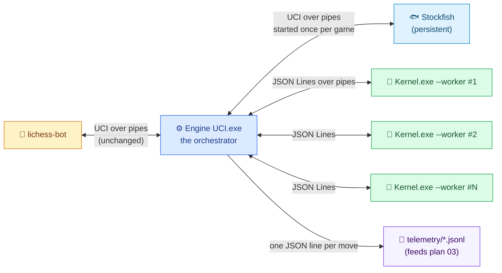
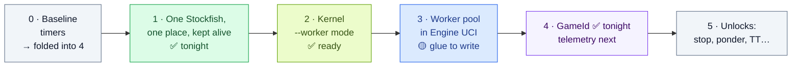

# 🔌 Plan — Fast Communication Between Engine UCI, the Kernel and Stockfish

**Written by Claude Opus 5.5, for Tareq.** 🤝 *October 23, 2026 · **v2, October 25:** every phase reviewed and prototyped on copies · tonight's exact steps are in `04 - Runbook for Tonight.md`*

<div style="background:#ecfdf5;border-left:6px solid #059669;border-radius:10px;padding:12px 18px;margin:16px 0;color:#1e293b;">

**✅ The plan in one paragraph:** start **one Stockfish** and **N Kernel workers** once per game, connect them to Engine UCI with pipes, and send each one a single line per move instead of files and fresh processes. Do it in safe steps. The persistent Stockfish comes first, because it's the biggest win for the smallest change: **Stockfish-played moves went from 670 ms to 80 ms** in the end-to-end test. Keep the old file mode as a switch until the new path has proven it gives identical answers.

</div>

<div style="background:#eff6ff;border-left:6px solid #2563eb;border-radius:10px;padding:12px 18px;margin:16px 0;color:#1e293b;">

**🔬 What the October 25 review changed** (8 agents, then my own integration build):
- **Every phase was prototyped on copies** of your real files, and Phase 1 + GameId were **merged into one tested `Engine UCI.cpp`** that passed the python-chess smoke test. It's waiting in `ready-for-tonight/engines/`. The status of each phase is shown below.
- **5 traps that would have bitten tonight**, now in the steps: (1) `cmd.exe` quoting breaks absolute paths; (2) `input\` and `history\` must hang off the *parent* folder; (3) the ownership trap is bigger than I wrote: 58 handlers per move; (4) **Windows Smart App Control is ON** and judges every new `.exe`, so each rebuild can be blocked; (5) `bestmove` isn't flushed, so anything done after it is on your clock.
- **2 latent bugs in today's code**, found and fixed in tonight's file: a failed Kernel launch can make Engine UCI play `bestmove It should be a default value…`, and the engine crashes when Stockfish isn't found.
- **Corrected numbers:** a fresh Stockfish costs **0.3–0.55 s depending on load**, not a flat 0.55 s. A query to the kept-alive one costs **~0.2 ms**.

</div>

---

## 1. 🎯 Target architecture



lichess-bot starts **one Engine UCI process per game** (`play_game` → `engine_wrapper.create_engine`), so "alive for the whole game" comes for free: Engine UCI starts its helpers once, and they all exit when the game ends. ⚠️ It also starts Engine UCI **once at bot startup**, only to check it (`lichess-bot.py` 1131–1133: handshake, `isready`, `quit`). Anything Engine UCI starts must survive that quick open-and-close, and `quit` must never wait for it.

### Design rules

1. **Start once, reuse forever.** No `system()`, no `popen()`, no `cmd.exe`, no temp files on the hot path.
2. **Engine UCI is the only boss.** Workers never talk to each other or to lichess-bot.
3. **A child's stdout carries protocol messages only.** Logs go to a file. (lichess-bot throws the engine's own `stderr` away: in this version `silence_stderr: false` means `DEVNULL`.)
4. **One message per line, flushed the moment it's written** (JSON Lines). Slow work only *after* the flush.
5. **Every message has an `id`**, so a late answer from a timed-out worker can never be mistaken for the current move's answer.
6. **Everything is measured.** Timings go into the telemetry (plan 03), so every improvement is a number, not a feeling.
7. **The old path stays behind a switch** until the new one gives identical answers.
8. **Paths come from the executable's own folder, never from the working directory.** That's the cure for the path problem behind your duplicate Stockfish package (Phase 1a).

---

## 2. 📏 Where the time goes today (measured ✅)

| Per move | Oct 23 | Oct 25 (laptop shared with other agents) | After this plan |
|---|---|---|---|
| Starting Stockfish for the legal moves (`go perft 1`) | ~0.55 s | ~0.31–0.34 s median (max 0.74 s) | **~0.0002 s** ✅ measured |
| Starting Stockfish again: the stalemate check (Kernel moves) or the depth search (Stockfish moves) | ~0.55 s | ~0.31–0.34 s | **~0.0002 s** for the check ✅; the `go depth 10` search itself: 4.5 ms ✅ |
| Starting 28 Kernels (`cmd.exe` + process + JSON), beyond their search | ~0.3 s | — | **~0.4 ms** per move ✅ (pool round trip with dummy workers; real Kernels pending) |
| The actual search inside the workers | ~0.23 s | — | the same (maybe less with less CPU contention) |
| **Total, measured in your lichess logs at a 1 s cap** | **median 2.16 s** | — | **≈ 0.3 s** 🟡 estimate |

**End to end on October 25** ✅ (real python-chess, the exact calls lichess-bot makes, scratch copies; the smoke test's clock is 9 s + 3 s):

| | Today's handler | Tonight's `Engine UCI.cpp` (Phase 1 + GameId) |
|---|---|---|
| A move Stockfish plays (opening, endgame) | 670–675 ms | **77–84 ms** |
| A Kernel move (28 workers) | median 2.49 s (4 samples) | median **2.21 s** (8 samples; the 28 Kernel starts stay until Phase 3) |
| Stockfish processes per game | 2 new ones per move | **exactly 1**, alive all game, gone after `quit` |

---

## 3. 📜 The protocol (Engine UCI ⇄ Kernel worker)

Every message is one line of compact JSON. The prototype (`ready-for-tonight/stretch-phase2-kernel-worker/`) speaks exactly this; it's shown pretty here only for reading.

**Handshake**, once, when the worker starts:

```json
{"type":"hello"}
{"type":"ready","protocol":1,"engineVersion":"kernel-worker-prototype-2026-10-25","pid":22552,"initMs":0.409}
```

**A search request**, once per move per worker:

```json
{"type":"search","id":4127,"gameId":"tN252leL","ply":23,"engineColor":true,
 "moves":["e2e4","e7e5","g1f3","b8c6","f1c4","f8c5"],
 "rootMoves":["f1e1","h2h3"],"timeMs":1000,"maxDepth":0}
```

*(Shortened for reading: the real request for ply 23 carries all 22 moves played so far, so `ply` = `len(moves)` + 1. Don't "fix" it to ply 7: after these 6 moves `f1e1` isn't even legal.)*

**The answer:**

```json
{"type":"result","id":4127,"status":"ok","bestMove":"h2h3","score":-135,"depth":8,
 "setupMs":0.1,"searchMs":226,"nodes":2104019,"leafNodes":1951300,"pruned":120884,"totalNodes":2161000,
 "perDepth":[{"depth":2,"completed":true,"ms":1,"nodes":1300,"leafNodes":1210,"pruned":41,"bestMove":"h2h3","score":-20},
             {"depth":4,"completed":true,"ms":6,"nodes":38104,"leafNodes":35100,"pruned":2212,"bestMove":"f1e1","score":-90}],
 "rootScores":[{"move":"h2h3","score":-135,"exact":true},{"move":"f1e1","score":-160,"exact":false}]}
```

*(The `perDepth` list is shortened too: the real one goes up to the final `depth`.)*

**Other messages:** `{"type":"quit"}`, later `{"type":"stop","id":4127}` (Phase 5), and from the worker `{"type":"error","id":4127,"message":"..."}`. `status` can also be `no_moves` or `no_completed_depth`: treat both as "no answer". (Today's file mode answers `a8a8` with score 0 in those cases, which could win a merge.)

What the fields are for:
- **`id`**: matches answers to questions; stale answers get ignored.
- **`timeMs`**: today's budget (`allowedEngineTimeInSeconds` × 1000). It keeps today's behavior exactly: a hard cap checked at every node, and no new depth once 5% of the budget is used.
- **`maxDepth`**: 0 means "use the time budget". A fixed depth is deterministic only if time can't interfere, because every node checks the clock (`Kernel.cpp` 2784, 2937) and `main` stops deepening at 5% (3399). So `maxDepth` > 0 **switches the clock off** (a huge budget), skips the 5% rule and stops after that depth; `timeMs` is then ignored. Only even depths are searched (the loop steps by 2, line 3376), so 5 means 4. ✅ Tested: without this, `maxDepth` 8 under a 300 ms budget silently returned the depth-6 answer.
- **`perDepth`**: one entry per completed iteration, copied from `theFinalCompletedProcessHandler` right after each depth (line 3387). Your `ProcessHandler` arrays (`theNumberOfAllStatesForEachDepth[51]`…) can't provide it on their own: they're indexed by the *remaining* depth inside one search, and they're wiped at the start of every iteration (3170). The prototype adds them per iteration as `statesByRemainingDepth` / `prunedByRemainingDepth`.
- **`rootScores`**: the score of every root move the worker searched, so the dashboard can show "what else was considered". ⚠️ With alpha-beta at the root, a score is **exact** only if it beat the best score so far when that move was searched: always true for the first move searched and for the best move. The others failed low and are upper bounds ("at most this"), hence `exact = (score > alphaBefore)` ✅ (126 exact scores checked against full-window searches: 0 wrong). From depth 6 on only the 4 best-ordered root moves are searched, so the others are listed in `unsearchedRootMoves`.
- **`nodes` / `pruned`**: 64-bit. The existing getters sum with an `int` start value (`accumulate(…, 0)` at 533 and 545) and would wrap negative above 2,147,483,647 nodes in one iteration; the prototype uses `0LL`.
- **`setupMs` vs `searchMs`**: replaying the game vs thinking. Replaying even a 200-ply game takes 0.11 ms ✅.

---

## 4. 🛣️ The phases



### Phase 0 — Baseline timers → folded into Phase 4

**Status:** not needed as a separate step. Tonight's `Engine UCI.cpp` logs `go -> bestmove took N ms` for every move (`logs\uci_*.log`), and the smoke test gives a before/after on the same moves.

The per-stage stopwatch moves into Phase 4's telemetry. Note where the stages really are: legal moves, the Stockfish search, dispatch, waiting and merge all happen inside **`ChessState::getEngineMoveWithThreading`** (191, 214–245, 249–310, 312–314, 316–336), so time them there and **add** (`+=`) them to `ChessState` members (the stalemate override calls it twice). The stalemate check (632), the report and the total belong to `getBestMoveFromEngine`.

### Phase 1 — Stockfish: one copy, in one place, kept alive ⭐ the biggest win

#### 1a · One Stockfish, in one place 🧹

**Status ✅:** prototyped (proto-uci-gameid: 4 legal moves from the root, from a foreign folder and from a path with spaces) and merged into tonight's file.

**What's on disk today** (checked again October 25 ✅). All four files are **byte-identical** (41,409,024 bytes, Stockfish 16), and **all four are committed to git**: 165.6 MB, of which 124.2 MB are duplicates:

| Copy | What uses it | Verdict |
|---|---|---|
| `lichess-bot-master/engines/stockfish/stockfish-windows-x86-64-avx2.exe` (inside a full Stockfish package: `src/`, `wiki/`, licence…) | `Stockfish Handler Testing.cpp` run from `engines/`, and Engine UCI run by hand from `engines/` (its Stockfish moves work; its first Kernel move crashes) | ⭐ **Keep: the one home.** It sits next to `Engine UCI.exe`, the program that queries it (`Kernel.exe` includes the same header but never calls Stockfish) |
| `lichess-bot-master/stockfish/stockfish-windows-x86-64-avx2.exe` (inside a second copy of the same package) | **Today's live bot**: lichess-bot starts Engine UCI from `lichess-bot-master/` | 🗑️ Delete the whole duplicate folder, **only after** the path fix |
| `lichess-bot-master/engines/stockfish-windows-x86-64-avx2.exe` | Nothing | 🗑️ Delete |
| `lichess-bot-master/stockfish-windows-x86-64-avx2.exe` | Nothing | 🗑️ Delete |

<div style="background:#fffbeb;border-left:6px solid #d97706;border-radius:10px;padding:12px 18px;margin:16px 0;color:#1e293b;">

**🔍 The root cause of your path problem:** a relative path like `"stockfish/stockfish-windows-x86-64-avx2.exe"` is resolved against the **current working directory**, i.e. the folder the program was *launched from*, not the folder where the `.exe` lives. lichess-bot launches Engine UCI from `lichess-bot-master/` (`working_dir: ""` in `config.yml`), so it uses `lichess-bot-master/stockfish/`. Launched by hand from `engines/`, Engine UCI finds `engines/stockfish/`, but it crashes on its first Kernel move, because `.\engines\Kernel.exe` and `input/` are relative too ✅ reproduced. So the package got copied to both places 😄. And when **no** copy is reachable, today's engine doesn't report an error: it crashes with an access violation (0xC0000005) on the first `go`, because `getAllPossibleMoves` pops 20 characters off an empty string ✅ reproduced.

**The real fix:** build paths from the **executable's own location**. `GetModuleFileNameA(NULL, …)` returns the full path of `Engine UCI.exe`, whose folder is `engines/`. Join the file names to that, and the path is right no matter who launched the engine or from where.

</div>

Steps (all done in tonight's file ✅):
1. **Two helpers:** `ExecutableDirectory()` (`GetModuleFileNameA`, then drop the file name) = `engines\`, and `RootDirectory()` = its parent = `lichess-bot-master\`. Then:
   - Stockfish = `ExecutableDirectory()\stockfish\stockfish-windows-x86-64-avx2.exe`, and Kernel = `ExecutableDirectory()\Kernel.exe` (not `…\engines\Kernel.exe`);
   - `input\`, `history\`, `logs\` and later `telemetry\` = under `RootDirectory()`, exactly where they are today. That covers lines 284, 396, 415, 447 and 470.
   - **Create `input\` and `logs\` at startup.** `ofstream` never creates folders, and a missing `input\` kills the engine on its first Kernel move ✅ reproduced. A fresh clone won't have it, because it's git-ignored.
2. ⚠️ **`cmd.exe` quoting.** `executeExeFileWithArguments` puts `.\` in front of the path (line 362), which breaks an absolute path. Worse, `cmd /c` strips the first and the last quote of the line, so the natural `"C:\…\Kernel.exe" "C:\…\thread_1.json"` fails **even without spaces** ✅ tested. Drop the prefix, and wrap the whole line in **one extra pair of quotes**: `""C:\…\Kernel.exe" "C:\…\input\thread_1_serialized_data.json""` ✅ tested, also with spaces in both paths. (Phase 3 replaces `system()` with `CreateProcess` anyway.)
3. ⚠️ **Check `system()`'s result.** It returns Kernel's exit code. Today a failed launch is silent: Engine UCI reads back its own request file, whose `bestMove` is the placeholder `It should be a default value like the previous line…` with score 0. That placeholder **wins the merge whenever every real score is negative**, and Engine UCI plays it as its move ✅ reproduced. Tonight's file accepts a thread's answer only if `Kernel.exe` exited 0 **and** picked one of that thread's own root moves. An unreadable file is caught instead of crashing a thread. If no thread answered at all, Stockfish (depth 14) plays the move, and the log says why ✅ tested with `Kernel.exe` removed.
4. **Log the paths at startup** (`logs\uci_<date>_pid<pid>.log`): exe folder, root folder, working directory, and the Stockfish, Kernel and input paths, each marked `<-- MISSING` if absent.
5. **Rebuild, then launch-test the new `.exe` at once** (Smart App Control, see §5), and test both ways: from `lichess-bot-master\` and from an unrelated folder. Include **a Kernel move** (plies 4–80); opening moves never touch the Kernel, so they prove nothing. To *prove* nothing still uses the other copies, rename them to `.old` during the test.
6. **Check the neural-network lab first.** A repo-wide search showed that two of its report files name `stockfish-windows-x86-64-avx2.exe` (I didn't open that folder). Make sure it uses `engines/stockfish/` before anything is deleted.
7. **Delete the three other copies** and the duplicate folder with `git rm`. ⚠️ Not before the path fix: with only `engines/stockfish/` present, *today's* engine started from `lichess-bot-master/` crashes on its first move ✅. And before the new repo's first commit, add `!lichess-bot-master/engines/stockfish/*.txt` right after `.gitignore` line 3 (`*.txt`). That rule hides the package's licence `Copying.txt` (GPL v3) and `Top CPU Contributors.txt`, so only 73 of its 75 files are tracked today.

**Exit:** exactly one Stockfish in the repo, the engine finds it from any working directory, the smoke test passes with the duplicates renamed, and a live game passes.

#### 1b · Keep it alive

**Status ✅:** prototyped (`StockfishProcess.hpp`: 140/140 identical answers, 19/19 kill-and-recovery tests), merged into tonight's file, and run end to end through python-chess (one Stockfish per game, none left behind).

It replaces only `Stockfish Handler.hpp`, with a 10-line shim that keeps the class name and every public function (`getAllPossibleMoves`, `getBestMoveByDepth`, `isTiePosition`, `isCheckmatePosition`…). Engine UCI, Kernel and the tester compile unchanged on top of it:
- **Start once** with `CreateProcess` and two pipes (tutorial §6), `stderr` to `NUL`, inside a Job Object with "kill on close". Handshake: send `uci` and skip the startup banner until `uciok`, then `isready` → `readyok`.
- **Framing**, from raw byte captures ✅: read whole lines and strip the `\r` (Stockfish writes CRLF).
  - **Before each query**, send `isready` and read to `readyok`. That drains what the last answer left behind: `perft` and `eval` end with a blank line. It's valid because no search runs between queries.
  - Then read each command to its own terminator: `go perft 1` → `Nodes searched` (accept only move-shaped lines like `e2e4: 1`), `go depth N` → `bestmove`, `eval` → `Final evaluation` (in check it's `Final evaluation: none (in check)`, with no blank line).
  - ⚠️ `isready` is **not** a barrier while a `go` runs: `readyok` arrived *before* the perft output, because perft runs on the search thread.
- **Before each `go depth N`: `ucinewgame` + `isready`, then ONE `go depth N`.** That reproduces a fresh process exactly (same move, same node count ✅). It is *not* always today's answer, though.
  - Today's double command perturbs the first search: its second `position` line runs while search 1 is running, and every replayed move adds 1 to the searching thread's node counter, which feeds Stockfish's `value_draw()`. So **~1.5% of today's bestmoves are slightly random** (5 of 340 comparisons).
  - A **legacy-compat switch** (send `position` again right after `go`) matches today 480/480 ✅. Use it to *prove* equality, then ship the clean mode.
- **Why the double command existed** (your theory, **confirmed** ✅): with stdin redirected from a file, end-of-file acts as `quit` (Stockfish `uci.cpp:247`), which stops the search at once. A single `go depth 15` from a file prints no info line and returns `bestmove a2a3`, the first generated move, unsearched. The second `go` waits for search 1 to finish (`thread.cpp:172`). Any `popen` version must keep it.
- ⚠️ **Ownership trap, bigger than it looks:** every `ChessState` holds a `StockfishHandler` *by value*, and they get built all the time. One Kernel move constructs **58 handlers** (29 `ChessState()` calls, 2 each), plus 56 copies and 28 moves, and every `Kernel.exe` run builds 4 more ✅ counted.
  - So the process lives in **ONE process-wide singleton**: a function-local static `SharedStockfish()`, started on first use or at `isready`, and told `quit` at exit. **Never** start it in a constructor (that would launch 58 Stockfish processes per move).
  - `StockfishHandler` becomes a cheap, copyable facade that forwards to the singleton, so `ChessState` can keep holding it by value. Kernel.exe never queries it, so it never starts a Stockfish.
- **One mutex** around every query: 8 threads × 50 mixed queries gave 0 wrong answers ✅.
- **A watchdog per query** (10 s for perft/eval/isready, 300 s for `go depth`, adjustable with `setTimeouts`) kills a hung Stockfish, so a hang becomes a death. A death means **restart once and retry** (~0.3 s). A second failure throws; tonight's Engine UCI writes the reason to its log. There is **no popen fallback**: it would hit the same missing or blocked `.exe`, and it has no watchdog.
- **Start it at `isready`** (tonight's file does), so it's running before the first `go`. lichess-bot's startup check also sends `isready`, so a missing or blocked Stockfish shows up **when the bot starts**, not in the middle of a game. (`readyok` takes ~0.3 s once, or ~1.5 s right after Stockfish was copied, while the antivirus scans it.)
- **Keep today's meaning** of the checks: `isTiePosition` = **stalemate only** (no threefold, 50-move or insufficient-material draws, despite its comment). `isCheckmatePosition` / `isStalematePosition` are never called by Engine UCI, and `isStalematePosition` is a stub that always returns false. Real draw detection is a separate change.
- **Don't start or restart Stockfish while Kernel threads are spawning:** `system()` inherits every inheritable handle. Today's flow is safe: perft runs before the threads start, and the stalemate check after they're joined. The class creates its pipes non-inheritable and makes Stockfish's ends inheritable only around its own `CreateProcess`.
- **What disappears with it:** the 0.3–0.55 s per query, `temp_command_file.txt` (and its latent race when 2+ engines share a folder), and the double-command trick.

**Exit:** legal moves, stalemate, checkmate and eval identical **100%** (140/140 ✅); bestmove identical with legacy-compat on (480/480 ✅) and ~1–2% different clean-Stockfish moves with it off; Stockfish moves ~8× faster in the end-to-end test (670 → 80 ms ✅).

### Phase 2 — `Kernel.exe --worker`

**Status ✅ ready:** prototype in `ready-for-tonight/stretch-phase2-kernel-worker/` (+368 / −27 lines). 0 mismatches over 288 shuffled requests against fresh processes, 72/72 against your untouched production binary, flat memory over 11,000 requests, and it also builds and passes with tonight's new header ✅.

- `Kernel.exe --worker` runs the request loop (tutorial §6). `Kernel.exe <file.json>` stays exactly as today, as the fallback and for A/B tests. It gains **one optional key**, `maxDepth` (absent or 0 = today's behavior; Engine UCI never writes it), and its output keys stay the same.
- **Build the tables once per process.** ⚠️ A hard requirement: `MovesPreCalculation()` only `push_back`s into `preCalculatedMoves`, so a second call doubles every ray table and makes every **bishop, rook and queen** move appear twice (pawns, knights and kings read only ray `[0]`, lines 1753 and 1826). The symptom is silent: the same move and score, but more nodes and time with every request (33 → 45 pseudo-legal moves after a second call; at depth 6 the worker hung). Guard the call with a static flag. (Building them takes only ~0.5 ms; today's per-launch cost is the process, `cmd.exe` and DLL loading.)
- **Reset the game state per request** (`ResetGameState`), **in this order**:
  1. `ENGINE_COLOR` = the request's color, **first**: `InitializeEngineScore()` / `InitializeOpponentScore()` read it (1019, 1037), and so does `MakeChanges` during the replay;
  2. `BoardInitialization()` (it already clears the board and the move counters ✅), the two masks (`blackPieces = (1ll<<16)-1; whitePieces = blackPieces<<48;`), then the two score functions;
  3. `previousMoves.clear()` and `processHandler = ProcessHandler()`;
  4. **then** `processHandler.setAllowedTime(…)`: the reset puts the budget back to 10,000 ms, and `setAllowedTime` takes **seconds**. ⚠️ Dropping the reset in at today's line 3372, after 3368, would silently give every worker a 10 s budget;
  5. replay the moves, and call `setAllProcessStartTime()` right before the depth loop (as at 3373).

  The mutation test showed which ones matter ✅: forgetting the board, the masks, the color or the scores gives **wrong answers silently** (632 / 604 / 322 / 143 mismatches). `previousMoves.clear()` and the `processHandler` reset changed no result (hygiene: memory growth, stale counters). Keep them anyway.
- **Clean stdout.** Good news: today only `"Insufficient argument provided."` (3346, when `argc < 2`) can actually print. The console dialog (101), `PrintTheBoard` (988) and `showFinalReport` (657) are never called. The real hazards are elsewhere:
  - line 550 (reached through the report at 703) switches `cout` to fixed/precision 5 for the rest of the process;
  - Windows text mode turns `\n` into `\r\n`;
  - under Git Bash, Kernel loads **Git's** `libstdc++-6.dll`, which uses a different C runtime, so `_setmode` doesn't even reach `cout`.

  So at worker start: `cout.rdbuf(cerr.rdbuf())` (a guard against future debug prints), `_setmode(_fileno(stdout), _O_BINARY)`, then write each answer with `fwrite` + `fputc('\n')` + `fflush(stdout)`. Every line then ends in a bare `\n` ✅.
- **Answer** with `dump(-1, ' ', false, json::error_handler_t::replace)`: a plain `dump()` throws `type_error.316` on invalid UTF-8. Catch every exception per request and reply `{"type":"error",…}` ✅ tested with garbage bytes.
- **`rootScores`**: recorded inside `GetBestMoveWithItsScore` (3167–3214), the loop where each move's score exists (`GetBestMoveAndItsScoreToInitializeProcessHandler` only orders and cuts the list). Keep the list of the last **completed** depth: in time mode the last iteration is aborted, and Magic returns 0 once the clock runs out.
- **Build flags:** production is plain `g++ Kernel.cpp` (that's `-O0`). `-O2 -march=native` gave **bit-identical answers on all 144 test requests and a 3.6× faster search** ✅. That's a free strength gain to decide on separately: `-march=native` ties the binary to this CPU, so build without it for another machine.

**Exit** ✅ (all passed on the prototype):
1. **A/B at a fixed `maxDepth`:** file mode with one fresh process per request vs **ONE** worker taking all requests, each twice, in shuffled order, both colors. Compare `bestMove`, score, nodes, leaf nodes and pruned; ignore `searchMs`, `setupMs` and `perDepth[].ms`. (Repeats alone miss leaks: a stale color gave 0 repeat differences, and only the comparison with file mode caught it.)
2. **10,000 requests** with flat private memory.

### Phase 3 — The worker pool inside Engine UCI

**Status 🟡:** the pool is prototyped and measured with dummy workers (`ready-for-tonight/stretch-phase3-pool/`: `ChildProcess.hpp` + `WorkerPool.hpp`). The **glue inside Engine UCI is not written yet**: about 150–250 lines plus tests, its own session.

- **`ChildProcess`:** start with pipes (STARTUPINFOEX + `PROC_THREAD_ATTRIBUTE_HANDLE_LIST`, stderr to a log file, created suspended and resumed only once it's in the Job Object), write a line, read a line (blocking), kill.
  - ⚠️ **Anonymous pipes have no overlapped I/O, so a read can't time out by itself.** The pool gives every worker **one reader thread** that pushes each line into a queue. The move waits on a condition variable with `wait_until(deadline)`, and a worker still silent at the deadline is killed with `TerminateProcess`. That ends its reader's blocked `ReadFile` with `ERROR_BROKEN_PIPE` in ~1.2 ms ✅ (101/101 exact timeouts).
  - The rejected options, measured: `CancelSynchronousIo` loses a cancel that arrives before the thread is inside `ReadFile`, and leaves the hung worker alive. `PeekNamedPipe` polling costs 15.6 ms per message, because `Sleep(1)` really sleeps 15.6 ms here. (Alternative: a named pipe opened with `FILE_FLAG_OVERLAPPED`.)
- **`WorkerPool`:** ONE global (never a `ChessState` member, same trap as Stockfish).
  - **Start** it as soon as Engine UCI starts, in a background thread that the first `go` joins. Measured: 0.40–0.47 s for 28 small workers, almost all of it `CreateProcess`. The real 2 MB `Kernel.exe` costs 22–40 ms per launch here, so expect ~0.6–1.1 s, about 1.8× less when started from several threads (the handle list makes that safe). python-chess allows 10 s for `uci` → `uciok`.
  - ⚠️ **Shutdown:** lichess-bot's startup check opens and closes Engine UCI at once, so `quit` must kill a half-started pool immediately (the Job Object) and never wait for the workers' handshakes. python-chess waits at most 10 s for the engine to exit, and a timeout there stops lichess-bot from starting.
- **Per move:** the same shuffle and round-robin split as today, then **one call** writes a request per bucket and waits for all the answers: `pool.roundTrip(lines, ids, timeMs + margin)`. Measured **0.36–0.41 ms** for 28 workers, vs 1.5–2.2 ms just for creating 28 `std::thread`s per move as today ✅.
- **Timeouts:** kill a late worker at once, without waiting inside the move.
  - The margin must cover the worker's own overrun plus Windows timer slack: the wait wakes ~10 ms late on median and ~26 ms at p99, or ~1.5 ms after `timeBeginPeriod(1)`.
  - **Respawn only after `bestmove` is printed and flushed** (~25 ms per worker with a dummy).
  - The late worker's moves are ignored for this move (or re-dispatched), and an event is written (plan 03).
- **Details that matter:** `DETACHED_PROCESS` (`CREATE_NO_WINDOW` adds one `conhost.exe` per worker); 64 KB pipes (big answers 4.5× faster than with the 4 KB default); each worker's stderr goes to its own log file; stale ids and stray non-JSON lines are dropped and counted. Until Phase 1b's code removes the last `system()`/`popen()` calls, never let them run during a spawn: hold the spawn mutex.
- **Fallback:** if the pool can't start, use the old file mode for the whole game and log why. ⚠️ If the reason is `CreateProcessW` error **4551**, Smart App Control blocked this `Kernel.exe`, and file mode would run the same blocked file. Rebuild, and launch the new one once by hand first.
- **For tests only:** seed the shuffle from the request, so a test position always produces the same split.

**Exit:** rerun the pool's hang, crash and bench tests against the real Kernel worker; then a match against the old build with no regression, overhead (total time − the slowest worker's search) under **50 ms per move**, and 0 crashes or timeouts over 50 games.

### Phase 4 — GameId + telemetry: the bridge to plan 03

**Status:** the GameId part is ✅ prototyped with the real python-chess and lichess-bot's own `create_engine`, and merged into tonight's file. Telemetry is not started.

- In the `uci` reply, declare `option name GameId type string default <empty>` and `option name UCI_Opponent type string default <empty>`.
  - python-chess stores whatever follows `default` literally, so treat `''`, `<empty>` and `none` as "no game id".
  - Compare option names case-insensitively, and take everything after ` value ` (possibly empty) as the value.
- **The real wire order** (python-chess 1.10.0, logged ✅):
  1. `uci` → `uciok`;
  2. `setoption name GameId value …` (when lichess-bot creates the engine);
  3. at the first move: `ucinewgame`, `setoption name UCI_Opponent value BOT 1692 computer Demolito_L4`, `isready`, `position startpos`, `go movetime 10000` (the first move of each side);
  4. later moves: `go wtime … btime … winc … binc …`;
  5. at the end: `isready` + `quit`. No result is ever sent.

  **GameId arrives *before* `ucinewgame`**, so never clear it (or UCI_Opponent) on `ucinewgame`. UCI_Opponent's format is `<title|none> <rating|none> <computer|human> <name>`, and the name may contain spaces (`none none computer AI level 8`).
- **Then, and only then,** in `extra_game_handlers.py` (lichess-bot's official customization file), make `game_specific_options` return `{"GameId": game.id}`, spelled exactly `GameId`. (python-chess replays a stale value if the case differs from the declaration.)
  - ⚠️ **The order matters, verified with lichess-bot's own code:** an engine that doesn't declare the option makes `configure()` raise `EngineError: engine does not support option GameId`, and lichess-bot kills the engine before the game loop. Engine change first, Python change second.
- **Use GameId in a path only if it matches `[A-Za-z0-9_-]{1,64}`** (lichess ids are 8 letters and digits). Tonight's file names the history folder after it from the first move, which also retires the "pick the newest folder" guess.
- **Telemetry:** print `bestmove` and **flush it first** (tonight's file does), **then** append **one prebuilt JSON line per engine move** to `telemetry/YYYY-MM-DD.jsonl` under `RootDirectory()`. Or hand the line to a background writer: the command loop is single-threaded, so a slow append would delay the next `position`/`go`.
  - ⚠️ Today's line 744 has no flush. The move only leaves when the loop gets back to `getline()` (tutorial §3), so anything done in between is paid on the bot's clock ✅ measured: 1.5 s of work after an unflushed bestmove made python-chess wait 2,399 ms instead of 907 ms.
  - The line holds: the `go` parameters **exactly as received** (the first move is `{"movetime":10000}`; Engine UCI copies movetime into wtime/btime, and those copies must not be logged), your time-ladder result, the path taken (Stockfish opening / Kernel / Stockfish endgame / stalemate override / only move / no-Kernel-answer fallback), `stockfishDepth` when Stockfish played, Phase 0's stage timers, and every worker's request and result.
  - Separate **event lines** record timeouts, crashes, restarts and fallbacks (plan 03 §3).
- **Fresh start for history** *(your decision ✅)*: `old_history/` is empty and referenced by nothing, so it can go tonight. `history/` is still written every move (line 517 recreates it), so delete it, together with `.gitignore` lines 6–7, only once telemetry replaces the text reports and those calls are removed.

### Phase 5 — What this unlocks (later, one at a time)

| Unlock | Why it needs persistent workers |
|---|---|
| **`stop`** (end a search early) | You can only interrupt a process that's still alive and listening (today a worker never reads stdin while it searches) |
| **Pondering** | `config.yml` says `ponder: true`, but Engine UCI prints `bestmove X` with no `ponder Y` (line 744), and python-chess only sends `go ponder` after a `bestmove X ponder Y`. It needs a ponder move, `stop`/`ponderhit` handling (the main loop has neither), and ideally `option name Ponder type check default false`. With live workers you could think on the opponent's time |
| **Keeping memory between moves** | A transposition table (item 3 in `Claude Docs/01`) or neural-net weights (`Claude Docs/02`) survive from move to move instead of being rebuilt 28 times per move |
| **Incremental positions** | Send only the new moves instead of replaying the whole game every time (cheap already: 0.11 ms for 200 plies) |
| **Tuning the worker count** | Measure 16 / 20 / 24 / 28; the earlier benchmark found 28 workers ≈ 8–9× one core on your laptop |
| **Threads instead of processes** | The final form: one process, shared memory, shared TT. It needs every global moved into a per-thread state struct, a big refactor for another day |

---

## 5. ⚠️ Risks and how the plan handles them

| Risk | What could happen | Defense |
|---|---|---|
| **Smart App Control (ON on this PC)** | Every new `.exe` hash is judged on its first launch, unpredictably: 4 of 9 test builds and even a byte-copy of today's `Engine UCI.exe` were blocked ✅. A blocked Engine UCI fails at `popen_uci` (`WinError 4551`, the game never starts); a blocked Kernel failed silently inside `system()` | **Launch-test every rebuild** before lichess-bot uses it (the smoke test). If blocked, relink (a new build stamp gives a new hash) and test again. Tonight's file also turns a blocked Kernel into a logged Stockfish move instead of garbage |
| **Git Bash's runtime DLLs** | Git Bash puts Git's own `libstdc++-6.dll` first on PATH, so the engines would run on a different C runtime (CRLF lines, different behavior) | Start lichess-bot and the tests from `Launch Server.bat` or PowerShell, never from Git Bash (or link with `-static`) |
| Deadlock | Both sides wait forever | Flush every message; read every answer; only protocol on stdout (tutorial §8) |
| **A hung Engine UCI** | python-chess gives clock-based moves **no timeout at all**, so a hang blocks the game until lichess flags it | The Stockfish watchdog (Phase 1b) and the worker deadlines (Phase 3) are the only protection |
| State leaks between requests | Different answers to the same request | The Phase 2 A/B test through **one** long-lived worker (shuffled, both colors, score and nodes compared), plus 10,000 requests with flat memory |
| Crashed or hung worker | A move with missing root moves | Deadlines, kill, respawn after the flushed bestmove, an event line, fallback to file mode |
| A failed Kernel launch (today) | Engine UCI plays the placeholder text as its move | Fixed in tonight's file: only answers from a clean exit with one of the thread's own moves count; Stockfish plays if none did |
| Orphan processes | Old Kernels eat your CPU after a crash | A Job Object with kill-on-close (`taskkill /F` on the parent: 0 of 28 workers alive 0.1 s later ✅) |
| Windows-only code | Can't run matches on the Linux Nebius box | Keep all OS calls inside `ChildProcess` / `StockfishProcess`, so a Linux version is one class each |
| Merge conflicts with the neural-net work | Two agents editing `Kernel.cpp` | Separate git branches. Phase 2 touches `main()` (split into file and worker mode), a few `ProcessHandler` getters and setters, a new reset function, the root loop in `GetBestMoveWithItsScore`, and the includes |

## 6. ⏱️ Effort and status (part-time 🟡)

| Phase | Status | Remaining effort | Payoff |
|---|---|---|---|
| 1 · One Stockfish, one place, kept alive (+ GameId options, flush, safe Kernel merge) | ✅ merged and tested | **tonight**: drop in, build, test, live games (~2–3 h) | Stockfish moves 670 → 80 ms; −124 MB of duplicates; no more path problems |
| 2 · Kernel worker mode | ✅ ready | drop in + tests (~1 h), best done together with Phase 3 | Enables Phase 3 |
| 3 · Worker pool | 🟡 pool ready, glue missing | 1–2 days | ≈ 0.3–0.5 s per Kernel move, plus deadlines and crash safety |
| 4 · Telemetry (GameId already done) | not started | 1–2 days | Feeds the whole database plan |
| **Total remaining** | | **≈ 1 week** | **≈ 2.2 s → ≈ 0.3 s per fast move** 🟡 |

— **Claude Opus 5.5** 🤖
