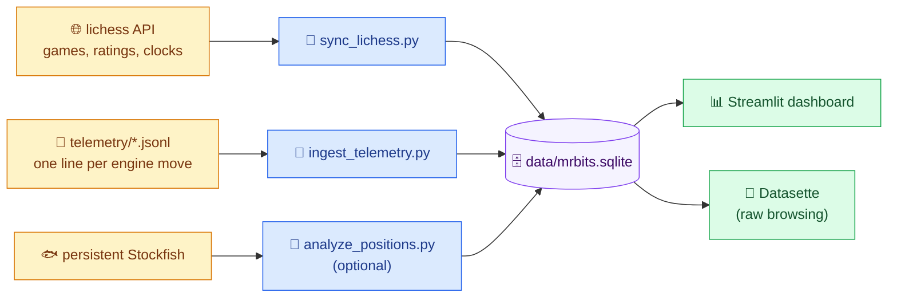
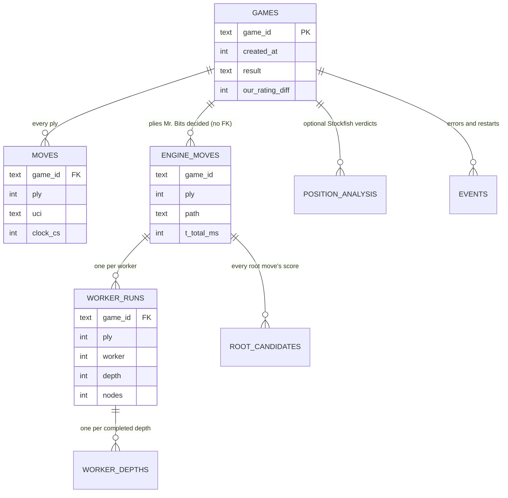
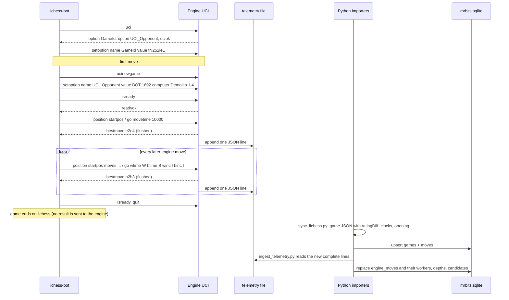
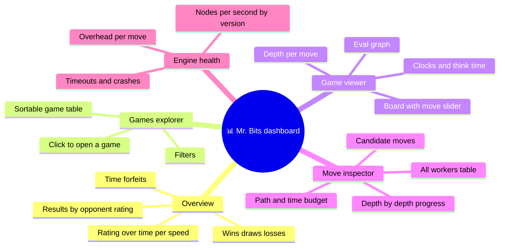
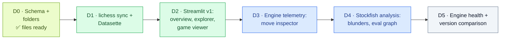

# 🗄️📊 Plan — One Database for Every Game, Move and Worker, Plus a Dashboard

**Written by Claude Opus 5.5, for Tareq.** 🤝 *October 23, 2026 · **v2, October 25:** schema tested on SQLite 3.50.4, 24 review findings applied · the D0 files are ready in `ready-for-tonight/database/`*

<div style="background:#ecfdf5;border-left:6px solid #059669;border-radius:10px;padding:12px 18px;margin:16px 0;color:#1e293b;">

**✅ The plan in one paragraph:** three sources feed **one SQLite file**:
1. the **lichess API**: results, ratings, rating changes, clocks and openings, for every game **from the day we switch it on** (you chose a fresh history ✅);
2. the **engine's telemetry**: one line per move with every worker's depth, nodes, time and scores (plan 02, Phase 4);
3. an optional **Stockfish analysis** of every played position.

A **`GameId`** links them. On top sits a **Streamlit dashboard** where you filter games by result, rating change, time control, date or opponent, then click into any game and any move to see what all the workers did. And the first useful version needs **no C++ change at all**. 🚀

</div>

<div style="background:#eff6ff;border-left:6px solid #2563eb;border-radius:10px;padding:12px 18px;margin:16px 0;color:#1e293b;">

**🔬 What the October 25 review changed** (the plan's own DDL, run and attacked; every fix re-tested):
- **2 high-severity bugs fixed.** `engine_moves` had a foreign key to `games`, but telemetry often arrives *before* the lichess sync, so the ingest would have failed. And the think-time formula was wrong for plies 1–2 and for the game-ending move. It was checked against your real game `tN252leL`: now a median of −8 ms from the wall clock.
- **"Running a job twice is harmless" is now actually true**: events got a key, and children are replaced, not merged.
- Plus: foreign keys are per connection (one `db.py` helper), SAN vs UCI, the `since` cursor, NULL/draw/timezone traps in the filters, and backups under WAL.
- ⚠️ **lichess now refuses anonymous game exports** (401 "Login required", Oct 25): every sync needs the bot's token.

</div>

---

## 1. 🎯 What the dashboard must answer

- **Filters:** wins / losses / draws · rating change (e.g. "games where I lost more than 10 points") · time control (bullet / blitz / rapid) · date range · opponent (name, bot or human, rating) · color · how the game ended (mate, resignation, time, stalemate…) · opening · which path played the move (Kernel / Stockfish opening / Stockfish endgame / stalemate override).
- **Per game:** the board with a move slider, both clocks, the eval graph, think time per move, depth per move, and where the game turned.
- **Per move:** the time ladder's budget vs. the time actually used · which path played it · **all N workers**: their root moves, depth reached, nodes, time, best move and score · how each worker's opinion changed depth by depth · the candidate moves and their scores · Stockfish's opinion of the move (optional) · any errors (timeouts, crashes).
- **Trends:** rating over time · win rate by opponent rating · time forfeits (the overhead problem!) · nodes per second and depth per engine version.

> 💡 **A taste of what it will show you:** while checking the clock data, the review found that in your 2+3 game `tN252leL` plies 5 and 7 took **29.1 s and 54.0 s**. The time ladder allows 50 + winc/3000 = **51 s per move** when 60–120 s are left, and the 5% rule only stops *starting* new depths. In a 2-minute game that's dangerous. The dashboard makes this kind of thing obvious in one chart.

---

## 2. 🧭 Where each piece of data lives

| Data | Source | Notes |
|---|---|---|
| Result, how the game ended, both ratings **and rating changes** | **lichess API** ✅ | Each player has `rating` (always) and `ratingDiff` (**rated games only**: it's absent in casual games, which your matchmaking also creates). Read it with `p.get("ratingDiff")` |
| Every move, both clocks after every move, opening, time control | **lichess API** ✅ | `clocks=true` gives the clocks in centiseconds; `opening=true` gives the opening. ⚠️ `moves` is **SAN** (`"d4 d5 c4 …"`), not UCI |
| Games from go-live day on | **lichess API** ✅ | The sync starts at the go-live date (a fresh history, your decision). Your own games export at up to **60 games/second** when authenticated. The token is required: anonymous export now returns 401 |
| Worker internals: root moves, depth, nodes, pruning, time, scores, per-depth progress | **Engine telemetry** (new) | Plan 02, Phase 4. Only exists from the day it's switched on |
| Stockfish's verdict on every position | **Analysis job** (optional) | Uses the persistent Stockfish from plan 02, Phase 1 |

**Why the lichess API and not the engine for results?** I checked your installed python-chess 1.10.0: for UCI engines, `send_game_result` is literally `pass`. **The engine is never told who won.** lichess knows, so we ask lichess. (The opponent's name, title and pre-game rating also come from lichess's `players`, so the engine's `UCI_Opponent` value isn't needed in the database. If you want it anyway, add `"opponent"` to the telemetry line and an `uci_opponent` column.)

**What about the old data? A fresh start ✅ (your decision).** Nothing is migrated. The database starts empty on go-live day, and `sync_lichess.py` uses that date as its starting point. One side note: `config.yml` has `pgn_directory: "/game_records"`, which means `C:\game_records`. lichess-bot creates that folder itself on the first saved game, so its absence means no PGN has been saved with this setting yet. If you want PGN files inside the repo, use `"./game_records"` (optional; the database doesn't need them).

---

## 3. 🏗️ The architecture



### Why a "flight recorder" log instead of SQLite inside the C++ engine

| | **A · Engine appends JSON lines, a Python job imports them** ⭐ | B · Engine writes SQLite directly |
|---|---|---|
| Risk to your clock | ~0, provided `bestmove` is **flushed** before the line is appended and the line is prebuilt (tonight's Engine UCI already flushes) | Small but real: a locked database or a slow disk can stall a move |
| New C++ dependencies | None (nlohmann/json is already there) | `sqlite3.c` (public domain, easy, but one more thing to build) |
| Changing the schema later | Edit Python and re-import everything from the logs | Edit C++, rebuild, and old data stays in the old shape |
| If something breaks | The raw log is still there; re-import it | Data written wrong stays wrong |
| Real time | Seconds of delay (the importer runs after each game or on demand) | Immediate |

**My recommendation is A**, the standard "structured log → import" pattern. The engine stays dumb and fast, and all the database intelligence lives in Python, which also runs the dashboard. Every telemetry line has a `"type"`. A **move line** looks like this (shown pretty for reading; in the file it's one line):

```json
{"v":1,"type":"move","gameId":"tN252leL","ply":23,"receivedAt":1792371802113,"engineVersion":"2026-10-25a",
 "go":{"wtime":118000,"btime":120000,"winc":3000,"binc":3000},"allowedSeconds":1,
 "path":"kernel","legalMoves":36,"bestMove":"h2h3","bestScore":-135,
 "timersMs":{"legal":0.1,"dispatch":0.4,"search":231,"merge":0.2,"tieCheck":0.1,"total":233},
 "workers":[{"worker":1,"rootMoves":["f1e1","h2h3"],"status":"ok","depth":8,"bestMove":"h2h3","score":-135,
             "setupMs":0.1,"searchMs":226,"nodes":2104019,"leafNodes":1951300,"pruned":120884,
             "perDepth":[{"depth":2,"nodes":1300,"pruned":41,"ms":1,"bestMove":"h2h3","score":-20}],
             "rootScores":[{"move":"h2h3","score":-135,"exact":true},{"move":"f1e1","score":-160,"exact":false}]}]}
```

- **`go` holds the parameters exactly as received.** On the bot's first move lichess-bot sends `go movetime 10000` (its fixed first-move time), so that line has `"go":{"movetime":10000}`. Today's main loop copies movetime into wtime and btime; the telemetry must not log those copies.
- **`go.wtime` / `go.btime` are what lichess-bot sent**, not lichess's clocks. Your own clock is lichess's value minus `move_overhead` (2,000 ms) minus the time since the game state arrived (118000 = 120000 − 2000 at ply 3 of `tN252leL`); the opponent's is lichess's raw value.
- Add `"stockfishDepth":N` when `path` starts with `stockfish_`. Per worker there's an optional `"raw":{"request":{…},"response":{…}}` with the exact messages (decision 3: on failures only, for 30 days, or never).
- **Event lines** carry timeouts, crashes, restarts and fallbacks, also outside a move:
  `{"v":1,"type":"event","ts":1792371802113,"gameId":"tN252leL","ply":23,"level":"warn","source":"worker 7","message":"timeout after 1200 ms"}`. A worker's `error` answer also writes one.
- The ingester skips types it doesn't know, and the engine writes each line in one piece, flushed.

---

## 4. 🧬 The schema



The full definition is `ready-for-tonight/database/schema.sql` (tested ✅: it creates every table, rejects orphans, cascades deletes, and keeps events and candidates idempotent). It's copied here exactly:

```sql
-- Mr. Bits game database (plan 03), with every review fix applied. Create it with:  python tools/mrbits_db/db.py --init
-- NOTE: foreign_keys is per connection. Every importer and the dashboard must run
--       "PRAGMA foreign_keys = ON;" right after connecting; this line only covers the creating connection.
PRAGMA journal_mode = WAL;     -- persistent: stored in the file
PRAGMA foreign_keys = ON;

CREATE TABLE games (
  game_id              TEXT PRIMARY KEY,   -- lichess 8-char id, e.g. 'tN252leL' (never the 12-char fullId)
  created_at           INTEGER NOT NULL,   -- unix ms (lichess createdAt)
  last_move_at         INTEGER,            -- unix ms
  rated                INTEGER NOT NULL CHECK (rated IN (0,1)),
  variant              TEXT,               -- standard / fromPosition / ...
  source               TEXT,               -- friend / lobby / pool / arena / ...
  initial_fen          TEXT,               -- NULL = standard start; needed to replay SAN -> UCI
  speed                TEXT,               -- ultraBullet / bullet / blitz / rapid / classical / correspondence
  clock_initial_s      INTEGER,            -- NULL for correspondence
  clock_increment_s    INTEGER,
  our_color            TEXT NOT NULL CHECK (our_color IN ('white','black')),
  opponent_id          TEXT,               -- lowercase lichess id (stable key)
  opponent_name        TEXT,
  opponent_title       TEXT,               -- 'BOT', 'GM', ... or NULL (untitled): filter humans with IS NOT 'BOT'
  our_rating           INTEGER,            -- before the game
  our_rating_diff      INTEGER,            -- NULL for casual games (lichess omits ratingDiff)
  opponent_rating      INTEGER,
  opponent_rating_diff INTEGER,
  our_accuracy         INTEGER,            -- players.*.analysis.accuracy, only when lichess analysed the game
  opponent_accuracy    INTEGER,
  result               TEXT CHECK (result IN ('win','loss','draw','aborted')),
  status               TEXT,               -- lichess status name: mate, resign, outoftime, timeout, stalemate, draw, ...
  opening_eco          TEXT,
  opening_name         TEXT,
  plies                INTEGER,
  pgn                  TEXT,
  synced_at            INTEGER
);

CREATE TABLE moves (                       -- every ply of both sides, from lichess
  game_id   TEXT NOT NULL REFERENCES games(game_id),
  ply       INTEGER NOT NULL,              -- 1-based index in the move list (1 = White's first move from startpos)
  by_us     INTEGER NOT NULL,
  uci       TEXT NOT NULL,                 -- converted from lichess SAN with python-chess
  san       TEXT,                          -- lichess `moves` field is SAN
  clock_cs  INTEGER,                       -- mover's clock after the move (lichess `clocks`, centiseconds)
  think_ms  INTEGER,                       -- NULL for ply 1-2; see the formula in the plan
  PRIMARY KEY (game_id, ply)
);

CREATE TABLE engine_moves (                -- one row per move Mr. Bits decided (from telemetry)
  game_id         TEXT NOT NULL,           -- no FK to games: telemetry can arrive before (or without) the lichess sync
  ply             INTEGER NOT NULL,        -- moves in the `position` command + 1
  received_at     INTEGER,
  wtime_ms INTEGER, btime_ms INTEGER, winc_ms INTEGER, binc_ms INTEGER,
  movetime_ms     INTEGER,                 -- `go movetime` (lichess-bot's first move)
  allowed_s       INTEGER,
  path            TEXT,
  legal_moves     INTEGER,
  workers         INTEGER,
  best_move       TEXT,
  best_score      INTEGER,                 -- centipawns from Mr. Bits' point of view
  stockfish_depth INTEGER,                 -- needs a `stockfishDepth` field in the telemetry line
  t_legal_ms REAL, t_dispatch_ms REAL, t_search_ms REAL, t_merge_ms REAL, t_tiecheck_ms REAL, t_total_ms REAL,
  engine_version  TEXT,                    -- the build that played; filter games with EXISTS (... em.engine_version = :v)
  PRIMARY KEY (game_id, ply)
);

CREATE TABLE worker_runs (
  game_id      TEXT NOT NULL,
  ply          INTEGER NOT NULL,
  worker       INTEGER NOT NULL,
  root_moves   TEXT,
  status       TEXT,                       -- ok / timeout / crash / error
  depth        INTEGER,
  best_move    TEXT,
  best_score   INTEGER,
  setup_ms     REAL,
  search_ms    REAL,
  nodes        INTEGER,
  leaf_nodes   INTEGER,
  pruned       INTEGER,
  request_json  TEXT,
  response_json TEXT,
  PRIMARY KEY (game_id, ply, worker),
  FOREIGN KEY (game_id, ply) REFERENCES engine_moves(game_id, ply) ON DELETE CASCADE
);

CREATE TABLE worker_depths (
  game_id TEXT NOT NULL, ply INTEGER NOT NULL, worker INTEGER NOT NULL, depth INTEGER NOT NULL,
  nodes INTEGER, pruned INTEGER, ms REAL, best_move TEXT, score INTEGER,
  PRIMARY KEY (game_id, ply, worker, depth),
  FOREIGN KEY (game_id, ply, worker) REFERENCES worker_runs(game_id, ply, worker) ON DELETE CASCADE
);

CREATE TABLE root_candidates (
  game_id TEXT NOT NULL, ply INTEGER NOT NULL, worker INTEGER NOT NULL, move TEXT NOT NULL,
  score INTEGER, exact INTEGER, depth INTEGER,  -- depth = the worker's last completed depth
  PRIMARY KEY (game_id, ply, worker, move),
  FOREIGN KEY (game_id, ply) REFERENCES engine_moves(game_id, ply) ON DELETE CASCADE
);

CREATE TABLE position_analysis (           -- position AFTER ply N (ply 0 = initial position)
  game_id TEXT NOT NULL, ply INTEGER NOT NULL,
  sf_depth INTEGER, sf_cp INTEGER, sf_mate INTEGER, sf_best_move TEXT,   -- sf_cp / sf_mate from White's point of view
  PRIMARY KEY (game_id, ply)
);

CREATE TABLE events (
  event_key TEXT PRIMARY KEY,              -- '<telemetry file>:<byte offset of its line>:<n-th event in that line>'
  ts INTEGER NOT NULL, game_id TEXT, ply INTEGER,
  level TEXT, source TEXT, message TEXT
);

CREATE TABLE sync_state (
  source TEXT PRIMARY KEY, cursor TEXT, updated_at INTEGER
);

CREATE INDEX idx_games_created ON games(created_at);
CREATE INDEX idx_games_filters ON games(result, speed, our_color);
CREATE INDEX idx_games_opp     ON games(opponent_id);
CREATE INDEX idx_engine_path   ON engine_moves(path);
CREATE INDEX idx_events_game   ON events(game_id, ply);
```

**The rules that go with it:**
- **Foreign keys are per connection.** `PRAGMA foreign_keys` isn't stored in the file (WAL is), so without it orphans are accepted silently and `ON DELETE CASCADE` does nothing. Every job and the dashboard connect through **one helper**, `tools/mrbits_db/db.py` (ready ✅). It turns them on and builds the path from its own folder. A relative `data/mrbits.sqlite` started from another folder would silently create a new, empty database.
- **`engine_moves` has no foreign key to `games`:** telemetry can arrive before the sync (game still running, or aborted). After each ingest, the sync fetches the telemetry games missing from `games` by id (§5).
- **`result`** comes from lichess's `winner` (absent for draws) and `status`:
  - `'win'` if `winner` is our color, `'loss'` if there's another winner;
  - `'aborted'` if `status` is `aborted` or `noStart` and there's no winner;
  - otherwise `'draw'`.

  Games still `created` or `started` aren't stored yet; the next sync gets them.
- **`moves.uci`**: replay lichess's SAN with python-chess:
  1. start from `board = chess.Board(g.get("initialFen") or chess.STARTING_FEN)`;
  2. for each SAN token: `mv = board.parse_san(san)`, `uci = mv.uci()`, `mover_white = board.turn`, `board.push(mv)`;
  3. set `by_us = (mover_white == (our_color == "white"))`.

  Castling comes out as `e1g1`, like Engine UCI and the bot stream ✅.
- **`moves.think_ms`, exactly** (checked on the real clocks of `tN252leL` ✅). `clocks[i-1]` is the mover's clock after ply *i*, in centiseconds; `inc_ms` = `clock.increment` × 1000; N = the number of plies:
  - plies 1 and 2 → `NULL`: lichess doesn't run the clock or add the increment for each side's first move;
  - 3 ≤ *i* < N, or *i* = N when the game went on after the move (resignation, draw agreed or claimed, the opponent flagged or left) → `10·clocks[i-3] − 10·clocks[i-1] + inc_ms` (`clocks[i-3]` is the same player's clock after their previous move);
  - *i* = N when the move itself ended the game (`mate`, `stalemate`, `variantEnd`, or an automatic draw: python-chess `is_insufficient_material()`, `is_fifty_moves()` or `is_fivefold_repetition()`) → the same **without** `+ inc_ms`: lichess adds no increment to a game-ending move.

  It's the time **lichess charged**, network and lag included: on `tN252leL` it matched the wall time with a median of −8 ms (62 of 68 moves within 100 ms). The engine's own time is `engine_moves.t_total_ms`, and the difference is your overhead.
- **`position_analysis`** is the position **after** ply N (0 = the initial position), from **White's** point of view like lichess's analysis. Stockfish's UCI score is from the side to move, so negate it when Black is to move. `engine_moves.best_score` stays in Mr. Bits' point of view (the Kernel returns engineScore − opponentScore), so flip it when Mr. Bits is Black before drawing both on one graph.
- **`root_candidates` keys on the worker too**, so a move re-dispatched after a timeout (plan 02, Phase 3) keeps both workers' scores.
- **The engine version** lives only in `engine_moves.engine_version` (no copy in `games` to keep in sync). The "engine version" filter is `EXISTS (SELECT 1 FROM engine_moves em WHERE em.game_id = g.game_id AND em.engine_version = :v)`.
- **Every importer is idempotent:**
  - `games`, `moves`, `position_analysis` and `sync_state` upsert (`INSERT … ON CONFLICT DO UPDATE`);
  - events are inserted with `ON CONFLICT(event_key) DO NOTHING`;
  - each telemetry line replaces its engine move and all its children in one transaction.

  So running any job twice is harmless ✅ tested.

---

## 5. 🔄 How one game flows into the database



### The three jobs (Python, in a new `lichess-bot-master/tools/mrbits_db/` folder)

| Job | What it does | When it runs |
|---|---|---|
| `sync_lichess.py` | See below | Manually, from a "Sync" button in the dashboard, or with Windows Task Scheduler, **between games** (it shares the bot's token and IP) |
| `ingest_telemetry.py` | Reads the new **complete** lines of `telemetry/*.jsonl` and fills `engine_moves`, `worker_runs`, `worker_depths`, `root_candidates`, `events` | The same "Sync" button |
| `analyze_positions.py` *(optional)* | Asks the persistent Stockfish about every played position; fills `position_analysis` → blunder markers and an eval graph | Overnight, or on demand per game |

**`sync_lichess.py`, step by step:**
1. Find the bot's username: `GET /api/account`.
2. Stream `GET /api/games/user/{username}?since=…&pgnInJson=true&clocks=true&opening=true&accuracy=true&sort=dateAsc` and upsert `games` and `moves`.
   - Headers: `{"Authorization": f"Bearer {token}", "Accept": "application/x-ndjson"}`. The export answers in PGN unless asked otherwise. `json.loads` each non-empty line.
   - **`since`**: the first run uses the go-live date in unix ms. After that it's `MAX(games.created_at) − 86,400,000`, one day of overlap (the upserts remove duplicates), stored in `sync_state('lichess')`. The spec doesn't say which timestamp `since` compares; the overlap is right either way.
3. **Then fetch by id every game that has telemetry but no `games` row**: `POST /api/games/export/_ids` (ids comma-separated in the body, up to 300 per request). Skip games still `created` or `started`: lichess returns running games with their last 3 moves missing. This also catches what the normal export leaves out (running games, and probably aborted ones 🟡), so a game that started before a newer saved one (`concurrency` > 1) is never lost.
4. On HTTP 429, wait a full minute before any other request.

**`ingest_telemetry.py`, safely:**
- It remembers **a byte offset per file** in `sync_state` (e.g. `source = 'telemetry:2026-10-25.jsonl'`).
- It opens the file in binary mode and consumes only up to the last `\n`, so a line the engine is still writing waits for the next run. A complete line that doesn't parse becomes an event and is skipped: one bad line never blocks the sync.
- It handles each line in **one transaction**: `DELETE FROM engine_moves WHERE game_id = ? AND ply = ?` (the cascade removes the old workers, depths and candidates), then insert the move and all its children. A plain per-row upsert would leave stale children behind after a parser fix.
- **"Re-import everything"** = `DELETE FROM engine_moves`, delete the telemetry events, reset the telemetry cursors in `sync_state`, then ingest from the start.

The token comes from `config.yml` at runtime. It is **never** stored in the database and never printed.

---

## 6. 📏 How big does it get? 🟡

Measured on the real schema with a generator (28 workers × 6 depths, 35 candidates) ✅:

| Per engine move | Approximate size |
|---|---|
| `engine_moves` row | ~0.2 KB |
| 28 `worker_runs` rows (without raw messages) | ~2.5 KB |
| ~6 `worker_depths` rows per worker | ~11 KB |
| ~35 `root_candidates` rows | ~2 KB |
| **Total without raw messages** | **≈ 16 KB per move → ≈ 0.9 MB per game (your 13 logged games average ≈ 56 engine moves, median 44) → ≈ 0.9 GB per 1,000 games** |
| Raw `request_json` / `response_json` | +≈ 30–40 KB per move (it grows with game length, since every request carries the move list): keep them only for the last 30 days, or only when a worker failed |

SQLite handles this easily. With WAL mode and the indexes above, the dashboard's filters stay instant at tens of thousands of games.

---

## 7. 📊 The dashboard

**Tools:** **Streamlit**, a Python dashboard framework. A page is a Python script, so it's quick to build without being a web developer. It's paired with `pandas`, `plotly` for charts, and `python-chess` (already installed, lichess-bot uses it) to draw the board as an SVG (`chess.svg.board()` works ✅). **Datasette** sits next to it for raw browsing: `datasette data/mrbits.sqlite` gives you every table with filters and facets in the browser, with zero code.

⚠️ **None of streamlit, datasette, pandas or plotly is installed yet.** Use a virtual environment: `python -m venv .venv-dash`, then `pip install streamlit pandas plotly datasette`. Then run `streamlit run tools/mrbits_db/dashboard.py` (port 8501) and `datasette data/mrbits.sqlite` (port 8001). If pip finds no wheels for your Python 3.14, use Python 3.12 or 3.13 for the dashboard only.



What the **game viewer + move inspector** page could look like (illustrative numbers):

```
┌─────────────────────────────────────────────────────────────────────────────────────┐
│ Mr. Bits vs BOT Demolito_L4 (1692) · Blitz 2+3 · LOSS −8 · ended by: resign · Italian│
├───────────────────────────────┬─────────────────────────────────────────────────────┤
│        ♜ ♞ ♝ ♛ ♚ ♝ · ♜        │ Move 12. h2h3    path: KERNEL   budget 1 s · used 0.23 s│
│        ♟ ♟ ♟ · · ♟ ♟ ♟        │ legal moves 36 · workers 28 · best score −1.35          │
│        · · ♞ ♟ · ♞ · ·        │ ┌───────┬────────────┬───────┬────────┬───────┬───────┐ │
│        · · ♝ · ♟ · · ·        │ │worker │ root moves │ depth │ nodes  │  ms   │ score │ │
│        · · ♗ · ♙ · · ·        │ │  #1   │ f1e1 h2h3  │   8   │ 2.10 M │  226  │ −1.35 │ │
│        · · ♙ ♙ · ♘ · ·        │ │  #2   │ c4b5       │   8   │ 1.84 M │  219  │ −1.52 │ │
│        ♙ ♙ · · · ♙ ♙ ♙        │ │  …    │            │       │        │       │       │ │
│        ♖ ♘ ♗ ♕ · ♖ ♔ ·        │ └───────┴────────────┴───────┴────────┴───────┴───────┘ │
│   ◀ ◀◀   move 23 / 61   ▶▶ ▶  │ [depth-by-depth chart]   [candidate moves table]        │
├───────────────────────────────┴─────────────────────────────────────────────────────┤
│ eval graph ▁▂▃▅▆▅▃▂▁▁ · think time per move ▂▂▂▃▇▂ · depth per move 8 8 10 8 6 8     │
└─────────────────────────────────────────────────────────────────────────────────────┘
```

The **Games explorer** filters: date range · result · speed / time control · color · rated · opponent (name, bot/human, rating range) · rating change range · how the game ended · opening · "contains a move where the stalemate override fired" · engine version.

**How to write them** (the obvious versions give wrong answers; all ✅ tested):
- **human / bot:** `opponent_title IS NOT 'BOT'` / `opponent_title = 'BOT'`. Untitled humans have NULL, and `<> 'BOT'` drops them.
- **lost on time:** `status = 'outoftime' AND result = 'loss'`. `outoftime` alone also counts your opponents' flags, and a flag against a side with no mating material is a draw. `timeout` means the opponent *left*, not a clock.
- **date range in local dates** (uses `idx_games_created`): `created_at >= unixepoch(:d1, 'utc') * 1000 AND created_at < unixepoch(:d2, '+1 day', 'utc') * 1000`. Your laptop is on UTC+4, and plain UTC dates would move late-evening games to the wrong day.
- **time-control label:** `CASE WHEN clock_initial_s IS NULL THEN 'corr' ELSE printf('%g+%d', clock_initial_s / 60.0, clock_increment_s) END`.
- **lost more than 10 points:** `our_rating_diff < -10` (rated games only: casual games have NULL).
- **stalemate override:** `EXISTS (SELECT 1 FROM engine_moves em WHERE em.game_id = g.game_id AND em.path = 'stalemate_override')`.
- **speed dropdown:** build it from `SELECT DISTINCT speed FROM games`.

---

## 8. 🛣️ The phases



| Phase | What | Needs plan 02? | Exit criterion |
|---|---|---|---|
| **D0** ✅ ready | Create `lichess-bot-master/tools/mrbits_db/` with `schema.sql` and `db.py` (both ready), then `python tools/mrbits_db/db.py --init`. It creates `lichess-bot-master/data/mrbits.sqlite` (+ `data/backup/`). Engine UCI will write `telemetry/` under `lichess-bot-master/`. Add `lichess-bot-master/data/` and `lichess-bot-master/telemetry/` to `.gitignore` as **folders**, each on its own line. ⚠️ The file has no newline after its last line (`**/__pycache__`), so a blind `echo >>` would glue the entry onto it ✅ tested | No | An empty database with all tables; `git check-ignore` confirms both folders |
| **D1** ⭐ | `sync_lichess.py` (§5), plus Datasette | **No** | Every game from go-live day on lands in the database with its result, ratings, rating change and clocks, browsable with filters |
| **D2** | Streamlit v1: overview, games explorer, game viewer (board, clocks, think time) | No | You can answer "which games did I lose on time?" in two clicks |
| **D3** | `ingest_telemetry.py` + the move inspector page | Yes, Phase 4 | Clicking any move shows all the workers, depth by depth |
| **D4** | `analyze_positions.py`: blunder markers and the eval graph | Yes, Phase 1 ✅ (done tonight) | Every lost game shows the move where it turned |
| **D5** | Engine-health page: overhead per move, timeouts, nodes per second per engine version | Yes | Compare builds by their real games |

**Effort (part-time 🟡):** D1 ≈ 1 day · D2 ≈ 2–3 days · D3 ≈ 2–3 days · D4 ≈ 1–2 days · D5 ≈ 1–2 days. With a fresh history nothing is lost by starting D1 later: lichess keeps every game, and the first sync fetches everything since go-live day. Only the engine internals of games played before Phase 4's telemetry are gone for good.

---

## 9. 🔐 Hygiene

- **The token:** read from `config.yml` at runtime (already git-ignored); never in the database, never in logs, never committed.
- **`data/` and `telemetry/` go in `.gitignore` as folders, before the first commit of the new repository.** Use `lichess-bot-master/data/` and `lichess-bot-master/telemetry/` in the root `.gitignore`. A line like `data/mrbits.sqlite` would miss everything ✅ checked with `git check-ignore`:
  - from the root `.gitignore` it doesn't even match the database under `lichess-bot-master/`;
  - it never matches `mrbits.sqlite-wal` / `-shm`;
  - the `*.log` rule doesn't cover `*.jsonl`.

  Both folders are personal data, and they grow.
- **Backups: use SQLite, never a plain file copy while anything is connected.** In WAL mode the latest commits live in `mrbits.sqlite-wal`. While the dashboard or Datasette has the database open, a copy of `mrbits.sqlite` alone can miss them, even whole tables ✅ reproduced. From `lichess-bot-master/` (works in PowerShell and Git Bash):
  `python -c "import sqlite3; sqlite3.connect('data/mrbits.sqlite').execute('VACUUM INTO ?', ('data/backup/mrbits-2026-10-25.sqlite',))"`
  `VACUUM INTO` refuses a file that already exists. Back up `telemetry/` too: it's the only copy of the engine internals. Copy both off the machine if you want them to survive a dead disk.
- **The jobs never touch lichess-bot's files.** The only lichess-bot change in all of this is the one-line `GameId` in `extra_game_handlers.py` (plan 02, Phase 4).
- **Multiple games at once:** you play with `concurrency: 1` today. Thanks to the `GameId`, this design keeps working if you ever raise it. Today's shared `input/thread_N_serialized_data.json` files and the "newest history folder" guess would not. (The third shared file, `temp_command_file.txt`, disappears tonight with the persistent Stockfish.)

---

## 10. ✅ Decisions waiting for you

1. **Recorder style:** A, a log file + importer (recommended), or B, SQLite inside the engine.
2. **Dashboard:** Streamlit + Datasette (recommended), or something else you prefer.
3. **Raw messages:** keep `request_json` / `response_json` for 30 days, only on failures, or never.
4. **D0 tonight?** It takes 10 minutes, and it puts the `.gitignore` lines in place before the new repo's first commit. D1 can follow any day without losing a game.

**Already decided ✅:** a fresh history (no old games or history files are migrated).

— **Claude Opus 5.5** 🤖
