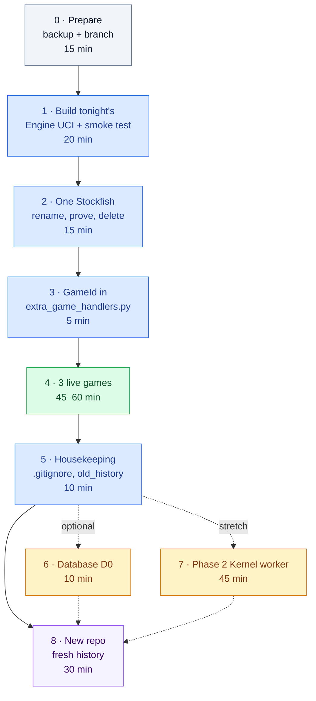

# 🌙 Tonight's Runbook — Phase 1 Live, Step by Step

**Written by Claude Opus 5.5, for Tareq.** 🤝 *October 25, 2026 · the checklist we follow tonight · every command was run on copies today unless it says otherwise*

<div style="background:linear-gradient(90deg,#0f766e,#1d4ed8);color:#ffffff;border-radius:14px;padding:16px 22px;margin:16px 0;">

**Tonight in one sentence:** we drop in **one tested `Engine UCI.cpp`** (one persistent Stockfish, paths from the `.exe` folder, the `GameId` option, a flushed `bestmove`, a safe Kernel merge), keep **one Stockfish**, switch on the **GameId** in lichess-bot, play **3 live games**, and finish with the **new repo**. Core: **≈ 2–2½ hours**. 🚀

</div>

---

## ✅ What's already proven, and 🟡 what only tonight can prove

| ✅ Proven today, on scratch copies of your real files | Evidence |
|---|---|
| Tonight's `Engine UCI.cpp` builds with your normal command (plain `g++`, GCC 14.2), with no new warnings | 4 s build, `-Wall -Wextra` checked |
| It plays legal moves through the **real python-chess**, called exactly like lichess-bot, from `lichess-bot-master\` **and** from an unrelated folder | smoke test: PASS, 4 runs |
| Stockfish-played moves: **670 ms → 80 ms**; Kernel moves: median 2.49 s → 2.21 s | back-to-back A/B, same moves |
| **Exactly one Stockfish per game**, never two at once, none left after `quit`, no `temp_command_file.txt` | process sampler every 40 ms |
| A failed Kernel launch now gives a **legal Stockfish move + a log line**, not `bestmove It should be a default value…` | test with `Kernel.exe` removed |
| `Kernel.cpp` (today's and the Phase 2 worker) and `Stockfish Handler Testing.cpp` compile with the new header; the worker still gives 0 mismatches | builds + 288-request A/B |
| The D0 database files work: right folder from anywhere, WAL, foreign keys, cascades, idempotent events | SQLite test |
| The persistent Stockfish class: 140/140 identical answers, 19/19 kill-and-restart tests | proto-stockfish |

| 🟡 Only tonight can prove | Why |
|---|---|
| Smart App Control lets **the build made in your real folder** run | It judges every new `.exe` hash on its first launch, unpredictably. The smoke test is the launch test |
| A **real lichess game** end to end | I'm not allowed to start lichess-bot or use your token |
| Nothing in the **neural-network lab** uses the Stockfish copies we delete | That folder is off-limits for me: you (or its agent) check it in Step 2 |

---

## 🧭 The map



<div style="background:#fffbeb;border-left:6px solid #d97706;border-radius:10px;padding:12px 18px;margin:16px 0;color:#1e293b;">

**⚠️ Ground rules for tonight**
1. **PowerShell or `Launch Server.bat` only, never Git Bash.** Git Bash puts Git's own `libstdc++-6.dll` first on PATH, so the engines would run on a different C runtime.
2. **One green step = one commit.** A red step means rollback, not improvising on the live bot.
3. **Every new `.exe` gets the smoke test before lichess-bot sees it** (Smart App Control).
4. **Pause the other agents working in `Mr_Bits`** (the neural-network work) until we're done: we rebuild and delete files under `engines/`.
5. **Nobody prints `config.yml`:** it holds the token.

</div>

**Paste this first in every new PowerShell window:**

```powershell
$repo = "C:\Users\tareq\Desktop\Mr_Bits"
$lb   = "$repo\lichess-bot-master"
$plan = "$lb\IPC and Game Database Plan\ready-for-tonight"
```

---

## Step 0 · Prepare (15 min)

Stop lichess-bot if it's running, then:

```powershell
cd $repo
git status --short     # expect ONLY the "??" lines (untracked folders): nothing modified
Get-Process -Name "Engine UCI", Kernel, stockfish* -ErrorAction SilentlyContinue |
    Where-Object { $_.Path -like "$lb\*" }    # expect nothing
git bundle create ..\Mr_Bits-old-history-2026-10-25.bundle --all    # the whole old history in one file
git bundle verify ..\Mr_Bits-old-history-2026-10-25.bundle
Copy-Item -Recurse "$lb\engines" ..\Mr_Bits-engines-backup-2026-10-25
Copy-Item "$lb\extra_game_handlers.py" ..\Mr_Bits-engines-backup-2026-10-25\
git switch -c tonight/ipc
```

✅ **Done when:** `git bundle verify` says *okay*, `..\Mr_Bits-engines-backup-2026-10-25\` exists, and `git branch --show-current` prints `tonight/ipc`.

---

## Step 1 · Build tonight's Engine UCI (20 min) — Phase 1a + 1b + GameId options

```powershell
Copy-Item "$plan\engines\Engine UCI.cpp", "$plan\engines\Stockfish Handler.hpp", "$plan\engines\StockfishProcess.hpp" "$lb\engines\" -Force
cd "$lb\engines"
g++ '-DMRBITS_BUILD_STAMP=\"2026-10-25a\"' "Engine UCI.cpp" -o "Engine UCI.exe"     # ~4 s, your usual flags
powershell -ExecutionPolicy Bypass -File "$plan\tests\run_smoke.ps1" -Exe "$lb\engines\Engine UCI.exe"
```

What changes in your code is in `ready-for-tonight/engines/Engine UCI.cpp.diff` (read it, it's yours 😄). **Don't rebuild `Kernel.exe` tonight:** it's unchanged, and a rebuild only adds a Smart App Control coin flip.

✅ **Done when:**
- the smoke test prints `RESULT: PASS`, with **3 PASS lines**, and the second move (`g1f3`) is **under 150 ms**;
- `Select-String -Path "$lb\logs\uci_*.log" -Pattern '!!'` prints **nothing**;
- the newest log shows `build 2026-10-25a` and no `<-- MISSING`;
- `Get-Process stockfish* -ErrorAction SilentlyContinue | Where-Object { $_.Path -like "$lb\*" }` prints nothing, and `Test-Path "$lb\temp_command_file.txt"` is `False`.

Then clean up the test game's folder and commit:

```powershell
Remove-Item -Recurse -Force "$lb\history\tN252leL"      # the smoke test's fake game
cd $repo
git add "lichess-bot-master/engines/Engine UCI.cpp" "lichess-bot-master/engines/Engine UCI.exe" "lichess-bot-master/engines/Stockfish Handler.hpp" "lichess-bot-master/engines/StockfishProcess.hpp"
git commit -m "Engine UCI: one persistent Stockfish, paths from the exe folder, GameId/UCI_Opponent options, flushed bestmove"
```

| If you see… | It means | Do |
|---|---|---|
| `WinError 4551` / "An Application Control policy has blocked this file" | Smart App Control blocked this exact build | Rebuild with a new stamp (`2026-10-25b`, `c`…) and rerun the smoke test. The first launch of an allowed build takes ~2 s longer (normal) |
| `NOT FOUND` next to a DLL | You're not in a normal PowerShell | Open a fresh PowerShell (the CodeBlocks `MinGW\bin` must be on PATH) |
| A FAIL with any other error | Something I didn't foresee | **Stop.** `git restore --source=HEAD --staged --worktree lichess-bot-master/engines` and send me the smoke output folder |

---

## Step 2 · One Stockfish (15 min) — rename, prove, delete

```powershell
cd $lb
Rename-Item stockfish stockfish.old
Rename-Item stockfish-windows-x86-64-avx2.exe stockfish-windows-x86-64-avx2.exe.old
Rename-Item engines\stockfish-windows-x86-64-avx2.exe stockfish-windows-x86-64-avx2.exe.old
powershell -ExecutionPolicy Bypass -File "$plan\tests\run_smoke.ps1" -Exe "$lb\engines\Engine UCI.exe"
Remove-Item -Recurse -Force "$lb\history\tN252leL"
```

✅ **PASS with the copies renamed** proves the new engine uses only `engines\stockfish\`.

**Now the neural-network lab check** (you, or its agent; I don't open that folder). Does anything there point at `lichess-bot-master\stockfish\` or at one of the two loose `.exe` files?

```powershell
Get-ChildItem "$repo\ChatGPT Neural Network Lab" -Recurse -File -Include *.py,*.json,*.yml,*.yaml,*.toml,*.cfg,*.ini,*.ps1,*.bat,*.md,*.txt |
    Select-String -Pattern "stockfish" | Select-Object Path, LineNumber, Line
```

If it uses one of them, point it at `lichess-bot-master\engines\stockfish\stockfish-windows-x86-64-avx2.exe` first. Then delete:

```powershell
cd $repo
git rm -r -q lichess-bot-master/stockfish lichess-bot-master/stockfish-windows-x86-64-avx2.exe lichess-bot-master/engines/stockfish-windows-x86-64-avx2.exe
Remove-Item -Recurse -Force "$lb\stockfish.old", "$lb\stockfish-windows-x86-64-avx2.exe.old", "$lb\engines\stockfish-windows-x86-64-avx2.exe.old"
git commit -m "Keep one Stockfish: lichess-bot-master/engines/stockfish"
```

✅ **Done when:** `git ls-files | Select-String "stockfish-windows"` shows **one** line (`engines/stockfish/…`), and the folder is ~124 MB lighter.

---

## Step 3 · GameId from lichess-bot (5 min)

In VS Code, open `lichess-bot-master\extra_game_handlers.py` and change **line 12** of `game_specific_options`:

```python
    return {}                       # before
    return {"GameId": game.id}      # after: spelled exactly GameId
```

⚠️ **Only with Step 1's engine in place:** an engine without the option makes every game die in `create_engine` ✅ (verified with lichess-bot's own code). If you ever roll the engine back, roll this line back too.

```powershell
cd $repo
git add lichess-bot-master/extra_game_handlers.py
git commit -m "lichess-bot: pass the lichess game id to the engine (GameId)"
```

---

## Step 4 · Three live games (45–60 min)

Start the bot the usual way: **double-click `Launch Server.bat`** (it runs `python lichess-bot.py` in PowerShell from `lichess-bot-master`).

1. **At bot startup**, lichess-bot opens and closes the engine once to check it. Its log (`logs\uci_*.log`) must show `uci`, `isready`, `readyok` and `quit`. That `isready` also starts and stops Stockfish once, so a Stockfish problem shows up *now*, not in a game.
2. **Play 3 games**: challenge the bot from your account, or let matchmaking run. Try for one longer game (past move 40, i.e. 80 plies: the Stockfish endgame path).
3. **While a game runs**, in a second PowerShell (paste the 3 variables first):

```powershell
Get-Process stockfish* | Where-Object { $_.Path -like "$lb\*" } | Select-Object Id, Path   # exactly ONE, under ...\engines\stockfish\
$log = Get-ChildItem "$lb\logs\uci_*.log" | Sort-Object LastWriteTime | Select-Object -Last 1
Get-Content $log.FullName -Tail 15                   # live: >> commands, << answers, "go -> bestmove took N ms"
Select-String -Path "$lb\logs\uci_*.log" -Pattern '!!'   # must stay empty
```

4. **After each game:** no `stockfish` process is left from `$lb`, and `history\<the 8-letter game id>\` exists with the text reports.

✅ **Done when:** 3 games finish normally (any result 😄), no `!!` lines, the `took` lines for Stockfish moves are well under a second, and each game used one Stockfish.

<div style="background:#fef2f2;border-left:6px solid #dc2626;border-radius:10px;padding:12px 18px;margin:16px 0;color:#1e293b;">

**🔙 Rollback, any time** (an illegal move, a crash, a hang, anything odd): press Ctrl+C in the bot's window, then

```powershell
cd $repo
git switch -f main     # today's engine, today's handler, today's 4 Stockfish copies, today's extra_game_handlers.py
```

Restart the bot: it's exactly as it was this morning. The `tonight/ipc` branch keeps every green step, and we debug from the logs, not live. (The bundle and `..\Mr_Bits-engines-backup-2026-10-25\` from Step 0 are the second safety net.)

</div>

---

## Step 5 · Housekeeping (10 min)

1. **`old_history\`** is empty and referenced by nothing: `Remove-Item "$lb\old_history"`. Keep `history\`: tonight's engine still writes the text reports there, until Phase 4's telemetry replaces them.
2. **`.gitignore`**, edited **in VS Code**. (Not with a PowerShell one-liner: the file has curly quotes in its comments and no newline at the end, and PowerShell 5.1's `Set-Content` would damage both.) Add the 4 lines marked `+`:

```gitignore

# ignore all text files…
*.txt
+# …except the Stockfish licence (GPL v3) and contributor list
+!lichess-bot-master/engines/stockfish/*.txt
# …but keep your requirements.
!lichess-bot-master/requirements.txt
# don’t ignore any .txt in lichess-bot-master/history (including subfolders).
!lichess-bot-master/history/**/*.txt

lichess-bot-master/config.yml

lichess-bot-master/input

*.log

**/__pycache__
+lichess-bot-master/data/
+lichess-bot-master/telemetry/
```

(Type the lines without the `+`, and end the file with a newline.)

```powershell
cd $repo
git check-ignore -v lichess-bot-master/config.yml lichess-bot-master/data/x.sqlite lichess-bot-master/telemetry/x.jsonl lichess-bot-master/logs/x.log   # 4 lines: all ignored ✅
git add .gitignore lichess-bot-master/engines/stockfish/Copying.txt "lichess-bot-master/engines/stockfish/Top CPU Contributors.txt"
git commit -m "Track the Stockfish licence; ignore data/ and telemetry/"
```

✅ **Done when:** `(git ls-files lichess-bot-master/engines/stockfish | Measure-Object).Count` prints **75** (the full package, licence included), and `git status --short` shows only the untracked top-level folders.

---

## Step 6 · Database D0 (optional, 10 min)

```powershell
New-Item -ItemType Directory "$lb\tools\mrbits_db" | Out-Null
Copy-Item "$plan\database\schema.sql", "$plan\database\db.py" "$lb\tools\mrbits_db\"
python "$lb\tools\mrbits_db\db.py" --init          # creates lichess-bot-master\data\mrbits.sqlite (+ data\backup\)
cd $repo
git add lichess-bot-master/tools/mrbits_db
git commit -m "Game database: schema and connection helper (plan 03, D0)"
```

✅ **Done when:** `git status --short` doesn't list `data/` (it's ignored), and running `--init` again refuses (*already exists*). **Write down the go-live date** (tonight): it's D1's starting point, and lichess keeps every game until then.

---

## Step 7 · Phase 2 Kernel worker (stretch, 45 min) — only if Steps 1–5 are green

⚠️ **No speed gain on its own:** today's Engine UCI keeps using file mode, which stays identical. This only gets `Kernel.exe` ready for Phase 3. Skip it if you're tired: it's just as ready next time.

```powershell
Copy-Item "$plan\stretch-phase2-kernel-worker\Kernel.cpp" "$lb\engines\Kernel.cpp" -Force
cd "$lb\engines"
g++ Kernel.cpp -o Kernel.exe                      # ~6 s, your usual flags
.\Kernel.exe                                      # expect: Insufficient argument provided.  (= Smart App Control allows it)
$OutputEncoding = New-Object System.Text.UTF8Encoding $false     # no BOM in front of what we pipe in
$req = '{"type":"hello"}' + "`n" + '{"type":"search","id":1,"engineColor":true,"moves":[],"rootMoves":["e2e4","d2d4","g1f3"],"maxDepth":4}' + "`n"
$req | .\Kernel.exe --worker                      # expect a "ready" line, then bestMove g1f3, score 0, depth 4, nodes 790
python -B "$plan\stretch-phase2-kernel-worker\tests\equivalence.py" "$lb\engines\Kernel.exe" tonight   # ~30 s
powershell -ExecutionPolicy Bypass -File "$plan\tests\run_smoke.ps1" -Exe "$lb\engines\Engine UCI.exe"  # file mode through Engine UCI
```

✅ **Done when:** `stretch-phase2-kernel-worker\runs\tonight\equivalence.json` has `"mismatches": []` and `"repeatMismatches": []`, the smoke test passes, and then one live game passes. Commit `Kernel.cpp` + `Kernel.exe`. If `.\Kernel.exe` is blocked, relink (`g++` again gives a new hash). With tonight's Engine UCI a blocked Kernel can no longer play garbage, but it would hand every Kernel move to Stockfish.

---

## Step 8 · The new repo with a fresh history (30 min)

**First, three decisions (yours):**

| Question | My recommendation |
|---|---|
| What goes in? | `lichess-bot-master/` and `Claude Docs/` yes. `ChatGPT Docs/` and `ChatGPT Neural Network Lab/`: your call. **`Chess Dataset/` NO: it's one 21.4 GB file.** `Mr_Bits_Neural_Lab_Upload.zip` (9.7 MB) + `.sha256`: probably no |
| Where? | **A new, empty GitLab project** (no README), e.g. next to `tareq-ali-group/mr-bits-chess-engine` |
| The old GitLab project? | Keep it as the archive. (Force-pushing the new history over it destroys the old one for everyone, and GitLab protects `main` against that by default) |

Then, with everything committed on `tonight/ipc`:

```powershell
cd $repo
git status --short                         # only the ?? folders: everything else is committed
# In VS Code, add to .gitignore whatever stays out, e.g.:   Chess Dataset/    *.zip    *.zip.sha256
Move-Item .git ..\Mr_Bits-old.git          # the old history stays next to the folder (plus the bundle)
git init -b main
git add -A --dry-run                       # READ this list: no Chess Dataset, no config.yml, no data/, no logs
git add -A
git count-objects -vH                      # the "size" line (loose objects) should be tens of MB, never gigabytes
git commit -m "Mr. Bits: fresh start"
```

(If git asks *"Please tell me who you are"*, your name and email lived in the old repo's config: `git config user.name "Tareq Ali"`, `git config user.email "<your email>"`, then commit again.)

**Then the push.** It's the one step that leaves your laptop, so we do it together and only on your word:

```powershell
git remote add origin https://gitlab.com/tareq-ali-group/<new-project>.git
git push -u origin main
```

✅ **Done when:** the new project shows one commit, `config.yml` is **not** in it, and `git ls-files | Select-String "stockfish-windows"` shows one line.

---

## 📦 Appendix: what's in `ready-for-tonight/`

| File | What it is | Tested how |
|---|---|---|
| `engines/Engine UCI.cpp` | Your `Engine UCI.cpp` + proto-uci-gameid's changes (paths, GameId/UCI_Opponent, command log, flushed bestmove, `cmd.exe` quoting) + my merge (persistent Stockfish, start at `isready`, safe Kernel merge with a Stockfish fallback, error logging) | Smoke test ×4, A/B, process sampler, failed-Kernel test |
| `engines/Engine UCI.cpp.diff` | Today → tonight, readable (≈ 325 changed lines) | — |
| `engines/Stockfish Handler.hpp` | The 10-line shim: `using StockfishHandler = PersistentStockfishHandler;` | Engine UCI, Kernel ×2 and the tester compile |
| `engines/StockfishProcess.hpp` | The persistent Stockfish (pipes, handshake, mutex, watchdog, restart, Job Object, exe-folder path) | 140/140 equivalence, 19/19 kill tests |
| `tests/run_smoke.ps1` + `smoke_test.py` | The launch test: handshake + 4 moves from the root + 4 from a foreign folder, through the real python-chess | Ran from this folder ✅ |
| `database/schema.sql` + `db.py` | Plan 03's D0, with every review fix | SQLite test ✅ |
| `stretch-phase2-kernel-worker/` | `Kernel.cpp` with `--worker` (+ its `.patch`), and the A/B test with its 72 positions | 0 mismatches, also with tonight's header ✅ |
| `stretch-phase3-pool/` | `ChildProcess.hpp` + `WorkerPool.hpp` for Phase 3 (the Engine UCI glue isn't written yet) | Dummy workers: 101/101 timeouts, 0 leaks over 100 respawns |

The prototypes' full logs (`RESULTS.md` per agent) are in my session's temp folder and will disappear with it. Everything needed tonight is in this folder.

— **Claude Opus 5.5** 🤖
