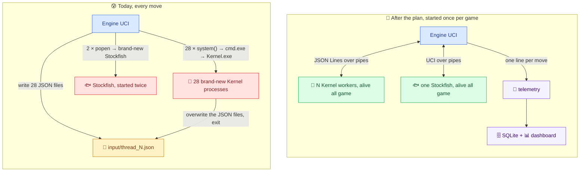

# 🔌🗄️ Mr. Bits — Engine Communication & Game Database Plan

**Written by Claude Opus 5.5, for Tareq.** 🤝
*October 23, 2026 · **v2, October 25:** reviewed by 8 agents, prototyped on copies, and Phase 1 merged into one tested file for tonight · nothing in the engine or bot was changed yet*

**In one sentence:** most of each move's overhead isn't your search, it's *starting processes*. Stockfish gets started from scratch twice per move (~0.3–0.55 s each), and on every Kernel move (plies 4–80) up to 28 `Kernel.exe` processes get started. The fix is to keep every process alive for the whole game and let them talk through **pipes**. Then we record everything into **one SQLite database** with a **dashboard** on top. 🚀

> ⚠️ **Viewing note:** like the docs in `Claude Docs/`, these files use Mermaid diagrams and small HTML color boxes. Your Markdown PDF extension renders both, and every diagram was test-rendered with the same Mermaid build ✅. **The `.html` files in this folder are from October 23**: re-export them after reading v2.

---

## 📁 What's in this folder

| File | What it is | Keep or delete? |
|---|---|---|
| `01 - Tutorial - How Two Processes Talk.md` | The knowledge you asked for: what IPC and pipes are, what Mr. Bits does today, what best practice looks like | 🗑️ **Temporary**: delete it once you've learned it, as you said |
| `02 - Plan - Engine UCI and Kernel Communication.md` | The plan to replace "JSON files + `system()`" with long-lived workers that talk over pipes, with each phase's status | Keep until it's done |
| `03 - Plan - Game Database and Dashboard.md` | The plan for one SQLite database (every game, every move, every worker) and the dashboard | Keep until it's done |
| `04 - Runbook for Tonight.md` 🌙 | **Tonight's checklist**: exact commands, a "done" check per step, rollback | Keep until tonight is done |
| `ready-for-tonight/` | The tested files: tonight's `Engine UCI.cpp` + headers + its diff, the smoke test, the D0 database files, and the Phase 2/3 prototypes | Its contents move into the engine tonight |

**Reading order:** for tonight, **this page → 04**, and 02 when you want the *why*. For learning: 01 → 02 → 03.

---

## 📏 The measurements this plan stands on (your laptop ✅)

All measured on copies in my temp folder, with your real `Kernel.exe` and your real Stockfish binary:

| What was measured | Today's way | The pipe way |
|---|---|---|
| Starting `cmd.exe` (what every `system()` call pays first) | 25 ms per start | not needed |
| One Stockfish query (`go perft 1`, used to get the legal moves) | **546 ms** on Oct 23 (worst 2.0 s), **310–340 ms** on Oct 25: it depends on the load | **~0.2 ms** (one Stockfish kept alive) |
| A move that Stockfish plays, end to end through python-chess | **670 ms** | **80 ms** ✅ tonight's file |
| One `Kernel.exe` worker with a 1-second budget | 172 ms of wall time, of which 126 ms is search | the process already exists |
| 28 `Kernel.exe` started at once (your real pattern) | **537 ms** per batch, for ~227 ms of actual search per worker | **~0.4 ms** round trip for all 28 (dummy workers) |

So **≈ 0.6–1.1 s of every move is spent starting Stockfish**, twice per move on every path: legal moves + the stalemate check on Kernel moves, and legal moves + the depth search on Stockfish moves. On top of that, ≈ 0.3 s goes to starting the 28 Kernels. That matches your lichess logs: moves with a 1-second cap took a median of **2.16 s**. 😮

---

## 🗺️ Before → after

**Tonight covers the Stockfish half** (one Stockfish, alive all game). The Kernel half needs Phase 3's glue code: the worker side (Phase 2) is ready, and the pool is prototyped.

---

## 💬 Short answers to your direct questions

| You asked | Short answer | Details |
|---|---|---|
| "What do we call this? Pipelining?" | **IPC (Inter-Process Communication)**, done with **pipes**. "Pipelining" is a different thing (overlapping work in stages) | 01 §1 |
| "Should Engine UCI give the input to the Kernel directly?" | **Yes.** Start each Kernel once, connect its `stdin`/`stdout` to pipes, and send one message per move. You already do exactly this with lichess-bot ↔ Engine UCI without noticing 😄 | 01 §3, 02 |
| "Is it like making the executable and calling it?" | Today it's "start a new process per move". Best practice is "start once, keep alive, send jobs" (a **worker pool**). The same lesson web servers learned in the 1990s | 01 §4 |
| "Store everything in a database?" | **Yes: one SQLite file.** Results, ratings and rating changes come from the lichess API, from go-live day on (you chose a fresh history). Engine internals come from a small telemetry line per move. A `GameId` option links the two (it's in tonight's file) | 03 |
| "A dashboard to filter and view everything?" | **Yes: Streamlit** (a Python dashboard that's quick to build), plus **Datasette** for zero-code browsing | 03 §7 |

---

## ✅ Already decided by you

- **Tonight: Phase 1** (one Stockfish, in one place, kept alive), plus the `GameId` option that comes with it. The runbook is `04`.
- **A fresh history.** No old games or history files are migrated. `old_history/` is empty and referenced by nothing, so it goes tonight. `history/` is still written by the engine, so it goes once Phase 4's telemetry replaces the text reports.
- **One Stockfish only, in the right place.** There are **four** identical copies today (41 MB each, all committed to git) and two copies of the whole Stockfish package. Tonight keeps `engines/stockfish/`, fixes the path problem at its root (paths built from the `.exe`'s own folder), proves nothing uses the others, then deletes them.
- **A new repo with a fresh git history after the cleanup.** None of the deleted duplicates or old files will survive in the history. Runbook step 8.

## 🤔 Decisions waiting for you

1. **The new repo** (runbook step 8): a **new GitLab project** (recommended; the old one stays as the archive), or a force-push over `tareq-ali-group/mr-bits-chess-engine`. And what goes in: **not `Chess Dataset/`, which is a single 21.4 GB file** 😱.
2. **Smart App Control is ON** on your laptop, and it blocks some fresh builds. My recommendation: **keep it on**, and relink when it blocks (a new build stamp means a new verdict). ⚠️ On Windows 11 releases so far, turning it off has been one-way (it only comes back with a Windows reset), so check the Windows Security page before deciding.
3. **Build `Kernel.exe` with `-O2`?** It gave **bit-identical answers and a 3.6× faster search** on all 144 test requests. That's free strength: the same time budget finishes the next depth far more often. (Not always: the Kernel searches even depths only, and each next one costs ~13–36× the nodes of the last.) Add `-march=native` only for this laptop. A/B it in games first, since a deeper search changes which moves get played.
4. **Message format between Engine UCI and Kernel:** **JSON Lines** (recommended, and what the Phase 2 prototype already speaks), or a custom text protocol like UCI.
5. **How the engine writes to the database:** a **"flight recorder" log file + a Python importer** (recommended), or SQLite linked directly into the C++.
6. **Dashboard:** **Streamlit** (recommended) + Datasette.
7. **Worker count after Phase 3:** measure 16 / 20 / 24 / 28. On your laptop, 28 workers measured only ~8–9× the speed of one core in the earlier NNUE benchmark.

---

## 🔎 Side discoveries (not IPC, but you should know)

| Found | Why it matters | Where |
|---|---|---|
| ⏱️ **The time ladder allows 51 s for one move** in a 2+3 game (60–120 s left: 50 + winc/3000), and the 5% rule only stops *starting* new depths | In game `tN252leL`, plies 5 and 7 took **29.1 s and 54.0 s** out of a 2-minute clock. A time-forfeit risk | `Engine UCI.cpp` 529–574 |
| 🎲 **~1.5% of today's Stockfish bestmoves are slightly random** | The double-command trick lets the second `position` line disturb the running search (Stockfish's draw-score jitter uses the node counter). Tonight's clean search removes that | 02, Phase 1b |
| 🪦 **A failed Kernel launch makes the engine play `bestmove It should be a default value…`** | It happens when all real scores are negative. Fixed in tonight's file: Stockfish plays instead, and the log says why | 02, Phase 1a step 3 |
| 💥 **No reachable Stockfish = an access-violation crash**, not an error message | Tonight's file logs `<-- MISSING` at startup, and lichess-bot's startup check catches it before any game | 02, Phase 1a |
| 🤝 **`isTiePosition` only detects stalemate** | No threefold, 50-move or insufficient-material draws, despite its comment. The stalemate override can't see the other draws | 02, Phase 1b |
| ⌛ **python-chess gives clock-based moves no timeout at all** | A hung Engine UCI would block the game until lichess flags it. The Stockfish watchdog (tonight) and the worker deadlines (Phase 3) are the protection | 02, §5 |
| 🔐 **lichess now refuses anonymous game exports** (401) | The database sync needs the bot's token | 03 §2 |

---

## 🧾 How I made this (and what I didn't touch)

- **Read:** `Engine UCI.cpp` (all of it), `Kernel.cpp` (main, globals, `ProcessHandler`, the search's root and clock), `Stockfish Handler.hpp`, lichess-bot's game loop and engine wrapper, your installed python-chess 1.10.0 source, Stockfish 16's source, and the official lichess API spec.
- **October 25 review:** 4 prototype agents (persistent Stockfish, Kernel worker, worker pool, paths + GameId), which proved their findings with tests, and 2 reviewers (every code claim, the whole database plan), whose 49 findings were each re-checked by a verifier: 47 confirmed real.
- **Then I built** the integration myself: the three prototypes merged into one `Engine UCI.cpp`, built with your normal flags, and tested through the real python-chess (A/B against today's handler, a Stockfish process counter, and a forced Kernel failure).
- **Changed:** nothing in the repo except this folder. I never started lichess-bot, never used the token, and didn't open the neural-network lab's folders.
- ⚠️ **Coordination note:** Phase 2 edits `Kernel.cpp` (`main()`, a new reset function, a few `ProcessHandler` getters, and the root loop in `GetBestMoveWithItsScore`). The neural-network work also edits `Kernel.cpp` (search and evaluation). Do each on its own git branch so the merges stay easy, and pause the other agents tonight while we rebuild under `engines/`.

— **Claude Opus 5.5** 🤖
