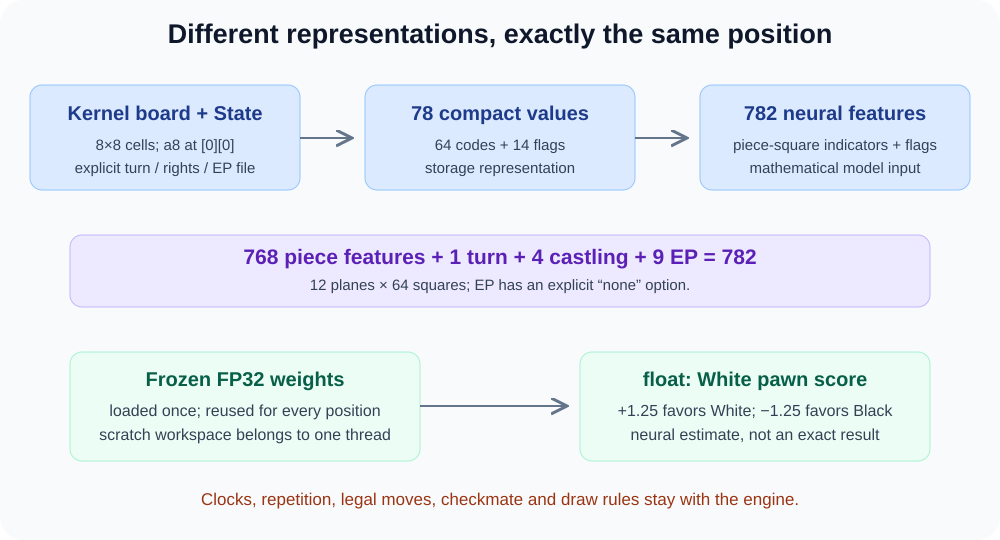
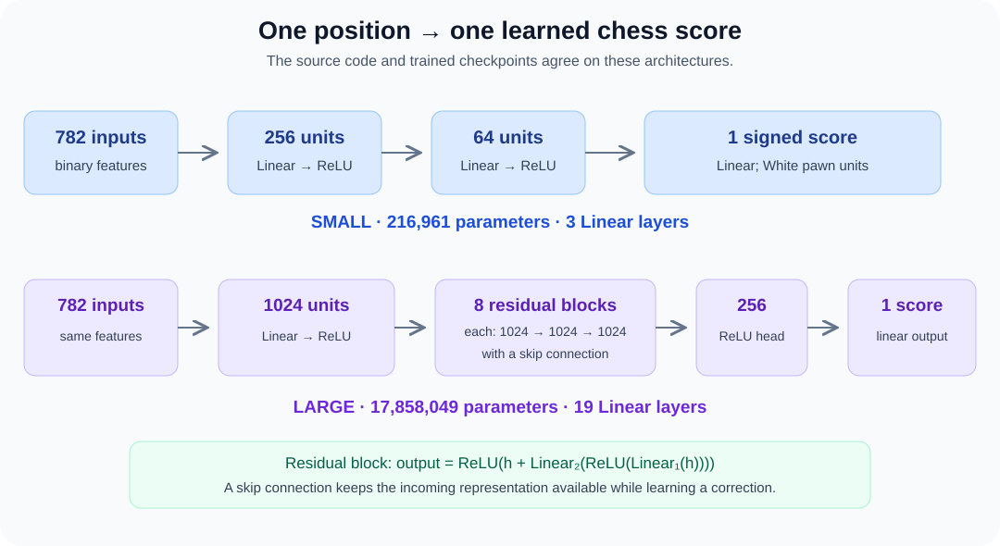
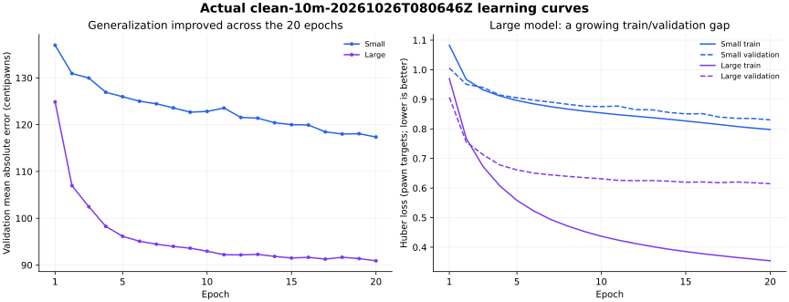

# ♟️ Your trained chess networks: from 782 inputs to a C++ score


> **28 October update:** The documentation/lab now lives under `lichess-bot-master/Mr Bits Docs/`, and the evaluator folder is named `engines/Neural Networks/`. The original `Kernel.cpp` now contains the two requested neural sorting functions, deliberately uncalled. [Kernel versions and usage](../../../engines/Kernels/README.md) explain the new `v1`, `v2`, and `v3` copies and their shared helper. The earlier inference measurements below remain measurements of those trained evaluators, not engine-game results.
<p style="color:#2563eb;font-size:1.15em"><strong>Mr_Bits Neural Network Lab · a practical lesson and a record of what we actually trained</strong></p>

**27 October 2026 · Run: `clean-10m-20261026T080646Z` · Feature contract: `board782_v1`**

Bro, we now have two real trained evaluators. Each takes a chess position and produces **one signed number in White-perspective pawn units**. The Small model is a compact candidate for frequent CPU calls. The Large model predicts the held-out teacher scores better, but carries much more computation. Both are useful experiments; neither has an established Elo or a demonstrated 95% best-move retention rate yet. ❤️

This guide explains the exact models, their input and output, what their results mean, and how their separate C++ headers fit beside your engine. It documents the downloaded run, rather than assuming every current default configuration was used. **Your existing `Kernel.cpp` is not changed by these evaluator components.**

> 🟦 **Read this first:** evaluation error, move ordering quality, and engine playing strength are three different measurements. We have held-out evaluation error. We still need a complete legal-child ranking benchmark and equal-time engine matches before claiming the network improves search.

## 1. The whole story on one page



During **training**, we already know a Stockfish search score for each accepted position. We show the network a position, compare its prediction with that score, and adjust its weights. During **inference**, the weights are frozen: supply a new position, run arithmetic through those weights, receive a score. No Stockfish search, training, dataset scan, GPU rental, or Python interpreter is required by the standalone C++ evaluator.

The label is a searched engine estimate, not a mathematically perfect answer. Training a static network to imitate searched scores is useful precisely because it tries to compress some expensive search knowledge into a cheaper function. It does not make the network a complete search engine.

```text
TRAINING, performed offline
position + saved Stockfish score → prediction → loss → weight update
                                      repeated for many mini-batches

INFERENCE, performed inside an eventual engine integration
position + current state → frozen weights → one estimated score
```

For now, the trained models are **general evaluators**. We did not train separate opening, middlegame, and endgame specialists in this run.

## 2. Exactly what enters the network? 🧩

The mathematical input is a vector of **782 `float32` features**. Each feature is currently a binary `0` or `1`. It is not a FEN string, an image, 64 raw piece numbers, or the future moves Stockfish searched.

### The 768 piece-square features

We have 12 piece kinds, including color, and 64 squares. Each kind gets a plane of 64 indicators:

| Plane | Piece | Input indices |
|---|---|---:|
| 0 | White pawn `P` | 0–63 |
| 1 | White knight `N` | 64–127 |
| 2 | White bishop `B` | 128–191 |
| 3 | White rook `R` | 192–255 |
| 4 | White queen `Q` | 256–319 |
| 5 | White king `K` | 320–383 |
| 6 | Black pawn `p` | 384–447 |
| 7 | Black knight `n` | 448–511 |
| 8 | Black bishop `b` | 512–575 |
| 9 | Black rook `r` | 576–639 |
| 10 | Black queen `q` | 640–703 |
| 11 | Black king `k` | 704–767 |

The square index follows **`a8, b8, …, h8, a7, …, h1`**. With zero-based array row and column:

```text
square_index = row * 8 + column
feature_index = plane * 64 + square_index

a8 = 0       h8 = 7
a7 = 8       h7 = 15
...
a1 = 56      h1 = 63
```

For a White knight on `f3`, the row is 5, column is 5, square index is 45, and feature `64 + 45 = 109` is `1`. The other piece planes at that square remain `0`. An empty square activates no piece feature. This keeps identity distinct: we do not tell the network that a queen is numerically “six times a pawn.” It learns relationships from separate indicators.

### The remaining 14 flags

| Index | Meaning | Encoding |
|---:|---|---|
| 768 | Side to move | `1` White; `0` Black |
| 769 | White kingside castling right | `1` if retained |
| 770 | White queenside castling right | `1` if retained |
| 771 | Black kingside castling right | `1` if retained |
| 772 | Black queenside castling right | `1` if retained |
| 773 | No recorded en passant target | One EP choice must be `1` |
| 774–781 | Recorded EP file `a`–`h` | One-hot file choice |

Castling rights mean **rights still retained**, not whether castling is legal this turn. A piece blocking `f1` does not erase White's kingside right. An attacked transit square does not erase it either. Legal move generation decides whether castling can actually be played.

En passant preserves the recorded target file, including a target for which no legal capture exists. The target rank follows from whose turn it is in orthodox chess: rank 6 for White to move, rank 3 for Black. “EP unavailable” activates index 773 rather than making all nine EP features zero.

**`768 + 1 + 4 + 9 = 782`.** These exact conventions must match training. Rotating the board, reversing colors, or guessing missing rights produces a different input, even if the C++ arithmetic itself is flawless.

### Why do the stored records have only 78 input bytes?

The dataset stores a compact representation to avoid saving mostly zero floats:

| Compact indices | Content |
|---:|---|
| 0–63 | Piece code for each square, in the same `a8` → `h1` order |
| 64 | White-to-move flag |
| 65–68 | Castling flags: White K, White Q, Black K, Black Q |
| 69 | EP none |
| 70–77 | EP files `a`–`h` |

Compact piece codes are `0` empty; `1,2,3,4,5,6` White pawn, knight, bishop, rook, queen, king; `7,8,9,10,11,12` the corresponding Black pieces. Expansion converts the 64 codes into 768 binary features and copies the 14 flags. **A compact `78`-byte position and an expanded `782`-float position represent the same information.**

The complete prepared row is **108 bytes**, because it also stores a 4-byte cp label, 2-byte depth, 8-byte node count, and 16-byte position key. Those metadata fields are not additional neural inputs. See [the data pipeline](DATA_PIPELINE.md) for the disk layout.

### Your Kernel uses a different piece encoding

Your engine's lower three bits encode type, while bit 3 marks White. Its knight code is `3`, not the compact dataset's `2`:

| Piece | Kernel Black | Kernel White | Compact White | Compact Black |
|---|---:|---:|---:|---:|
| Empty | 0 | — | 0 | 0 |
| Pawn | 1 | 9 | 1 | 7 |
| Knight | 3 | 11 | 2 | 8 |
| Bishop | 4 | 12 | 3 | 9 |
| Rook | 5 | 13 | 4 | 10 |
| Queen | 6 | 14 | 5 | 11 |
| King | 7 | 15 | 6 | 12 |

The adapter reads the low nibble, maps the types, and ignores higher move-related bits. **Do not pass compact dataset codes into an API expecting Kernel codes.** State must come from your engine's current position: castling rights cannot be reconstructed reliably from piece placement alone.

### What the network cannot see

`board782_v1` has no halfmove clock, fullmove number, repetition history, move list, last capture, or game ID. The source export did not supply the missing history. Appending `0 1` when parsing a four-field FEN provides parser counters; it does not recover the real game history.

The engine must still handle legal moves, checkmate, stalemate, repetition and move-count draw rules using its complete state. The models support **orthodox chess**, not arbitrary variants or Chess960 positions. The source continuation notation uses Chess960-compatible castling notation, but that notation alone does not turn our feature contract into a Chess960 model.

## 3. Exactly what comes out? 🎯

One **FP32 signed White-perspective pawn score**:

| Network output | Meaning |
|---:|---|
| `+0.35f` | Estimated White advantage of 0.35 pawn units |
| `-1.20f` | Estimated Black advantage of 1.20 pawn units |
| `0.0f` | Approximately balanced according to the learned evaluator |

The perspective remains White even when Black is to move. To rank legal children, White prefers higher scores; Black prefers lower scores. A negamax search that stores side-to-move scores must convert consistently:

```cpp
float side_to_move_pawns = state.white_to_move ? white_pawns : -white_pawns;
```

Keep the units explicit. Multiply by `100` only at a boundary that expects centipawns. A `+1.0` neural score does not mean a 100% winning probability, and a `+9.0` score does not prove a literal queen is missing.

Training targets were `clamp(raw_cp / 100, -15, +15)`. Accepted labels already satisfy `|cp| <= 1500`, so this release's recorded test clipping fraction is zero. The final network layer is **linear**: the prediction itself is not clamped to `[-15, +15]` and can go outside that range. It is neither a mate-distance output nor an exact terminal detector.

## 4. Meet the two actual architectures 🧠



### Small: a compact multilayer perceptron

```text
782 → Linear(256) → ReLU → Linear(64) → ReLU → Linear(1)
```

Each Linear layer computes weighted sums and adds biases. For example, one first-layer unit computes `b + w₀x₀ + … + w₇₈₁x₇₈₁`. ReLU means `max(0, value)`. Combining learned sums with nonlinear activations lets later layers represent relationships between pieces and state flags, rather than only adding fixed piece values.

Small contains **216,961 learned parameters**: weights and biases. It has three Linear layers, two hidden layers and **216,640 dense Linear multiply-accumulates** per position. That operation count excludes biases, activations, feature handling, validation, and other overhead.

### Large: a wider residual network

```text
782 → Linear(1024) → ReLU
    → 8 residual blocks, each at width 1024
    → Linear(256) → ReLU → Linear(1)

One residual block:
h_next = ReLU(h + Linear₂(ReLU(Linear₁(h))))
```

The `h + ...` is a skip connection. The block can learn a correction while keeping its incoming representation available. This helps optimization of a deeper network; it does not guarantee better chess for every input.

Large contains **17,858,049 parameters**, 19 Linear layers, and **17,840,384 dense Linear multiply-accumulates** per position. It has about 82 times Small's parameters. Its better prediction error is real in this run; whether it earns its CPU cost inside search is a separate experiment.

### “Depth” has two completely different meanings here

**Neural depth** is the sequence of learned transformations used for one evaluation. **Search depth** is how far the chess engine explores moves. A network with 19 Linear layers does not search 19 moves ahead. It does no explicit move tree traversal during one forward pass.

The network can learn patterns associated with future consequences because the teacher labels came from search. That is different from proving those consequences in the current position. Quiet sacrifices and tactical exceptions remain reasons to retain search.

## 5. What 20 epochs actually did 📚

The actual downloaded release selected **10,000,000 distinct visible inputs** from a bounded scan:

```text
first 20,000,000 raw records scanned
     ↓ structural, search-quality and finite-score filters
13,515,498 accepted unique candidates
     ↓ deterministic hash selection within that scanned pool
10,000,000 prepared positions
     ├── 9,001,091 training positions
     ├──   499,588 validation positions
     └──   499,321 held-out test positions
```

This is not a uniform sample of the complete Lichess archive. The hash selection samples the accepted **20-million-record prefix**. Archive ordering, human analysis choices, related positions, and filtering can still bias the distribution. Exact repeated visible inputs were kept in one hash split; nearby but different positions can remain correlated because complete game provenance was unavailable.

Preparation selected the strongest saved analysis by `(depth, knodes)` and then its first PV. This release required depth **20–80**, at least **1,000 knodes**, a finite score within **±1,500 cp**, a structurally valid nonterminal orthodox parent, and a fully legal saved continuation. Mate labels were rejected. One thousand knodes means one million searched nodes; a reported depth is selective search depth, not proof that every branch was exhaustively searched that far. The continuation was checked for legality but was **not supplied as a neural input**.

Both models saw the same training release and used:

| Setting | Actual downloaded run |
|---|---|
| Epochs completed | 20 each |
| Mini-batch size | 2,048 |
| Updates per epoch | 4,396, including the final short batch |
| Total optimizer updates | 87,920 each |
| Optimizer | AdamW |
| Learning rate | 0.0003 |
| Weight decay | 0.0001 |
| Training loss | Huber; delta 1.0 pawn |
| Gradient clipping | Global norm 1.0 |
| Seed | 20261023 |
| Best checkpoint | Epoch 20 for both, selected by validation Huber |
| Training/validation arithmetic | CUDA bfloat16 autocast |
| Saved learned parameters | FP32 |
| Held-out test evaluation | FP32, explicitly recorded in each `test.json` |
| Recorded GPU | NVIDIA RTX PRO 6000 Blackwell Server Edition |

An **epoch** is one traversal of the training split. Twenty epochs means roughly **180,021,820 training-position presentations per model**, with the same 9,001,091 examples revisited. It does not mean we acquired 180 million independent positions or trained on validation/test records.

A **mini-batch** groups positions for parallel arithmetic. The network predicts them, the loss compares predictions with labels, backpropagation computes how weights influenced the error, and AdamW updates those weights. Repeating this process builds the learned function.

Huber loss behaves quadratically near a correct answer and linearly for large errors. It makes big mistakes matter without letting a few extreme examples dominate as strongly as pure squared error. It remains a training objective, not a chess rating.

### Activations: why not just add more Linear layers?

Several Linear layers without nonlinear activations collapse algebraically into one affine transformation. ReLU makes the composition more expressive. ReLU inside the network does **not** forbid negative chess evaluations: the final Linear layer can output either sign.

The lab can build other activation experiments, including GELU, SiLU and tanh. Changing an activation changes the function and generally requires training an appropriate model. Replacing ReLU in the deployed C++ code while keeping these weights would not be an optimization of the same model; it would deploy a different, unvalidated evaluator.

### More epochs are an experiment, not a guarantee



This plot uses the actual `metrics.csv` values, not rounded console summaries. The source training and validation passes used bfloat16 autocast; full decimal logging does not change that arithmetic precision.

Both validation MAEs continued to improve overall and both best checkpoints occurred at epoch 20. That supports testing a controlled continuation. However, Large's training Huber reached `0.35408567000012436` while validation Huber remained `0.6146177878916279`. That gap is a warning to watch generalization. It does not establish that epoch 21 will be worse, nor that unlimited additional training will help.

Choose experiments on validation, save the best validation checkpoint, and keep the final test set reserved for declared comparisons. Consider learning-rate scheduling, data coverage and tactical examples alongside more epochs. Do not repeatedly tune settings against the final test and still call it untouched evidence.

## 6. Honest results: better score prediction, with important gaps 📊

The following are the downloaded **FP32 held-out test** metrics on **499,321 positions**. Their original numerical precision is preserved below; machine-readable originals remain in the run directories.

| Metric | Small | Large |
|---|---:|---:|
| Mean absolute error, cp | 117.46930382031158 | 90.8242293011166 |
| Root mean squared error, cp | 199.7820215901521 | 173.5659051718218 |
| Signed prediction bias, cp | -11.49521980664952 | -2.544820890946876 |
| Huber loss | 0.8311656711934808 | 0.6138006459506934 |
| Fraction within 25 cp | 0.27679989425640017 | 0.3935504414995564 |
| Fraction within 50 cp | 0.46695612641967793 | 0.5820143755219588 |
| Fraction within 100 cp | 0.6617626737108994 | 0.752732210341644 |

**Interpretation:** Large's average absolute miss is about `0.908` pawn units, versus Small's `1.175`, on this filtered distribution. Large is within half a pawn of its teacher on about 58.2% of these positions. These fractions describe score proximity, not move accuracy or a probability that the network is “correct.”

The test's always-zero baseline has MAE `168.39025396488432 cp`; the simple material baseline has `177.94438447411585 cp`. Both networks improve on those baselines. This supports that they learned useful structure beyond these particular baselines, but does not establish superiority over your existing handcrafted evaluator or any Stockfish NNUE.

RMSE exceeds MAE because larger misses receive more emphasis. The negative bias means a small average shift toward Black in the residual error, not that the network always undervalues White. One average does not reveal whether a specific tactical position is safe.

### Material coverage exposes where work remains

| Material bucket | Test positions | Small MAE, cp | Large MAE, cp |
|---|---:|---:|---:|
| Low material | 114,511 | 161.7007558510194 | 117.68486887903882 |
| Medium material | 89,550 | 156.70647374193538 | 122.53828371951782 |
| High material | 295,260 | 88.41465242842038 | 70.78821943904498 |

These buckets count non-pawn material with knight/bishop = 1, rook = 2, queen = 4, summed across both colors. Low is at most 8; medium is 9–16; high is above 16. They are **material buckets**, not exact opening/middlegame/endgame classifications. A closed middlegame and an early opening can both have high material.

The models are weaker on low/medium material in this test. Endgame-specialist training is a plausible later experiment, but first inspect coverage and failure cases. Missing draw history cannot be fixed by merely widening the network. Exact immediate terminals and supported tablebase probes should still take precedence.

> 🟧 **The biggest missing chess metric:** these scalar test records do not give an independently scored complete set of legal children for every parent. Therefore they cannot establish best-move recall@5, safe pruning percentages, or the chance of discarding a unique defense.

The preparation policy rejected mate labels and scores beyond ±15 pawns, so tactical mates and decisive tails are not represented as ordinary regression targets. Even among accepted examples, deeper search is an estimate and teacher versions vary. The held-out metric is evidence about this target distribution, not a guarantee across all chess.

## 7. The C++ components: load once, score many times ⚙️

The standalone deployment lives beside your engine in this deliberately named folder:

```text
lichess-bot-master/engines/Neural Networks/
├── common.hpp
├── Small/
│   ├── Small.hpp
│   ├── weights.bin
│   └── README.md
└── Large/
    ├── Large.hpp
    ├── weights.bin
    └── README.md
```

The trained C++17 model is code **plus its corresponding weights file**. Including a header alone does not embed tens of megabytes of learned weights. `load(path)` reads the binary once into an object. Keep that object alive across positions and moves; loading on every leaf would turn inexpensive arithmetic into repeated disk I/O, parsing and memory allocation. The standalone executable does not depend on PyTorch or any third-party C++ inference library.

The C++ binary uses the learned **FP32** parameters. It is not an INT8 or FP16 quantization. The original PyTorch training checkpoints remain separate so training and experiments can continue.

### A complete minimal call

Place this example where the relative header path is appropriate, or add the `Neural Networks` directory to your compiler's include paths:

```cpp
#include <cstdint>
#include <iostream>
#include "Small/Small.hpp"

int main() {
    // Kernel piece codes; [0][0] is a8 and [7][7] is h1.
    const std::int8_t board[8][8] = {
        {5, 3, 4, 6, 7, 4, 3, 5},
        {1, 1, 1, 1, 1, 1, 1, 1},
        {0, 0, 0, 0, 0, 0, 0, 0},
        {0, 0, 0, 0, 0, 0, 0, 0},
        {0, 0, 0, 0, 0, 0, 0, 0},
        {0, 0, 0, 0, 0, 0, 0, 0},
        {9, 9, 9, 9, 9, 9, 9, 9},
        {13, 11, 12, 14, 15, 12, 11, 13}
    };

    auto model = mrbits::nn::Small::load("Small/weights.bin");
    mrbits::nn::Small::Workspace workspace;
    // White turn; all four retained castling rights; no EP target.
    mrbits::nn::State state{true, 15, -1};
    const float white_pawns = model.evaluate(board, state, workspace);
    std::cout << white_pawns << '\n';
}
```

For Large, include `Large/Large.hpp`, call `mrbits::nn::Large::load(...)`, and use `mrbits::nn::Large::Workspace`. The board/state/output contract is identical. The weights path is resolved against the process's **working directory**, not automatically against the header location; production callers should resolve and pass a reliable path.

`State` has these exact fields:

```cpp
struct State {
    bool white_to_move;
    std::uint8_t castling;  // WK=1, WQ=2, BK=4, BQ=8
    std::int8_t ep_file;    // -1 none; 0=a through 7=h
};
```

For example, White queenside plus Black kingside rights are `2 | 4`, or `6`. A recorded EP target on file `e` means `ep_file = 4`. The board parameter is an **8×8 `std::int8_t` array**, matching your Kernel's cell storage. An `int[8][8]` is a different C++ type; do not reinterpret it as bytes.

### What a Workspace is, and why one belongs to each thread

A forward pass needs temporary arrays for hidden activations. A `Workspace` provides reusable scratch memory so evaluating a position does not repeatedly allocate those arrays.

```text
one model loaded once, used read-only
             │
      ┌──────┼─────────┐
      ▼      ▼         ▼
  thread A thread B thread C
  its own  its own  its own
 workspace workspace workspace
```

Several search threads can share the frozen model through `const` references while each keeps its own Workspace. Copying the model object copies its parameter storage, so passing it by value to every worker wastes memory. The actual Workspace sizes are **2,304 bytes for Small** and **13,312 bytes for Large**, including raw projection accumulators and scratch arrays. Large fuses its second residual Linear result, skip addition and ReLU into one destination. Sharing one mutable Workspace concurrently would race: one position's intermediate values would overwrite another's. The caller must also ensure its board and state are not being mutated concurrently while an evaluation reads them.

This organization removes Python process launches and per-evaluation file handoffs from neural inference. How your Engine UCI and Kernel processes communicate remains a separate integration decision.

## 8. Where the CPU cost really goes 🚀

| Resource | Small | Large |
|---|---:|---:|
| Learned parameters | 216,961 | 17,858,049 |
| FP32 parameter payload | 867,844 bytes | 71,432,196 bytes |
| Actual `weights.bin`, including 64-byte header | 867,908 bytes | 71,432,260 bytes |
| Payload in MiB | About 0.828 | About 68.123 |
| Original `best.pt` checkpoint | 2,651,343 bytes | 214,382,535 bytes |
| Dense Linear MACs per position | 216,640 | 17,840,384 |

The weights binary also has a small format header; the payload figures above count learned floats only. The Python checkpoint is larger because it contains training state and metadata, including AdamW state. Its file size is not the inference model's required parameter memory. Runtime memory also includes Workspace arrays, container overhead, executable/code and any copies the caller creates.

### Sparse first projection: use the board's actual structure

Most of the 782 inputs are zero. A legal position has at most 32 occupied squares, plus one EP feature, up to four castling flags, and possibly the White-turn flag. The first Linear layer can therefore sum only the **active feature columns**, beginning with the bias. Multiplication by zero disappears, and multiplication by one becomes addition.

That is an exact algebraic optimization of this binary input contract. Different accumulation order can produce small floating-point differences, so cross-language checks still need explicit tolerances.

This helps Small substantially because its first projection dominates its original dense operation count. Large spends most of its work in the sixteen dense `1024 × 1024` layers inside its residual blocks. Making only Large's first projection sparse cannot erase that bulk. Memory locality and cache capacity matter as well; weights do not become cheap just because the training GPU was powerful.

### SIMD, batching and precision

A portable C++ implementation can keep contiguous weights and loops that optimizing compilers can vectorize. Architecture-specific SIMD or tuned linear algebra may improve throughput after measuring the target CPU. SIMD processes several values per instruction; it does not reduce parameter count or automatically preserve every rounding detail. Compiler settings and CPU instruction support must be recorded with timing results.

Batching sibling positions can improve hardware utilization, especially for Large. It also requires building those children, can delay a useful early alpha-beta cutoff, and is not automatically profitable at every node. Measure complete engine behavior, not only a matrix multiplication isolated from search.

FP16/INT8 deployment, distillation from Large into Small, and a purpose-designed incrementally updatable evaluator are further experiments. Each needs parity or quality measurements. The current binaries remain FP32; there is no hidden claim that quantization has already preserved chess quality.

The optional accumulator interface can update the first projection after feature additions/removals. It needs exact changes for captures, promotion, castling, EP, turn and rights. FP32 addition and subtraction are not perfectly reversible; many make/unmake cycles can accumulate drift. Saving/restoring the parent's raw accumulator costs **1,024 bytes per Small position** or **4,096 bytes per Large position**; periodic rebuilding is another strategy to measure. The interface does **not** make the later dense layers incremental, and it does not turn the trained architecture into Stockfish NNUE. Start with `evaluate(board, state, workspace)`; add incremental state only after make/unmake parity is demonstrated.

A [reproducible accumulator stress check](../reports/cpp-inference-clean-10m-20261026T080646Z/incremental-usage.md) completed 256 starting-position ↔ `e2e4` feature-delta round trips, rebuilding every 16. The maximum observed score drift was about **0.000167 cp for Small** and **0.000156 cp for Large**; full rebuilds restored the raw accumulators exactly. This is a bounded numerical check of those fixtures and that rebuild policy, not a universal drift guarantee or a chess-strength test.

### What the local C++ verification actually measured

The final harness **passed on 592 unique positions**: 256 from the prepared validation split and 336 special fixtures/legal-walk positions. It compared the actual exported weights with **Python/PyTorch CPU FP32**, without autocast, using both portable and AVX2/FMA C++ builds. Across both builds, maximum fresh-evaluation disagreement was approximately **0.000358 cp for Small** and **0.001192 cp for Large**. These are implementation-parity differences, far smaller than the models' teacher-prediction error.

The harness also checked both board adapters, malformed input/weight rejection, fresh accumulators, bounded feature deltas, and concurrent correctness with **four private Workspaces**. The four-thread check measured correctness, not parallel throughput. The separate 32-position delta-chain check observed at most about **0.011873 cp** Large score drift before rebasing; do not confuse it with either fresh-inference parity or the narrower starting-position/`e2e4` round-trip check above.

Here are the measured **median warm serial CPU latencies**, with one PyTorch compute thread and five timing rounds. The compiler was GCC 14.2.0 on the local Windows x64 Intel host. These are CPU measurements, not GPU measurements:

| Timed path | Small | Large |
|---|---:|---:|
| Python/PyTorch FP32, pre-expanded inputs, one call per position | 39.163 µs | 2.520 ms |
| Portable C++, prebuilt active features | 1.652 µs | 3.598 ms |
| Portable C++, compact-78 adapter + evaluation | 2.200 µs | 4.010 ms |
| AVX2/FMA C++, prebuilt active features | 0.955 µs | 2.820 ms |
| AVX2/FMA C++, compact-78 adapter + evaluation | 1.213 µs | 2.940 ms |

**One millisecond is 1,000 microseconds.** Large's AVX2/FMA evaluation took roughly 3,000 times Small's prebuilt-feature call here. Small's narrow sparse path performed very well in this local test. Large's optimized C++ path was still about **12% slower than PyTorch's** single-position call, so this result does not support a Large C++ speedup claim. Efficient deployed code cannot remove the cost of seventeen million mostly dense operations per position.

The timing scopes matter. C++ prebuilt-feature timing excludes feature preparation. The second C++ path starts with the **compact 78-byte representation**, not the Kernel's `int8_t[8][8]` board adapter. PyTorch starts with expanded `[1,782]` FP32 inputs and includes Python/PyTorch dispatch. Neither path includes move generation, making/unmaking legal children, sorting, search, startup weight loading, or GPU work. The host was not pinned/isolated; consult the per-round ranges before treating close timing differences as stable.

AVX2/FMA binaries require those instructions on the deployment CPU; these headers do not dispatch automatically at runtime. Use the portable build for an unknown target. Match compiler options across translation units and avoid `-ffast-math` when checking numerical agreement and finite-value validation.

The [verification summary](../reports/cpp-inference-clean-10m-20261026T080646Z/summary.json), [Small report](../reports/cpp-inference-clean-10m-20261026T080646Z/small-verification.json), and [Large report](../reports/cpp-inference-clean-10m-20261026T080646Z/large-verification.json) preserve exact numbers, hashes, tolerances, timing scopes, compiler commands and host metadata. Training/validation curves used bfloat16 autocast; deployment parity compares FP32 against FP32. A parity test is not another complete held-out chess evaluation.

To reproduce from the lab directory, use a **new** output folder and a CPU that supports the requested builds:

```powershell
python scripts/verify_cpp.py --help
python scripts/verify_cpp.py --models small large --builds portable avx2 --validation-positions 256 --rounds 5 --output reports/cpp-inference-recheck
```

Use `--builds portable` for a portable-only run, and `--compiler "PATH TO g++.exe"` when the compiler is not on your PATH. The harness reads the trained checkpoints and weights; it does not retrain the networks or edit the engine.

For search, still measure complete move-ranking latency, nodes per second and equal-time game results. Load weights once at startup, outside the per-position loop. These warm network microbenchmarks are **not engine nodes per second** and cannot establish whether pruning or deeper search improves playing strength.

## 9. How we should use these networks in search ♜

My first experiment would use **Small for move ordering**, retain all legal moves, and compare against your unchanged search. Large can serve as a research comparator, a selectively called evaluator, or a teacher for later distillation. Its presence alone does not prove those uses pay off.

```text
generate every legal move
       ↓
make each child with correct updated state
       ↓
score children; White high first / Black low first
       ↓
search in that order with normal exact rules and safeguards
       ↓
measure strength and time against a fixed baseline
```

Better ordering can cause alpha-beta to find useful bounds earlier. That allows more pruning based on search bounds without asserting that a low neural score makes a move impossible. Permanently discarding every move below the top five is a much stronger and riskier hypothesis: an evaluator can easily underrate the only move that avoids mate.

**A trust factor is a tunable heuristic, not a calibrated confidence guarantee.** The network outputs a score, not a verified error bar. Averaging Small and Large or observing that they agree does not establish safety, because they share training data, missing features and teacher biases.

Before hard pruning, build an independent benchmark that searches **every legal child** with a declared teacher budget. Measure strict best-move recall@1/@5/@7, near-best recall, cp regret and mate failures separately; inspect White and Black results, legal-move counts and material/tactical coverage. [The implemented ranking tools](MOVE_RANKING.md) already describe that distinction and the leakage checks.

A 95% recall@5 target means five percent of measured parents still lose all teacher-best moves. In a long search that can be consequential. Report confidence intervals and failure categories, not only one headline percentage. We have **not measured 95% retention for these downloaded checkpoints**.

Once ordering is useful, selective reductions with re-search can be tested before permanent omission. Protect checks, forcing moves, unique evasions, immediate terminals and sensitive late-game cases according to a measured search policy. Such safeguards reduce some risks; they do not prove the remaining pruning sound.

## 10. The next learning experiments, in a sensible order 🛠️

1. **Establish the deployment baseline.** Verify input mapping, Python/C++ FP32 parity, startup behavior and CPU cost. Freeze model hashes so future comparisons identify the actual weights.
2. **Measure ranking quality.** Use independently searched complete legal-child sets, including tactical defenses and low-material positions. Do not reuse sparse saved PVs as if they covered every move equally.
3. **Test ordering in the engine.** Use a fixed baseline, matched openings and equal wall-clock budgets. Include inference overhead; lower cp MAE alone does not select the engine-strength winner.
4. **Improve coverage.** Sample beyond the same source prefix. Audit related-position leakage and teacher consistency. Add carefully labeled hard examples from failure analysis, preserving a frozen final test.
5. **Try a training continuation.** Lower learning rates or scheduling may be worthwhile. Choose on validation; track the growing train/validation gap and compare against simply adding better data.
6. **Try distillation and specialists.** Large can provide additional teacher signals for a smaller model, but inherits its own mistakes. A material-aware or endgame specialist needs enough representative data and a smooth, measured gating policy. Compare it against a single general model at the same inference budget.
7. **Reconsider architecture if leaf cost dominates.** A network designed for incremental board updates may fit search better than this general residual model. First measure what the current compact model can do.

No one experiment makes an engine “perfect.” What makes this project convincing is that every claimed improvement has a repeatable target: correct state, measured predictions, measured ranking, measured runtime, then measured games. That is a strong engineering story in its own right, bro. ❤️

## 11. Files to keep together and sources of truth

The raw archive now belongs inside **`ChatGPT Neural Network Lab/Chess Dataset/`**. Prepared records live under `data/`; the downloaded trained run under `runs/`; deployment files under `lichess-bot-master/engines/Neural Networks/`. These roles are different. Deleting the training dataset is not necessary to load a C++ evaluator, but the source, release fingerprint, configs, checkpoints and reports are valuable reproducibility artifacts.

The exact downloaded data fingerprint is:

```text
f80ec3878a2d69b866ccfa5347a268c6c481f5b1f918cbba1a7dd6365326b77e
```

The source records supporting this guide are:

- [Frozen input encoding](../chesslab/features.py), [Kernel mapping](../chesslab/kernel_adapter.py), [architectures](../chesslab/models.py), [training](../chesslab/train.py), and [metric definitions](../chesslab/metrics.py).
- [Actual Small configuration](../runs/clean-10m-20261026T080646Z/small/config.json) and [prepared data manifest](../runs/clean-10m-20261026T080646Z/small/data_manifest.json).
- [Small FP32 test report](../runs/clean-10m-20261026T080646Z/small/test.json) and [Large FP32 test report](../runs/clean-10m-20261026T080646Z/large/test.json).
- [Small per-epoch CSV](../runs/clean-10m-20261026T080646Z/small/metrics.csv), [Large per-epoch CSV](../runs/clean-10m-20261026T080646Z/large/metrics.csv), and [downloaded comparison](../runs/clean-10m-20261026T080646Z/comparison.json).
- [Small C++ component](../../../engines/Neural%20Networks/Small/README.md) and [Large C++ component](../../../engines/Neural%20Networks/Large/README.md).

Colors and diagrams are presentation aids; the text, tables and code contain the full contract. SVG figures are local files and remain available without a Mermaid plugin or network connection. When converting this Markdown to HTML, keep the relative `assets/` folder beside the rendered document, or embed its SVG images in your converter.
