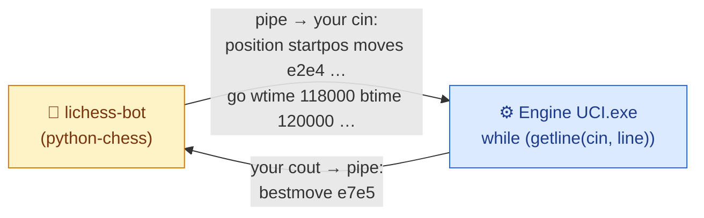
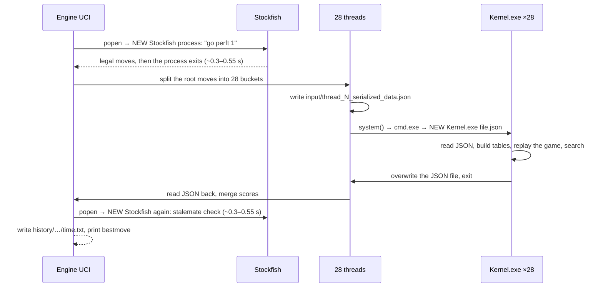
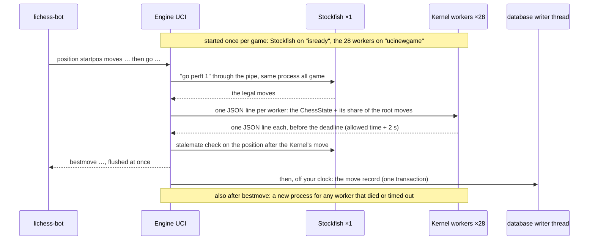
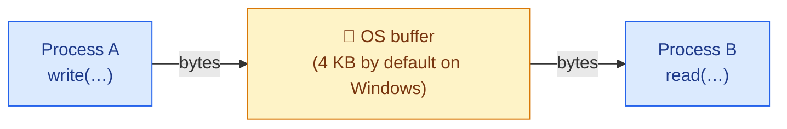

# 🎓 How Two Processes Talk — A Tutorial for Mr. Bits

**Written by Claude Opus 5.5, for Tareq.** 🤝 *October 23, 2026 · v2, October 25: corrected with what the prototypes measured on your laptop · **v4, October 27: as built***

> 🗑️ **This is the temporary tutorial you asked for.** Delete it once you've learned it. Phase 3 is built now, so it has done its job, and deleting it breaks no link: the README only names it in its reading order (plain text, so take it out of that list too), and plan 02 no longer points into it. Plan 03 and the runbook (04) don't depend on it.
>
> ✅ = measured on your laptop: October 23–25 (your old binaries and the prototypes), unless it says **October 27**, which means the built engine.

---

## 1. 🏷️ The name of the thing

<div style="background:#eff6ff;border-left:6px solid #2563eb;border-radius:10px;padding:12px 18px;margin:16px 0;color:#1e293b;">

**It's called IPC: Inter-Process Communication.** The specific technique you're describing ("Engine UCI gives the input to the Kernel directly") is **pipes**: connecting a child process's `stdin` and `stdout` to pipes owned by the parent.

It is **not** "pipelining". Pipelining means splitting work into stages that overlap in time, like a CPU working on several instructions at once, or an assembly line. Both words contain "pipe", so everyone mixes them up at first 😄.

</div>

The words you'll meet, translated into Mr. Bits:

| Term | Meaning | In Mr. Bits |
|---|---|---|
| **Process** | A running program with its own private memory | `Engine UCI.exe`, each `Kernel.exe`, Stockfish, lichess-bot |
| **Thread** | A line of execution *inside* a process, sharing that process's memory | Before: up to 28 `std::thread`s per move in Engine UCI, each waiting for its own brand-new `Kernel.exe`. Now: one reader thread per Kernel worker, plus the database's writer thread |
| **IPC** | Any way two processes exchange data | Before: JSON files in `input\`. Now: pipes |
| **Pipe** | A one-way byte channel the operating system manages, with a write end and a read end | How lichess-bot talks to Engine UCI, and now also how Engine UCI talks to Stockfish and to every Kernel worker |
| **stdin / stdout / stderr** | The three standard streams every process is born with | `cin`, `cout`, `cerr` |
| **Redirection** | Connecting a child's stdin/stdout to pipes (or files) instead of the console | What python-chess does to Engine UCI, and what Engine UCI now does to Stockfish and the Kernel workers |
| **Spawn** | Create a new process | Before: `system()` → `cmd.exe` → `Kernel.exe`, up to 28 times per move. Now: `CreateProcess` → `Kernel.exe` directly, 28 times per game (plus one for each worker that dies) |
| **Handle** | Windows' name for an open file, pipe end or process | Each pipe has two: a read end and a write end |
| **Worker / worker pool** | Long-lived child processes that wait for jobs | Built: 28 Kernels alive for the whole game (`engines\Kernel Workers.hpp`) |
| **Protocol** | The agreed message format | UCI between lichess-bot and Engine UCI (and between Engine UCI and Stockfish); JSON Lines between Engine UCI and the Kernel workers |
| **Framing** | How the reader knows where one message ends | One message per line, in UCI and in JSON Lines |
| **JSON Lines** (a.k.a. NDJSON) | One compact JSON object per line | The format for Engine UCI ⇄ Kernel |

---

## 2. 🧱 A process in 60 seconds

- **Every process has its own memory.** A `Kernel.exe` cannot read Engine UCI's variables, even on the same machine; the operating system forbids it. That isolation is a feature: one crash can't corrupt another program. It's also why your globals (`board`, `whitePieces`…) are safe in 28 processes and would *not* be safe in 28 threads.
- So when processes need to share data, **they need a channel the operating system provides**: a file, a pipe, a socket, shared memory…
- **Every process is born with three open "files":** `stdin` (number 0), `stdout` (1) and `stderr` (2). In a terminal they're the keyboard and the screen. But the parent that starts a process can connect them to *anything*: a file, or a pipe.

---

## 3. 😄 Surprise: you already wrote a pipe program

Look at Engine UCI's `main()`, as you first wrote it:

```cpp
while (getline(cin, line)) {             // read one command from stdin
    ...
    cout << "bestmove " << bestMove << "\n";   // answer on stdout
}
```

It never opens a file or a socket, yet lichess-bot talks to it all game long. How? lichess-bot uses python-chess, which starts `Engine UCI.exe` with its `stdin` and `stdout` **connected to pipes** (`SimpleEngine.popen_uci` in `lib/engine_wrapper.py`). python-chess writes `position …` and `go …` lines into one pipe and reads your `bestmove …` from the other.



**That's exactly the mechanism Engine UCI now uses with the Kernel workers and with Stockfish.** You don't need to learn a new world, just the parent's side of it.

<div style="background:#f5f3ff;border-left:6px solid #7c3aed;border-radius:10px;padding:12px 18px;margin:16px 0;color:#1e293b;">

**🤓 A hidden detail that saved you, until it doesn't:** `cout << "bestmove ..." << "\n"` has no flush, and output to a pipe is buffered. So why does lichess-bot receive it immediately? Because in C++, **`cin` is "tied" to `cout`**: before every `getline(cin, …)`, the library flushes `cout` automatically. Your loop goes straight back to `getline` after printing, so the answer gets flushed by luck 😄.

The day you add work *after* the print (a log line, telemetry), that work runs **before** the move leaves. Measured ✅: 1.5 s of work after an unflushed `bestmove` made python-chess wait 2,399 ms instead of 907 ms. So: **flush explicitly after every message**, and don't rely on the tie. Your `Engine UCI.cpp` does now (`SendUciLine()` ends every line with `flush`), and that day has come: the database record and the worker restarts run right *after* `bestmove`.

</div>

---

## 4. 🐢 What happened before, step by step (with measured costs)

Your original engine (the initial commit), before Phases 1, 2 and 3:



Measured on your laptop with your real binaries, October 23–25 ✅:

| Step | Cost |
|---|---|
| `cmd.exe` start (paid by every `system()` and `popen()`) | ~25 ms |
| One fresh Stockfish process answering `go perft 1` | **~0.55 s** on Oct 23 (worst run 2.0 s), **~0.31–0.34 s** on Oct 25: it depends on how busy the laptop is |
| The same query to a Stockfish kept alive and fed through pipes | **~0.2 ms** (0.18–0.29 ms) |
| One `Kernel.exe` with a 1 s budget: wall time vs. its own search time | 172 ms vs. 126 ms |
| 28 `Kernel.exe` at once: whole batch vs. search per worker | 537 ms vs. ~227 ms |
| The same 28 workers kept alive: one request to each and all 28 answers back | **~0.4 ms** (measured with dummy workers) |

So at a 1-second cap, a move cost ≈ **0.6–1.1 s of Stockfish launches + ≈ 0.3 s of Kernel launches + ≈ 0.25 s of real search**. That was most of the 2.16 s median your lichess logs showed for moves with a 1 s cap: these three parts add up to ≈ 1.2–1.7 s, and the rest was never broken down. Either way, most of each fast move was *startup*, not thinking.

<div style="background:#f8fafc;border-left:6px solid #475569;border-radius:10px;padding:12px 18px;margin:16px 0;color:#1e293b;">

**📜 History repeats:** in the 1990s, web servers ran a brand-new program for every web request ("CGI"). It was simple, and it was slow, because starting a process costs far more than the work it did. The fix was **FastCGI**: start the program once, keep it alive, and send it requests through a pipe or socket. That's exactly the move from "spawn `Kernel.exe` per move" to "a worker pool for the whole game". You re-invented CGI; now you've upgraded to FastCGI 😄.

</div>

### 🚀 …and now (October 27, as built)

Every helper starts **once per game** and stays alive: **one Stockfish** (it starts on `isready`) and **28 Kernel workers** (they start in a background thread on `ucinewgame`, and are usually ready before the first Kernel move at ply 5 or 6; if not, that one move waits for them, see plan 02 §2). A Kernel move is then **one JSON line each way per worker**, and the database write waits until `bestmove` has left:



Measured with the built engine on your laptop, October 27 ✅:

| Step | Cost |
|---|---|
| Starting one Kernel worker (`CreateProcess`, no `cmd.exe`): 28 per game, none per move | **17.7 ms** median, 37 ms max (280 launches) |
| Starting the one Stockfish, on `isready` | ~1.1 s on a cold first launch |
| A typical Kernel move with a 3–5 s budget | ~1.7–2.3 s, and that's the search itself (your 5% rule decides when it stops): the pipe round trip is negligible next to it |
| Replacing a worker that died or timed out | ~22–40 ms each, after `bestmove`, so off your clock. All 28 at once (only after a catastrophe): 0.4–0.9 s in 19 of 21 runs, 3.7 s and 5.2 s in the other 2 (both while the neural-network lab's heavy jobs were running), and that can eat into your next move's clock |

⚠️ **Not measured yet:** a live lichess game with the built engine (runbook 04, step 1). The 2.16 s above came from your lichess logs at a 1 s cap; these numbers come from tests on your laptop at other budgets, so they don't compare directly, and the real gain per move on lichess is still to be seen.

---

## 5. 🍽️ The menu of IPC mechanisms

| Mechanism | How it works | Speed | Difficulty | For Mr. Bits? |
|---|---|---|---|---|
| **Files** (before) | Writer writes a file; reader reads it after some signal (here: the process exiting) | Slow-ish, and forces a new process per message | Easy | ❌ Retired: `Kernel.exe` has no file mode any more |
| **Anonymous pipes** + redirected stdin/stdout | Parent creates pipes; the child inherits them as its stdin/stdout | Microseconds per message (0.2 ms round trip with Stockfish, 0.4 ms for all 28 workers ✅) | Medium | ⭐ **The recommended choice, and what Mr. Bits uses now** |
| **Named pipes** | A pipe with a name (`\\.\pipe\mrbits`) that any process can open | Same as pipes | Medium+ | If processes are started independently, or if you need a real read timeout (overlapped I/O, §6) |
| **Sockets** (TCP on `localhost`) | Like a network connection, on a port number | Fast (tens of µs) | Medium+ | If you want the same code on Linux (Nebius) or across machines |
| **Shared memory** (file mapping) | Both processes map the same RAM | Fastest (no copying at all) | Hard: needs locks and synchronization | Later: a transposition table shared by all workers |
| **Threads** (no IPC at all) | One process, shared memory | Fastest | Hardest for Mr. Bits: every global must become per-thread | The long-term option (the "thread-local state" in `Claude Docs/01 - Fable 5 Honest Evaluation of Mr Bits.md`) |

---

## 6. 🔧 How a pipe works inside



Four rules explain almost every pipe bug:
1. **One-way.** A conversation needs **two pipes**: requests go into the child's stdin, answers come out of its stdout.
2. **A byte stream, not messages.** The reader can receive half a message, or two at once. You need **framing** (§7).
3. **Blocking.** `read` waits until data arrives. `write` waits if the buffer is full, i.e. if nobody is reading. On Windows, a read on an anonymous pipe **can't time out by itself**: it blocks until data arrives or every write end closes.
4. **End of file.** When *every* write end of a pipe is closed, including copies a child inherited by accident, the reader gets EOF. On Windows, `ReadFile` then fails with `ERROR_BROKEN_PIPE` (109), which `getline` turns into end of input. That's how an *idle* worker knows its parent is gone and exits. A worker in the middle of a search doesn't read stdin, so it doesn't notice: only the Job Object (step 7 below) stops it.

### Starting a child with pipes on Windows (the steps)

`engines\Kernel Workers.hpp` does all of this for the 28 Kernel workers, and your `Stockfish Handler.hpp` does the same for the one Stockfish, with small differences (its stderr goes to `NUL`, it uses `CREATE_NO_WINDOW` instead of `DETACHED_PROCESS`, its own Job Object has `JOB_OBJECT_LIMIT_KILL_ON_JOB_CLOSE` only and is made at its first start, and its read timeout is a watchdog timer, see below). Here's what each step is for:

1. **`CreatePipe` twice**, one pipe for the child's stdin and one for its stdout. Pass `nSize = 65536`: the default is only 4 KB, and 64 KB pipes made big answers 4.5× faster ✅.
2. **Create both pipes non-inheritable** (`lpPipeAttributes = NULL`). Right before `CreateProcess`, make only the child's three handles inheritable (`SetHandleInformation(h, HANDLE_FLAG_INHERIT, HANDLE_FLAG_INHERIT)`), and pass a `STARTUPINFOEX` whose **`PROC_THREAD_ATTRIBUTE_HANDLE_LIST`** holds exactly those three (flag `EXTENDED_STARTUPINFO_PRESENT`). The child then inherits nothing else:
   - not its own stdin's write end (otherwise EOF never arrives: the classic bug);
   - not another worker's pipe ends. Measured ✅: 28 workers spawned in parallel without the list left 27 of 28 deaths undetectable, because a sibling held a copy of each one's stdout;
   - not Engine UCI's own stdin/stdout from python-chess (without the list, Python saw EOF 3 s late ✅).
3. **Fill the `STARTUPINFOEX`** (`StartupInfo.cb = sizeof(STARTUPINFOEX)`) with `STARTF_USESTDHANDLES`: `hStdInput` and `hStdOutput` = the child's pipe ends, `hStdError` = a log file opened with `FILE_APPEND_DATA` and `FILE_SHARE_READ | FILE_SHARE_WRITE` (your pool opens that same file, `engines\logs\kernel_workers_stderr.log`, once for every worker it starts, so all 28 append to one file, and it normally stays empty). All three must be inheritable and listed once each, and the list must stay alive until `CreateProcess` returns.
4. **`CreateProcess(fullExePath, writableQuotedCommandLine, …, bInheritHandles = TRUE, CREATE_SUSPENDED | DETACHED_PROCESS | EXTENDED_STARTUPINFO_PRESENT, …)`** starts `Kernel.exe` **directly**, with no `cmd.exe` in between.
   - `fullExePath` comes from the executable's own folder (plan 02, rule 8). Your code uses the `A` versions (`CreateProcessA`, `GetModuleFileNameA`): fine for `C:\Users\tareq\Desktop\Mr_Bits`, but a folder name with characters outside your Windows code page would need the `W` versions.
   - The command line is just the quoted path (`"C:\…\engines\Kernel.exe"`), with **no arguments**: a worker needs none. It must sit in a writable buffer, because `CreateProcess` may modify it.
   - `DETACHED_PROCESS` means no console window and no `conhost.exe` per worker (`CREATE_NO_WINDOW` would add one each).
   - No priority flag is needed: the child starts at NORMAL, and Kernel's `main()` raises itself to HIGH, as it always did.
   - One `CreateProcess` costs ~15–40 ms on this laptop (October 27: 17.7 ms median, 37 ms max over 280 launches of `Kernel.exe`), so the pool starts once per game, never per move.
5. **Close the child's ends in the parent immediately after `CreateProcess` returns** (success or failure), before starting the next worker. An end left open means the parent never sees EOF when that worker dies, and the next child may inherit it.
6. **Talk with `WriteFile`** (loop until every byte is written) **and a small buffered `ReadFile` line reader** that splits on `\n` and drops one trailing `\r`. One line can take many `ReadFile` calls. `ReadFile` failing with `ERROR_BROKEN_PIPE` (109) means EOF; `WriteFile` failing with `ERROR_NO_DATA` (232) means the worker is dead. (Standard C++ streams can't wrap a Windows handle.)
7. **Put every worker in one Job Object**, created once, before the first worker starts:
   - `CreateJobObject`, then `SetInformationJobObject` with `JOB_OBJECT_LIMIT_KILL_ON_JOB_CLOSE | JOB_OBJECT_LIMIT_DIE_ON_UNHANDLED_EXCEPTION`;
   - start each worker `CREATE_SUSPENDED`, call `AssignProcessToJobObject`, then `ResumeThread`, so it never runs outside the job;
   - keep the job handle open (and non-inheritable) all game. When Engine UCI exits or is killed, even with `taskkill /F`, Windows kills every worker, busy or idle (0 of 28 alive 0.1 s later ✅). Without it, busy workers ran on for seconds. October 27, the built engine: after a hard kill of Engine UCI, 0 Kernel and 0 Stockfish were left ✅ (Stockfish has its own job).
   - If Engine UCI is already inside a job, Windows 8+ simply nests the new one ✅.

**And the read timeout?** Rule 3 says a read can't time out. The pool gives each worker **one reader thread** that pushes every line it reads into a queue. The move waits on a condition variable with a deadline (`wait_until`), and a worker still silent at the deadline is killed with `TerminateProcess`. That ends its reader's blocked `ReadFile` in ~1.2 ms ✅. In your pool the deadline is the allowed time + 2 s (October 27: a frozen worker was cut off at 7,005–7,024 ms for a 7,000 ms deadline ✅), and the killed worker is replaced right after `bestmove`. Stockfish, one process asked one question at a time, gets a simpler guard: a watchdog timer (`CreateTimerQueueTimer`) kills it when a question takes too long (10 s, or 300 s for a search), and then it's restarted once and asked again.

The Linux version (for Nebius one day) is `pipe()` + `fork()` + `dup2()` + `exec()`. Small portable libraries do it for both systems: **tiny-process-library** (MIT), **reproc** (MIT), or **Boost.Process**.

**Why not `popen`?** Your old `Stockfish Handler.hpp` used `popen`. It's one-way only (read *or* write), and it goes through `cmd.exe`. That's why the handler wrote its commands into `temp_command_file.txt` and piped the file in with `<`, starting a new Stockfish for every single question. It's also why `getBestMoveByDepth` sent its `go` twice: the end of the file acted as `quit` and stopped a lone search at once (your theory, confirmed ✅). Phase 1 replaced all of it with one Stockfish and two pipes, and one `go` is enough now: a pipe has no end of file until you close it.

### The shape of both sides (pseudo-code)

```
// Kernel.exe  (the child, started with NO arguments: an argument → a clear error on stderr, exit code 1)
cout → stderr; _setmode(stdout and stdin, binary)   // nothing but answers may reach stdout
build the move tables ONCE                          // a second build doubles every slider move
while (getline(cin, line)):                         // one request per line
    strip a trailing '\r'
    request = parse(line)                           // a bad line → an "error" answer, never a crash
    if request.type == "quit": break
    if request.type == "hello": answer = ready
    else:                                           // "search"
        reset the game state, replay request.previousMoves
        answer = search(request.movesForThisThread, request.allowedEngineTimeInSeconds)
    fwrite(answer.toOneLine()); fputc('\n'); fflush(stdout)   // one answer per line, flushed
```

```
// Engine UCI.exe  (the parent), once per game: on "ucinewgame", in a background thread
job = createKillOnCloseJob()
for i in 1..28: worker[i] = spawnWithPipes(ExecutableDirectory() + "\\Kernel.exe", job)   // no arguments
                writeLine(worker[i], hello)
wait (deadline: 10 s) until every worker has answered ready

// every Kernel move
for each of min(28, usable workers, legal moves) workers: writeLine(worker.stdin, request with a new id)   // its round-robin share of the shuffled root moves
wait on a condition variable (deadline = allowed time + 2 s) until each reader thread has delivered the answer with that id
kill every worker still silent; respawn it after bestmove is printed AND flushed
```

---

## 7. ✂️ Framing: where does one message end?

A pipe delivers a *stream* of bytes, so you must agree on boundaries. There are two classic answers:
- **A delimiter:** one message per line, ended by `\n`. UCI does this.
- **A length prefix:** send 4 bytes with the size, then exactly that many bytes.

**Recommendation: JSON Lines**, one JSON object per line. You already use nlohmann/json, so that's what Engine UCI and the workers speak now. A real exchange with your built worker (October 27: Black to move after 1. e4 e5 2. Nf3, a 1 s budget, three root moves; `…` marks what I shortened):

```
{"allowedEngineTimeInSeconds":1,"bestMove":"…","bestMoveScore":0,"engineColor":false,"id":29,"movesForThisThread":["b8c6","d7d6","g8f6"],"previousMoves":["e2e4","e7e5","g1f3"],"report":"","type":"search"}
{"bestMove":"g8f6","depth":6,"id":29,"leafNodes":193753,"nodes":206146,"perDepth":[…],"pruned":9985,"rootScores":[…],"score":-150,"searchMs":76.586,"setupMs":0.016,"status":"ok","totalNodes":209411,"type":"result","unsearchedRootMoves":[]}
```

The request is the whole `ChessState`, exactly what the old JSON file held (so `bestMove`, `bestMoveScore` and `report` ride along, unused by the search), plus `type` and `id`. nlohmann/json writes the keys in alphabetical order, which is why `type` comes last: a JSON reader doesn't care. (And your 5% rule stopped this search after depth 6, at 77 ms of its second.)

⚠️ Use `json.dump()` **without** an indent. The old JSON files used `dump(4)`, which pretty-prints one object over many lines: fine for a file, wrong for line framing. Engine UCI now sends `request.dump()`, one line per request. Newlines *inside* strings (like the Kernel's old text report) are escaped as `\n` by the JSON library, so they're safe.

Three Windows traps, all hit by the prototypes ✅:
- **`\r\n`:** a child's stdout is in text mode, so each `\n` arrives as `\r\n`. Strip one trailing `\r` from every line you read (python-chess does the same), especially before comparing with strings like `readyok`. The child's text-mode `cin` already turns `\r\n` into `\n`. Your worker sidesteps the trap: its stdout is binary and written with `fwrite`, so its lines end in a bare `\n` (October 27: not one `\r` byte ✅), and both sides still strip a stray `\r`.
- **Invalid UTF-8:** a plain `dump()` throws `type_error.316` on a string that isn't valid UTF-8. In the worker, use `dump(-1, ' ', false, nlohmann::json::error_handler_t::replace)`: yours does.
- **Byte `0x1A`:** in text mode it means end of file: a text-mode child that receives one quietly exits (the prototypes' worker did). Your worker's stdin is binary, so there it's just a byte: that line is bad JSON, the worker answers `error` and carries on (October 27 ✅). JSON escapes it anyway, so it can't come out of `dump()`; never write raw bytes into a worker's stdin.

---

## 8. 🐛 The nine classic pipe bugs (six classics + three Windows ones)

<div style="background:#fef2f2;border-left:6px solid #dc2626;border-radius:10px;padding:12px 18px;margin:16px 0;color:#1e293b;">

1. **Forgot to flush** → the answer sits in a buffer and both sides wait forever, or it leaves late: the old Engine UCI's `bestmove` only went out at the next `getline` (§3). Flush after every message.
2. **Stray output on stdout** → the protocol is corrupted. A worker's stdout must carry *only* protocol messages. Your worker makes sure of it: before it builds its tables, it points `cout` at `stderr`, so even an old print (`PrintTheBoard`'s `W`/`B`/`.`, the old `cout` report: nothing calls them now, but if something ever does) lands in `engines\logs\kernel_workers_stderr.log` instead of the pipe. The answers are written by one function only, with `fwrite` + `fflush`. And the old way of calling it (`Kernel.exe <file.json>`) gets a clear error on `stderr` ("Kernel.exe doesn't read JSON files any more…") and exit code 1, instead of a worker that waits forever for input.
3. **Full-buffer deadlock** → the child writes lots of output that nobody reads, its buffer fills (only 4 KB by default for `CreatePipe(…, 0)`; pass 65536), and it blocks while the parent waits for it. Give each worker a reader thread that always drains its stdout, and send stderr to a file, never to a pipe nobody reads. The mirror case exists too: a request bigger than the buffer blocks the parent's `WriteFile` until the worker reads, so keep one request in flight per worker.
4. **Inherited handle leak** → a child keeps a copy of a pipe end it shouldn't have.
   - If it's **its own stdin's write end**, it never gets EOF.
   - If it's a **sibling worker's stdout write end**, killing or crashing that sibling is never noticed (measured: 27 of 28 workers with parallel spawns).
   - If it's **Engine UCI's own stdout** to python-chess, that pipe stays open after Engine UCI exits.

   The fix is `PROC_THREAD_ATTRIBUTE_HANDLE_LIST` with exactly the child's three handles (step 2 in §6).
5. **Partial reads** → always read up to the `\n`, never "one read = one message".
6. **Orphan processes** → if the parent crashes, workers keep running. Use a Job Object (step 7 in §6).
7. **Hung worker** → `ReadFile` on an anonymous pipe has no timeout. Wait for answers with a deadline (a reader thread + a condition variable), then `TerminateProcess` the silent worker; that ends the blocked read with `ERROR_BROKEN_PIPE`.
8. **`\r\n` line endings** → a text-mode child's `\n` arrives as `\r\n`. Strip the `\r`, or `"readyok\r" == "readyok"` is false.
9. **Writing to a dead worker** → `WriteFile` fails with `ERROR_NO_DATA` (232): treat that as "worker died". On Linux the same event is `SIGPIPE`, which kills the parent unless it's ignored.

</div>

---

## 9. 🎯 The whole lesson in four lines

1. You already wrote a pipe-based program: Engine UCI talking to lichess-bot.
2. Before, Engine UCI talked to the Kernel with **files** and paid to **start a new process every time** (and started Stockfish from scratch twice per move). **Now** it starts one Stockfish and 28 Kernel workers once per game, and talks to all of them over pipes.
3. Best practice is to **start once and talk over pipes**: a worker pool, one compact message per line, flushed, with a deadline on every answer.
4. The measured payoff for one Stockfish question is **0.3–0.55 s → 0.2 ms**, and an opening move Stockfish plays (depth 14) went from **670 ms to 80 ms** end to end (October 25, Phase 1). On the Kernel side, the launches per move are gone and the pipe round trip is negligible; what that gains in live lichess games is still to be measured. Plan 02 describes how it's built, and runbook 04 is tonight's checklist.

— **Claude Opus 5.5** 🤖
