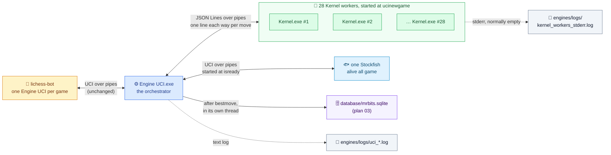
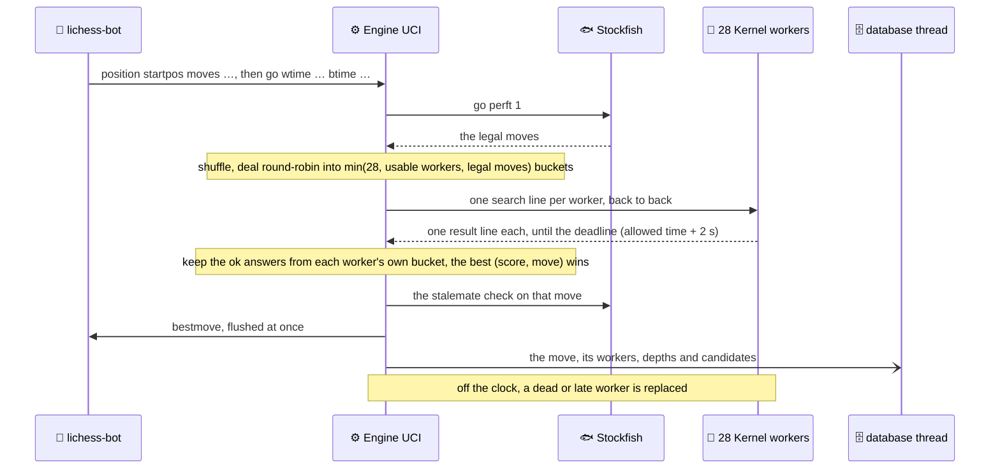
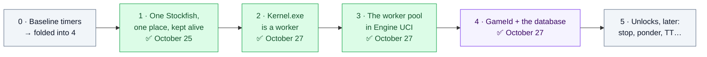

# 🔌 Plan — Fast Communication Between Engine UCI, the Kernel and Stockfish

**Written by Claude Opus 5.5, for Tareq.** 🤝 *October 23, 2026 · v2, October 25: every phase reviewed and prototyped on copies · v3, October 25 evening: Phase 1 + GameId are in your code, built and tested · **v4, October 27: as built** · what's left for you is in `04 - Runbook for Tonight.md`*

<div style="background:#ecfdf5;border-left:6px solid #059669;border-radius:10px;padding:12px 18px;margin:16px 0;color:#1e293b;">

**✅ As built (October 27):** every helper now starts **once per game** and stays alive: **one Stockfish** (at `isready`) and **28 Kernel workers** (at `ucinewgame`), all talking to Engine UCI through pipes. For a Kernel move, Engine UCI writes **one JSON line to each worker** (the same `ChessState` your JSON file used to hold, plus `type` and `id`) and reads one line back: no files, no `cmd.exe`, no new process per move. The workers think **exactly like your old `Kernel.exe`** (0 mismatches over 144 requests). Everything around the search now costs **a few milliseconds per Kernel move** (2.5–10.3 ms in the final tests) instead of ~0.3 s; the one exception is a game's first Kernel move, which can wait for the workers' start (§2). A dead worker costs at most its own root moves, for that one move; a frozen one costs its moves too, and holds that move until the deadline (the allowed time + 2 s: 7.0 s instead of ~2 s in the test). Every move goes into `database\mrbits.sqlite` right after `bestmove`. The old file mode is retired (the rollback is `engines\backup-phase1\` plus git, see 04). Still unproven: **your live games**. 🚀

</div>

<div style="background:#eff6ff;border-left:6px solid #2563eb;border-radius:10px;padding:12px 18px;margin:16px 0;color:#1e293b;">

**🔬 History: what the October 25 reviews changed** (8 agents in the morning, 4 reviewers in the evening, then my own builds and tests):
- **Phase 1 + GameId went into your code** that evening, and passed the python-chess smoke test, 140/140 identical answers against the old handler, 19/19 kill-and-restart tests and the failure tests.
- **5 traps caught by the morning review:** `cmd.exe` quoting and the `input\` / `history\` folders (both gone now, with the files); the ownership trap (58 `StockfishHandler`s per move); **Smart App Control** (ON, it judges every new `.exe`); and the unflushed `bestmove`.
- **3 bugs in the old code, fixed:** a failed Kernel launch could play `bestmove It should be a default value…`; the engine crashed with no explanation when Stockfish wasn't found; two moves finishing within one second overwrote each other's history report.
- **Corrected numbers:** a fresh Stockfish costs **0.3–0.55 s depending on load**; a query to the kept-alive one, **~0.2 ms**.

</div>

---

## 1. 🎯 The architecture, as built



lichess-bot starts **one Engine UCI process per game** (`play_game` → `engine_wrapper.create_engine`), so "alive for the whole game" comes for free: Engine UCI starts its helpers once, and at `quit` they all go (the workers get `{"type":"quit"}` and half a second to exit, whatever is left is killed, and the Job Objects take care of the rest, even after a `taskkill /F`). ⚠️ It also starts Engine UCI **once at bot startup**, only to check it (`lichess-bot.py` 1131–1133: handshake, `isready`, `quit`). That check opens the log and the database, starts and stops Stockfish once, and starts **no Kernel worker**: they start at `ucinewgame`, which the check never sends (0.4–1.2 s in 4 test runs). And no Stockfish means no `readyok`, so a missing or blocked Stockfish stops lichess-bot right at startup instead of killing the first game. (A missing or blocked `Kernel.exe` does **not** stop it: see §5.)

### Design rules (all eight hold in the built code)

1. **Start once, reuse forever.** No `system()`, no `popen()`, no `cmd.exe` and no temp files are left anywhere in the engine: Stockfish and the workers are started with `CreateProcess`, once per game, and the only files Engine UCI writes are the two logs and the database.
2. **Engine UCI is the only boss.** The workers never talk to each other, to Stockfish or to lichess-bot.
3. **A child's stdout carries protocol messages only.** Inside `Kernel.cpp`, `cout` goes to stderr, and the answer lines are written with `fwrite` (a bare `\n`, flushed). The workers' stderr goes to **`engines\logs\kernel_workers_stderr.log`** (one file for all 28; it stays empty in a normal game, and the engine test checks that), Stockfish's to `NUL`, and Engine UCI's own text log to `engines\logs\uci_<date>-<time>_pid<pid>.log`. (lichess-bot throws Engine UCI's own stderr away: in this version `silence_stderr: false` means `DEVNULL`.)
4. **One message per line, flushed the moment it's written** (JSON Lines). Slow work only *after* the flush: `bestmove` goes out first, then the database record, the events and the restarts.
5. **Every search carries an `id`**, so a late answer from a timed-out worker can never be mistaken for the current move's answer.
6. **Everything is measured, in the database.** Per move: `t_legal_ms`, `t_kernel_ms`, `t_tie_check_ms` and `t_total_ms` (`engine_moves`); per worker: `setup_ms` and `search_ms`; per depth: `ms`; and the `v_engine_moves` view adds `overhead_ms` (the move's time minus its slowest worker's search). Plan 03 has the tables.
7. **The old file mode is retired.** It stayed until the equivalence test proved identical answers (§4, Phase 2). Now `Kernel.exe` has no file mode and no flag, and the rollback is `engines\backup-phase1\` plus git (04).
8. **Paths come from the executable's own folder, never from the working directory** (Phase 1a): `engines\` for Stockfish, `Kernel.exe` and the logs, and its parent `lichess-bot-master\` for `database\`. The engine test plays from an empty temporary folder to prove it.

---

## 2. 📏 Where the time goes (measured ✅)

| Per move | Oct 23 | Oct 25 (laptop shared with other agents) | **Oct 27, as built** |
|---|---|---|---|
| Starting Stockfish for the legal moves (`go perft 1`) | ~0.55 s | ~0.31–0.34 s median (max 0.74 s) | **0.11–0.64 ms** (`t_legal_ms`: one query to the live Stockfish) |
| Starting Stockfish again: the stalemate check (Kernel moves) or the depth search (Stockfish moves) | ~0.55 s | ~0.31–0.34 s | the check: **0.14–0.72 ms**; a whole depth-14 Stockfish move: **64–81 ms** |
| Starting 28 Kernels (`cmd.exe` + process + JSON), beyond their search | ~0.3 s | — | **2.5–10.3 ms**, *everything* around the search included (`overhead_ms`); the 28 processes start once per game |
| The actual search inside the workers | ~0.23 s | — | the same search, the same 5% rule |
| **Total, measured in your lichess logs at a 1 s cap** | **median 2.16 s** | — | **not measured yet** 🟡: the tests use 3 s and 5 s budgets. By the rows above it should be the search plus a few ms (the October estimate: ≈ 0.3 s) |

*(The October 27 column comes from the final test runs' own database rows: 53 engine moves, 32 of them Kernel moves, on this laptop. The overhead leaves out the frozen-worker test moves, which wait for the deadline on purpose, and one first move of a game that waited for the workers' start (below). October 25 had measured ~0.2 ms per Stockfish query and ~0.4 ms for the pool's round trip with dummy workers; with 28 real Kernels the queries take 0.1–0.7 ms, and everything around the search, the round trip included, 2.5–10.3 ms.)*

**End to end** ✅ (real python-chess 1.10.0, the exact calls lichess-bot makes; the test clock is 9 s + 3 s, so a Kernel move gets 3 s or 5 s):

| | The old handler (Oct 25) | Phase 1 (Oct 25) | **As built (Oct 27)** |
|---|---|---|---|
| An opening move that Stockfish plays at depth 14 | 670–675 ms | 77–92 ms | **64–81 ms** |
| The first move of each side (`go movetime 10000` → 5 s → depth 16) | — | — | **75–222 ms** inside the engine; **0.33–0.50 s** for python-chess, because the `isready` sent right before it is what starts Stockfish (~0.24–0.28 s) |
| A Kernel move (28 workers) | median 2.49 s (4 samples) | median 2.21 s (8 samples) | median **1.90 s** (27 samples, 1.43–2.66 s) |
| Stockfish processes per game | 2 new ones per move | exactly 1 | exactly 1 |
| Kernel processes | 28 new ones per Kernel move | 28 new ones per Kernel move | **28 per game**, alive all game |

*(The October 27 column is the engine's own `go` → `bestmove` time, `t_total_ms`: python-chess's own timer is only 0.5–7 ms longer on every move except the first. Read the Kernel row with care: the move is mostly its search, and with a 3–5 s budget every worker whose depth 6 ends before the 5% mark (150 or 250 ms) starts depth 8, which is another ~1–2 s. So these medians move with the positions; what the pool itself changed is the overhead row above. Endgame moves weren't timed end to end: from ply 82 on (more than 80 plies played), Stockfish searches depth 18–26 on purpose (14–16 with less than 15 s on the clock), ~0.5–3 s.)*

**The pool's own numbers** (October 27):
- **Starting a worker:** `CreateProcess` of `Kernel.exe` takes 17.7 ms median and 37 ms max (280 launches), and its move tables 0.44 ms (`initMs`). The 28 start in a background thread at `ucinewgame`.
- ⚠️ **The first Kernel move of a game waits for that start** if it isn't finished. With this build (`2026-10-27_02-36-51`) it waited in 5 of its 14 test games, 135–645 ms (in the final runs only once, 135 ms), because the test's opponent answers instantly. At worst it waits until the start's own deadline (10 s after the workers are started), if a worker never answers `hello`. In a live game, two opponent moves and their lichess round trips come in between, so it should be rare. It isn't measured live yet: `overhead_ms` on each game's first Kernel move will tell.
- **A frozen worker:** the move waits exactly until the deadline, 7,005–7,024 ms for 7,000 (5 s + 2 s) with the final build.
- **Restarts,** after `bestmove`: one worker ~22–40 ms; all 28 at once 0.4–0.9 s in 19 of 21 runs, but **3.7 s and 5.2 s** in the other 2, while the neural-network lab's heavy jobs were running. The fastest real `bestmove` → next `go` in your lichess logs is 365 ms, so one restart never costs clock time. The all-28 case only follows a catastrophe, and then it can (§5).
- **Replaying the game** inside a worker (`setupMs`): 0.01–0.3 ms. Writing the 28 requests and reading the 28 answers is part of the 2.5–10.3 ms above.

---

## 3. 📜 The protocol (Engine UCI ⇄ Kernel worker), as built

Every message is **one line of compact JSON** ending in a bare `\n`: requests on the worker's stdin, answers on its stdout. This section is exactly what the code does: `RunWorkerMode` and `AnswerSearchRequest` in `Kernel.cpp`, `serializeObject` and `getEngineMoveWithThreading` in `Chess State.hpp`, `askAllWorkers` in `Kernel Workers.hpp`. The examples are **real**: the handshake comes from the final equivalence run, and the request and the answer are worker 3 at ply 11 of the engine test's game `tN252leL` (October 27; the test borrows the id of your real lichess game), rebuilt from that game's moves and the rows it left in the test database. They're shown pretty here only for reading. On the wire, each one is a single line with its keys in alphabetical order (that's how nlohmann's `json` writes an object).

**The handshake**, once per worker start:

```json
{"type":"hello"}
{"engineVersion":"kernel-2026-10-27_02-36-51","initMs":0.441,"pid":77144,"protocol":1,"type":"ready"}
```

`engineVersion` is `kernel-` + the build stamp, and `initMs` is the move tables, built once per process. A worker gets no request before its `ready`.

**A search request**, once per worker per Kernel move:

```json
{"allowedEngineTimeInSeconds":5,
 "bestMove":"It should be a default value like the previous line but I want to maintain more time",
 "bestMoveScore":0,
 "engineColor":true,
 "id":86,
 "movesForThisThread":["f3e5","f3g5"],
 "previousMoves":["e2e4","e7e5","g1f3","b8c6","b1c3","g8f6","f1d3","f8c5","d3b5","d7d6"],
 "report":"",
 "type":"search"}
```

It's `ChessState::serializeObject()`: the 7 fields your JSON file used to hold, with `movesForThisThread` = this worker's bucket, plus `"type":"search"` and an `"id"`. Nothing else: no `gameId`, no `ply`, no `timeMs` (the October 25 draft had them; the worker doesn't need them, and the database gets them from Engine UCI).
- **`previousMoves`**: every move of the game so far, from the start position. The worker replays them (0.01–0.3 ms).
- **`engineColor`** and **`allowedEngineTimeInSeconds`**: your color and the time ladder's budget, in **seconds**. The worker sets it with `setAllowedTime` and searches exactly like the file mode did: the hard cap checked at every node, and no new depth once 5% of it is used.
- **`bestMove`**, **`bestMoveScore`**, **`report`**: `ChessState`'s defaults (yes, that's the placeholder sentence 😄). The worker requires every key (`deserializeObject` reads them with `at()` now, so a missing one gets an `error` answer instead of garbage), but never uses these three.
- **`id`**: one counter per Engine UCI process, a new id for every request. (Ply 11 was that game's fourth Kernel move: its 28 requests were ids 84–111, and worker 3's was 86.)
- **`maxDepth`** (optional, **tests only**: Engine UCI never sends it): 0 or absent means "use the allowed time". A depth up to 30 switches the clock off (an `INT_MAX` budget), skips the 5% rule and stops after that depth. Only even depths are searched, so 5 means 4. Anything outside 0…30 is an error. (On October 25 this caught a real trap: with the clock still on, `maxDepth` 8 under a 300 ms budget silently returned the depth-6 answer.)

**The answer:**

```json
{"bestMove":"f3g5","depth":6,"id":86,"leafNodes":126634,"nodes":138244,
 "perDepth":[{"bestMove":"f3g5","completed":true,"depth":2,"leafNodes":51,"ms":0.038,"nodes":53,"pruned":1,"score":-160},
             {"bestMove":"f3g5","completed":true,"depth":4,"leafNodes":4087,"ms":5.657,"nodes":4408,"pruned":254,"score":-195},
             {"bestMove":"f3g5","completed":true,"depth":6,"leafNodes":126634,"ms":382.625,"nodes":138244,"pruned":8821,"score":-125}],
 "pruned":8821,
 "rootScores":[{"exact":true,"move":"f3g5","score":-125},{"exact":false,"move":"f3e5","score":-130}],
 "score":-125,"searchMs":388.323,"setupMs":0.03,"status":"ok","totalNodes":142705,"type":"result",
 "unsearchedRootMoves":[]}
```

What the fields are for:
- **`id`**: the request's id, echoed (`null` if it had none). The pool takes a `result` or an `error` only if it carries **exactly** this move's id for that worker. Anything else in the worker's inbox (a late answer to an older request, a line that isn't JSON) is skipped.
- **`status`**: `ok`, `no_moves` (an empty bucket, which Engine UCI never sends) or `no_completed_depth` (not even depth 2 finished in time). Only `ok` can count. For the other two, `bestMove` and `score` are `null`, `depth` is 0, and `nodes`, `leafNodes` and `pruned` are 0 (`totalNodes` and `perDepth` still report what was searched, an aborted depth 2 for `no_completed_depth`). (The file mode answered `a8a8` with score 0 there.)
- **`bestMove`**, **`score`**, **`depth`**: the last **completed** depth's best root move, its score, and that depth. Here depth 6 ended at ~388 ms, past the 5% mark of a 5 s budget (250 ms), so depth 8 never started.
- **`nodes`**, **`leafNodes`**, **`pruned`**: the last completed depth's main search (the same numbers as the old text report), counted in 64 bits. **`totalNodes`**: every iteration, an aborted last one included (here 53 + 4,408 + 138,244 = 142,705).
- **`perDepth`**: one entry per iteration. An aborted one has `"completed":false` and no `bestMove` / `score`.
- **`rootScores`**: every root move searched at the last completed depth, in search order. ⚠️ A score is **exact** only if it beat the window it was searched with: always true for the first move searched and for every new best. The others failed low and are only bounds. Here `f3g5` was searched first (−125, exact), and `f3e5` is "at most −130". (October 25: 126 exact scores checked against full-window searches, 0 wrong.)
- **`unsearchedRootMoves`**: this worker's moves that the last completed depth didn't search (from depth 6 on, the root keeps only its 4 best-ordered moves). With 28 workers, a bucket holds 1 or 2 moves in almost every position, so this list fills only when few workers are usable.
- **`setupMs`** / **`searchMs`**: replaying the game vs thinking.

**The other messages:**
- **An error**, from the worker, for anything it can't answer: not JSON, not an object, no `type` or an unknown one, a missing `ChessState` key, a malformed move, `maxDepth` out of range. For example `{"id":86,"message":"\"movesForThisThread\" holds a malformed move: \"e2e9\"","type":"error"}`. The worker never dies on bad input; the pool records that worker as `error`, with the message.
- **`{"type":"quit"}`**, or simply the end of its stdin: the worker exits with code 0, without answering.
- **`Kernel.exe` started with an argument** (the old `Kernel.exe <file.json>`): one line on stderr, `Kernel.exe doesn't read JSON files any more: Engine UCI starts it as a worker, with no arguments.`, and exit code 1.

**One Kernel move, end to end:**



**How Engine UCI uses the answers** (`getEngineMoveWithThreading`: your logic, new plumbing):

1. **The legal moves** come from Stockfish (`go perft 1`). None → `bestmove 0000` (`no_legal_move`; before, the report text was sent as the move). One → played at once (`only_move`).
2. **The buckets:** N = min(28, usable workers, legal moves). *Usable* = started, ready and still alive, so a worker that died while waiting gets no moves, and none of the root moves are lost with it. The legal moves are shuffled, then dealt round-robin exactly like before: the k-th move goes to bucket k mod N, counting from k = 1 (that's why workers 2–6 got two moves each at ply 11: 33 moves, 28 buckets). With all 28 alive, it's exactly the old split. N = 0 → Stockfish plays the move at depth 14 (`no_kernel_answer`).
3. **One request per bucket**, written back to back before the wait starts, then **one deadline for all of them: the allowed time + 2 s.** The workers stop by themselves at the allowed time; the 2 s are only for a worker that hangs.
4. **Each worker ends with one status**, stored in `worker_runs`: `ok`, `no_moves`, `no_completed_depth`, `error`, `timeout` (still silent at the deadline: killed at once, restarted after `bestmove`), `dead` (its output ended: it exited or crashed), or `rejected` (next point).
5. **An answer counts only if** its status is `ok`, its `bestMove` is **one of that worker's own moves**, and its `score` is an **integer**. Otherwise it's `rejected`, with the reason (`bestMove 'X' isn't one of this worker's moves` / `its score isn't an integer`).
6. **The pick is unchanged:** all the (score, move) pairs, sorted with `greater<pair<int,string>>`. The highest score wins, and a tie goes to the larger move string. No usable answer at all → Stockfish plays at depth 14 (`no_kernel_answer`), and the events table says why.
7. Then, as before, **the stalemate check**, only on a Kernel move now (the other paths are Stockfish's own moves or the only legal move): a move that stalemates is replaced by Stockfish's (`stalemate_override`). Then `bestmove`, flushed, and only after it the database, the events and the restarts.

<div style="background:#fffbeb;border-left:6px solid #d97706;border-radius:10px;padding:12px 18px;margin:16px 0;color:#1e293b;">

**⚠️ Unchanged on purpose, and now visible in the database: the pick compares different depths.** Every worker stops on its own clock (the 5% rule). In the test game `tN252leL` at ply 5 (a 3 s budget), 22 of the 27 workers reached depth 8 and 5 stopped at depth 6 (their depth 6 ended after the 150 ms mark). The move came from one of those 5: `b1c3` at −40 (depth 6), while the best depth-8 answer was `f1d3` at −115. Your file mode did exactly the same, so it's not a regression. But it means the move depends on CPU timing as well as on the position. `worker_runs.depth` shows it for every move; comparing at one common depth is a Phase 5 idea.

</div>

---

## 4. 🛣️ The phases



### Phase 0 — Baseline timers → folded into Phase 4 ✅

The per-stage stopwatch became database columns in `engine_moves`: `t_legal_ms` and `t_kernel_ms` (timed inside `getEngineMoveWithThreading` and added with `+=`, because the stalemate override calls it a second time), `t_tie_check_ms` (in `getBestMoveFromEngine`) and `t_total_ms`; `setup_ms` and `search_ms` per worker; `ms` per depth; and `overhead_ms` in the `v_engine_moves` view. The text log still says `go -> bestmove took N ms (path, game '…')` for every move.

### Phase 1 — Stockfish: one copy, in one place, kept alive ⭐ the biggest win

#### 1a · One Stockfish, in one place 🧹

**Status ✅ in your code since October 25, finished on October 27:** the three duplicate copies (`lichess-bot-master\stockfish\`, `engines\stockfish-windows-x86-64-avx2.exe` and `lichess-bot-master\stockfish-windows-x86-64-avx2.exe`, renamed `.old` on October 25) are **deleted**. They were byte-identical to the kept one (41,409,024 bytes, Stockfish 16) and used by nothing (no code reference, no process). The one home is `engines\stockfish\stockfish-windows-x86-64-avx2.exe`, next to `Engine UCI.exe`, the only program that queries it.

<div style="background:#fffbeb;border-left:6px solid #d97706;border-radius:10px;padding:12px 18px;margin:16px 0;color:#1e293b;">

**🔍 The root cause of your old path problem:** a relative path like `"stockfish/stockfish-windows-x86-64-avx2.exe"` is resolved against the **current working directory**, the folder the program was *launched from*, not the folder where the `.exe` lives. lichess-bot launches Engine UCI from `lichess-bot-master\`, and you launched it by hand from `engines\`, so the package got copied to both places 😄. **The fix:** `ExecutableDirectory()` (`GetModuleFileNameA`, in `Stockfish Handler.hpp`) = `engines\`, and every path is built from it (`RootDirectory()` = its parent, for `database\`). The engine logs its paths at startup, with the Stockfish and Kernel paths marked `<-- MISSING` if absent.

</div>

**Exit ✅:** one Stockfish, found from any working directory (the engine test plays from an empty temporary folder), and the duplicates are gone.

#### 1b · Keep it alive

**Status ✅ in your code since October 25,** unchanged on October 27 except one comment (it now names the Kernel workers that the pool can start at the same moment). In short:
- **`StockfishProcess`**, the one persistent Stockfish, lives behind `GetTheStockfishProcess()` (a function-local static). Your `StockfishHandler` keeps every old public function and only forwards to it, so `ChessState` still holds it by value. ⚠️ **That's the ownership trap:** one Kernel move used to build 58 handlers, so a process started in a constructor would have meant 58 Stockfish processes per move. The worker pool is ONE global for the same reason.
- **Started at `isready`** (or on first use) with `CreateProcess` and two pipes, stderr to `NUL`, inside a Job Object with "kill on close". If it can't start, there's no `readyok`. It takes ~0.3 s, or ~1.1 s cold on the first launch.
- **Framing** (from raw byte captures): `isready` → `readyok` before every query (it drains what the last answer left behind), then each command is read to its own terminator: `go perft 1` → `Nodes searched`, `go depth N` → `bestmove`, `eval` → `Final evaluation`. The `\r` is stripped (Stockfish writes CRLF). ⚠️ `isready` is not a barrier while a `go` runs.
- **Before each `go depth N`: `ucinewgame` + `isready`, then ONE `go depth N`.** That reproduces a fresh process exactly. Your old double command existed because end-of-file acts as `quit` for Stockfish (your theory, confirmed), and it made ~1.5% of the old bestmoves slightly random (5 of 340); a legacy-compat switch reproduces them exactly, for tests only.
- **One mutex** around every query, and **a watchdog per query** (10 s for perft/eval/isready, 300 s for `go depth`) that turns a hang into a death. A death means **restart once and retry**; a second failure throws, and Engine UCI logs `go failed`, writes the event and exits with code 1.
- **Today's meaning of the checks is kept:** `isTiePosition` = **stalemate only**; Engine UCI never calls `isCheckmatePosition` or `isStalematePosition`, and `isStalematePosition` still always returns false.
- **Handle hygiene:** Stockfish's pipe ends are inheritable only around its own `CreateProcess`, and a handle list gives it exactly its three handles, so a Kernel worker started at the same moment can never inherit them (and the other way round).

**Exit ✅ (October 25):** legal moves, stalemate, checkmate and eval identical **100%** (140/140); bestmove identical with legacy-compat on (140/140); opening Stockfish moves ~8× faster end to end (670 → 80 ms).

### Phase 2 — `Kernel.exe` is a worker

**Status ✅ built and tested (October 27).** `Kernel.exe` has **no file mode and no flag any more.** Started with no arguments (the only way Engine UCI starts it), it's a worker (`RunWorkerMode`). Started with any argument, it prints one clear line on stderr and exits 1, so an old Engine UCI that still calls `Kernel.exe <file.json>` fails at once instead of waiting forever. The search itself is untouched: `RunIterativeDeepening()` **is** the old `main()` loop (even depths 2…30, the hard time cap at every node, no new depth once 5% of the allowed time is used).

What the new tail of `Kernel.cpp` does, and why:
- **`BuildTheTablesOnce()`**: a hard requirement, not an optimization. `MovesPreCalculation()` only `push_back`s, so a second call doubles every bishop, rook and queen ray: the same move and score, but more nodes with every request (October 25: 33 → 45 pseudo-legal moves; at depth 6 the worker hung). It takes 0.44 ms.
- **Per request, in this order** (`AnswerSearchRequest`): read the `ChessState` (with `at()`, so a missing key is an error instead of garbage) and check that every move is well-formed; then **`ResetGameState(engineColor)`**: `ENGINE_COLOR` **first** (the two score functions and `MakeChanges` read it), then `processHandler`, `previousMoves`, the root scores, the board, the two masks and the two scores; **then** `setAllowedTime(seconds)`, because the reset puts the budget back to 10,000 ms; then `ReplayMoves`, then the search. October 25's mutation test is why the order matters: forgetting the board, the masks, the color or the scores gives **wrong answers silently** (632 / 604 / 322 / 143 mismatches).
- **Clean stdout:** `cout` is redirected to stderr, stdin and stdout are switched to binary, and `WriteProtocolLine` writes each answer with `fwrite` + `'\n'` + `fflush`. Every line ends in a bare `\n`, even under Git Bash's `libstdc++-6.dll`, where `_setmode` doesn't reach `cout`.
- **It never dies on bad input:** every exception becomes an `error` line, and the answers are dumped with `error_handler_t::replace`, so invalid UTF-8 can't throw.
- **`rootScores`** are recorded inside `GetBestMoveWithItsScore` (the root loop, where each move's score exists) and kept for the last **completed** depth. `nodes` and `pruned` are summed in 64 bits (the `…As64Bit` getters: the old ones sum into an `int`).
- **Build:** plain `g++` like always (that's `-O0`), with the `-DMRBITS_BUILD_STAMP` that `Build Engines.bat` sets. **`-O2` is still yours to decide** (README): on October 25, `-O2 -march=native` gave bit-identical answers on 144 requests and a 3.6× faster search (plain `-O2` was never measured on its own, and `-march=native` ties the `.exe` to this CPU), and `kernel_equivalence_test.py --reference-mode worker` checks a new build against the current one.

**Exit ✅ (October 27):** `tests\kernel_equivalence_test.py` against your **production `Kernel.exe`** (the file-mode one, sha256 `d0fe2de950d199e0…`). The old exe searched 72 positions for 1 s each and completed depth 6 or 8; then **ONE** worker got **144 requests** (every position twice, both colors, shuffled) at those depths: **0 mismatches** in `bestMove`, score, nodes, leaf nodes, pruned and depth, 0 differences between repeats, exit code 0, 0 bytes on stderr. One worker for everything is the point: on October 25 a stale color gave 0 repeat differences, and only the comparison with the file mode caught it. (The 11,000-request flat-memory run was on the October 25 prototype; the October 27 tests don't repeat it.)

### Phase 3 — The worker pool inside Engine UCI

**Status ✅ built and tested (October 27):** `engines\Kernel Workers.hpp` (~700 lines, in your style), used from `ChessState::getEngineMoveWithThreading`.

- **`KernelWorkerProcess`**, one worker: two 64 KB pipes with all four ends non-inheritable. Under a start mutex, the worker's three ends (stdin, stdout and the stderr log) become inheritable, and a `PROC_THREAD_ATTRIBUTE_HANDLE_LIST` gives it **exactly** those three. `CreateProcess` gets the quoted full path and no arguments, with `DETACHED_PROCESS` (no console, no `conhost.exe` per worker) and `CREATE_SUSPENDED`: the worker is resumed only once it's inside the Job Object. Engine UCI closes its copies of the worker's ends at once, so a death is visible: the reader's `ReadFile` fails with a broken pipe.
- **`KernelWorkerPool`**, the 28: ONE global (`GetTheKernelWorkerPool()`), never a `ChessState` member, the same trap as Stockfish. Anonymous pipes have no read timeout, so every worker gets **one reader thread** that puts each line into its inbox. (October 25 measured the alternatives: `CancelSynchronousIo` can lose a cancel, and `PeekNamedPipe` polling costs 15.6 ms per message.)
- **Start:** `configure()` at Engine UCI's start starts nothing. **`ucinewgame`** starts the 28 in a background thread, inside one Job Object (kill on close, and die on an unhandled exception). Each worker answers `hello` with `ready`, and the start waits up to 10 s for all of them. The first Kernel move joins that thread (and starts the pool itself if no `ucinewgame` came), then uses whichever workers are ready.
- **Per Kernel move:** the usable workers get the buckets (§3). `askAllWorkers` writes every request, then waits on a condition variable until each worker has answered or died, or the deadline (allowed time + 2 s) has passed. A worker still silent then is a **`timeout`**: killed at once with `TerminateProcess`, without waiting for it.
- **After `bestmove`:** every worker that timed out, died during the move or died while waiting is replaced (`respawnTheDeadWorkers`: kill, wait for its reader, start a new one, then wait up to 3 s for its `ready`), and the events table says so.
- **Shutdown** (`quit`, or the end of the input): `{"type":"quit"}` and the end of their stdin to every worker, half a second in total to exit, then whatever is left is killed and the Job closed.

**What changed from the October 25 plan, on purpose:**
- the start moved from Engine UCI's start to **`ucinewgame`**, so lichess-bot's startup check starts no worker at all;
- **one shared stderr file**, `engines\logs\kernel_workers_stderr.log`, instead of one per worker (it stays empty in a normal game);
- **no file-mode fallback**, since there's no file mode any more: a move with no usable answer is played by Stockfish at depth 14 (`no_kernel_answer`), and the events table says why;
- a late worker's moves are **not re-dispatched**: they're simply missing from that one move;
- stale ids and non-JSON lines are skipped, not counted, and the test-only seeded shuffle wasn't needed (the tests check instead that the buckets together hold exactly the legal moves).

**Found by the October 27 adversarial review, and fixed:** a worker that died *while waiting* still got its bucket, so its root moves were never searched for that move. Now only usable workers get buckets, and an idle dead worker is restarted after `bestmove` like the others.

**Exit:**
- ✅ **The hang and crash tests against the real workers:** `tests\kernel_workers_test.py`, **27 / 27** in the final runs. A worker killed while waiting gets no moves, and the other 27 search **all 29 legal moves**. A frozen worker gives one `timeout` at exactly the deadline (7,005–7,024 ms for 7,000), and is killed and restarted. A worker killed mid-search gives one `dead` (only its own moves lost, for that move), and is restarted. With every worker dead, no worker is asked, Stockfish plays at depth 14 (`no_kernel_answer`), and all 28 come back. And after a hard kill of Engine UCI: 0 Kernel and 0 Stockfish left, and every move before the kill stored.
- 🟡 **The overhead target** (total time − the slowest worker's search) **under 50 ms**: 2.5–10.3 ms on every Kernel move except a game's first one (§2). When the workers' start isn't finished yet, that move took 135–645 ms in 5 of the 14 test games with this build. Live, two opponent moves come first, so it should be rare: `overhead_ms` on each game's first Kernel move will tell.
- ⏳ **0 crashes or timeouts over 50 live games**, and a match against the old build: not run yet. The first 3 games are tonight's runbook.

### Phase 4 — GameId + the database: the bridge to plan 03

**Status ✅:** GameId since October 25, the database since October 27. You chose **"database only"**: instead of the planned `telemetry/*.jsonl` files, SQLite 3.54.1 is compiled into Engine UCI (`engines\sqlite\`), and every move goes straight into `database\mrbits.sqlite`, with no file in between.

- **The options:** the `uci` reply declares `option name GameId type string default <empty>` **and** `option name UCI_Opponent type string default <empty>` (python-chess refuses to send an option the engine didn't declare). `<empty>` and `none` both mean "no value". Option names are compared case-insensitively, and the value is everything after ` value `.
- **The real wire order** (python-chess 1.10.0, checked in the engine test's logs):
  1. `uci` → `uciok`;
  2. `setoption name GameId value tN252leL`, when lichess-bot creates the engine: **before** `ucinewgame`, so `ucinewgame` never clears it;
  3. at the first move: `ucinewgame` (→ the 28 workers start), `setoption name UCI_Opponent value BOT 1692 computer Demolito_L4` (`<title|none> <rating|none> <computer|human> <name>`, right after every `ucinewgame`), `isready` (→ Stockfish starts), `position startpos moves …`, `go movetime 10000` (the first move of each side);
  4. later moves: `go wtime … btime … winc … binc …`;
  5. at the end: `isready` + `quit`. No result is ever sent: that's what `sync_lichess.py` is for (plan 03).
- **`extra_game_handlers.py`** returns `{"GameId": game.id}`, spelled exactly `GameId`. ⚠️ If you ever roll the engine back to one that doesn't declare it, roll this line back too: an undeclared option makes `configure()` raise, and lichess-bot kills the engine before the game (04, rollback B).
- **GameId is only a database key now** (a bound SQL parameter, never part of a path), so the old `[A-Za-z0-9_-]{1,64}` filter left with the history folders. A game without a GameId is stored as `local-<unix ms>`.
- **After `bestmove` (flushed first),** the move record goes to the database's writer thread, which stores it in **one transaction**: `engine_games` (an upsert, with the opponent), one `engine_moves` row (the `go` parameters exactly as received, the ladder's `allowed_seconds`, the path, `stockfish_depth` and the four timers), one `worker_runs` row per worker, its `worker_depths` and its `root_candidates`. The first move is stored as `movetime_ms` 10000: Engine UCI's copies of it into wtime/btime are never stored. Problems go to `events` (failed workers, fallbacks, restarts). If the database can't be opened, the engine keeps playing and the log says so. Plan 03 has the rest.
- **The paths** stored per move: `kernel`, `stockfish_opening`, `stockfish_endgame`, `stalemate_override`, `only_move`, `no_kernel_answer`, `no_legal_move`.
- ⚠️ **Why the flush matters** (October 25, measured): the old `bestmove` wasn't flushed, so the move only left when the loop got back to `getline()`, and 1.5 s of work after an unflushed `bestmove` made python-chess wait 2,399 ms instead of 907 ms.
- **The fresh start you chose:** `history\` and `input\` are gone; the database has one row per move.

### Phase 5 — What this unlocks (later, one at a time)

| Unlock | Why it needs persistent workers (or what's ready for it) |
|---|---|
| **`stop`** (end a search early) | You can only interrupt a process that's alive and listening. A worker still reads its next line only after answering, so `stop` needs a second reading thread inside the worker; the ids are already there |
| **Pondering** | `config.yml` says `ponder: true`, but Engine UCI prints `bestmove X` with no `ponder Y`, and python-chess only sends `go ponder` after a `bestmove X ponder Y`. It needs a ponder move, `stop`/`ponderhit` handling (the main loop has neither), and ideally `option name Ponder type check default false`. With live workers you could think on the opponent's time |
| **Keeping memory between moves** | A transposition table (item 3 in `Claude Docs/01`) or neural-net weights (`Claude Docs/02`) can now survive from move to move, instead of being rebuilt 28 times per move |
| **Incremental positions** | Send only the new moves instead of the whole game (cheap already: `setupMs` 0.01–0.3 ms) |
| **Tuning the worker count** | `NUMBER_OF_KERNEL_WORKERS` in `Engine UCI.cpp` (and the same constant in `tests\engine_test.py` and `tests\kernel_workers_test.py`, which expect 28; the second one also waits for the event text `restarted 28 worker(s)`): measure 16 / 20 / 24 / 28 in real games now that the pool exists. The earlier benchmark found 28 workers ≈ 8–9× one core on your laptop |
| **One depth for every worker** | The answers already carry every completed depth (`perDepth`), so Engine UCI could compare all the workers at the deepest depth they *all* completed, with no protocol change (§3's yellow box). It changes the moves, so A/B it in games first |
| **Threads instead of processes** | The final form: one process, shared memory, a shared TT. It needs every global moved into a per-thread state struct, a big refactor for another day |

---

## 5. ⚠️ Risks: what's handled, what's still open

| Risk | What could happen | Status (October 27) |
|---|---|---|
| **Smart App Control (ON on this PC)** | Every new `.exe` hash is judged on its first launch (October 25: it blocked 2 of 3 builds of `Engine UCI.exe`, and even a byte-copy of the old one, `WinError 4551`) | 🟡 **Handled, still there.** `Build Engines.bat` stamps every build (a new hash) and launch-checks both `.exe` files: if one is blocked, run it again. ⚠️ A blocked or missing `Kernel.exe` doesn't fail lichess-bot's startup check (no worker starts there): every Kernel move then falls back to Stockfish at depth 14, the log says why (for a blocked one, `… Smart App Control blocked this Kernel.exe, rebuild it`), and `events` gets rows. The game goes on, but it's Stockfish playing instead of your Kernel, so check the `!!` lines (runbook) |
| **Git Bash's runtime DLLs** | Git puts its own `libstdc++-6.dll` first on PATH: a different C runtime | 🟡 The worker lines are safe either way (`fwrite`, a bare `\n`, and Engine UCI strips a `\r` anyway). Still: start everything from PowerShell or `Launch Server.bat` |
| Deadlock | Both sides wait forever | ✅ By design: every line is flushed, one reader thread per worker always drains its pipe, and stdout carries only protocol |
| **A hung Engine UCI** | python-chess gives clock-based moves **no timeout at all**, so a hang blocks the game until lichess flags it | ✅ For the workers (the deadline, then a kill) and for Stockfish (the watchdog). 🟡 The watchdog on `go depth` is 300 s, longer than a whole blitz clock: a hung Stockfish search would still lose that game on time, only not silently |
| State leaks between requests | Different answers to the same request | ✅ The equivalence test through ONE worker: 0 mismatches, 0 repeat differences |
| Crashed or hung worker | A move with missing root moves | ✅ Tested (§4): a worker that died while waiting costs nothing; one that dies during a move costs only its own moves, for that move; one that freezes also holds that move until the deadline (the allowed time + 2 s: 7,005–7,024 ms instead of ~2 s in the test, and up to 53–68 s with a 2+3 game's ladder); with all of them dead, Stockfish plays |
| A failed Kernel launch | The old engine played the placeholder text as its move | ✅ Impossible now: an answer counts only with status `ok`, a `bestMove` from that worker's own bucket and an integer score |
| Orphan processes | Old Kernels eat your CPU after a crash | ✅ Job Objects with kill-on-close: a hard kill of Engine UCI left 0 Kernel and 0 Stockfish behind |
| **A process-start stall under load** | The all-28 restart runs on Engine UCI's main loop after `bestmove` (and waits up to 3 s for the `ready`s), so the next `position`/`go` waits behind it. The first Kernel move of a game can also wait for the start (§2) | 🟡 **Open.** 0.4–0.9 s in 19 of 21 test runs, but 3.7 s and 5.2 s in the other 2 (while the neural-network lab's heavy jobs were running): if the opponent had answered faster, those seconds would have been on your clock. It only follows a catastrophe (every worker dead); one restart (~22–40 ms) is far below the fastest reply in your lichess logs (365 ms). The fix, if it ever matters: restart in the background thread, like the start at `ucinewgame` |
| ⏱️ **The time ladder** | **51–66 s for one move** in a 2+3 game, and the 5% rule only stops *starting* new depths, so a search can use all of it | 🔴 **Open, unchanged on purpose** (same behavior). In your real lichess game `tN252leL`, plies 5 and 7 took 29.1 s and 54.0 s out of a 2-minute clock. Yours to decide (README) |
| 🤝 **`isTiePosition` = stalemate only** | No threefold, 50-move or insufficient-material draws, so the stalemate override can't see the other draws | 🔴 **Open, unchanged** |
| ♟️ **`position fen …`** | Engine UCI parses it, but the Kernel and Stockfish both replay the moves from the start position, so a game that starts from a FEN (lichess "From position") would be searched on the wrong board, and its moves could be illegal | 🔴 **Open.** Until it's fixed, don't let the bot accept "From position" games |
| 🎲 **Mixed depths in the pick** | The best (score, move) can come from a shallower worker (§3's yellow box) | 🟡 **Open, unchanged on purpose**: your file mode did the same. A Phase 5 idea |
| Windows-only code | Can't run matches on the Linux Nebius box | 🟡 Open: the process code lives in `KernelWorkerProcess` / `KernelWorkerPool` and `StockfishProcess`, so a Linux version is mostly those classes |
| Merge conflicts with the neural-net work | Two agents editing `Kernel.cpp` | 🟡 Small: the search is untouched. Only the file's tail (the worker's `main()`), a few `ProcessHandler` getters and the root loop's score recording are new, and the Kernel's own `ChessState` copy is gone (it includes `Chess State.hpp`). Keep separate git branches |

---

## 6. ⏱️ Status and what's left

| Phase | Status | What's left | Payoff |
|---|---|---|---|
| 0 · Baseline timers | ✅ folded into 4 | — | Every stage timer is a database column |
| 1 · One Stockfish, one place, kept alive (+ GameId, flush, safe Kernel merge) | ✅ in your code (October 25) | — (the duplicate copies are deleted) | Opening Stockfish moves 670 → ~80 ms; −124 MB of duplicates; no more path problems |
| 2 · `Kernel.exe` is a worker | ✅ built (October 27) | — | The same answers as your old `Kernel.exe`, with no files and no `cmd.exe` |
| 3 · The worker pool | ✅ built (October 27) | Your live games (runbook, step 1), then 50 games with nothing in `events` | ~0.3 s of process starts per Kernel move → a few ms; deadlines, crash safety, no orphans |
| 4 · GameId + the database | ✅ built (October 27) | The first lichess sync (runbook, step 3) | Every move, worker, depth and candidate in SQLite: plan 03 |
| 5 · Unlocks | later, one at a time | — | `stop`, pondering, a TT, the worker count, one common depth… |
| **Total remaining** | | **≈ 1 hour tonight** (the runbook), then live games | The ≈ 0.3 s fast move (at a 1 s cap) is still an estimate 🟡: your games will measure it |

— **Claude Opus 5.5** 🤖
