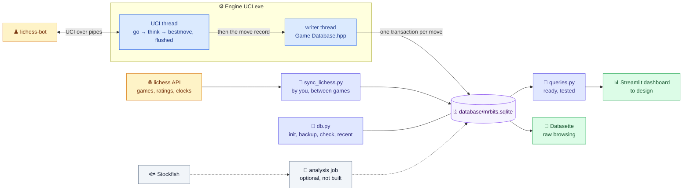
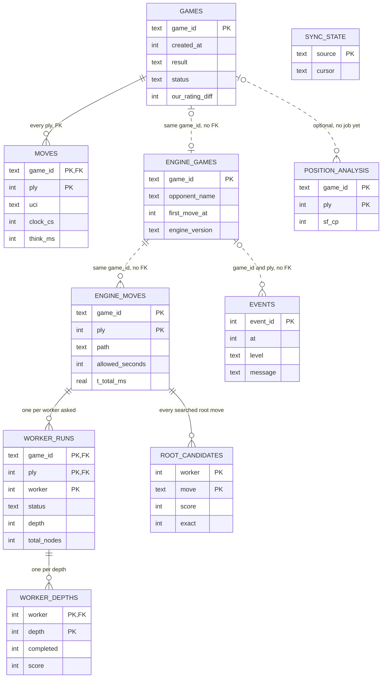
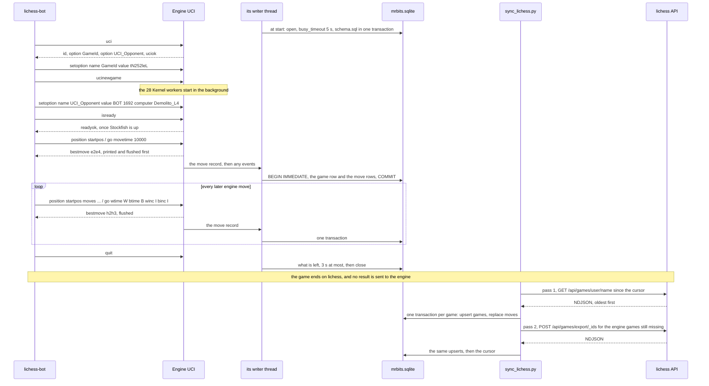
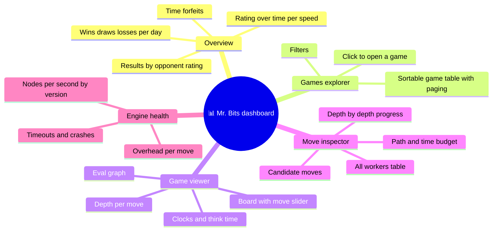
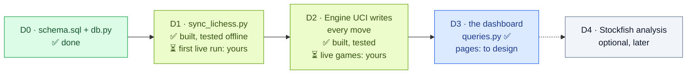

# 🗄️📊 One Database for Every Game, Move and Worker (built ✅), Plus a Dashboard (planned)

**Written by Claude Opus 5.5, for Tareq.** 🤝 *October 23, 2026 · v2, October 25: schema tested on SQLite 3.50.4, 24 review findings applied · **v4, October 27: as built***

<div style="background:#ecfdf5;border-left:6px solid #059669;border-radius:10px;padding:12px 18px;margin:16px 0;color:#1e293b;">

**✅ As built, in one paragraph:** two writers fill **one SQLite file**, `lichess-bot-master\database\mrbits.sqlite`:
1. **Engine UCI itself**, after every move: the `go` parameters, the time ladder's budget, the path that decided the move, its timings, **every Kernel worker** (root moves, status, depth, nodes, times), each worker's opinion **depth by depth**, **every candidate move's score**, and every problem (`events`). It writes from its own thread, and only after `bestmove` is sent;
2. **`database\sync_lichess.py`**, run by you between games: results, ratings, **rating changes**, clocks, think times, openings, accuracy and PGN, for every game from go-live day on (a fresh history ✅);
3. *(optional, not built)* a Stockfish analysis of every played position: its table is there, its job isn't.

A **`GameId`** links them. **`database\queries.py`**, the dashboard's read API, is ready and tested. The **dashboard itself** (Streamlit + Datasette) is the next thing to design. 🚀

</div>

<div style="background:#eff6ff;border-left:6px solid #2563eb;border-radius:10px;padding:12px 18px;margin:16px 0;color:#1e293b;">

**🔬 What October 26–27 changed** (built, attacked by reviewers, re-tested):
- **Your decision: "no more json files, database only".** SQLite 3.54.1 is compiled into Engine UCI, and the engine stores every move itself. v2's telemetry file and its importer were never built: §3 shows how the engine handles the risks they were meant to avoid.
- **The adversarial review found 4 real problems, 3 of them in the database, all fixed and re-tested:** two engines starting at the same moment broke each other's schema setup (`view already exists`: a whole game unrecorded, 19 times in 160 in the reviewer's race test; now 0 in 180); a reader could see a view dropped and not re-created yet; and a database locked at the start of a game lost that game (now the writer tries again before every record: a 7 s lock at the start → all 5 moves stored).
- **`v_games` got fast:** at 1,000 games, `list_games` 382 → 23 ms, `count_games` 666 → 0.7 ms, one game 676 → 0.1 ms (§4).
- **130 tests** in `database\tests\` (never the network, the token, `config.yml` or your real database). The new ones fail against the unfixed code (a mutation check), and the verifiers' 38 adversarial tests and an oracle run (5 × 400 adversarial games × 1,500 filter trials) pass. The engine test checks every stored row against what python-chess saw: **183 / 183**.
- *Still true from October 25:* `engine_moves` has no foreign key to `games` (the engine's rows come first), and the think-time formula matches the wall clock with a median of −8 ms on your real game `tN252leL`.
- ⚠️ **lichess refuses anonymous game exports** (401 "Login required", Oct 25): every sync needs the bot's token.

</div>

<div style="background:#fffbeb;border-left:6px solid #d97706;border-radius:10px;padding:12px 18px;margin:16px 0;color:#1e293b;">

**⚠️ Not proven yet (honestly):**
- **No live lichess game is in the database yet.** Every check so far used test databases, with python-chess playing lichess-bot's part. The first real games are yours (runbook step 1).
- **The first live sync is yours too:** it needs the token. The parsing is tested on lichess's two official examples, your real game `tN252leL` (rebuilt from lichess-bot's log: real moves and clocks, but not a lichess export, so no rating change, opening or accuracy) and synthetic games, but the two API passes have only run against a fake session, so no real export of your games has been parsed yet.
- **The size per game is still an estimate** (§6).
- **A lock held longer than 5 s** (DB Browser for SQLite with unsaved edits, during a game) costs the records that waited for it (§3).
- **The dashboard doesn't exist yet**, and neither streamlit, datasette, pandas nor plotly is installed (checked October 27, Python 3.14.2).

</div>

---

## 1. 🎯 What the dashboard must answer

- **Filters:** wins / losses / draws · rating change (e.g. "games where I lost more than 10 points") · time control (bullet / blitz / rapid) · date range · opponent (name, bot or human, rating) · color · how the game ended (mate, resignation, time, stalemate…) · opening · engine trouble (a stalemate override, a move with no Kernel answer, worker timeouts or failures) · engine version.
- **Per game:** the board with a move slider, both clocks, the eval graph, think time per move, depth per move, and where the game turned.
- **Per move:** the time ladder's budget vs. the time actually used · which path played it (`kernel`, `stockfish_opening`, `stockfish_endgame`, `stalemate_override`, `only_move`, `no_kernel_answer`, `no_legal_move`) · **all the workers**: their root moves, depth reached, nodes, time, best move and score · how each worker's opinion changed depth by depth · the candidate moves and their scores · Stockfish's opinion of the move (optional) · any errors (timeouts, dead workers, restarts).
- **Trends:** rating over time · win rate by opponent rating · time forfeits (the overhead problem!) · nodes per second and depth per engine version.

✅ **All of it has its data in the database now**, except Stockfish's opinion of a move, the eval graph and "where the game turned": those need the optional analysis (§8, D4). A rough eval graph from the Kernel's own scores is possible already.

> 💡 **A taste of what it will show you:** October 25, from the clocks of your 2+3 game `tN252leL`: plies 5 and 7 took **29.1 s and 54.0 s**. The time ladder allows 50 + winc/3000 = **51 s per move** when 60–120 s are left (and 66 s for White, 61 s for Black, with ≥ 120 s left), and the 5% rule only stops *starting* new depths. In a 2-minute game that's dangerous. Now every move stores `allowed_seconds` next to `t_total_ms`, and `v_games.max_move_ms` puts the slowest move of every game in one column.

---

## 2. 🧭 Where each piece of data lives

Everything lives in **`lichess-bot-master\database\`**: `schema.sql`, `mrbits.sqlite`, `db.py`, `queries.py`, `sync_lichess.py` and `tests\`. (v2 planned `data\` and `tools\mrbits_db\`: neither exists.)

| Data | Source → table | Notes |
|---|---|---|
| Result, how the game ended, both ratings **and rating changes**, accuracy, PGN | **lichess API** → `games` (`sync_lichess.py`) | `ratingDiff` only exists in **rated** games: casual ones get NULL. Accuracy only once lichess has analysed the game |
| Every ply of both sides, both clocks, think times, opening, time control | **lichess API** → `moves`, `games` | `clocks=true` gives centiseconds. lichess's `moves` is **SAN**: the sync replays it into UCI with python-chess |
| Games from go-live day on | **lichess API**, with the bot's token | `--since` your go-live date the first time. Anonymous export returns 401 |
| Your engine's side of every move: the `go` parameters as sent, the time budget, the path, legal moves, Stockfish's depth, four timings, the build | **Engine UCI** → `engine_games`, `engine_moves` | Written by the engine itself, after `bestmove`, from the first move of its first game on |
| Every Kernel worker: root moves, status, depth, nodes, pruning, times, its opinion depth by depth, every searched root move's score (and the ones it skipped) | **Engine UCI** → `worker_runs`, `worker_depths`, `root_candidates` | Worker numbers are fixed (1–28), so you can follow one worker from move to move |
| Problems: workers with no usable answer, moves with no Kernel answer, restarts, startup failures | **Engine UCI** → `events` | A normal game has none. The two fatal ones (Stockfish can't start, a `go` that fails) have no ply (NULL), and the first one has no game either when it comes before any GameId or `go` (lichess-bot's startup check) |
| The opponent at the start of the game: title, rating, bot or human, name | **Engine UCI** (`UCI_Opponent`, from python-chess) → `engine_games` | So a game shows its opponent even before the sync. Once synced, lichess's data wins |
| Stockfish's verdict on every position | *(optional analysis job, not built)* → `position_analysis` | The table exists, empty |

**Why lichess and not the engine for results?** I checked your installed python-chess 1.10.0 on October 25: for UCI engines, `send_game_result` is literally `pass`. **The engine is never told who won.** lichess knows, so we ask lichess. (Who the opponent is, the engine does learn: python-chess sends `UCI_Opponent` right after every `ucinewgame`.)

**Until the sync runs, the database knows only your engine's half of a game:** its own moves and the work behind them, not the opponent's moves (the engine doesn't store the move list). A game played without a `GameId` (by hand, a GUI, a test) is stored as `local-<unix ms>` and is never synced, so its opponent's moves are never stored.

**What about the old data? A fresh start ✅ (your decision).** Nothing is migrated. The old JSON files (`input\`) and per-move reports (`history\`) are deleted. The first sync starts at your go-live date. lichess-bot's own PGN files (`pgn_directory` in `config.yml`) aren't needed either: every synced game's PGN is in `games.pgn`.

---

## 3. 🏗️ The architecture



### Why SQLite *is* inside Engine UCI after all

On October 25 I recommended **A**: the engine appends JSON lines to a "flight recorder" file, and a Python job imports them, so that nothing about a database could ever touch your clock. **You chose B: "no more json files, database only".** It's a fair call: one file format fewer to keep, read and back up, and the data is there the moment the move is played. But it meant the engine itself had to answer every worry that made me pick A. This is how the built one does it:

| The worry (October 25) | How the built engine handles it |
|---|---|
| ⏱️ **Your clock:** a locked database or a slow disk could stall a move | The writer is **its own thread**, and it gets the move record **only after `bestmove` is printed and flushed**. The UCI thread never waits for SQLite (it only hands the record over), so no write is ever on your clock |
| 🔒 **Another program writing at the same moment** (the sync, DB Browser) | **WAL**, stored in the file: readers never block the engine, and the engine never blocks readers. Plus a **5 s `busy_timeout`**: a second writer waits its turn instead of failing |
| 🧩 **A half-written move** | **One transaction per move** (`BEGIN IMMEDIATE` … `COMMIT`): the game's row, the move, its workers, depths and candidates land together or not at all. A **replayed ply** (the engine restarted mid-game) **replaces** its old rows: delete + insert, and the foreign keys cascade to its old workers, depths and candidates |
| 🏁 **Two engines starting together** | `schema.sql` runs in **ONE transaction** (the two PRAGMAs first, because `journal_mode` can't change inside a transaction, then `BEGIN IMMEDIATE` … `COMMIT`). The second engine waits for the first instead of failing halfway (before: `view already exists`, a whole game unrecorded, 19 times in 160; now 0 in 180), and a reader never sees a view dropped and not re-created yet |
| 🔐 **A database locked when the engine starts** (DB Browser with unsaved edits) | The writer rolls back, closes, and **tries again before every record**: a 7 s lock at the start → all 5 moves stored |
| 💥 **A database that can't be opened at all** (`schema.sql` missing, a broken file) | **The engine keeps playing.** Only the log says so (`!! database not ready: …`), and the writer tries again before the next record |
| 🚪 **A late writer at exit** | On `quit`, the writer gets **at most 3 s** for what's left. The `GameDatabase` object is **never destroyed** (a deliberately leaked singleton), so a writer thread that `close()` stopped waiting for can never touch a destroyed object while the process ends. And when Engine UCI is killed hard, every move before the kill is stored (`kernel_workers_test.py`) |

**What A had that B doesn't (still true, so know it):**
- **There's no raw log to re-import from.** The database is the only copy of the workers' internals: the text log (`engines\logs\uci_<date>-<time>_pid<pid>.log`) has the UCI conversation and every problem (`!!` lines), not the workers' numbers. If the engine ever stores a wrong value, it stays wrong, which is exactly why the engine test checks every row against python-chess. And it's why backups matter now (§9).
- **A lock that outlasts the 5 s wait costs the records that waited for it.** Each one is dropped with a `!!` line in the log and never retried; the records that come after the lock is gone are stored normally. So save or revert DB Browser's edits before a game, and run the sync between games.
- **Changing the schema:** `schema.sql` is applied at **every engine start** and by `db.py --init`, so new tables, indexes and views appear on their own. **A new column in an existing table doesn't:** `CREATE TABLE IF NOT EXISTS` skips a table that exists, so it needs an `ALTER TABLE`. A new field from the engine also needs `Game Database.hpp` and a rebuild.

---

## 4. 🧬 The schema

**The single source of truth is `lichess-bot-master\database\schema.sql`:** 10 tables, 14 indexes and 3 views, with comments next to its columns. This section explains it instead of copying it, so it can't go stale. Two programs apply it: Engine UCI at every start, and `python database\db.py --init`. Every statement can run again safely (`IF NOT EXISTS`, and the views are dropped and re-created).



*(A few columns per table; the file has them all.)*

### The 10 tables

| Table | One row per | Written by | Key (and foreign key) |
|---|---|---|---|
| `games` | lichess game: result, status, ratings and rating changes, clock, opponent, opening, accuracy, PGN | the sync | `game_id` (lichess's 8-character id) |
| `moves` | ply of both sides: SAN, UCI, `by_us`, the mover's clock, think time | the sync | `(game_id, ply)` → `games`, cascade |
| `engine_games` | game the engine played: its color, the opponent from `UCI_Opponent`, its first and last move time, the build | the engine | `game_id` |
| `engine_moves` | move Mr. Bits decided: the `go` parameters, `allowed_seconds`, `path`, legal moves, workers asked, best move and score, Stockfish's depth, `t_legal_ms`, `t_kernel_ms`, `t_tie_check_ms`, `t_total_ms`, the build | the engine | `(game_id, ply)`, **no foreign key** |
| `worker_runs` | Kernel worker per engine move: root moves (JSON), `status`, depth, best move and score, setup and search time, nodes, leaf nodes, pruned, total nodes, unsearched root moves, error | the engine | `(game_id, ply, worker)` → `engine_moves`, cascade |
| `worker_depths` | worker per depth: completed or cut by the clock, ms, nodes, leaf nodes, pruned, best move, score | the engine | `(game_id, ply, worker, depth)` → `worker_runs`, cascade |
| `root_candidates` | searched root move: its score, `exact`, the worker's last completed depth | the engine | `(game_id, ply, worker, move)` → `engine_moves`, cascade |
| `events` | problem: workers without a usable answer, fallbacks, restarts, startup failures | the engine | `event_id` |
| `position_analysis` | position after ply N: Stockfish's depth, cp, mate, best move (White's point of view) | the optional job (not built) | `(game_id, ply)` |
| `sync_state` | importer: where it stopped | the sync | `source` |

The paths a move can take, and what a worker's run can end as:

```sql
  path             TEXT NOT NULL CHECK (path IN ('kernel', 'stockfish_opening', 'stockfish_endgame',
                                                 'stalemate_override', 'only_move', 'no_kernel_answer',
                                                 'no_legal_move')),
```

```sql
  status                 TEXT NOT NULL CHECK (status IN ('ok', 'timeout', 'dead', 'error', 'no_moves',
                                                         'no_completed_depth', 'rejected')),
```

`ok` is a usable answer; `timeout`: silent at the deadline (allowed time + 2 s), killed, restarted after `bestmove`; `dead`: it died during the search (only its moves are lost, for that move); `error`: it answered with an error message; `no_moves` and `no_completed_depth` are the worker's own answers (nothing to search / not even the first depth finished); `rejected`: its move isn't one of its own root moves, or its score isn't an integer. A worker that died *before* the move gets no moves and no row: the living workers search its share.

### The 14 indexes

- **`games`**, for the filters: `idx_games_created` (`created_at`), `idx_games_filters` (`result, speed, our_color`), `idx_games_status`, `idx_games_opponent` (`opponent_id`), `idx_games_rating_diff` (`our_rating_diff`);
- **`engine_games`**: `idx_engine_games_first` (`first_move_at`);
- **`engine_moves`**: `idx_engine_moves_path`, `idx_engine_moves_time` (`received_at`);
- **`worker_runs`**: `idx_worker_runs_status`;
- **`events`**: `idx_events_game` (`game_id, ply`), `idx_events_at`;
- and the three that keep `v_games` fast:

```sql
-- v_games reads every game's engine figures through these three, one game at a time (never a scan).
CREATE INDEX IF NOT EXISTS idx_worker_runs_game_depth  ON worker_runs(game_id, depth);
CREATE INDEX IF NOT EXISTS idx_worker_runs_game_status ON worker_runs(game_id, status);
CREATE INDEX IF NOT EXISTS idx_engine_moves_game_path  ON engine_moves(game_id, path);
```

### The 3 views

They hold no data, so `schema.sql` drops and re-creates them every time (inside its one transaction).

**`v_games`: one row per game, from either side.** Every `game_id` in `games` **or** `engine_games` has its row, so a game the sync hasn't fetched yet, or a `local-…` game, is there too. lichess's data wins when it's there, and the engine's fills in otherwise (start time, color, opponent). It computes `started_at`, **`local_date`** (your local date), `lost_on_time`, the `time_control` label (`'3+2'`, `'0.5+0'`, `'corr'`), `opponent_kind` (`'bot'`, `'human'`, or NULL when nobody knows), `synced`, and the engine's figures for the game: `engine_moves`, `kernel_moves`, `stockfish_moves`, `had_stalemate_override`, `had_no_kernel_answer`, `avg_move_ms`, `max_move_ms`, `max_depth`, `worker_timeouts`, `worker_failures` (`dead` or `error`) and `engine_version`. A game without engine moves gets NULL counts, 0 flags and 0 timeouts / failures.

**`v_engine_moves`: one row per engine move**, with its workers summed up: `workers_ok`, `workers_failed`, `max_depth`, `total_nodes`, `slowest_search_ms` and **`overhead_ms`**, the move's time minus its slowest worker's search, which is what the engine itself cost:

```sql
       MAX(w.search_ms)                                                          AS slowest_search_ms,
       em.t_total_ms - MAX(w.search_ms)                                          AS overhead_ms
```

**`overhead_ms` is NULL when no worker searched** (Stockfish's moves, `only_move`, `no_legal_move`, every worker timed out). It used to give the whole move there, Stockfish's thinking included; `queries.py` guards against that too.

**`v_moves`: every ply from lichess**, with the engine's side (`path`, `best_score`, `allowed_seconds`, `t_total_ms`) on the plies Mr. Bits played.

**Why `v_games` asks one game at a time (and why it matters):** its first version joined per-game totals that SQLite built by grouping **every** engine move and **every** worker of **every** game, so even reading one game summed up the whole database. Now each engine figure is a subquery on **one** game, through those three `(game_id, …)` indexes, and it only runs for the rows a call actually returns:

```sql
       (SELECT NULLIF(COUNT(*), 0) FROM engine_moves em WHERE em.game_id = a.game_id)       AS engine_moves,
```

| At 1,000 games | before | now |
|---|---|---|
| `list_games` (a page of games) | 382 ms | 23 ms |
| `count_games` | 666 ms | 0.7 ms |
| one game | 676 ms | 0.1 ms |

At 3,000 games it was 1.5–2 s per call, and it's 0.04–38 ms now. **`tests\test_schema.py` keeps it that way:** it runs every statement of every `queries.py` call through `EXPLAIN QUERY PLAN` and fails if one ever scans `engine_moves` or `worker_runs`.

### The rules that go with it

**Two engines, one transaction.** The file starts like this, and its last line is `COMMIT;`:

```sql
PRAGMA journal_mode = WAL;     -- stored in the file: readers (the dashboard) never block the engine
PRAGMA foreign_keys = ON;      -- per connection only: every program turns it on again when it connects

BEGIN IMMEDIATE;
```

- **Foreign keys are per connection.** Only WAL is stored in the file, so without `PRAGMA foreign_keys = ON` orphans are accepted silently and `ON DELETE CASCADE` does nothing. Python connects through **`db.connect()`**: it turns them on, sets the same 5 s busy timeout as the engine, gives rows that work like dicts, finds the file **next to `db.py`** (never relative to the working folder, where a plain `sqlite3.connect()` would silently create a new, empty database), and **refuses a missing database** instead of creating one ("run `python database/db.py --init`"). The engine's own SQLite is built with foreign keys on by default, and turns them on again anyway.
- **`engine_moves` has no foreign key to `games`:** the engine's rows exist long before the sync, and a `local-…` game is never synced.
- **`result`** comes from lichess's `winner` and `status`: `'win'` / `'loss'` when there's a winner; `'aborted'` for `aborted` or `noStart` without one; otherwise `'draw'`. Games still `created` or `started` aren't stored: the next sync gets them.
- **`moves.uci`**: lichess's SAN, replayed with python-chess from the game's start (its `initialFen`, with its variant's rules). **`by_us` comes from the side to move**, not from the ply number: a game from a position can start with Black. Castling comes out as `e1g1`, like Engine UCI.
- **`moves.think_ms`** is the time **lichess charged**, network and lag included. Plies 1 and 2 → NULL (lichess doesn't run the clock for each side's first move). From ply 3: the mover's clock after their previous move minus their clock now, **plus the increment**, except that the move that **ended the game** itself (mate, stalemate, a variant's end, an automatic draw) gets **no** increment, and neither does a side that **berserked**. On `tN252leL`: a median of −8 ms against the wall clock over 68 moves. Your engine's own time is `engine_moves.t_total_ms`, and the difference is your overhead. If lichess's clock list doesn't have one value per ply (or one more: the flagged player's final clock), the game is stored without clocks, with a warning.
- **Points of view:** `engine_moves.best_score` is the Kernel's score from **Mr. Bits' point of view** (NULL when Stockfish chose the move), and `position_analysis` is from **White's**, like lichess's analysis. Flip `best_score` when Mr. Bits is Black before drawing both on one graph.
- **`root_candidates.exact = 0` is an upper bound** ("at most this", alpha-beta at the root), not a real score: don't show it as one. **`worker_runs.unsearched_root_moves`** lists the root moves a worker didn't search at its last completed depth (from depth 6 on, the root keeps only its 4 best moves).
- **The engine version is the build stamp** (`Build Engines.bat` uses the date and time; `dev` without it): in `engine_games.engine_version` and on every `engine_moves` row. ⚠️ Every rebuild gets a new stamp, even a rebuild of the same code after a Smart App Control block, so when you compare versions, group the stamps that are really the same code.
- **Everything can be written twice:** the sync upserts `games` (a re-import without accuracy, opening, plies or PGN keeps the stored ones), replaces a game's `moves` (keeping the stored clocks of the same moves when an export has none), and the engine replaces a replayed ply. `events` is a log: each event is written once, when it happens.
- ⚠️ **After editing `schema.sql`, run `Build Engines.bat test` too, not only `db.py --init`.** The engine's SQLite is stricter than Python's (`SQLITE_DQS=0`: `"text"` in double quotes is a column name, never a string; Python's SQLite accepts it, checked October 27), and if `schema.sql` fails inside the engine, the engine stores nothing at all (it keeps playing). And after **adding an index** to a database with many games, run `db.py --init` once between games, so the index is built there and not at the next engine start (~10 s at 3,000 games).

---

## 5. 🔄 How one game flows into the database



### Who writes what, and when

| Program | Writes | When |
|---|---|---|
| **Engine UCI.exe** (`Game Database.hpp`) | `engine_games`, `engine_moves`, `worker_runs`, `worker_depths`, `root_candidates`, `events` | By itself, after every move. It applies `schema.sql` at every start, so its very first start (already `Build Engines.bat`'s launch check) creates the database |
| **`sync_lichess.py`** | `games`, `moves`, and its cursor in `sync_state` | By you, **between games**: it shares the bot's token and IP with lichess-bot, and lichess rate-limits both |
| **`db.py`** | only the schema (`--init`) and backups | By you |
| **`queries.py`** | nothing: it only reads | The dashboard |
| *the analysis job (optional)* | `position_analysis` | Not written yet |

### Engine UCI, per move (all of it after `bestmove`)

1. `bestmove X` is printed **and flushed**. The game id is the `GameId` lichess-bot sent before `ucinewgame` (the one line in `extra_game_handlers.py`), or `local-<unix ms>` when nobody sent one.
2. The move record goes into the writer's queue: the `go` parameters **exactly as sent** (on each side's first move lichess-bot sends `go movetime 10000`, stored as `movetime_ms`, never as made-up clocks), `allowed_seconds`, the path, the legal moves, the workers asked, the best move and score, Stockfish's depth, the four timings (`t_total_ms` = `go` received → `bestmove` sent), the build, the opponent from `UCI_Opponent`, and every worker's whole answer.
3. If something went wrong, the events follow (a normal game has none; the list is below).
4. The writer thread stores the move in **one transaction** (the `engine_games` upsert, then the move's rows) while your engine already waits for the opponent. Each event is its own small insert.

**The events Engine UCI can record:**

| level | source | message | ply |
|---|---|---|---|
| warning | `kernel workers` | `N of M gave no usable answer` | ✓ |
| error | `kernel workers` | `no usable answer at all: Stockfish played the move` | ✓ |
| info | `kernel workers` | `restarted N worker(s)` | ✓ |
| warning | `kernel workers` | `tried to restart N worker(s): …` | ✓ |
| warning | `stockfish` | `Stockfish was restarted (N time(s) in this game)` | ✓ |
| error | `stockfish` | `could not start: … -> exiting without readyok` | NULL |
| error | `engine` | `go failed: … -> exiting` | NULL |

Which worker failed, and why, is in `worker_runs.status` and `worker_runs.error`: the events only count them.

### `sync_lichess.py`, after the games

From `lichess-bot-master\`:

```powershell
python database\sync_lichess.py --since YYYY-MM-DD    # the first time: your go-live date (a LOCAL date)
python database\sync_lichess.py                       # every later time: from where the last sync stopped
python database\sync_lichess.py --dry-run             # fetch and check everything, write nothing
python database\sync_lichess.py --from-file games.ndjson   # offline: lichess NDJSON from a file (tests, re-imports)
```

`--from-file` finds the bot as the one player in every game of the file; when that isn't clear (one game alone has two candidates), add `--user <the bot's lichess id>`. `--user` only goes with `--from-file`, and `--since` only with the API. Without `--since`, a run starts at the last sync's cursor; with no cursor yet, at the engine's first game minus a day; with no engine game either, 7 days ago.

**The two passes:**
1. `GET /api/account` (whose token is this?), then **the bot's games since the cursor**: `GET /api/games/user/<name>` with `since`, `pgnInJson`, `clocks`, `opening`, `accuracy` and `sort=dateAsc` (NDJSON, oldest first). Then the cursor moves to **the newest game's `createdAt` minus one day** (the overlap is harmless: every write is an upsert).
2. **By id, every game the engine played that still has no lichess data** (an `engine_games` row without a `games` row, real 8-character lichess ids only, never `local-…`): `POST /api/games/export/_ids`, **300 ids per request**. This also repairs any gap the cursor might leave.

**Safe by design:**
- Games still running are skipped (lichess even holds back their last 3 moves): the next run gets them. Games the bot didn't play and games that can't be read are skipped and counted; one bad game never stops the others.
- **One transaction per game**, and running it again is harmless.
- Every request has a timeout (10 s to connect, 60 s of silence). **HTTP 429 → it waits 60 s and tries once more**, then stops ("try again later"). Any other HTTP error stops the sync, and the cursor stays where the last complete pass left it.
- It ends with one line: `lichess sync: N games inserted, N updated, N moves written; skipped: N still running, N not played by the bot, N with errors`.

### `db.py`, by hand

```powershell
python database\db.py --init        # create the database, or bring an existing one up to schema.sql (data is never deleted)
python database\db.py --backup      # SQLite's online backup into database\backup\mrbits-YYYY-MM-DD_HH-MM.sqlite (safe while a game runs)
python database\db.py --check       # integrity check, foreign keys, journal mode, rows per table (exit code 1 if unhealthy)
python database\db.py --recent 20   # the newest 20 engine moves and events (12 without a number): a quick look
```

One action per call. `sync_lichess.py` and `queries.py` need the database to exist; the engine creates it by itself.

---

## 6. 📏 How big does it get? 🟡 (an estimate)

**Not measured on the built schema yet.** This is the October 25 estimate, made with a generator on the v2 schema (28 workers × 6 depths, 35 candidates):

| Per engine move | Approximate size (October 25) |
|---|---|
| `engine_moves` row | ~0.2 KB |
| 28 `worker_runs` rows | ~2.5 KB |
| ~6 `worker_depths` rows per worker | ~11 KB |
| ~35 `root_candidates` rows | ~2 KB |
| **Total** | **≈ 16 KB per move → ≈ 0.9 MB per game (your 13 logged games averaged ≈ 56 engine moves, median 44) → ≈ 0.9 GB per 1,000 games** |

What changed since: the raw `request_json` / `response_json` columns (+≈ 30–40 KB per move in v2) **don't exist** in the built schema, so that cost is gone. A worker row has a few more columns now (`total_nodes`, `unsearched_root_moves`, `error`; a depth row has `completed` and `leaf_nodes`), while a worker at today's speed probably completes fewer than 6 depths (the equivalence test reached depth 6 or 8 in 1 s). So the real number can land on either side of 16 KB.

**Measure it after your first real games** (2 minutes): `python database\db.py --backup` (the backup is one self-contained file, so its size is the database's real size), then divide it by the `engine_moves` count that `db.py --check` prints.

SQLite handles this size easily, and the dashboard's reads were measured on generated data: 0.04–38 ms per call at 3,000 games (§4).

---

## 7. 📊 The dashboard (still a plan, but its data layer is ready)

**Tools (recommended, unchanged):** **Streamlit**, a Python dashboard framework where a page is a Python script, so it's quick to build without being a web developer. It's paired with `pandas`, `plotly` for charts, and `python-chess` (already installed: lichess-bot uses it) to draw the board as an SVG (`chess.svg.board()`, checked October 25). **Datasette** sits next to it for raw browsing: `datasette database\mrbits.sqlite` gives you every table and view with filters and facets in the browser, with zero code. Open it normally, never with `--immutable`: that mode assumes nobody writes the file, and your engine does.

⚠️ **None of streamlit, datasette, pandas or plotly is installed** (checked October 27, Python 3.14.2). Use a virtual environment: `python -m venv .venv-dash` (git already ignores `.venv-*/`), then `pip install streamlit pandas plotly datasette`. If pip finds no wheels for Python 3.14, use 3.12 or 3.13 for the dashboard only. Streamlit serves on port 8501, Datasette on 8001.



### ✅ The data layer: `database\queries.py`

Plain functions that return lists of dicts, one dict per row. Every value reaches SQLite as a **bound parameter**, and the only name put into the SQL text, the `ORDER BY` column, must be in a whitelist (every column of `v_games`). Each function takes an optional `con=` to share one connection; without it, it opens and closes its own, which also works from Streamlit's threads (a SQLite connection belongs to the thread that opened it).

| Page | `queries.py` gives it |
|---|---|
| Overview | `results_by_day` (wins, draws, losses, aborted and not synced yet per local date, with a score %), `rating_history` (game by game, one speed or all), `results_by_opponent_rating` (100-point buckets by default) |
| Games explorer | `list_games` (one page, sorted, with every filter below), `count_games` (the same filters, for paging), `filter_choices` (the values present, for the drop-downs, plus the first and last date) |
| Game viewer | `game_overview` (the `v_games` row), `game_moves` (every ply with SAN, clock, think time and the engine's side), `engine_moves`, `game_events` (the ones without a ply included) |
| Move inspector | `move_detail(game_id, ply)`: the engine's move and lichess's side of that ply, every worker with its depths and its candidates, every candidate best first, and that ply's events |
| Engine health | `engine_health` (the last 50 games by default: moves, Kernel moves, average and slowest move, average and largest overhead, timeouts, failures, deepest depth), `recent_events` (newest first, by level) |

**The filters of `list_games` and `count_games`** (all optional, combined with AND; an unknown filter name is refused):
- a value, or a list meaning "any of these": `result`, `speed`, `time_control`, `our_color`, `opponent_kind`, `status`, `opening_eco`, `engine_version`;
- True / False: `rated`, `lost_on_time`, `had_stalemate_override`, `had_no_kernel_answer`, `had_timeouts`, `had_worker_failures`, `synced`, `local`;
- part of a name, any case: `opponent`, `opening`;
- number ranges, both ends included: `opponent_rating_min` / `opponent_rating_max`, `rating_diff_min` / `rating_diff_max`;
- local dates `'YYYY-MM-DD'`, both included: `date_from` / `date_to`;
- plus `order_by` (games without a value come last), `descending`, `limit` (100 by default, `None` = all) and `offset`.

**The traps they already avoid** (the obvious SQL gives wrong answers; every one is tested):
- **Human or bot:** untitled humans have a NULL title, so `title <> 'BOT'` would drop them all. `opponent_kind` comes from `v_games`, which also uses `UCI_Opponent`'s computer / human before the sync.
- **Lost on time** = status `outoftime` **and** result `loss`. `outoftime` alone also counts your opponents' flags, and a flag against a side with no mating material is a draw. (`timeout` means the opponent *left*, not a clock.)
- **Dates are local** (`v_games.local_date`): your laptop is on UTC+4, and UTC dates would move late-evening games to the next day.
- **Rating changes only exist in rated games:** `rating_diff_min` / `_max` only match those.
- **Unsynced games** have no result, speed or rating change, so a filter on those leaves them out; `synced=False` lists them.
- **`local-…` games** (no GameId) are never synced: `local=False` leaves them out, `local=True` lists only them. ⚠️ The default (`None`) keeps them, so **the dashboard must pass `local=False`**, to `results_by_day` too, or they count as "not synced" forever.
- **Numbers from a web form arrive as text:** `'1500'` becomes 1500 (SQLite would compare text with a number as text, and a minimum would silently match no game), text that isn't a number is refused, and True / False filters refuse text (`bool('false')` is True in Python).
- **`opponent` and `opening`** match any case, and `_` is just a character, not a wildcard.
- **Score %** = (wins + draws / 2) out of the decided-or-drawn games (None when there's none), and on a day without a synced game the counts are 0, not NULL.
- **`engine_health`** picks its last N games first and only then reads their moves, so it never scans every move of every game.
- **`overhead_ms` is `None`** when no worker reported a search time.

**Not handled yet (for the dashboard to do):**
- On a `stalemate_override` move, and on a `no_kernel_answer` move where a worker still reported its search time, `overhead_ms` also contains Stockfish's replacement search, and `engine_health` averages those in. Use `path = 'kernel'` for a clean overhead chart.
- `engine_moves.wtime_ms` / `btime_ms` are what lichess-bot sent, not lichess's clocks: your own is lichess's value minus `move_overhead` (2,000 ms on October 25) minus the time since the game state arrived. The real clocks are `moves.clock_cs`.

What the **game viewer + move inspector** page could look like (illustrative numbers):

```
┌─────────────────────────────────────────────────────────────────────────────────────┐
│ Mr. Bits vs BOT Demolito_L4 (1692) · Blitz 2+3 · LOSS −8 · ended by: resign · Italian│
├───────────────────────────────┬─────────────────────────────────────────────────────┤
│        ♜ ♞ ♝ ♛ ♚ ♝ · ♜        │ Move 12. h2h3    path: KERNEL   budget 1 s · used 0.23 s│
│        ♟ ♟ ♟ · · ♟ ♟ ♟        │ legal moves 36 · workers 28 · best score −1.35          │
│        · · ♞ ♟ · ♞ · ·        │ ┌───────┬────────────┬───────┬────────┬───────┬───────┐ │
│        · · ♝ · ♟ · · ·        │ │worker │ root moves │ depth │ nodes  │  ms   │ score │ │
│        · · ♗ · ♙ · · ·        │ │  #1   │ f1e1 h2h3  │   8   │ 2.10 M │  226  │ −1.35 │ │
│        · · ♙ ♙ · ♘ · ·        │ │  #2   │ c4b5       │   8   │ 1.84 M │  219  │ −1.52 │ │
│        ♙ ♙ · · · ♙ ♙ ♙        │ │  …    │            │       │        │       │       │ │
│        ♖ ♘ ♗ ♕ · ♖ ♔ ·        │ └───────┴────────────┴───────┴────────┴───────┴───────┘ │
│   ◀ ◀◀   move 23 / 61   ▶▶ ▶  │ [depth-by-depth chart]   [candidate moves table]        │
├───────────────────────────────┴─────────────────────────────────────────────────────┤
│ eval graph ▁▂▃▅▆▅▃▂▁▁ · think time per move ▂▂▂▃▇▂ · depth per move 8 8 10 8 6 8     │
└─────────────────────────────────────────────────────────────────────────────────────┘
```

---

## 8. 🛣️ The phases



| Phase | What | Status | Exit criterion |
|---|---|---|---|
| **D0** | `database\schema.sql` + `db.py` (`--init`, `--backup`, `--check`, `--recent`) | ✅ **done** (`test_db.py`: 22 tests, `test_schema.py`: 6) | `db.py --init` creates 10 tables, 14 indexes and 3 views in WAL mode, and `--check` says ok |
| **D1** | `sync_lichess.py`: results, ratings, rating changes, clocks, think times, openings | ✅ **built and tested offline** (`test_sync_lichess.py`: 58 tests) · ⏳ **the first live run is yours**: it needs the token (runbook step 3) | Every game from go-live day on has its row in `games` and its plies in `moves` |
| **D2** | Engine UCI writes every move, worker, depth, candidate and event | ✅ **built and tested** (engine test 183 / 183, workers test 27 / 27) · ⏳ **the first live games are yours** (runbook steps 1–2) | Every engine move of a live game is in `engine_moves`, with its workers (runbook step 2) |
| **D3** | The dashboard: Streamlit pages on top of `queries.py`, plus Datasette | 📝 **to design.** `queries.py` is ✅ (`test_queries.py`: 44 tests) | "Which games did I lose on time?" in two clicks, and any move shows all its workers, depth by depth |
| **D4** *(optional)* | A Stockfish analysis job → `position_analysis`: blunder markers and the eval graph | Later | Every lost game shows the move where it turned |

The database tests run from `lichess-bot-master\database\` with `python -m unittest discover -s tests`.

**Effort (part-time 🟡):** the October 25 estimates were 2–3 days for overview + explorer + game viewer, 2–3 days for the telemetry import + move inspector, 1–2 days for engine health, and 1–2 days for D4. The import is gone and the read side of every page is written and tested, so expect less: what's left is mostly page layout. Nothing is lost by starting later: the engine records every move from its first game on, and lichess keeps every game for the sync.

---

## 9. 🔐 Hygiene

- **The token**, exactly as `sync_lichess.py` handles it:
  - it takes `LICHESS_TOKEN` if it's set, else `LICHESS_BOT_TOKEN` (the variable lichess-bot itself reads), else `"token"` in `lichess-bot-master\config.yml`;
  - it only ever goes into the `Authorization: Bearer …` header of the sync's session: **never printed, logged or stored** (not in the database, not in `sync_state`);
  - a token that a header can't carry (a space, a line break, a non-ASCII character) is **refused without being shown**: the error names where it came from, never the token. A broken `config.yml` is reported without its YAML error, because that text could quote the token line;
  - its error messages name the URL, never the headers;
  - `--from-file` never reads the token and never touches the network;
  - the tests never see it: sockets are blocked, `config.yml` is pointed at a file that doesn't exist, and both variables are removed while they run.
- **Nobody prints `config.yml`:** not in a terminal, a chat or a screenshot. It holds the token (and git ignores it).
- **Backups: `python database\db.py --backup`, never a plain file copy while anything is connected.** In WAL mode the newest commits live in `mrbits.sqlite-wal`, so a copy of `mrbits.sqlite` alone can miss them, even whole tables (reproduced on October 25). `--backup` uses SQLite's online backup: it's safe while a game runs, makes one self-contained file in `database\backup\`, and never overwrites one. **The database is now the only copy of your engine's internals** (there's no telemetry file any more), so copy `database\backup\` off the laptop now and then if you want it to survive a dead disk.
- **Git:** `mrbits.sqlite` (with its `-wal` and `-shm`) and `backup\` are git-ignored: they're personal data, and they grow. `git check-ignore -v "lichess-bot-master/database/mrbits.sqlite-wal"`, from the repo's root, shows the rule that catches it. `schema.sql`, the Python files and `tests\` belong in git.
- **The database never touches lichess-bot's files.** The only lichess-bot change in all of this is the one-line `GameId` in `extra_game_handlers.py`.
- **More than one game at once:** each game has its own Engine UCI and its own `game_id`, WAL and the 5 s busy timeout handle two writers, and two engines applying `schema.sql` together were tested (0 failures in 180). So the database keeps working if you ever raise lichess-bot's `concurrency`. (The old shared `input\` files and the "newest history folder" guess, which wouldn't have, are gone.)

---

## 10. ✅ Decisions

**Decided ✅**
1. **Recorder style: B, SQLite inside the engine.** Your words: "no more json files, database only". §3 shows how the build answers A's reasons.
2. **A fresh history:** nothing old is migrated, and the first sync starts at your go-live date.
3. **The folder:** `lichess-bot-master\database\`.
4. **Raw worker messages are not stored:** the built schema has no `request_json` / `response_json`. A failing worker's reason is in `worker_runs.error`, and its stderr goes to `engines\logs\kernel_workers_stderr.log`. Getting them back would be a schema change plus `Game Database.hpp`.
5. **Games without a GameId** are stored as `local-<unix ms>` and never synced.
6. **One schema file**, applied at every engine start and by `db.py --init`.

**Still yours to decide 🤔**
1. **The dashboard:** Streamlit + Datasette (recommended) or something else, and its design: which page comes first, and what's on it.
2. **When the sync runs:** by hand after a session, Windows Task Scheduler, or a "Sync" button in the dashboard. Whichever you pick, keep it **between games**.
3. **The Stockfish analysis (D4):** build it, or leave `position_analysis` empty.
4. **Backups:** how often, and where the off-laptop copy goes.
5. **The first new column in an existing table:** when it comes, decide how to migrate (most likely an `ALTER TABLE` that `db.py --init` runs before the first game with the new build), since `schema.sql` alone won't add it.

— **Claude Opus 5.5** 🤖
