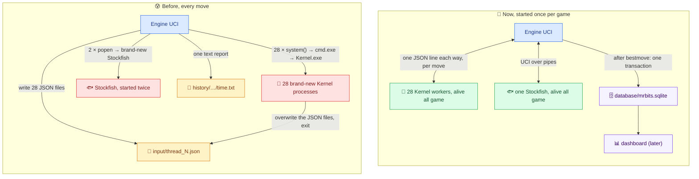

# 🔌🗄️ Mr. Bits — Engine Communication & Game Database

**Written by Claude Opus 5.5, for Tareq.** 🤝
*October 23, 2026 · v2, October 25: reviewed and prototyped · v3, October 25 evening: Phase 1 (one Stockfish) in your code · **v4, October 27: all of it is built — the Kernel worker pool, the game database, one `ChessState`, and the clean folders***

<div style="background:linear-gradient(90deg,#0f766e,#1d4ed8);color:#ffffff;border-radius:14px;padding:16px 22px;margin:16px 0;">

**In one sentence:** every helper process now starts **once per game** and stays alive — one Stockfish and 28 Kernel workers — and they all talk to Engine UCI through **pipes**: no JSON files, no `cmd.exe`, no new process per move. **Every move, every worker, every depth and every candidate move goes into one SQLite database**, ready for the dashboard. 🚀

</div>

> ⚠️ **Viewing note:** these files use Mermaid diagrams and small HTML color boxes, like the docs in `Claude Docs/`. The `.html` files next to them are exported from **this** version, in the same style as your VS Code export.

---

## 🚦 Where things stand (October 27)

| | Status |
|---|---|
| **Phase 1:** one Stockfish, in one place, kept alive | ✅ in your code since October 25 |
| **Phase 2:** `Kernel.exe` is a worker (one JSON line in, one JSON line out) | ✅ built. **0 mismatches** against your production `Kernel.exe` on 144 requests |
| **Phase 3:** the pool of 28 Kernel workers inside Engine UCI | ✅ built. Tested with a dead worker, a frozen worker, all workers dead, and a hard kill of the engine |
| **One `ChessState`** | ✅ `engines\Chess State.hpp`, included by both `Engine UCI.cpp` and `Kernel.cpp` |
| **The game database** | ✅ `database\mrbits.sqlite`. Engine UCI writes it after every move. The Python side has the init, the backup, the lichess sync and the dashboard queries, with tests |
| **No more files per move** | ✅ `input\` and `history\` are gone |
| **One Stockfish copy** | ✅ the 3 old copies are deleted (byte-identical to `engines\stockfish\`, used by nothing) |
| **Live games** | ⏳ **yours**: [04 - Runbook](04%20-%20Runbook%20for%20Tonight.md) |
| **The dashboard (the live board)** | Later: it needs its design first. The database, its indexes and its filters are ready for it |

---

## 📁 Where everything lives now

```text
lichess-bot-master\
├── engines\                      ← the engine (C++)
│   ├── Engine UCI.cpp            the UCI front end: lichess-bot ⇄ Mr. Bits
│   ├── Chess State.hpp           THE ChessState (one copy for both programs)
│   ├── Kernel Workers.hpp        the 28 Kernel workers and their pipes
│   ├── Game Database.hpp         writes every move into the database
│   ├── Engine Log.hpp            the text log, for debugging
│   ├── Stockfish Handler.hpp     the one Stockfish, kept alive
│   ├── Kernel.cpp                your search (unchanged) + the worker's main()
│   ├── json.hpp, sqlite\         the two libraries (nlohmann JSON, SQLite 3.54.1)
│   ├── Build Engines.bat         builds both .exe files (and checks Windows lets them run)
│   ├── tests\                    3 tests: the engine, the workers under trouble, the Kernel's answers
│   ├── stockfish\                the one Stockfish
│   ├── backup-phase1\            Phase 1's engine, for a rollback (not in git: delete it after the live games)
│   └── logs\                     Engine UCI's text logs (not in git)
├── database\                     ← the game database
│   ├── schema.sql                every table, index and view
│   ├── mrbits.sqlite             the database itself (not in git)
│   ├── db.py                     --init, --backup, --check, --recent
│   ├── sync_lichess.py           adds lichess's side: results, ratings, clocks, openings
│   ├── queries.py                what the dashboard will read (filters, paging, stats)
│   └── tests\
├── Mr Bits Docs\                 ← every document (this folder is in here)
└── lib\, docs\, wiki\, …         lichess-bot's own files, untouched
```

**Reading order:** for tonight, **this page → 04**. For the *why* and the *how*: 01 (the tutorial) → 02 (the engine) → 03 (the database).

---

## 🗺️ Before → now



**What did NOT change:** your search, your evaluation, the time ladder, the Stockfish depths, the shuffle and the round-robin split of the root moves, and how the best answer is picked. The workers get exactly what the JSON file used to hold (the same `ChessState` fields), and they think exactly like before: same move, same score, same node counts.

---

## 🧪 What was tested (on copies first, then again in your real folder, with the real python-chess 1.10.0)

| Test | What it proves | Result |
|---|---|---|
| `engines\tests\engine_test.py` | lichess-bot's startup check, a game as White, a game as Black, a game without GameId. **Every database row is checked against what python-chess saw**: the plies, the moves, the `go` parameters, the time ladder (recomputed), the paths, the Stockfish depths, the workers' root moves (= exactly the legal moves), each worker's depths and candidates, and that the chosen move is the best worker answer | ✅ **183 / 183** |
| `engines\tests\kernel_workers_test.py` | A worker that died while waiting (it gets no moves, so the other 27 still search **every** legal move), a frozen worker (cut off at the deadline: 7,005–7,024 ms for 7,000), a worker killed in the middle of its search, every worker dead (Stockfish plays that move, then all 28 come back: 0.4–0.9 s in 19 of 21 runs, 3.7 s and 5.2 s in the other 2, while the neural-network lab's heavy jobs were running), and Engine UCI killed hard (**0** Kernel and **0** Stockfish left running) | ✅ **27 / 27** |
| `engines\tests\kernel_equivalence_test.py` | The new worker against your **production** `Kernel.exe`: 72 positions at the depth the old one reached (6 or 8), 144 requests shuffled through **one** worker (so no state can leak between moves) | ✅ **0 mismatches** in move, score, nodes, leaf nodes and pruned branches |
| `database\tests\` | The init, the backup, the lichess sync (offline fixtures: casual games, draws, mate, flags, berserk, fromPosition, …), every dashboard filter, and `schema.sql` itself: two programs applying it at once, a failure halfway, and that **no** dashboard query ever scans the engine's tables | ✅ **130 / 130** |
| `Kernel.exe` missing | Every Kernel move falls back to Stockfish (depth 14), the database says why, the game goes on | ✅ |

---

## ✅ Decided

- **Phase 1 → 2 → 3, all done**, and the old file mode is retired: the equivalence test proved the new path gives identical answers, so there's no switch to keep (rollback: the Phase 1 copy in `engines\backup-phase1\`, or git, see 04).
- **JSON Lines** between Engine UCI and the workers (one JSON object per line).
- **"Database only"** (your words): SQLite is compiled into Engine UCI, and there's no JSON or log file in between. The write happens in its own thread and only **after** `bestmove` is sent, so it never costs clock time. If the database can't be opened, the engine keeps playing and the log says so.
- **One `ChessState`**: the Engine UCI copy was the complete one (the Kernel's copy differed only in the Stockfish depths inside a function the Kernel never calls), so that's the one in `Chess State.hpp`.
- **A fresh history**: no old games are imported. The lichess sync starts on your go-live date.

## 🤔 Still yours to decide

1. **Smart App Control is ON**, and it still blocks some fresh builds. My recommendation stays: **keep it on**. `Build Engines.bat` gives every build a new stamp, so when it blocks one, running the `.bat` again is enough. ⚠️ Turning it off has been one-way on Windows 11 so far.
2. **Build `Kernel.exe` with `-O2`?** On October 25, `-O2 -march=native` gave bit-identical answers and a 3.6× faster search (plain `-O2` wasn't measured, and `-march=native` ties the `.exe` to this CPU). `python -B tests\kernel_equivalence_test.py --reference Kernel.exe --reference-mode worker --worker Kernel_O2.exe` checks an `-O2` build in about a minute. A deeper search changes which moves get played, so A/B it in games first.
3. **The worker count**: still 28. Now that the pool exists, 16 / 20 / 24 / 28 can be measured with real games. (The two engine tests expect 28: change `NUMBER_OF_KERNEL_WORKERS` in them too, or `Build Engines.bat test` fails.)
4. **The time ladder** still allows **51–66 s for one move** in a 2+3 game (below). That's unchanged on purpose (same behavior), but it's a real time-forfeit risk.
5. **The dashboard**: Streamlit (recommended) + Datasette for browsing, when you're ready to design it (03 §7).

---

## 🔎 Side discoveries (still true, not fixed on purpose)

| Found | Why it matters | Where |
|---|---|---|
| ⏱️ **The time ladder allows 51–66 s for one move** in a 2+3 game (50 + winc/3000 with 60–120 s left; 65 + winc/3000 for White and 60 + binc/3000 for Black with ≥ 120 s left), and the 5% rule only stops *starting* new depths | In game `tN252leL`, plies 5 and 7 took 29.1 s and 54.0 s out of a 2-minute clock | `Engine UCI.cpp`, `getBestMoveFromEngine` |
| 🤝 **`isTiePosition` only detects stalemate** | No threefold, 50-move or insufficient-material draws, so the stalemate override can't see the other draws | `Stockfish Handler.hpp` |
| ♟️ **`position fen …` isn't really supported** | The Kernel replays every game from the start position, so a game that starts from a FEN (lichess "From position") would be searched from the wrong board | `Engine UCI.cpp` + the Kernel |
| ⌛ **python-chess gives clock-based moves no timeout at all** | A hung Engine UCI would block the game until lichess flags it. The Stockfish watchdog and the workers' deadline (allowed time + 2 s) are the protection now | 02 |

**Fixed along the way:** a move with no legal move sent the report text as the move (now `0000`); the Kernel workers were 28 brand-new processes per move (now a pool); two moves in one second overwrote each other's report (there are no reports any more: the database has one row per move).

---

## 🧾 How I made this (and what I touched)

- **Built and tested on copies first**, then applied to your folder (the hashes of your files were checked right before, so nothing of yours was overwritten blindly).
- **Written in your style:** `this->`, your long names, your banners and Notes boxes, your comments in the first person. The search in `Kernel.cpp` is untouched: only the file's tail (the worker's `main()`), a few `ProcessHandler` getters and the root loop's score recording are new.
- **Reviewed adversarially:** 4 reviewers (concurrency, behavior parity, the database, the UCI protocol), each with a skeptic who tried to refute every finding. Of 10 findings, the skeptics refuted 5. The other 5 held up: 4 different problems, since two reviewers found the same one. All 4 are fixed and re-tested:
  - root moves of a worker that died *before* the move are now given to the living workers;
  - two engines starting at the same moment can't break each other's database setup (it was a whole game lost, 19 times in 160 in the reviewer's race test; now 0 in 180);
  - a reader never sees a view missing;
  - a database locked at the start of a game no longer loses that game.
- **I never** started lichess-bot, used the token, contacted lichess, or opened the neural-network folders (`ChatGPT …`, `engines\Neural Networkds\`). Git is yours: I committed nothing, and the only git file I edited is `.gitignore` (merged with the other agent's lines, which are untouched).

— **Claude Opus 5.5** 🤖
